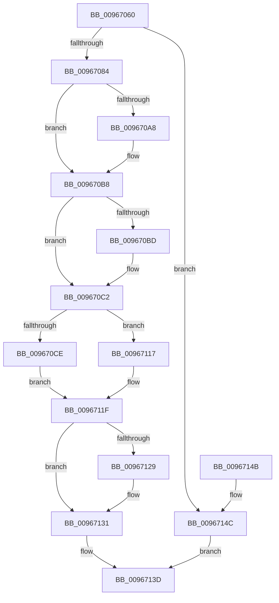

# sub_00967060

- RVA: `0x00967060`–`0x00967153` (길이 `243` bytes)
- VA: `0x0000000140967060`
- 실행 섹션: `PAGE`
- PDB 이름 있음: `아니요`; PDB Function 태그: `아니요`
- unwind 정보 RVA: `0x00095068`
- 디코드: `70`개 명령, `243/243` bytes 표시
- 미해석 바이트: `0` (있으면 어셈블리에 `.byte`로 보존)

> 이 문서는 커널 이미지의 기계어와 PDB 기호를 분석해 생성했습니다. 4번과 5번은 함수 원형과 자료형을 바이너리 사용 방식에서 추정한 C 해석이며 원본 소스 복구 결과는 아닙니다.

## 1. Dependencies

- 직접 호출 지점: **5**; 고유 호출 대상: **5**
- 직접 호출자로 확인된 함수: **2**
- RIP 상대 이미지 참조: **0**

### Outgoing calls
- `0x00967093` → [KeAbPreAcquire](../../text/21/KeAbPreAcquire_function_00210230.md) (function, `0x00210230`)
- `0x009670B3` → [ExfAcquirePushLockSharedEx](../../text/21/ExfAcquirePushLockSharedEx_function_0021044C.md) (function, `0x0021044C`)
- `0x009670E8` → [sub_009675F8](Unknown_function_009675F8.md) (function, `0x009675F8`)
- `0x0096712C` → [ExfReleasePushLockShared](../../text/26/ExfReleasePushLockShared_function_00263440.md) (function, `0x00263440`)
- `0x00967134` → [KeAbPostRelease](../../text/2E/KeAbPostRelease_function_002E1600.md) (function, `0x002E1600`)

### Direct callers
- [ExpGetLicenseTamperState](../../text/65/ExpGetLicenseTamperState_function_00657740.md) at `0x0065778B`
- [sub_007C7FB0](../7C/Unknown_function_007C7FB0.md) at `0x007C807E`
- [sub_007C7FB0](../7C/Unknown_function_007C7FB0.md) at `0x007C8255`

### Static image references
- 디코드된 RIP-relative 메모리 참조가 없습니다.

## 2. Other-region calls and transfers

- 다른 실행 섹션으로 향하는 call: **4**
  - `0x00967093` → [KeAbPreAcquire](../../text/21/KeAbPreAcquire_function_00210230.md) (`PAGE` → `.text`)
  - `0x009670B3` → [ExfAcquirePushLockSharedEx](../../text/21/ExfAcquirePushLockSharedEx_function_0021044C.md) (`PAGE` → `.text`)
  - `0x0096712C` → [ExfReleasePushLockShared](../../text/26/ExfReleasePushLockShared_function_00263440.md) (`PAGE` → `.text`)
  - `0x00967134` → [KeAbPostRelease](../../text/2E/KeAbPostRelease_function_002E1600.md) (`PAGE` → `.text`)
- 별도 외부 분기/꼬리 이동을 확인하지 못했습니다.

## 3. Assembly (complete function range)

```asm
00967060  48 89 4C 24 08                  mov qword ptr [rsp + 8], rcx
00967065  53                              push rbx
00967066  56                              push rsi
00967067  57                              push rdi
00967068  41 54                           push r12
0096706A  41 56                           push r14
0096706C  41 57                           push r15
0096706E  48 83 EC 38                     sub rsp, 0x38
00967072  48 8B F2                        mov rsi, rdx
00967075  48 8B F9                        mov rdi, rcx
00967078  45 33 FF                        xor r15d, r15d
0096707B  48 85 D2                        test rdx, rdx
0096707E  0F 84 C8 00 00 00               je 0x14096714c
00967084  48 8D 99 B0 B7 00 00            lea rbx, [rcx + 0xb7b0]
0096708B  45 33 C0                        xor r8d, r8d
0096708E  33 D2                           xor edx, edx
00967090  48 8B CB                        mov rcx, rbx
00967093  E8 98 91 8A FF                  call 0x140210230
00967098  4C 8B F0                        mov r14, rax
0096709B  33 C0                           xor eax, eax
0096709D  45 8D 67 11                     lea r12d, [r15 + 0x11]
009670A1  F0 4C 0F B1 23                  lock cmpxchg qword ptr [rbx], r12
009670A6  74 10                           je 0x1409670b8
009670A8  4C 8B CB                        mov r9, rbx
009670AB  4D 8B C6                        mov r8, r14
009670AE  33 D2                           xor edx, edx
009670B0  48 8B CB                        mov rcx, rbx
009670B3  E8 94 93 8A FF                  call 0x14021044c
009670B8  4D 85 F6                        test r14, r14
009670BB  74 05                           je 0x1409670c2
009670BD  41 C6 46 0A 01                  mov byte ptr [r14 + 0xa], 1
009670C2  48 8B 87 A8 B7 00 00            mov rax, qword ptr [rdi + 0xb7a8]
009670C9  48 85 C0                        test rax, rax
009670CC  74 49                           je 0x140967117
009670CE  48 8B 00                        mov rax, qword ptr [rax]
009670D1  48 89 84 24 80 00 00 00         mov qword ptr [rsp + 0x80], rax
009670D9  4C 89 7C 24 78                  mov qword ptr [rsp + 0x78], r15
009670DE  48 89 44 24 78                  mov qword ptr [rsp + 0x78], rax
009670E3  48 8D 4C 24 78                  lea rcx, [rsp + 0x78]
009670E8  E8 0B 05 00 00                  call 0x1409675f8
009670ED  48 8B 44 24 78                  mov rax, qword ptr [rsp + 0x78]
009670F2  48 89 84 24 80 00 00 00         mov qword ptr [rsp + 0x80], rax
009670FA  44 89 7C 24 20                  mov dword ptr [rsp + 0x20], r15d
009670FF  0F 10 00                        movups xmm0, xmmword ptr [rax]
00967102  0F 11 06                        movups xmmword ptr [rsi], xmm0
00967105  0F 10 48 10                     movups xmm1, xmmword ptr [rax + 0x10]
00967109  0F 11 4E 10                     movups xmmword ptr [rsi + 0x10], xmm1
0096710D  0F 10 40 20                     movups xmm0, xmmword ptr [rax + 0x20]
00967111  0F 11 46 20                     movups xmmword ptr [rsi + 0x20], xmm0
00967115  EB 08                           jmp 0x14096711f
00967117  C7 44 24 20 25 02 00 C0         mov dword ptr [rsp + 0x20], 0xc0000225
0096711F  49 8B C4                        mov rax, r12
00967122  F0 4C 0F B1 3B                  lock cmpxchg qword ptr [rbx], r15
00967127  74 08                           je 0x140967131
00967129  48 8B CB                        mov rcx, rbx
0096712C  E8 0F C3 8F FF                  call 0x140263440
00967131  48 8B CB                        mov rcx, rbx
00967134  E8 C7 A4 97 FF                  call 0x1402e1600
00967139  8B 44 24 20                     mov eax, dword ptr [rsp + 0x20]
0096713D  48 83 C4 38                     add rsp, 0x38
00967141  41 5F                           pop r15
00967143  41 5E                           pop r14
00967145  41 5C                           pop r12
00967147  5F                              pop rdi
00967148  5E                              pop rsi
00967149  5B                              pop rbx
0096714A  C3                              ret
0096714B  CC                              int3
0096714C  B8 0D 00 00 C0                  mov eax, 0xc000000d
00967151  EB EA                           jmp 0x14096713d
```

## 4. C-style interpretation (structured pseudocode)

```c
__int64 __fastcall sub_00967060(__int64 a1, __int64 a2, int a3)
{
    __int64 result;
    __int64 v_r15;
    __int64 v_rsp;
    unsigned int v_stack_m48;
    unsigned __int64 v_stack_p10;
    unsigned __int64 v_stack_p18;
    unsigned __int64 v_stack_p8;

    v_stack_p8 = a1;
    v_rsp = (v_rsp) - (56);
    v_r15 = 0;
    if (a2 == 0) goto loc_0096714C;
    a3 = 0;
    a2 = 0;
    result = KeAbPreAcquire(a1 + 47024, a2, a3, a4);
    result = 0;
    if (!(condition_is_equal)) {
        a4 = a1 + 47024;
        a3 = 0;
        a2 = 0;
        a1 = a1 + 47024;
        result = ExfAcquirePushLockSharedEx(a1, a2, a3, a4);
    }
    if (result != 0) {
        *(unsigned __int8 *)(result + 10) = 1;
    }
    if (*(unsigned __int64 *)(a1 + 47016) == 0) goto loc_00967117;
    v_stack_p18 = *(unsigned __int64 *)(*(unsigned __int64 *)(a1 + 47016));
    v_stack_p10 = 0;
    v_stack_p10 = *(unsigned __int64 *)(*(unsigned __int64 *)(a1 + 47016));
    result = sub_009675F8(v_stack_p10, a2, a3, a4);
    v_stack_p18 = v_stack_p10;
    v_stack_m48 = 0;
    *(unsigned __int64 *)(a2) = v_xmm0;
    *(unsigned __int64 *)(a2 + 16) = v_xmm1;
    *(unsigned __int64 *)(a2 + 32) = v_xmm0;
    goto loc_0096711F;
loc_00967117:
    v_stack_m48 = 0xC0000225ULL;
loc_0096711F:
    result = v_r15 + 17;
    if (*(unsigned __int64 *)(a1 + 47016) != 0) {
        a1 = a1 + 47024;
        result = ExfReleasePushLockShared(a1, a2, a3, a4);
    }
    result = KeAbPostRelease(a1 + 47024, a2, a3, a4);
loc_0096713D:
    v_rsp = (v_rsp) + (56);
    return (unsigned int)(v_stack_m48);
loc_0096714C:
    goto loc_0096713D;
}
```

## 5. (Beta) C Style

```c
int64_t sub_00967060(void *Arg1, void *Arg2, int32_t Arg3)
{
    uint8_t *arg1 = (uint8_t *)Arg1;
    uint8_t *arg2 = (uint8_t *)Arg2;

    int64_t result;
    int64_t local_r15;
    int64_t local_rsp;
    uint32_t v_stack_m48;
    uint64_t v_stack_p10;
    uint64_t v_stack_p18;
    uint64_t v_stack_p8;

    v_stack_p8 = Arg1;
    local_rsp = (local_rsp) - (56);
    local_r15 = 0;
    if (Arg2 == NULL) goto loc_0096714C;
    Arg3 = 0;
    Arg2 = 0;
    result = KeAbPreAcquire(Arg1 + 47024, Arg2, Arg3, a4);
    result = 0;
    if (!(condition_is_equal)) {
        a4 = Arg1 + 47024;
        Arg3 = 0;
        Arg2 = 0;
        Arg1 = Arg1 + 47024;
        result = ExfAcquirePushLockSharedEx(Arg1, Arg2, Arg3, a4);
    }
    if (result != 0) {
        *(uint8_t *)(result + 0xA) = 1;
    }
    if (*(uint64_t *)(arg1 + 0xB7A8) == 0) goto loc_00967117;
    v_stack_p18 = *(uint64_t *)(*(uint64_t *)(arg1 + 0xB7A8));
    v_stack_p10 = 0;
    v_stack_p10 = *(uint64_t *)(*(uint64_t *)(arg1 + 0xB7A8));
    result = sub_009675F8(v_stack_p10, Arg2, Arg3, a4);
    v_stack_p18 = v_stack_p10;
    v_stack_m48 = 0;
    *(uint64_t *)(arg2) = v_xmm0;
    *(uint64_t *)(arg2 + 0x10) = v_xmm1;
    *(uint64_t *)(arg2 + 0x20) = v_xmm0;
    goto loc_0096711F;
loc_00967117:
    v_stack_m48 = 0xC0000225ULL;
loc_0096711F:
    result = local_r15 + 17;
    if (*(uint64_t *)(arg1 + 0xB7A8) != 0) {
        Arg1 = Arg1 + 47024;
        result = ExfReleasePushLockShared(Arg1, Arg2, Arg3, a4);
    }
    result = KeAbPostRelease(Arg1 + 47024, Arg2, Arg3, a4);
loc_0096713D:
    local_rsp = (local_rsp) + (56);
    return (uint32_t)(v_stack_m48);
loc_0096714C:
    goto loc_0096713D;
}
```

### 관측된 메모리 오프셋

구조체 형식이 확인되지 않은 접근은 인자 기준의 오프셋으로만 기록했습니다.

| 기준 인자 | 오프셋 표현 | 폭 (bit) | 접근 |
|---|---:|---:|---|
| `Arg1` | `+ 0x0` | `64` | `R` |
| `Arg1` | `+ 0xB7A8` | `64` | `R` |
| `Arg1` | `+ 0xB7B0` | `64` | `R` |
| `Arg2` | `+ 0x0` | `128` | `R` |
| `Arg2` | `+ 0x10` | `128` | `R` |
| `Arg2` | `+ 0x20` | `128` | `R` |

## 6. Execution-region graph

[열기: 2D/3D 그래프와 함수 탐색 컨트롤 패널](../../../control-panel.html?section=page&rva=0x00967060&view=graph)

- 2D 그래프는 위에서 아래로 흐르고, 3D 그래프는 빈 공간을 드래그해 회전합니다. Shift+드래그는 이동, 휠은 확대·축소, 함수 노드 선택은 대상 보고서 이동입니다.

### Static fallback


