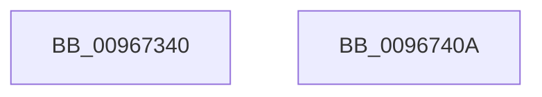

# sub_00967340

- RVA: `0x00967340`–`0x0096740B` (길이 `203` bytes)
- VA: `0x0000000140967340`
- 실행 섹션: `PAGE`
- PDB 이름 있음: `아니요`; PDB Function 태그: `아니요`
- unwind 정보 RVA: `0x00069588`
- 디코드: `54`개 명령, `203/203` bytes 표시
- 미해석 바이트: `0` (있으면 어셈블리에 `.byte`로 보존)

> 이 문서는 커널 이미지의 기계어와 PDB 기호를 분석해 생성했습니다. 4번과 5번은 함수 원형과 자료형을 바이너리 사용 방식에서 추정한 C 해석이며 원본 소스 복구 결과는 아닙니다.

## 1. Dependencies

- 직접 호출 지점: **0**; 고유 호출 대상: **0**
- 직접 호출자로 확인된 함수: **1**
- RIP 상대 이미지 참조: **0**

### Outgoing calls
- 직접 디코드된 call 명령이 없습니다.

### Direct callers
- [sub_009675F8](Unknown_function_009675F8.md) at `0x009677FA`

### Static image references
- 디코드된 RIP-relative 메모리 참조가 없습니다.

## 2. Other-region calls and transfers

- 다른 실행 섹션으로 향하는 call: **0**
- 별도 외부 분기/꼬리 이동을 확인하지 못했습니다.

## 3. Assembly (complete function range)

```asm
00967340  48 89 5C 24 08                  mov qword ptr [rsp + 8], rbx
00967345  48 89 74 24 10                  mov qword ptr [rsp + 0x10], rsi
0096734A  48 89 7C 24 18                  mov qword ptr [rsp + 0x18], rdi
0096734F  8B 7C 24 38                     mov edi, dword ptr [rsp + 0x38]
00967353  4C 8B D2                        mov r10, rdx
00967356  48 8B D9                        mov rbx, rcx
00967359  49 8B F1                        mov rsi, r9
0096735C  4D 8B D8                        mov r11, r8
0096735F  83 E3 03                        and ebx, 3
00967362  44 8B CF                        mov r9d, edi
00967365  48 B8 AB AA AA AA AA AA AA AA   movabs rax, 0xaaaaaaaaaaaaaaab
0096736F  48 F7 E2                        mul rdx
00967372  49 8D 42 01                     lea rax, [r10 + 1]
00967376  4C 8B 54 24 30                  mov r10, qword ptr [rsp + 0x30]
0096737B  48 D1 EA                        shr rdx, 1
0096737E  48 03 D3                        add rdx, rbx
00967381  48 03 C2                        add rax, rdx
00967384  83 E0 03                        and eax, 3
00967387  41 0F B7 14 42                  movzx edx, word ptr [r10 + rax*2]
0096738C  48 B8 93 24 49 92 24 49 92 24   movabs rax, 0x2492492492492493
00967396  44 2B CA                        sub r9d, edx
00967399  49 F7 E0                        mul r8
0096739C  49 8B C0                        mov rax, r8
0096739F  48 2B C2                        sub rax, rdx
009673A2  48 D1 E8                        shr rax, 1
009673A5  48 03 C2                        add rax, rdx
009673A8  48 C1 E8 02                     shr rax, 2
009673AC  48 6B D0 07                     imul rdx, rax, 7
009673B0  41 0F B7 04 5A                  movzx eax, word ptr [r10 + rbx*2]
009673B5  48 8B 5C 24 08                  mov rbx, qword ptr [rsp + 8]
009673BA  0F B6 CA                        movzx ecx, dl
009673BD  41 2A C8                        sub cl, r8b
009673C0  44 2A DA                        sub r11b, dl
009673C3  80 C1 1F                        add cl, 0x1f
009673C6  45 8B C1                        mov r8d, r9d
009673C9  41 D3 E8                        shr r8d, cl
009673CC  41 8D 4B 01                     lea ecx, [r11 + 1]
009673D0  41 D3 E1                        shl r9d, cl
009673D3  45 0B C1                        or r8d, r9d
009673D6  44 0F AF C0                     imul r8d, eax
009673DA  48 B8 89 88 88 88 88 88 88 88   movabs rax, 0x8888888888888889
009673E4  48 F7 E6                        mul rsi
009673E7  48 C1 EA 03                     shr rdx, 3
009673EB  0F B6 CA                        movzx ecx, dl
009673EE  6B D1 0F                        imul edx, ecx, 0xf
009673F1  40 2A F2                        sub sil, dl
009673F4  8D 4E 01                        lea ecx, [rsi + 1]
009673F7  48 8B 74 24 10                  mov rsi, qword ptr [rsp + 0x10]
009673FC  D3 EF                           shr edi, cl
009673FE  44 33 C7                        xor r8d, edi
00967401  48 8B 7C 24 18                  mov rdi, qword ptr [rsp + 0x18]
00967406  41 8B C0                        mov eax, r8d
00967409  C3                              ret
0096740A  CC                              int3
```

## 4. C-style interpretation (structured pseudocode)

```c
__int64 __fastcall sub_00967340(__int64 a1, __int64 a2, __int64 a3, __int64 a4, __int64 a5, __int64 a6, unsigned int a7)
{
    __int64 result;
    __int64 v_r11;
    __int64 v_rbx;
    __int64 v_rdi;
    __int64 v_rsi;
    unsigned __int64 v_stack_p10;
    unsigned __int64 v_stack_p18;
    unsigned __int64 v_stack_p8;

    v_stack_p8 = v_rbx;
    v_stack_p10 = v_rsi;
    v_stack_p18 = v_rdi;
    v_rbx = (unsigned int)((a1) & (3));
    a2 = (a2) >> (1);
    a2 = (a2) + (v_rbx);
    result = (a2 + 1) + (a2);
    result = (unsigned int)((result) & (3));
    a4 = (unsigned int)(((unsigned int)((unsigned int)((unsigned int)(a7)))) - ((unsigned int)(*(unsigned __int16 *)(a6 + result * 2))));
    result = (a3) - (*(unsigned __int16 *)(a6 + result * 2));
    result = (result) >> (1);
    result = (result) + (*(unsigned __int16 *)(a6 + result * 2));
    result = (result) >> (2);
    a2 = (*(unsigned __int16 *)(a6 + result * 2)) * (result);
    a1 = (unsigned __int8)(((unsigned __int8)(a2)) - ((unsigned __int8)(a3)));
    v_r11 = (unsigned __int8)((a3) - ((unsigned __int8)(a2)));
    a1 = (unsigned __int8)((a1) + (31));
    a3 = (unsigned int)(((unsigned int)((unsigned int)(a4))) >> ((unsigned __int8)(a1)));
    a4 = (unsigned int)((a4) << ((unsigned __int8)(v_r11 + 1)));
    a3 = (unsigned int)((a3) | ((unsigned int)(a4)));
    a3 = (unsigned int)((a3) * ((unsigned int)(*(unsigned __int16 *)(a6 + v_rbx * 2))));
    a2 = (a2) >> (3);
    a2 = (unsigned int)((a2) * ((unsigned int)((unsigned __int8)(a2))));
    v_rsi = (unsigned __int8)((a4) - ((unsigned __int8)(a2)));
    v_rdi = (unsigned int)(((unsigned int)(a7)) >> ((unsigned __int8)(v_rsi + 1)));
    a3 = (unsigned int)((a3) ^ ((unsigned int)(v_rdi)));
    return (unsigned int)((unsigned int)(a3));
}
```

## 5. (Beta) C Style

```c
int64_t sub_00967340(int64_t Arg1, void *Arg2, void *Arg3, int64_t Arg4, uint64_t Arg5, void *Arg6, uint32_t Arg7)
{
    uint8_t *arg2 = (uint8_t *)Arg2;
    uint8_t *arg3 = (uint8_t *)Arg3;
    uint8_t *arg6 = (uint8_t *)Arg6;

    int64_t result;
    int64_t local_r11;
    int64_t local_rbx;
    int64_t local_rdi;
    int64_t local_rsi;
    uint64_t v_stack_p10;
    uint64_t v_stack_p18;
    uint64_t v_stack_p8;

    v_stack_p8 = local_rbx;
    v_stack_p10 = local_rsi;
    v_stack_p18 = local_rdi;
    local_rbx = (uint32_t)((Arg1) & (3));
    Arg2 = (Arg2) >> (1);
    Arg2 = (Arg2) + (local_rbx);
    result = (Arg2 + 1) + (Arg2);
    result = (uint32_t)((result) & (3));
    Arg4 = (uint32_t)(((uint32_t)((uint32_t)((uint32_t)(Arg7)))) - ((uint32_t)(*(uint16_t *)(arg6 + result * 2))));
    result = (Arg3) - (*(uint16_t *)(arg6 + result * 2));
    result = (result) >> (1);
    result = (result) + (*(uint16_t *)(arg6 + result * 2));
    result = (result) >> (2);
    Arg2 = (*(uint16_t *)(arg6 + result * 2)) * (result);
    Arg1 = (uint8_t)(((uint8_t)(Arg2)) - ((uint8_t)(Arg3)));
    local_r11 = (uint8_t)((Arg3) - ((uint8_t)(Arg2)));
    Arg1 = (uint8_t)((Arg1) + (31));
    Arg3 = (uint32_t)(((uint32_t)((uint32_t)(Arg4))) >> ((uint8_t)(Arg1)));
    Arg4 = (uint32_t)((Arg4) << ((uint8_t)(local_r11 + 1)));
    Arg3 = (uint32_t)((Arg3) | ((uint32_t)(Arg4)));
    Arg3 = (uint32_t)((Arg3) * ((uint32_t)(*(uint16_t *)(arg6 + local_rbx * 2))));
    Arg2 = (Arg2) >> (3);
    Arg2 = (uint32_t)((Arg2) * ((uint32_t)((uint8_t)(Arg2))));
    local_rsi = (uint8_t)((Arg4) - ((uint8_t)(Arg2)));
    local_rdi = (uint32_t)(((uint32_t)(Arg7)) >> ((uint8_t)(local_rsi + 1)));
    Arg3 = (uint32_t)((Arg3) ^ ((uint32_t)(local_rdi)));
    return (uint32_t)((uint32_t)(Arg3));
}
```

### 관측된 메모리 오프셋

구조체 형식이 확인되지 않은 접근은 인자 기준의 오프셋으로만 기록했습니다.

| 기준 인자 | 오프셋 표현 | 폭 (bit) | 접근 |
|---|---:|---:|---|
| `Arg2` | `+ 0x1` | `64` | `R` |
| `Arg3` | `+ 0x1` | `32` | `R` |
| `Arg6` | `+ 0x0 + rax*2` | `16` | `R` |
| `Arg6` | `+ 0x0 + rbx*2` | `16` | `R` |

## 6. Execution-region graph

[열기: 2D/3D 그래프와 함수 탐색 컨트롤 패널](../../../control-panel.html?section=page&rva=0x00967340&view=graph)

- 2D 그래프는 위에서 아래로 흐르고, 3D 그래프는 빈 공간을 드래그해 회전합니다. Shift+드래그는 이동, 휠은 확대·축소, 함수 노드 선택은 대상 보고서 이동입니다.

### Static fallback


