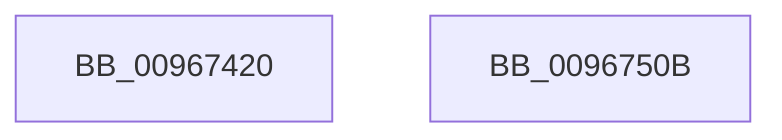

# sub_00967420

- RVA: `0x00967420`–`0x0096750C` (길이 `236` bytes)
- VA: `0x0000000140967420`
- 실행 섹션: `PAGE`
- PDB 이름 있음: `아니요`; PDB Function 태그: `아니요`
- unwind 정보 RVA: `0x000950A8`
- 디코드: `65`개 명령, `236/236` bytes 표시
- 미해석 바이트: `0` (있으면 어셈블리에 `.byte`로 보존)

> 이 문서는 커널 이미지의 기계어와 PDB 기호를 분석해 생성했습니다. 4번과 5번은 함수 원형과 자료형을 바이너리 사용 방식에서 추정한 C 해석이며 원본 소스 복구 결과는 아닙니다.

## 1. Dependencies

- 직접 호출 지점: **0**; 고유 호출 대상: **0**
- 직접 호출자로 확인된 함수: **1**
- RIP 상대 이미지 참조: **0**

### Outgoing calls
- 직접 디코드된 call 명령이 없습니다.

### Direct callers
- [sub_009675F8](Unknown_function_009675F8.md) at `0x009676EB`

### Static image references
- 디코드된 RIP-relative 메모리 참조가 없습니다.

## 2. Other-region calls and transfers

- 다른 실행 섹션으로 향하는 call: **0**
- 별도 외부 분기/꼬리 이동을 확인하지 못했습니다.

## 3. Assembly (complete function range)

```asm
00967420  48 89 5C 24 08                  mov qword ptr [rsp + 8], rbx
00967425  48 89 6C 24 10                  mov qword ptr [rsp + 0x10], rbp
0096742A  48 89 74 24 18                  mov qword ptr [rsp + 0x18], rsi
0096742F  48 89 7C 24 20                  mov qword ptr [rsp + 0x20], rdi
00967434  41 56                           push r14
00967436  48 8B 5C 24 38                  mov rbx, qword ptr [rsp + 0x38]
0096743B  48 8B F1                        mov rsi, rcx
0096743E  8B 6C 24 40                     mov ebp, dword ptr [rsp + 0x40]
00967442  4C 8B D2                        mov r10, rdx
00967445  83 E6 03                        and esi, 3
00967448  49 8B F8                        mov rdi, r8
0096744B  4D 8B F1                        mov r14, r9
0096744E  48 B8 AB AA AA AA AA AA AA AA   movabs rax, 0xaaaaaaaaaaaaaaab
00967458  48 F7 E2                        mul rdx
0096745B  49 8D 42 01                     lea rax, [r10 + 1]
0096745F  48 D1 EA                        shr rdx, 1
00967462  48 03 D6                        add rdx, rsi
00967465  48 03 C2                        add rax, rdx
00967468  83 E0 03                        and eax, 3
0096746B  44 0F B7 1C 43                  movzx r11d, word ptr [rbx + rax*2]
00967470  48 B8 93 24 49 92 24 49 92 24   movabs rax, 0x2492492492492493
0096747A  49 F7 E0                        mul r8
0096747D  44 33 DD                        xor r11d, ebp
00967480  49 8B C0                        mov rax, r8
00967483  48 2B C2                        sub rax, rdx
00967486  45 8B D3                        mov r10d, r11d
00967489  48 D1 E8                        shr rax, 1
0096748C  48 03 C2                        add rax, rdx
0096748F  48 C1 E8 02                     shr rax, 2
00967493  4C 6B C0 07                     imul r8, rax, 7
00967497  48 B8 11 42 08 21 84 10 42 08   movabs rax, 0x842108421084211
009674A1  49 F7 E1                        mul r9
009674A4  49 8B C1                        mov rax, r9
009674A7  41 0F B6 C8                     movzx ecx, r8b
009674AB  48 2B C2                        sub rax, rdx
009674AE  40 2A CF                        sub cl, dil
009674B1  80 C1 1F                        add cl, 0x1f
009674B4  48 D1 E8                        shr rax, 1
009674B7  48 03 C2                        add rax, rdx
009674BA  41 D3 EA                        shr r10d, cl
009674BD  48 C1 E8 04                     shr rax, 4
009674C1  41 2A F8                        sub dil, r8b
009674C4  4C 6B C8 1F                     imul r9, rax, 0x1f
009674C8  0F B7 04 73                     movzx eax, word ptr [rbx + rsi*2]
009674CC  8D 4F 01                        lea ecx, [rdi + 1]
009674CF  48 8B 5C 24 10                  mov rbx, qword ptr [rsp + 0x10]
009674D4  8B D5                           mov edx, ebp
009674D6  48 8B 74 24 20                  mov rsi, qword ptr [rsp + 0x20]
009674DB  48 8B 7C 24 28                  mov rdi, qword ptr [rsp + 0x28]
009674E0  41 D3 E3                        shl r11d, cl
009674E3  41 0F B6 C9                     movzx ecx, r9b
009674E7  41 2A CE                        sub cl, r14b
009674EA  45 0B D3                        or r10d, r11d
009674ED  80 C1 1F                        add cl, 0x1f
009674F0  41 0F AF C2                     imul eax, r10d
009674F4  D3 E2                           shl edx, cl
009674F6  45 2A F1                        sub r14b, r9b
009674F9  41 8D 4E 01                     lea ecx, [r14 + 1]
009674FD  D3 ED                           shr ebp, cl
009674FF  0B D5                           or edx, ebp
00967501  48 8B 6C 24 18                  mov rbp, qword ptr [rsp + 0x18]
00967506  2B C2                           sub eax, edx
00967508  41 5E                           pop r14
0096750A  C3                              ret
0096750B  CC                              int3
```

## 4. C-style interpretation (structured pseudocode)

```c
__int64 __fastcall sub_00967420(__int64 a1, __int64 a2, __int64 a3, __int64 a4, __int64 a5, __int64 a6, unsigned int a7)
{
    __int64 result;
    __int64 v_r10;
    __int64 v_r11;
    __int64 v_r14;
    __int64 v_rbp;
    __int64 v_rdi;
    __int64 v_rsi;
    unsigned __int64 v_stack_p10;
    unsigned __int64 v_stack_p18;
    unsigned __int64 v_stack_p20;
    unsigned __int64 v_stack_p8;

    v_stack_p8 = v_rbx;
    v_stack_p10 = v_rbp;
    v_stack_p18 = v_rsi;
    v_stack_p20 = v_rdi;
    v_rsi = (unsigned int)((a1) & (3));
    a2 = (a2) >> (1);
    a2 = (a2) + (v_rsi);
    result = (a2 + 1) + (a2);
    result = (unsigned int)((result) & (3));
    v_r11 = (unsigned int)((*(unsigned __int16 *)(a6 + result * 2)) ^ ((unsigned int)((unsigned int)(a7))));
    result = (a3) - (a2);
    result = (result) >> (1);
    result = (result) + (a2);
    result = (result) >> (2);
    a3 = (a3) * (result);
    result = (a4) - (a2);
    a1 = (unsigned __int8)(((unsigned __int8)(a3)) - ((unsigned __int8)(a3)));
    a1 = (unsigned __int8)((a1) + (31));
    result = (result) >> (1);
    result = (result) + (a2);
    v_r10 = (unsigned int)(((unsigned int)((unsigned int)(v_r11))) >> ((unsigned __int8)(a1)));
    result = (result) >> (4);
    v_rdi = (unsigned __int8)((a3) - ((unsigned __int8)(a3)));
    a4 = (a4) * (result);
    v_r11 = (unsigned int)((v_r11) << ((unsigned __int8)(v_rdi + 1)));
    a1 = (unsigned __int8)(((unsigned __int8)(a4)) - ((unsigned __int8)(a4)));
    v_r10 = (unsigned int)((v_r10) | ((unsigned int)(v_r11)));
    a1 = (unsigned __int8)((a1) + (31));
    result = (unsigned int)((*(unsigned __int16 *)(a6 + v_rsi * 2)) * ((unsigned int)(v_r10)));
    a2 = (unsigned int)(((unsigned int)((unsigned int)((unsigned int)(a7)))) << ((unsigned __int8)(a1)));
    v_r14 = (unsigned __int8)((a4) - ((unsigned __int8)(a4)));
    v_rbp = (unsigned int)(((unsigned int)(a7)) >> ((unsigned __int8)(v_r14 + 1)));
    a2 = (unsigned int)((a2) | ((unsigned int)(v_rbp)));
    result = (unsigned int)((result) - ((unsigned int)(a2)));
    return result;
}
```

## 5. (Beta) C Style

```c
int64_t sub_00967420(int64_t Arg1, void *Arg2, void *Arg3, void *Arg4, uint64_t Arg5, void *Arg6, uint32_t Arg7)
{
    uint8_t *arg2 = (uint8_t *)Arg2;
    uint8_t *arg3 = (uint8_t *)Arg3;
    uint8_t *arg4 = (uint8_t *)Arg4;
    uint8_t *arg6 = (uint8_t *)Arg6;

    int64_t result;
    int64_t local_r10;
    int64_t local_r11;
    int64_t local_r14;
    int64_t local_rbp;
    int64_t local_rdi;
    int64_t local_rsi;
    uint64_t v_stack_p10;
    uint64_t v_stack_p18;
    uint64_t v_stack_p20;
    uint64_t v_stack_p8;

    v_stack_p8 = local_rbx;
    v_stack_p10 = local_rbp;
    v_stack_p18 = local_rsi;
    v_stack_p20 = local_rdi;
    local_rsi = (uint32_t)((Arg1) & (3));
    Arg2 = (Arg2) >> (1);
    Arg2 = (Arg2) + (local_rsi);
    result = (Arg2 + 1) + (Arg2);
    result = (uint32_t)((result) & (3));
    local_r11 = (uint32_t)((*(uint16_t *)(arg6 + result * 2)) ^ ((uint32_t)((uint32_t)(Arg7))));
    result = (Arg3) - (Arg2);
    result = (result) >> (1);
    result = (result) + (Arg2);
    result = (result) >> (2);
    Arg3 = (Arg3) * (result);
    result = (Arg4) - (Arg2);
    Arg1 = (uint8_t)(((uint8_t)(Arg3)) - ((uint8_t)(Arg3)));
    Arg1 = (uint8_t)((Arg1) + (31));
    result = (result) >> (1);
    result = (result) + (Arg2);
    local_r10 = (uint32_t)(((uint32_t)((uint32_t)(local_r11))) >> ((uint8_t)(Arg1)));
    result = (result) >> (4);
    local_rdi = (uint8_t)((Arg3) - ((uint8_t)(Arg3)));
    Arg4 = (Arg4) * (result);
    local_r11 = (uint32_t)((local_r11) << ((uint8_t)(local_rdi + 1)));
    Arg1 = (uint8_t)(((uint8_t)(Arg4)) - ((uint8_t)(Arg4)));
    local_r10 = (uint32_t)((local_r10) | ((uint32_t)(local_r11)));
    Arg1 = (uint8_t)((Arg1) + (31));
    result = (uint32_t)((*(uint16_t *)(arg6 + local_rsi * 2)) * ((uint32_t)(local_r10)));
    Arg2 = (uint32_t)(((uint32_t)((uint32_t)((uint32_t)(Arg7)))) << ((uint8_t)(Arg1)));
    local_r14 = (uint8_t)((Arg4) - ((uint8_t)(Arg4)));
    local_rbp = (uint32_t)(((uint32_t)(Arg7)) >> ((uint8_t)(local_r14 + 1)));
    Arg2 = (uint32_t)((Arg2) | ((uint32_t)(local_rbp)));
    result = (uint32_t)((result) - ((uint32_t)(Arg2)));
    return result;
}
```

### 관측된 메모리 오프셋

구조체 형식이 확인되지 않은 접근은 인자 기준의 오프셋으로만 기록했습니다.

| 기준 인자 | 오프셋 표현 | 폭 (bit) | 접근 |
|---|---:|---:|---|
| `Arg2` | `+ 0x1` | `64` | `R` |
| `Arg3` | `+ 0x1` | `32` | `R` |
| `Arg4` | `+ 0x1` | `32` | `R` |
| `Arg6` | `+ 0x0 + rax*2` | `16` | `R` |
| `Arg6` | `+ 0x0 + rsi*2` | `16` | `R` |

## 6. Execution-region graph

[열기: 2D/3D 그래프와 함수 탐색 컨트롤 패널](../../../control-panel.html?section=page&rva=0x00967420&view=graph)

- 2D 그래프는 위에서 아래로 흐르고, 3D 그래프는 빈 공간을 드래그해 회전합니다. Shift+드래그는 이동, 휠은 확대·축소, 함수 노드 선택은 대상 보고서 이동입니다.

### Static fallback


