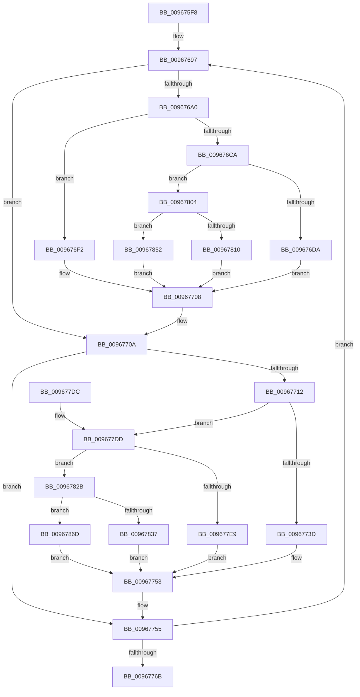

# sub_009675F8

- RVA: `0x009675F8`–`0x00967888` (길이 `656` bytes)
- VA: `0x00000001409675F8`
- 실행 섹션: `PAGE`
- PDB 이름 있음: `아니요`; PDB Function 태그: `아니요`
- unwind 정보 RVA: `0x000950C4`
- 디코드: `172`개 명령, `656/656` bytes 표시
- 미해석 바이트: `0` (있으면 어셈블리에 `.byte`로 보존)

> 이 문서는 커널 이미지의 기계어와 PDB 기호를 분석해 생성했습니다. 4번과 5번은 함수 원형과 자료형을 바이너리 사용 방식에서 추정한 C 해석이며 원본 소스 복구 결과는 아닙니다.

## 1. Dependencies

- 직접 호출 지점: **9**; 고유 호출 대상: **8**
- 직접 호출자로 확인된 함수: **3**
- RIP 상대 이미지 참조: **11**

### Outgoing calls
- `0x009676EB` → [sub_00967420](Unknown_function_00967420.md) (function, `0x00967420`)
- `0x00967703` → [sub_00967520](Unknown_function_00967520.md) (function, `0x00967520`)
- `0x0096774E` → [sub_00967B10](Unknown_function_00967B10.md) (function, `0x00967B10`)
- `0x009677B9` → [_security_check_cookie](../../text/6A/_security_check_cookie_function_006AC640.md) (function, `0x006AC640`)
- `0x009677FA` → [sub_00967340](Unknown_function_00967340.md) (function, `0x00967340`)
- `0x00967821` → [sub_00967240](Unknown_function_00967240.md) (function, `0x00967240`)
- `0x00967848` → [sub_00967160](Unknown_function_00967160.md) (function, `0x00967160`)
- `0x00967863` → [guard_dispatch_icall](../../text/6B/guard_dispatch_icall_function_006BAAD0.md) (function, `0x006BAAD0`)
- `0x0096787E` → [guard_dispatch_icall](../../text/6B/guard_dispatch_icall_function_006BAAD0.md) (function, `0x006BAAD0`)

### Direct callers
- [sub_00966DF0](Unknown_function_00966DF0.md) at `0x00966E92`
- [sub_0096700C](Unknown_function_0096700C.md) at `0x0096702D`
- [sub_00967060](Unknown_function_00967060.md) at `0x009670E8`

### Static image references
- `0x00967617` → RVA `0x00E0A740` (`.data`; read)
- `0x00967628` → RVA `0x00FD8D2E` (`PAGEDATA`; read)
- `0x0096762F` → RVA `0x00FD8290` (`PAGEDATA`; read)
- `0x00967636` → RVA `0x00FD8D0E` (`PAGEDATA`; read)
- `0x00967641` → RVA `0x00FD84C0` (`PAGEDATA`; read)
- `0x009676A5` → RVA `0x00967520` (`PAGE`; read)
- `0x009676CA` → RVA `0x00967420` (`PAGE`; read)
- `0x00967717` → RVA `0x00967B10` (`PAGE`; read)
- `0x009677DD` → RVA `0x00967340` (`PAGE`; read)
- `0x00967804` → RVA `0x00967240` (`PAGE`; read)
- `0x0096782B` → RVA `0x00967160` (`PAGE`; read)

## 2. Other-region calls and transfers

- 다른 실행 섹션으로 향하는 call: **3**
  - `0x009677B9` → [_security_check_cookie](../../text/6A/_security_check_cookie_function_006AC640.md) (`PAGE` → `.text`)
  - `0x00967863` → [guard_dispatch_icall](../../text/6B/guard_dispatch_icall_function_006BAAD0.md) (`PAGE` → `.text`)
  - `0x0096787E` → [guard_dispatch_icall](../../text/6B/guard_dispatch_icall_function_006BAAD0.md) (`PAGE` → `.text`)
- 별도 외부 분기/꼬리 이동을 확인하지 못했습니다.

## 3. Assembly (complete function range)

```asm
009675F8  48 89 5C 24 10                  mov qword ptr [rsp + 0x10], rbx
009675FD  48 89 74 24 18                  mov qword ptr [rsp + 0x18], rsi
00967602  48 89 7C 24 20                  mov qword ptr [rsp + 0x20], rdi
00967607  55                              push rbp
00967608  41 54                           push r12
0096760A  41 55                           push r13
0096760C  41 56                           push r14
0096760E  41 57                           push r15
00967610  48 8B EC                        mov rbp, rsp
00967613  48 83 EC 60                     sub rsp, 0x60
00967617  48 8B 05 22 31 4A 00            mov rax, qword ptr [rip + 0x4a3122]
0096761E  48 33 C4                        xor rax, rsp
00967621  48 89 45 F8                     mov qword ptr [rbp - 8], rax
00967625  48 8B 01                        mov rax, qword ptr [rcx]
00967628  4C 8D 3D FF 16 67 00            lea r15, [rip + 0x6716ff]
0096762F  48 8B 15 5A 0C 67 00            mov rdx, qword ptr [rip + 0x670c5a]
00967636  48 8D 35 D1 16 67 00            lea rsi, [rip + 0x6716d1]
0096763D  48 89 45 F0                     mov qword ptr [rbp - 0x10], rax
00967641  4C 8D 2D 78 0E 67 00            lea r13, [rip + 0x670e78]
00967648  0F B6 5D F4                     movzx ebx, byte ptr [rbp - 0xc]
0096764C  41 BE 1E 00 00 00               mov r14d, 0x1e
00967652  0F B6 F8                        movzx edi, al
00967655  0F B6 45 F1                     movzx eax, byte ptr [rbp - 0xf]
00967659  C1 E7 08                        shl edi, 8
0096765C  0B F8                           or edi, eax
0096765E  C1 E3 08                        shl ebx, 8
00967661  0F B6 45 F2                     movzx eax, byte ptr [rbp - 0xe]
00967665  45 8D 66 F2                     lea r12d, [r14 - 0xe]
00967669  C1 E7 08                        shl edi, 8
0096766C  0B F8                           or edi, eax
0096766E  48 89 4D E0                     mov qword ptr [rbp - 0x20], rcx
00967672  0F B6 45 F3                     movzx eax, byte ptr [rbp - 0xd]
00967676  C1 E7 08                        shl edi, 8
00967679  0B F8                           or edi, eax
0096767B  48 89 55 E8                     mov qword ptr [rbp - 0x18], rdx
0096767F  0F B6 45 F5                     movzx eax, byte ptr [rbp - 0xb]
00967683  0B D8                           or ebx, eax
00967685  0F B6 45 F6                     movzx eax, byte ptr [rbp - 0xa]
00967689  C1 E3 08                        shl ebx, 8
0096768C  0B D8                           or ebx, eax
0096768E  0F B6 45 F7                     movzx eax, byte ptr [rbp - 9]
00967692  C1 E3 08                        shl ebx, 8
00967695  0B D8                           or ebx, eax
00967697  41 0F B6 47 01                  movzx eax, byte ptr [r15 + 1]
0096769C  3C 1F                           cmp al, 0x1f
0096769E  73 6A                           jae 0x14096770a
009676A0  49 8B 44 C5 00                  mov rax, qword ptr [r13 + rax*8]
009676A5  4C 8D 1D 74 FE FF FF            lea r11, [rip - 0x18c]
009676AC  0F B6 4E 01                     movzx ecx, byte ptr [rsi + 1]
009676B0  4D 8D 56 01                     lea r10, [r14 + 1]
009676B4  44 0F B6 0E                     movzx r9d, byte ptr [rsi]
009676B8  44 0F B6 46 FF                  movzx r8d, byte ptr [rsi - 1]
009676BD  0F B6 56 FE                     movzx edx, byte ptr [rsi - 2]
009676C1  89 7C 24 30                     mov dword ptr [rsp + 0x30], edi
009676C5  49 3B C3                        cmp rax, r11
009676C8  74 28                           je 0x1409676f2
009676CA  4C 8D 1D 4F FD FF FF            lea r11, [rip - 0x2b1]
009676D1  49 3B C3                        cmp rax, r11
009676D4  0F 85 2A 01 00 00               jne 0x140967804
009676DA  48 8D 45 E8                     lea rax, [rbp - 0x18]
009676DE  48 89 44 24 28                  mov qword ptr [rsp + 0x28], rax
009676E3  48 89 4C 24 20                  mov qword ptr [rsp + 0x20], rcx
009676E8  49 8B CA                        mov rcx, r10
009676EB  E8 30 FD FF FF                  call 0x140967420
009676F0  EB 16                           jmp 0x140967708
009676F2  48 8D 45 E8                     lea rax, [rbp - 0x18]
009676F6  48 89 44 24 28                  mov qword ptr [rsp + 0x28], rax
009676FB  48 89 4C 24 20                  mov qword ptr [rsp + 0x20], rcx
00967700  49 8B CA                        mov rcx, r10
00967703  E8 18 FE FF FF                  call 0x140967520
00967708  33 D8                           xor ebx, eax
0096770A  41 0F B6 07                     movzx eax, byte ptr [r15]
0096770E  3C 1F                           cmp al, 0x1f
00967710  73 43                           jae 0x140967755
00967712  49 8B 44 C5 00                  mov rax, qword ptr [r13 + rax*8]
00967717  4C 8D 15 F2 03 00 00            lea r10, [rip + 0x3f2]
0096771E  0F B6 4E FD                     movzx ecx, byte ptr [rsi - 3]
00967722  44 0F B6 4E FC                  movzx r9d, byte ptr [rsi - 4]
00967727  44 0F B6 46 FB                  movzx r8d, byte ptr [rsi - 5]
0096772C  0F B6 56 FA                     movzx edx, byte ptr [rsi - 6]
00967730  89 5C 24 30                     mov dword ptr [rsp + 0x30], ebx
00967734  49 3B C2                        cmp rax, r10
00967737  0F 85 A0 00 00 00               jne 0x1409677dd
0096773D  48 8D 45 E8                     lea rax, [rbp - 0x18]
00967741  48 89 44 24 28                  mov qword ptr [rsp + 0x28], rax
00967746  48 89 4C 24 20                  mov qword ptr [rsp + 0x20], rcx
0096774B  49 8B CE                        mov rcx, r14
0096774E  E8 BD 03 00 00                  call 0x140967b10
00967753  33 F8                           xor edi, eax
00967755  49 83 EE 02                     sub r14, 2
00967759  49 83 EF 02                     sub r15, 2
0096775D  48 83 EE 08                     sub rsi, 8
00967761  49 83 EC 01                     sub r12, 1
00967765  0F 85 2C FF FF FF               jne 0x140967697
0096776B  4C 8B 6D E0                     mov r13, qword ptr [rbp - 0x20]
0096776F  F7 D3                           not ebx
00967771  8B C3                           mov eax, ebx
00967773  40 88 7D EB                     mov byte ptr [rbp - 0x15], dil
00967777  C1 E0 18                        shl eax, 0x18
0096777A  8B CF                           mov ecx, edi
0096777C  C1 E1 18                        shl ecx, 0x18
0096777F  C1 EF 08                        shr edi, 8
00967782  0B CF                           or ecx, edi
00967784  88 5D EF                        mov byte ptr [rbp - 0x11], bl
00967787  88 4D EA                        mov byte ptr [rbp - 0x16], cl
0096778A  C1 C9 08                        ror ecx, 8
0096778D  C1 EB 08                        shr ebx, 8
00967790  0B C3                           or eax, ebx
00967792  88 4D E9                        mov byte ptr [rbp - 0x17], cl
00967795  88 45 EE                        mov byte ptr [rbp - 0x12], al
00967798  C1 C8 08                        ror eax, 8
0096779B  C1 C9 08                        ror ecx, 8
0096779E  88 45 ED                        mov byte ptr [rbp - 0x13], al
009677A1  C1 C8 08                        ror eax, 8
009677A4  88 45 EC                        mov byte ptr [rbp - 0x14], al
009677A7  88 4D E8                        mov byte ptr [rbp - 0x18], cl
009677AA  48 8B 45 E8                     mov rax, qword ptr [rbp - 0x18]
009677AE  49 89 45 00                     mov qword ptr [r13], rax
009677B2  48 8B 4D F8                     mov rcx, qword ptr [rbp - 8]
009677B6  48 33 CC                        xor rcx, rsp
009677B9  E8 82 4E D4 FF                  call 0x1406ac640
009677BE  4C 8D 5C 24 60                  lea r11, [rsp + 0x60]
009677C3  49 8B 5B 38                     mov rbx, qword ptr [r11 + 0x38]
009677C7  49 8B 73 40                     mov rsi, qword ptr [r11 + 0x40]
009677CB  49 8B 7B 48                     mov rdi, qword ptr [r11 + 0x48]
009677CF  49 8B E3                        mov rsp, r11
009677D2  41 5F                           pop r15
009677D4  41 5E                           pop r14
009677D6  41 5D                           pop r13
009677D8  41 5C                           pop r12
009677DA  5D                              pop rbp
009677DB  C3                              ret
009677DC  CC                              int3
009677DD  4C 8D 15 5C FB FF FF            lea r10, [rip - 0x4a4]
009677E4  49 3B C2                        cmp rax, r10
009677E7  75 42                           jne 0x14096782b
009677E9  48 8D 45 E8                     lea rax, [rbp - 0x18]
009677ED  48 89 44 24 28                  mov qword ptr [rsp + 0x28], rax
009677F2  48 89 4C 24 20                  mov qword ptr [rsp + 0x20], rcx
009677F7  49 8B CE                        mov rcx, r14
009677FA  E8 41 FB FF FF                  call 0x140967340
009677FF  E9 4F FF FF FF                  jmp 0x140967753
00967804  4C 8D 1D 35 FA FF FF            lea r11, [rip - 0x5cb]
0096780B  49 3B C3                        cmp rax, r11
0096780E  75 42                           jne 0x140967852
00967810  48 8D 45 E8                     lea rax, [rbp - 0x18]
00967814  48 89 44 24 28                  mov qword ptr [rsp + 0x28], rax
00967819  48 89 4C 24 20                  mov qword ptr [rsp + 0x20], rcx
0096781E  49 8B CA                        mov rcx, r10
00967821  E8 1A FA FF FF                  call 0x140967240
00967826  E9 DD FE FF FF                  jmp 0x140967708
0096782B  4C 8D 15 2E F9 FF FF            lea r10, [rip - 0x6d2]
00967832  49 3B C2                        cmp rax, r10
00967835  75 36                           jne 0x14096786d
00967837  48 8D 45 E8                     lea rax, [rbp - 0x18]
0096783B  48 89 44 24 28                  mov qword ptr [rsp + 0x28], rax
00967840  48 89 4C 24 20                  mov qword ptr [rsp + 0x20], rcx
00967845  49 8B CE                        mov rcx, r14
00967848  E8 13 F9 FF FF                  call 0x140967160
0096784D  E9 01 FF FF FF                  jmp 0x140967753
00967852  4C 8D 5D E8                     lea r11, [rbp - 0x18]
00967856  4C 89 5C 24 28                  mov qword ptr [rsp + 0x28], r11
0096785B  48 89 4C 24 20                  mov qword ptr [rsp + 0x20], rcx
00967860  49 8B CA                        mov rcx, r10
00967863  E8 68 32 D5 FF                  call 0x1406baad0
00967868  E9 9B FE FF FF                  jmp 0x140967708
0096786D  4C 8D 55 E8                     lea r10, [rbp - 0x18]
00967871  4C 89 54 24 28                  mov qword ptr [rsp + 0x28], r10
00967876  48 89 4C 24 20                  mov qword ptr [rsp + 0x20], rcx
0096787B  49 8B CE                        mov rcx, r14
0096787E  E8 4D 32 D5 FF                  call 0x1406baad0
00967883  E9 CB FE FF FF                  jmp 0x140967753
```

## 4. C-style interpretation (structured pseudocode)

```c
__int64 __fastcall sub_009675F8(__int64 a1)
{
    __int64 result;
    __int64 v_r12;
    __int64 v_r14;
    __int64 v_r15;
    __int64 v_rbx;
    __int64 v_rdi;
    __int64 v_rsi;
    __int64 v_rsp;
    unsigned __int64 v_stack_m28;
    unsigned __int64 v_stack_m30;
    unsigned __int8 v_stack_m31;
    unsigned __int8 v_stack_m32;
    unsigned __int8 v_stack_m33;
    unsigned __int8 v_stack_m34;
    unsigned __int8 v_stack_m35;
    unsigned __int8 v_stack_m36;
    unsigned __int8 v_stack_m37;
    unsigned __int64 v_stack_m38;
    unsigned __int8 v_stack_m39;
    unsigned __int8 v_stack_m3A;
    unsigned __int8 v_stack_m3B;
    unsigned __int8 v_stack_m3C;
    unsigned __int8 v_stack_m3D;
    unsigned __int8 v_stack_m3E;
    unsigned __int8 v_stack_m3F;
    unsigned __int64 v_stack_m40;
    unsigned __int64 v_stack_m48;
    unsigned int v_stack_m58;
    unsigned __int64 v_stack_m60;
    unsigned __int64 v_stack_m68;
    unsigned __int64 v_stack_p10;
    unsigned __int64 v_stack_p18;
    unsigned __int64 v_stack_p20;

    v_stack_p10 = v_rbx;
    v_stack_p18 = v_rsi;
    v_stack_p20 = v_rdi;
    v_rsp = (v_rsp) - (96);
    result = (*(unsigned __int64 *)(v_rip + 4862242)) ^ (v_rsp);
    v_stack_m30 = result;
    v_stack_m38 = *(unsigned __int64 *)(a1);
    v_rdi = (unsigned int)(((unsigned __int8)(*(unsigned __int64 *)(a1))) << (8));
    v_rdi = (unsigned int)((v_rdi) | ((unsigned int)(v_stack_m37)));
    v_rbx = (unsigned int)((v_stack_m34) << (8));
    v_rdi = (unsigned int)((v_rdi) << (8));
    v_rdi = (unsigned int)((v_rdi) | ((unsigned int)(v_stack_m36)));
    v_stack_m48 = a1;
    v_rdi = (unsigned int)((v_rdi) << (8));
    v_rdi = (unsigned int)((v_rdi) | ((unsigned int)(v_stack_m35)));
    v_stack_m40 = *(unsigned __int64 *)(v_rip + 6753370);
    v_rbx = (unsigned int)((v_rbx) | ((unsigned int)(v_stack_m33)));
    v_rbx = (unsigned int)((v_rbx) << (8));
    v_rbx = (unsigned int)((v_rbx) | ((unsigned int)(v_stack_m32)));
    v_rbx = (unsigned int)((v_rbx) << (8));
    v_rbx = (unsigned int)((v_rbx) | ((unsigned int)(v_stack_m31)));
loc_00967697:
    if (((unsigned __int8)(*(unsigned __int8 *)(v_rip + 6756095 + 1))) >= 31) goto loc_0096770A;
    v_stack_m58 = (unsigned int)(v_rdi);
    if ((*(unsigned __int64 *)(v_rip + 6753912 + *(unsigned __int8 *)(v_rip + 6756095 + 1) * 8)) == (v_rip - 396)) goto loc_009676F2;
    if ((*(unsigned __int64 *)(v_rip + 6753912 + *(unsigned __int8 *)(v_rip + 6756095 + 1) * 8)) != (v_rip - 689)) goto loc_00967804;
    v_stack_m60 = v_stack_m40;
    v_stack_m68 = *(unsigned __int8 *)(v_rip + 6756049 + 1);
    result = sub_00967420(30 + 1, *(unsigned __int8 *)(v_rip + 6756049 - 2), *(unsigned __int8 *)(v_rip + 6756049 - 1), *(unsigned __int8 *)(v_rip + 6756049));
    goto loc_00967708;
loc_009676F2:
    v_stack_m60 = v_stack_m40;
    v_stack_m68 = 30 + 1;
    result = sub_00967520(30 + 1, *(unsigned __int8 *)(v_rip + 6756049 - 2), *(unsigned __int8 *)(v_rip + 6756049 - 1), *(unsigned __int8 *)(v_rip + 6756049));
loc_00967708:
    v_rbx = (unsigned int)((v_rbx) ^ ((unsigned int)(result)));
loc_0096770A:
    if (((unsigned __int8)(*(unsigned __int8 *)(v_rip + 6756095))) >= 31) goto loc_00967755;
    v_stack_m58 = (unsigned int)(v_rbx);
    if ((*(unsigned __int64 *)(v_rip + 6753912 + *(unsigned __int8 *)(v_rip + 6756095) * 8)) != (v_rip + 1010)) goto loc_009677DD;
    v_stack_m60 = v_stack_m40;
    v_stack_m68 = *(unsigned __int8 *)(v_rip + 6756049 - 3);
    result = sub_00967B10(30, *(unsigned __int8 *)(v_rip + 6756049 - 6), *(unsigned __int8 *)(v_rip + 6756049 - 5), *(unsigned __int8 *)(v_rip + 6756049 - 4));
loc_00967753:
    v_rdi = (unsigned int)((v_rdi) ^ ((unsigned int)(result)));
loc_00967755:
    v_r14 = (30) - (2);
    v_r15 = (v_rip + 6756095) - (2);
    v_rsi = (v_rip + 6756049) - (8);
    v_r12 = (30 - 14) - (1);
    if (condition_is_not_equal) goto loc_00967697;
    v_rbx = (unsigned int)(~(v_rbx));
    v_stack_m3D = (unsigned __int8)(v_rdi);
    result = (unsigned int)(((unsigned int)((unsigned int)(v_rbx))) << (24));
    a1 = (unsigned int)(((unsigned int)((unsigned int)(v_rdi))) << (24));
    v_rdi = (unsigned int)((v_rdi) >> (8));
    a1 = (unsigned int)((a1) | ((unsigned int)(v_rdi)));
    v_stack_m39 = (unsigned __int8)(v_rbx);
    v_stack_m3E = (unsigned __int8)(a1);
    v_rbx = (unsigned int)((v_rbx) >> (8));
    result = (unsigned int)((result) | ((unsigned int)(v_rbx)));
    v_stack_m3F = (unsigned __int8)(a1);
    v_stack_m3A = (unsigned __int8)(result);
    v_stack_m3B = (unsigned __int8)(result);
    v_stack_m3C = (unsigned __int8)(result);
    v_stack_m40 = (unsigned __int8)(a1);
    *(unsigned __int64 *)(v_stack_m48) = v_stack_m40;
    a1 = (v_stack_m30) ^ (v_rsp);
    result = _security_check_cookie(a1, *(unsigned __int8 *)(v_rip + 6756049 - 6), *(unsigned __int8 *)(v_rip + 6756049 - 5), *(unsigned __int8 *)(v_rip + 6756049 - 4));
    return result;
loc_009677DD:
    if (result != (v_rip - 1188)) goto loc_0096782B;
    v_stack_m38 = v_stack_m40;
    v_stack_m40 = a1;
    result = sub_00967340(v_r14, *(unsigned __int8 *)(v_rip + 6756049 - 6), *(unsigned __int8 *)(v_rip + 6756049 - 5), *(unsigned __int8 *)(v_rip + 6756049 - 4));
    goto loc_00967753;
loc_00967804:
    if (result != (v_rip - 1483)) goto loc_00967852;
    v_stack_m38 = v_stack_m40;
    v_stack_m40 = v_r14;
    result = sub_00967240(v_rip - 1188, *(unsigned __int8 *)(v_rip + 6756049 - 6), *(unsigned __int8 *)(v_rip + 6756049 - 5), *(unsigned __int8 *)(v_rip + 6756049 - 4));
    goto loc_00967708;
loc_0096782B:
    if (result != (v_rip - 1746)) goto loc_0096786D;
    v_stack_m38 = v_stack_m40;
    v_stack_m40 = v_rip - 1188;
    result = sub_00967160(v_r14, *(unsigned __int8 *)(v_rip + 6756049 - 6), *(unsigned __int8 *)(v_rip + 6756049 - 5), *(unsigned __int8 *)(v_rip + 6756049 - 4));
    goto loc_00967753;
loc_00967852:
    v_stack_m38 = v_stack_m40;
    v_stack_m40 = v_r14;
    result = guard_dispatch_icall(v_rip - 1746, *(unsigned __int8 *)(v_rip + 6756049 - 6), *(unsigned __int8 *)(v_rip + 6756049 - 5), *(unsigned __int8 *)(v_rip + 6756049 - 4));
    goto loc_00967708;
loc_0096786D:
    v_stack_m38 = v_stack_m40;
    v_stack_m40 = v_rip - 1746;
    result = guard_dispatch_icall(v_r14, *(unsigned __int8 *)(v_rip + 6756049 - 6), *(unsigned __int8 *)(v_rip + 6756049 - 5), *(unsigned __int8 *)(v_rip + 6756049 - 4));
    goto loc_00967753;
}
```

## 5. (Beta) C Style

```c
int64_t sub_009675F8(void *Arg1)
{
    uint8_t *arg1 = (uint8_t *)Arg1;

    int64_t result;
    int64_t local_r12;
    int64_t local_r14;
    int64_t local_r15;
    int64_t local_rbx;
    int64_t local_rdi;
    int64_t local_rsi;
    int64_t local_rsp;
    uint64_t v_stack_m28;
    uint64_t v_stack_m30;
    uint8_t v_stack_m31;
    uint8_t v_stack_m32;
    uint8_t v_stack_m33;
    uint8_t v_stack_m34;
    uint8_t v_stack_m35;
    uint8_t v_stack_m36;
    uint8_t v_stack_m37;
    uint64_t v_stack_m38;
    uint8_t v_stack_m39;
    uint8_t v_stack_m3A;
    uint8_t v_stack_m3B;
    uint8_t v_stack_m3C;
    uint8_t v_stack_m3D;
    uint8_t v_stack_m3E;
    uint8_t v_stack_m3F;
    uint64_t v_stack_m40;
    uint64_t v_stack_m48;
    uint32_t v_stack_m58;
    uint64_t v_stack_m60;
    uint64_t v_stack_m68;
    uint64_t v_stack_p10;
    uint64_t v_stack_p18;
    uint64_t v_stack_p20;

    v_stack_p10 = local_rbx;
    v_stack_p18 = local_rsi;
    v_stack_p20 = local_rdi;
    local_rsp = (local_rsp) - (96);
    result = (*(uint64_t *)(v_rip + 0x4A3122)) ^ (local_rsp);
    v_stack_m30 = result;
    v_stack_m38 = *(uint64_t *)(arg1);
    local_rdi = (uint32_t)(((uint8_t)(*(uint64_t *)(arg1))) << (8));
    local_rdi = (uint32_t)((local_rdi) | ((uint32_t)(v_stack_m37)));
    local_rbx = (uint32_t)((v_stack_m34) << (8));
    local_rdi = (uint32_t)((local_rdi) << (8));
    local_rdi = (uint32_t)((local_rdi) | ((uint32_t)(v_stack_m36)));
    v_stack_m48 = Arg1;
    local_rdi = (uint32_t)((local_rdi) << (8));
    local_rdi = (uint32_t)((local_rdi) | ((uint32_t)(v_stack_m35)));
    v_stack_m40 = *(uint64_t *)(v_rip + 0x670C5A);
    local_rbx = (uint32_t)((local_rbx) | ((uint32_t)(v_stack_m33)));
    local_rbx = (uint32_t)((local_rbx) << (8));
    local_rbx = (uint32_t)((local_rbx) | ((uint32_t)(v_stack_m32)));
    local_rbx = (uint32_t)((local_rbx) << (8));
    local_rbx = (uint32_t)((local_rbx) | ((uint32_t)(v_stack_m31)));
loc_00967697:
    if (((uint8_t)(*(uint8_t *)(v_rip + 0x6716FF + 0x1))) >= 31) goto loc_0096770A;
    v_stack_m58 = (uint32_t)(local_rdi);
    if ((*(uint64_t *)(v_rip + 0x670E78 + *(uint8_t *)(v_rip + 0x6716FF + 0x1) * 8)) == (v_rip - 396)) goto loc_009676F2;
    if ((*(uint64_t *)(v_rip + 0x670E78 + *(uint8_t *)(v_rip + 0x6716FF + 0x1) * 8)) != (v_rip - 689)) goto loc_00967804;
    v_stack_m60 = v_stack_m40;
    v_stack_m68 = *(uint8_t *)(v_rip + 0x6716D1 + 0x1);
    result = sub_00967420(30 + 1, *(uint8_t *)(v_rip + 0x6716D1 - 0x2), *(uint8_t *)(v_rip + 0x6716D1 - 0x1), *(uint8_t *)(v_rip + 0x6716D1));
    goto loc_00967708;
loc_009676F2:
    v_stack_m60 = v_stack_m40;
    v_stack_m68 = 30 + 1;
    result = sub_00967520(30 + 1, *(uint8_t *)(v_rip + 0x6716D1 - 0x2), *(uint8_t *)(v_rip + 0x6716D1 - 0x1), *(uint8_t *)(v_rip + 0x6716D1));
loc_00967708:
    local_rbx = (uint32_t)((local_rbx) ^ ((uint32_t)(result)));
loc_0096770A:
    if (((uint8_t)(*(uint8_t *)(v_rip + 0x6716FF))) >= 31) goto loc_00967755;
    v_stack_m58 = (uint32_t)(local_rbx);
    if ((*(uint64_t *)(v_rip + 0x670E78 + *(uint8_t *)(v_rip + 0x6716FF) * 8)) != (v_rip + 1010)) goto loc_009677DD;
    v_stack_m60 = v_stack_m40;
    v_stack_m68 = *(uint8_t *)(v_rip + 0x6716D1 - 0x3);
    result = sub_00967B10(30, *(uint8_t *)(v_rip + 0x6716D1 - 0x6), *(uint8_t *)(v_rip + 0x6716D1 - 0x5), *(uint8_t *)(v_rip + 0x6716D1 - 0x4));
loc_00967753:
    local_rdi = (uint32_t)((local_rdi) ^ ((uint32_t)(result)));
loc_00967755:
    local_r14 = (30) - (2);
    local_r15 = (v_rip + 6756095) - (2);
    local_rsi = (v_rip + 6756049) - (8);
    local_r12 = (30 - 14) - (1);
    if (condition_is_not_equal) goto loc_00967697;
    local_rbx = (uint32_t)(~(local_rbx));
    v_stack_m3D = (uint8_t)(local_rdi);
    result = (uint32_t)(((uint32_t)((uint32_t)(local_rbx))) << (24));
    Arg1 = (uint32_t)(((uint32_t)((uint32_t)(local_rdi))) << (24));
    local_rdi = (uint32_t)((local_rdi) >> (8));
    Arg1 = (uint32_t)((Arg1) | ((uint32_t)(local_rdi)));
    v_stack_m39 = (uint8_t)(local_rbx);
    v_stack_m3E = (uint8_t)(Arg1);
    local_rbx = (uint32_t)((local_rbx) >> (8));
    result = (uint32_t)((result) | ((uint32_t)(local_rbx)));
    v_stack_m3F = (uint8_t)(Arg1);
    v_stack_m3A = (uint8_t)(result);
    v_stack_m3B = (uint8_t)(result);
    v_stack_m3C = (uint8_t)(result);
    v_stack_m40 = (uint8_t)(Arg1);
    *(uint64_t *)(v_stack_m48) = v_stack_m40;
    Arg1 = (v_stack_m30) ^ (local_rsp);
    result = _security_check_cookie(Arg1, *(uint8_t *)(v_rip + 0x6716D1 - 0x6), *(uint8_t *)(v_rip + 0x6716D1 - 0x5), *(uint8_t *)(v_rip + 0x6716D1 - 0x4));
    return result;
loc_009677DD:
    if (result != (v_rip - 1188)) goto loc_0096782B;
    v_stack_m38 = v_stack_m40;
    v_stack_m40 = Arg1;
    result = sub_00967340(local_r14, *(uint8_t *)(v_rip + 0x6716D1 - 0x6), *(uint8_t *)(v_rip + 0x6716D1 - 0x5), *(uint8_t *)(v_rip + 0x6716D1 - 0x4));
    goto loc_00967753;
loc_00967804:
    if (result != (v_rip - 1483)) goto loc_00967852;
    v_stack_m38 = v_stack_m40;
    v_stack_m40 = local_r14;
    result = sub_00967240(v_rip - 1188, *(uint8_t *)(v_rip + 0x6716D1 - 0x6), *(uint8_t *)(v_rip + 0x6716D1 - 0x5), *(uint8_t *)(v_rip + 0x6716D1 - 0x4));
    goto loc_00967708;
loc_0096782B:
    if (result != (v_rip - 1746)) goto loc_0096786D;
    v_stack_m38 = v_stack_m40;
    v_stack_m40 = v_rip - 1188;
    result = sub_00967160(local_r14, *(uint8_t *)(v_rip + 0x6716D1 - 0x6), *(uint8_t *)(v_rip + 0x6716D1 - 0x5), *(uint8_t *)(v_rip + 0x6716D1 - 0x4));
    goto loc_00967753;
loc_00967852:
    v_stack_m38 = v_stack_m40;
    v_stack_m40 = local_r14;
    result = guard_dispatch_icall(v_rip - 1746, *(uint8_t *)(v_rip + 0x6716D1 - 0x6), *(uint8_t *)(v_rip + 0x6716D1 - 0x5), *(uint8_t *)(v_rip + 0x6716D1 - 0x4));
    goto loc_00967708;
loc_0096786D:
    v_stack_m38 = v_stack_m40;
    v_stack_m40 = v_rip - 1746;
    result = guard_dispatch_icall(local_r14, *(uint8_t *)(v_rip + 0x6716D1 - 0x6), *(uint8_t *)(v_rip + 0x6716D1 - 0x5), *(uint8_t *)(v_rip + 0x6716D1 - 0x4));
    goto loc_00967753;
}
```

### 관측된 메모리 오프셋

구조체 형식이 확인되지 않은 접근은 인자 기준의 오프셋으로만 기록했습니다.

| 기준 인자 | 오프셋 표현 | 폭 (bit) | 접근 |
|---|---:|---:|---|
| `Arg1` | `+ 0x0` | `64` | `R` |

## 6. Execution-region graph

[열기: 2D/3D 그래프와 함수 탐색 컨트롤 패널](../../../control-panel.html?section=page&rva=0x009675F8&view=graph)

- 2D 그래프는 위에서 아래로 흐르고, 3D 그래프는 빈 공간을 드래그해 회전합니다. Shift+드래그는 이동, 휠은 확대·축소, 함수 노드 선택은 대상 보고서 이동입니다.

### Static fallback


