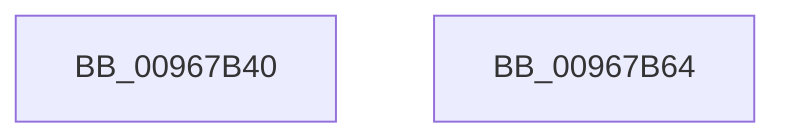

# sub_00967B40

- RVA: `0x00967B40`–`0x00967B65` (길이 `37` bytes)
- VA: `0x0000000140967B40`
- 실행 섹션: `PAGE`
- PDB 이름 있음: `아니요`; PDB Function 태그: `아니요`
- unwind 정보 RVA: `0x000DB714`
- 디코드: `12`개 명령, `37/37` bytes 표시
- 미해석 바이트: `0` (있으면 어셈블리에 `.byte`로 보존)

> 이 문서는 커널 이미지의 기계어와 PDB 기호를 분석해 생성했습니다. 4번과 5번은 함수 원형과 자료형을 바이너리 사용 방식에서 추정한 C 해석이며 원본 소스 복구 결과는 아닙니다.

## 1. Dependencies

- 직접 호출 지점: **0**; 고유 호출 대상: **0**
- 직접 호출자로 확인된 함수: **1**
- RIP 상대 이미지 참조: **0**

### Outgoing calls
- 직접 디코드된 call 명령이 없습니다.

### Direct callers
- [sub_00967F18](Unknown_function_00967F18.md) at `0x0096856D`

### Static image references
- 디코드된 RIP-relative 메모리 참조가 없습니다.

## 2. Other-region calls and transfers

- 다른 실행 섹션으로 향하는 call: **0**
- 별도 외부 분기/꼬리 이동을 확인하지 못했습니다.

## 3. Assembly (complete function range)

```asm
00967B40  48 8B 54 24 30                  mov rdx, qword ptr [rsp + 0x30]
00967B45  4C 8B C1                        mov r8, rcx
00967B48  8B 44 24 38                     mov eax, dword ptr [rsp + 0x38]
00967B4C  83 E1 03                        and ecx, 3
00967B4F  49 D1 E8                        shr r8, 1
00967B52  49 FF C8                        dec r8
00967B55  41 83 E0 01                     and r8d, 1
00967B59  0F B7 0C 4A                     movzx ecx, word ptr [rdx + rcx*2]
00967B5D  42 2B 04 82                     sub eax, dword ptr [rdx + r8*4]
00967B61  2B C1                           sub eax, ecx
00967B63  C3                              ret
00967B64  CC                              int3
```

## 4. C-style interpretation (structured pseudocode)

```c
__int64 __fastcall sub_00967B40(__int64 a1, __int64 a2, __int64 a3, __int64 a4, __int64 a5, __int64 a6, unsigned int a7)
{
    __int64 result;

    a1 = (unsigned int)((a1) & (3));
    a3 = (a1) >> (1);
    a3 = (a3) - 1;
    a3 = (unsigned int)((a3) & (1));
    result = (unsigned int)(((unsigned int)(a7)) - (*(unsigned int *)(a6 + a3 * 4)));
    result = (unsigned int)((result) - ((unsigned int)(*(unsigned __int16 *)(a6 + a1 * 2))));
    return result;
}
```

## 5. (Beta) C Style

```c
int64_t sub_00967B40(int64_t Arg1, int64_t Arg2, int64_t Arg3, int64_t Arg4, uint64_t Arg5, void *Arg6, uint32_t Arg7)
{
    uint8_t *arg6 = (uint8_t *)Arg6;

    int64_t result;

    Arg1 = (uint32_t)((Arg1) & (3));
    Arg3 = (Arg1) >> (1);
    Arg3 = (Arg3) - 1;
    Arg3 = (uint32_t)((Arg3) & (1));
    result = (uint32_t)(((uint32_t)(Arg7)) - (*(uint32_t *)(arg6 + Arg3 * 4)));
    result = (uint32_t)((result) - ((uint32_t)(*(uint16_t *)(arg6 + Arg1 * 2))));
    return result;
}
```

### 관측된 메모리 오프셋

구조체 형식이 확인되지 않은 접근은 인자 기준의 오프셋으로만 기록했습니다.

| 기준 인자 | 오프셋 표현 | 폭 (bit) | 접근 |
|---|---:|---:|---|
| `Arg6` | `+ 0x0 + r8*4` | `32` | `R` |
| `Arg6` | `+ 0x0 + rcx*2` | `16` | `R` |

## 6. Execution-region graph

[열기: 2D/3D 그래프와 함수 탐색 컨트롤 패널](../../../control-panel.html?section=page&rva=0x00967B40&view=graph)

- 2D 그래프는 위에서 아래로 흐르고, 3D 그래프는 빈 공간을 드래그해 회전합니다. Shift+드래그는 이동, 휠은 확대·축소, 함수 노드 선택은 대상 보고서 이동입니다.

### Static fallback


