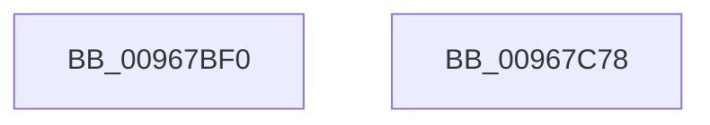

# sub_00967BF0

- RVA: `0x00967BF0`–`0x00967C79` (길이 `137` bytes)
- VA: `0x0000000140967BF0`
- 실행 섹션: `PAGE`
- PDB 이름 있음: `아니요`; PDB Function 태그: `아니요`
- unwind 정보 RVA: `0x000950EC`
- 디코드: `36`개 명령, `137/137` bytes 표시
- 미해석 바이트: `0` (있으면 어셈블리에 `.byte`로 보존)

> 이 문서는 커널 이미지의 기계어와 PDB 기호를 분석해 생성했습니다. 4번과 5번은 함수 원형과 자료형을 바이너리 사용 방식에서 추정한 C 해석이며 원본 소스 복구 결과는 아닙니다.

## 1. Dependencies

- 직접 호출 지점: **0**; 고유 호출 대상: **0**
- 직접 호출자로 확인된 함수: **2**
- RIP 상대 이미지 참조: **0**

### Outgoing calls
- 직접 디코드된 call 명령이 없습니다.

### Direct callers
- [sub_00967F18](Unknown_function_00967F18.md) at `0x0096853B`
- [sub_00968AF6](Unknown_function_00968AF6.md) at `0x00968B45`

### Static image references
- 디코드된 RIP-relative 메모리 참조가 없습니다.

## 2. Other-region calls and transfers

- 다른 실행 섹션으로 향하는 call: **0**
- 별도 외부 분기/꼬리 이동을 확인하지 못했습니다.

## 3. Assembly (complete function range)

```asm
00967BF0  48 89 5C 24 08                  mov qword ptr [rsp + 8], rbx
00967BF5  48 89 7C 24 10                  mov qword ptr [rsp + 0x10], rdi
00967BFA  48 8B D9                        mov rbx, rcx
00967BFD  4C 8B D2                        mov r10, rdx
00967C00  49 8B F8                        mov rdi, r8
00967C03  41 0F B6 CA                     movzx ecx, r10b
00967C07  4C 8B 44 24 30                  mov r8, qword ptr [rsp + 0x30]
00967C0C  83 E3 03                        and ebx, 3
00967C0F  48 B8 89 88 88 88 88 88 88 88   movabs rax, 0x8888888888888889
00967C19  48 F7 E2                        mul rdx
00967C1C  48 B8 AB AA AA AA AA AA AA AA   movabs rax, 0xaaaaaaaaaaaaaaab
00967C26  48 C1 EA 03                     shr rdx, 3
00967C2A  4C 6B CA 0F                     imul r9, rdx, 0xf
00967C2E  8B 54 24 38                     mov edx, dword ptr [rsp + 0x38]
00967C32  44 8B DA                        mov r11d, edx
00967C35  41 2A C9                        sub cl, r9b
00967C38  45 2A CA                        sub r9b, r10b
00967C3B  FE C1                           inc cl
00967C3D  41 D3 EB                        shr r11d, cl
00967C40  41 8D 49 1F                     lea ecx, [r9 + 0x1f]
00967C44  D3 E2                           shl edx, cl
00967C46  41 0F B7 0C 58                  movzx ecx, word ptr [r8 + rbx*2]
00967C4B  44 0B DA                        or r11d, edx
00967C4E  48 F7 E7                        mul rdi
00967C51  44 2B D9                        sub r11d, ecx
00967C54  48 8D 4F 01                     lea rcx, [rdi + 1]
00967C58  48 8B 7C 24 10                  mov rdi, qword ptr [rsp + 0x10]
00967C5D  48 D1 EA                        shr rdx, 1
00967C60  48 03 D3                        add rdx, rbx
00967C63  48 8B 5C 24 08                  mov rbx, qword ptr [rsp + 8]
00967C68  48 03 CA                        add rcx, rdx
00967C6B  83 E1 03                        and ecx, 3
00967C6E  41 0F B7 04 48                  movzx eax, word ptr [r8 + rcx*2]
00967C73  41 0F AF C3                     imul eax, r11d
00967C77  C3                              ret
00967C78  CC                              int3
```

## 4. C-style interpretation (structured pseudocode)

```c
__int64 __fastcall sub_00967BF0(__int64 a1, __int64 a2, __int64 a3, __int64 a4, __int64 a5, __int64 a6, unsigned int a7)
{
    __int64 result;
    __int64 v_r11;
    __int64 v_rbx;
    unsigned __int64 v_stack_p10;
    unsigned __int64 v_stack_p8;

    v_stack_p8 = v_rbx;
    v_stack_p10 = v_rdi;
    v_rbx = (unsigned int)((a1) & (3));
    a2 = (a2) >> (3);
    a4 = (a4) * (a2);
    a1 = (unsigned __int8)(((unsigned __int8)(a2)) - ((unsigned __int8)(a4)));
    a4 = (unsigned __int8)((a4) - ((unsigned __int8)(a2)));
    a1 = (unsigned __int8)((a1) + 1);
    v_r11 = (unsigned int)(((unsigned int)((unsigned int)((unsigned int)(a7)))) >> ((unsigned __int8)(a1)));
    a2 = (unsigned int)(((unsigned int)(a7)) << ((unsigned __int8)(a4 + 31)));
    v_r11 = (unsigned int)((v_r11) | ((unsigned int)(a2)));
    v_r11 = (unsigned int)((v_r11) - ((unsigned int)(*(unsigned __int16 *)(a6 + v_rbx * 2))));
    a2 = (a2) >> (1);
    a2 = (a2) + (v_rbx);
    a1 = (a3 + 1) + (a2);
    a1 = (unsigned int)((a1) & (3));
    result = (unsigned int)((*(unsigned __int16 *)(a6 + a1 * 2)) * ((unsigned int)(v_r11)));
    return result;
}
```

## 5. (Beta) C Style

```c
int64_t sub_00967BF0(int64_t Arg1, int64_t Arg2, int64_t Arg3, void *Arg4, uint64_t Arg5, void *Arg6, uint32_t Arg7)
{
    uint8_t *arg4 = (uint8_t *)Arg4;
    uint8_t *arg6 = (uint8_t *)Arg6;

    int64_t result;
    int64_t local_r11;
    int64_t local_rbx;
    uint64_t v_stack_p10;
    uint64_t v_stack_p8;

    v_stack_p8 = local_rbx;
    v_stack_p10 = local_rdi;
    local_rbx = (uint32_t)((Arg1) & (3));
    Arg2 = (Arg2) >> (3);
    Arg4 = (Arg4) * (Arg2);
    Arg1 = (uint8_t)(((uint8_t)(Arg2)) - ((uint8_t)(Arg4)));
    Arg4 = (uint8_t)((Arg4) - ((uint8_t)(Arg2)));
    Arg1 = (uint8_t)((Arg1) + 1);
    local_r11 = (uint32_t)(((uint32_t)((uint32_t)((uint32_t)(Arg7)))) >> ((uint8_t)(Arg1)));
    Arg2 = (uint32_t)(((uint32_t)(Arg7)) << ((uint8_t)(Arg4 + 31)));
    local_r11 = (uint32_t)((local_r11) | ((uint32_t)(Arg2)));
    local_r11 = (uint32_t)((local_r11) - ((uint32_t)(*(uint16_t *)(arg6 + local_rbx * 2))));
    Arg2 = (Arg2) >> (1);
    Arg2 = (Arg2) + (local_rbx);
    Arg1 = (Arg3 + 1) + (Arg2);
    Arg1 = (uint32_t)((Arg1) & (3));
    result = (uint32_t)((*(uint16_t *)(arg6 + Arg1 * 2)) * ((uint32_t)(local_r11)));
    return result;
}
```

### 관측된 메모리 오프셋

구조체 형식이 확인되지 않은 접근은 인자 기준의 오프셋으로만 기록했습니다.

| 기준 인자 | 오프셋 표현 | 폭 (bit) | 접근 |
|---|---:|---:|---|
| `Arg4` | `+ 0x1F` | `32` | `R` |
| `Arg6` | `+ 0x0 + rbx*2` | `16` | `R` |
| `Arg6` | `+ 0x0 + rcx*2` | `16` | `R` |

## 6. Execution-region graph

[열기: 2D/3D 그래프와 함수 탐색 컨트롤 패널](../../../control-panel.html?section=page&rva=0x00967BF0&view=graph)

- 2D 그래프는 위에서 아래로 흐르고, 3D 그래프는 빈 공간을 드래그해 회전합니다. Shift+드래그는 이동, 휠은 확대·축소, 함수 노드 선택은 대상 보고서 이동입니다.

### Static fallback


