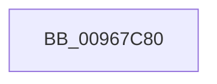

# sub_00967C80

- RVA: `0x00967C80`–`0x00967CA6` (길이 `38` bytes)
- VA: `0x0000000140967C80`
- 실행 섹션: `PAGE`
- PDB 이름 있음: `아니요`; PDB Function 태그: `아니요`
- unwind 정보 RVA: `0x000950FC`
- 디코드: `9`개 명령, `38/38` bytes 표시
- 미해석 바이트: `0` (있으면 어셈블리에 `.byte`로 보존)

> 이 문서는 커널 이미지의 기계어와 PDB 기호를 분석해 생성했습니다. 4번과 5번은 함수 원형과 자료형을 바이너리 사용 방식에서 추정한 C 해석이며 원본 소스 복구 결과는 아닙니다.

## 1. Dependencies

- 직접 호출 지점: **0**; 고유 호출 대상: **0**
- 직접 호출자로 확인된 함수: **1**
- RIP 상대 이미지 참조: **1**

### Outgoing calls
- 직접 디코드된 call 명령이 없습니다.

### Direct callers
- [sub_00A3A820](../A3/Unknown_function_00A3A820.md) at `0x00A3A840`

### Static image references
- `0x00967C95` → RVA `0x00E0A740` (`.data`; read)

## 2. Other-region calls and transfers

- 다른 실행 섹션으로 향하는 call: **0**
- 별도 외부 분기/꼬리 이동을 확인하지 못했습니다.

## 3. Assembly (complete function range)

```asm
00967C80  4C 8B DC                        mov r11, rsp
00967C83  55                              push rbp
00967C84  57                              push rdi
00967C85  41 57                           push r15
00967C87  49 8D AB 98 FE FF FF            lea rbp, [r11 - 0x168]
00967C8E  48 81 EC 50 02 00 00            sub rsp, 0x250
00967C95  48 8B 05 A4 2A 4A 00            mov rax, qword ptr [rip + 0x4a2aa4]
00967C9C  48 33 C4                        xor rax, rsp
00967C9F  48 89 85 20 01 00 00            mov qword ptr [rbp + 0x120], rax
```

## 4. C-style interpretation (structured pseudocode)

```c
__int64 __fastcall sub_00967C80(void)
{
    __int64 result;
    __int64 v_rsp;

    v_rsp = (v_rsp) - (592);
    result = (*(unsigned __int64 *)(v_rip + 4860580)) ^ (v_rsp);
    *(unsigned __int64 *)(v_rsp - 360 + 288) = result;
    return result;
}
```

## 5. (Beta) C Style

```c
void sub_00967C80(void)
{
    int64_t result;
    int64_t local_rsp;

    local_rsp = (local_rsp) - (592);
    result = (*(uint64_t *)(v_rip + 0x4A2AA4)) ^ (local_rsp);
    *(uint64_t *)(local_rsp - 0x168 + 0x120) = result;
    return result;
}
```

## 6. Execution-region graph

[열기: 2D/3D 그래프와 함수 탐색 컨트롤 패널](../../../control-panel.html?section=page&rva=0x00967C80&view=graph)

- 2D 그래프는 위에서 아래로 흐르고, 3D 그래프는 빈 공간을 드래그해 회전합니다. Shift+드래그는 이동, 휠은 확대·축소, 함수 노드 선택은 대상 보고서 이동입니다.

### Static fallback


