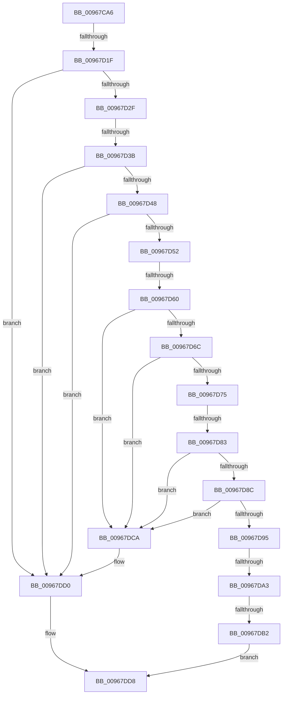

# sub_00967CA6

- RVA: `0x00967CA6`–`0x00967DEF` (길이 `329` bytes)
- VA: `0x0000000140967CA6`
- 실행 섹션: `PAGE`
- PDB 이름 있음: `아니요`; PDB Function 태그: `아니요`
- unwind 정보 RVA: `0x00095114`
- 디코드: `89`개 명령, `329/329` bytes 표시
- 미해석 바이트: `0` (있으면 어셈블리에 `.byte`로 보존)

> 이 문서는 커널 이미지의 기계어와 PDB 기호를 분석해 생성했습니다. 4번과 5번은 함수 원형과 자료형을 바이너리 사용 방식에서 추정한 C 해석이며 원본 소스 복구 결과는 아닙니다.

## 1. Dependencies

- 직접 호출 지점: **0**; 고유 호출 대상: **0**
- 직접 호출자로 확인된 함수: **0**
- RIP 상대 이미지 참조: **0**

### Outgoing calls
- 직접 디코드된 call 명령이 없습니다.

### Direct callers
- 이 함수 시작 RVA로 연결되는 직접 call은 확인되지 않았습니다. 간접 호출은 완전히 역산할 수 없습니다.

### Static image references
- 디코드된 RIP-relative 메모리 참조가 없습니다.

## 2. Other-region calls and transfers

- 다른 실행 섹션으로 향하는 call: **0**
- call이 아닌 외부 분기/꼬리 이동: **7**
  - `0x00967D19` → [sub_00968AF6 + 0x221F](Unknown_function_00968AF6.md) (`tail-transfer`)
  - `0x00967D35` → [sub_00968ADD](Unknown_function_00968ADD.md) (`tail-transfer`)
  - `0x00967D5A` → [sub_00968AF6](Unknown_function_00968AF6.md) (`tail-transfer`)
  - `0x00967D7D` → [sub_00968AF6 + 0x2229](Unknown_function_00968AF6.md) (`tail-transfer`)
  - `0x00967D9D` → [sub_00968AF6 + 0x2239](Unknown_function_00968AF6.md) (`tail-transfer`)
  - `0x00967DAC` → [sub_00967F18](Unknown_function_00967F18.md) (`tail-transfer`)
  - `0x00967DED` → [sub_00967DEF + 0xD](Unknown_function_00967DEF.md) (`tail-transfer`)

## 3. Assembly (complete function range)

```asm
00967CA6  49 89 5B 10                     mov qword ptr [r11 + 0x10], rbx
00967CAA  45 33 FF                        xor r15d, r15d
00967CAD  49 89 73 E0                     mov qword ptr [r11 - 0x20], rsi
00967CB1  48 8B C1                        mov rax, rcx
00967CB4  33 F6                           xor esi, esi
00967CB6  4D 89 63 D8                     mov qword ptr [r11 - 0x28], r12
00967CBA  4D 89 6B D0                     mov qword ptr [r11 - 0x30], r13
00967CBE  45 33 E4                        xor r12d, r12d
00967CC1  45 33 ED                        xor r13d, r13d
00967CC4  4D 89 73 C8                     mov qword ptr [r11 - 0x38], r14
00967CC8  45 33 F6                        xor r14d, r14d
00967CCB  48 89 4D B8                     mov qword ptr [rbp - 0x48], rcx
00967CCF  48 8B 8D 90 01 00 00            mov rcx, qword ptr [rbp + 0x190]
00967CD6  0F 57 C0                        xorps xmm0, xmm0
00967CD9  4C 89 4D 68                     mov qword ptr [rbp + 0x68], r9
00967CDD  0F 57 C9                        xorps xmm1, xmm1
00967CE0  44 89 45 E0                     mov dword ptr [rbp - 0x20], r8d
00967CE4  48 89 4D 70                     mov qword ptr [rbp + 0x70], rcx
00967CE8  4C 89 64 24 70                  mov qword ptr [rsp + 0x70], r12
00967CED  4C 89 74 24 58                  mov qword ptr [rsp + 0x58], r14
00967CF2  4C 89 7C 24 50                  mov qword ptr [rsp + 0x50], r15
00967CF7  4C 89 7D B0                     mov qword ptr [rbp - 0x50], r15
00967CFB  4C 89 6C 24 68                  mov qword ptr [rsp + 0x68], r13
00967D00  48 89 74 24 60                  mov qword ptr [rsp + 0x60], rsi
00967D05  48 89 75 58                     mov qword ptr [rbp + 0x58], rsi
00967D09  48 89 75 18                     mov qword ptr [rbp + 0x18], rsi
00967D0D  0F 11 45 90                     movups xmmword ptr [rbp - 0x70], xmm0
00967D11  0F 11 4C 24 78                  movups xmmword ptr [rsp + 0x78], xmm1
00967D16  83 FA 04                        cmp edx, 4
00967D19  0F 82 F6 2F 00 00               jb 0x14096ad15
00967D1F  44 8B 28                        mov r13d, dword ptr [rax]
00967D22  4C 8D 40 04                     lea r8, [rax + 4]
00967D26  4C 3B C0                        cmp r8, rax
00967D29  0F 82 A1 00 00 00               jb 0x140967dd0
00967D2F  8D 42 FC                        lea eax, [rdx - 4]
00967D32  41 3B C5                        cmp eax, r13d
00967D35  0F 82 A2 0D 00 00               jb 0x140968add
00967D3B  4B 8D 0C 28                     lea rcx, [r8 + r13]
00967D3F  49 3B C8                        cmp rcx, r8
00967D42  0F 82 88 00 00 00               jb 0x140967dd0
00967D48  45 8D 45 04                     lea r8d, [r13 + 4]
00967D4C  41 83 F8 04                     cmp r8d, 4
00967D50  72 7E                           jb 0x140967dd0
00967D52  8B C2                           mov eax, edx
00967D54  41 2B C0                        sub eax, r8d
00967D57  83 F8 04                        cmp eax, 4
00967D5A  0F 82 96 0D 00 00               jb 0x140968af6
00967D60  44 8B 31                        mov r14d, dword ptr [rcx]
00967D63  4C 8D 79 04                     lea r15, [rcx + 4]
00967D67  4C 3B F9                        cmp r15, rcx
00967D6A  72 5E                           jb 0x140967dca
00967D6C  45 8D 48 04                     lea r9d, [r8 + 4]
00967D70  45 3B C8                        cmp r9d, r8d
00967D73  72 55                           jb 0x140967dca
00967D75  8B C2                           mov eax, edx
00967D77  41 2B C1                        sub eax, r9d
00967D7A  41 3B C6                        cmp eax, r14d
00967D7D  0F 82 9C 2F 00 00               jb 0x14096ad1f
00967D83  4B 8D 0C 37                     lea rcx, [r15 + r14]
00967D87  49 3B CF                        cmp rcx, r15
00967D8A  72 3E                           jb 0x140967dca
00967D8C  47 8D 04 0E                     lea r8d, [r14 + r9]
00967D90  45 3B C1                        cmp r8d, r9d
00967D93  72 35                           jb 0x140967dca
00967D95  8B C2                           mov eax, edx
00967D97  41 2B C0                        sub eax, r8d
00967D9A  83 F8 04                        cmp eax, 4
00967D9D  0F 82 8C 2F 00 00               jb 0x14096ad2f
00967DA3  8B 31                           mov esi, dword ptr [rcx]
00967DA5  4C 8D 61 04                     lea r12, [rcx + 4]
00967DA9  4C 3B E1                        cmp r12, rcx
00967DAC  0F 83 66 01 00 00               jae 0x140967f18
00967DB2  BF 95 00 00 C0                  mov edi, 0xc0000095
00967DB7  4C 8B 64 24 70                  mov r12, qword ptr [rsp + 0x70]
00967DBC  4D 8B F4                        mov r14, r12
00967DBF  4D 8B EC                        mov r13, r12
00967DC2  4D 8B FC                        mov r15, r12
00967DC5  49 8B F4                        mov rsi, r12
00967DC8  EB 0E                           jmp 0x140967dd8
00967DCA  4C 8B FE                        mov r15, rsi
00967DCD  4C 8B F6                        mov r14, rsi
00967DD0  BF 95 00 00 C0                  mov edi, 0xc0000095
00967DD5  4C 8B EE                        mov r13, rsi
00967DD8  48 8B 4D 98                     mov rcx, qword ptr [rbp - 0x68]
00967DDC  33 DB                           xor ebx, ebx
00967DDE  48 89 5D 90                     mov qword ptr [rbp - 0x70], rbx
00967DE2  48 8B 9C 24 78 02 00 00         mov rbx, qword ptr [rsp + 0x278]
00967DEA  48 85 C9                        test rcx, rcx
00967DED  74 0D                           je 0x140967dfc
```

## 4. C-style interpretation (structured pseudocode)

```c
__int64 __fastcall sub_00967CA6(__int64 a1, __int64 a2, int a3, __int64 a4, __int64 a5, __int64 a6, __int64 a7, __int64 a8, __int64 a9, __int64 a10, __int64 a11, __int64 a12, __int64 a13, __int64 a14, __int64 a15, __int64 a16, __int64 a17, __int64 a18, __int64 a19, __int64 a20, __int64 a21, __int64 a22, __int64 a23, __int64 a24, __int64 a25, __int64 a26, __int64 a27, __int64 a28, __int64 a29, __int64 a30, __int64 a31, __int64 a32, __int64 a33, __int64 a34, __int64 a35, __int64 a36, __int64 a37, __int64 a38, __int64 a39, __int64 a40, __int64 a41, __int64 a42, __int64 a43, __int64 a44, __int64 a45, __int64 a46, __int64 a47, __int64 a48, __int64 a49, __int64 a50, __int64 a51, __int64 a52, __int64 a53, __int64 a54, __int64 a55, __int64 a56, __int64 a57, __int64 a58, __int64 a59, __int64 a60, __int64 a61, __int64 a62, __int64 a63, __int64 a64, __int64 a65, __int64 a66, __int64 a67, __int64 a68, __int64 a69, __int64 a70, __int64 a71, __int64 a72, __int64 a73, __int64 a74, __int64 a75, __int64 a76, __int64 a77, __int64 a78, __int64 a79)
{
    __int64 result;
    __int64 v_r12;
    __int64 v_r13;
    __int64 v_r14;
    __int64 v_r15;
    __int64 v_rbx;
    __int64 v_rsi;
    unsigned __int64 v_stack_p50;
    unsigned __int64 v_stack_p58;
    unsigned __int64 v_stack_p60;
    unsigned __int64 v_stack_p68;
    unsigned __int64 v_stack_p70;

    *(unsigned __int64 *)(v_r11 + 16) = v_rbx;
    v_r15 = 0;
    *(unsigned __int64 *)(v_r11 - 32) = v_rsi;
    v_rsi = 0;
    *(unsigned __int64 *)(v_r11 - 40) = v_r12;
    *(unsigned __int64 *)(v_r11 - 48) = v_r13;
    v_r12 = 0;
    v_r13 = 0;
    *(unsigned __int64 *)(v_r11 - 56) = v_r14;
    v_r14 = 0;
    *(unsigned __int64 *)(v_rbp - 72) = a1;
    *(unsigned __int64 *)(v_rbp + 104) = a4;
    *(unsigned int *)(v_rbp - 32) = a3;
    *(unsigned __int64 *)(v_rbp + 112) = *(unsigned __int64 *)(v_rbp + 400);
    v_stack_p70 = 0;
    v_stack_p58 = 0;
    v_stack_p50 = 0;
    *(unsigned __int64 *)(v_rbp - 80) = 0;
    v_stack_p68 = 0;
    v_stack_p60 = 0;
    *(unsigned __int64 *)(v_rbp + 88) = 0;
    *(unsigned __int64 *)(v_rbp + 24) = 0;
    *(unsigned __int64 *)(v_rbp - 112) = v_xmm0;
    a15 = v_xmm1;
    if ((a1 + 4) < a1) goto loc_00967DD0;
    if ((a1 + 4 + (unsigned int)(*(unsigned int *)(a1)) * 1) < (a1 + 4)) goto loc_00967DD0;
    if (((unsigned int)((unsigned int)(*(unsigned int *)(a1)) + 4)) < 4) goto loc_00967DD0;
    result = (unsigned int)(((unsigned int)((unsigned int)(a2))) - ((unsigned int)((unsigned int)(*(unsigned int *)(a1)) + 4)));
    if ((a1 + 4 + (unsigned int)(*(unsigned int *)(a1)) * 1 + 4) < (a1 + 4 + (unsigned int)(*(unsigned int *)(a1)) * 1)) goto loc_00967DCA;
    if (((unsigned int)((unsigned int)(*(unsigned int *)(a1)) + 4 + 4)) < ((unsigned int)((unsigned int)(*(unsigned int *)(a1)) + 4))) goto loc_00967DCA;
    result = (unsigned int)(((unsigned int)((unsigned int)(a2))) - ((unsigned int)((unsigned int)(*(unsigned int *)(a1)) + 4 + 4)));
    if ((a1 + 4 + (unsigned int)(*(unsigned int *)(a1)) * 1 + 4 + (unsigned int)(*(unsigned int *)(a1 + 4 + (unsigned int)(*(unsigned int *)(a1)) * 1)) * 1) < (a1 + 4 + (unsigned int)(*(unsigned int *)(a1)) * 1 + 4)) goto loc_00967DCA;
    if (((unsigned int)((unsigned int)(*(unsigned int *)(a1 + 4 + (unsigned int)(*(unsigned int *)(a1)) * 1)) + (unsigned int)(*(unsigned int *)(a1)) + 4 + 4 * 1)) < ((unsigned int)((unsigned int)(*(unsigned int *)(a1)) + 4 + 4))) goto loc_00967DCA;
    result = (unsigned int)(((unsigned int)((unsigned int)(a2))) - ((unsigned int)((unsigned int)(*(unsigned int *)(a1 + 4 + (unsigned int)(*(unsigned int *)(a1)) * 1)) + (unsigned int)(*(unsigned int *)(a1)) + 4 + 4 * 1)));
    goto loc_00967DD8;
loc_00967DCA:
loc_00967DD0:
loc_00967DD8:
    v_rbx = 0;
    *(unsigned __int64 *)(v_rbp - 112) = 0;
}
```

## 5. (Beta) C Style

```c
int64_t sub_00967CA6(void *Arg1, int64_t Arg2, int32_t Arg3, int64_t Arg4, uint64_t Arg5, uint64_t Arg6, uint64_t Arg7, uint64_t Arg8, uint64_t Arg9, uint64_t Arg10, uint64_t Arg11, uint64_t Arg12, uint64_t Arg13, int64_t Arg14, int64_t Arg15, uint64_t Arg16, uint64_t Arg17, uint64_t Arg18, uint64_t Arg19, uint64_t Arg20, uint64_t Arg21, uint64_t Arg22, uint64_t Arg23, uint64_t Arg24, uint64_t Arg25, uint64_t Arg26, uint64_t Arg27, uint64_t Arg28, uint64_t Arg29, uint64_t Arg30, uint64_t Arg31, uint64_t Arg32, uint64_t Arg33, uint64_t Arg34, uint64_t Arg35, uint64_t Arg36, uint64_t Arg37, uint64_t Arg38, uint64_t Arg39, uint64_t Arg40, uint64_t Arg41, uint64_t Arg42, uint64_t Arg43, uint64_t Arg44, uint64_t Arg45, uint64_t Arg46, uint64_t Arg47, uint64_t Arg48, uint64_t Arg49, uint64_t Arg50, uint64_t Arg51, uint64_t Arg52, uint64_t Arg53, uint64_t Arg54, uint64_t Arg55, uint64_t Arg56, uint64_t Arg57, uint64_t Arg58, uint64_t Arg59, uint64_t Arg60, uint64_t Arg61, uint64_t Arg62, uint64_t Arg63, uint64_t Arg64, uint64_t Arg65, uint64_t Arg66, uint64_t Arg67, uint64_t Arg68, uint64_t Arg69, uint64_t Arg70, uint64_t Arg71, uint64_t Arg72, uint64_t Arg73, uint64_t Arg74, uint64_t Arg75, uint64_t Arg76, uint64_t Arg77, uint64_t Arg78, int64_t Arg79)
{
    uint8_t *arg1 = (uint8_t *)Arg1;

    int64_t result;
    int64_t local_r12;
    int64_t local_r13;
    int64_t local_r14;
    int64_t local_r15;
    int64_t local_rbx;
    int64_t local_rsi;
    uint64_t v_stack_p50;
    uint64_t v_stack_p58;
    uint64_t v_stack_p60;
    uint64_t v_stack_p68;
    uint64_t v_stack_p70;

    *(uint64_t *)(local_r11 + 0x10) = local_rbx;
    local_r15 = 0;
    *(uint64_t *)(local_r11 - 0x20) = local_rsi;
    local_rsi = 0;
    *(uint64_t *)(local_r11 - 0x28) = local_r12;
    *(uint64_t *)(local_r11 - 0x30) = local_r13;
    local_r12 = 0;
    local_r13 = 0;
    *(uint64_t *)(local_r11 - 0x38) = local_r14;
    local_r14 = 0;
    *(void **)(local_rbp - 0x48) = Arg1;
    *(uint64_t *)(local_rbp + 0x68) = Arg4;
    *(uint32_t *)(local_rbp - 0x20) = Arg3;
    *(uint64_t *)(local_rbp + 0x70) = *(uint64_t *)(local_rbp + 0x190);
    v_stack_p70 = 0;
    v_stack_p58 = 0;
    v_stack_p50 = 0;
    *(uint64_t *)(local_rbp - 0x50) = 0;
    v_stack_p68 = 0;
    v_stack_p60 = 0;
    *(uint64_t *)(local_rbp + 0x58) = 0;
    *(uint64_t *)(local_rbp + 0x18) = 0;
    *(uint64_t *)(local_rbp - 0x70) = v_xmm0;
    Arg15 = v_xmm1;
    if ((Arg1 + 4) < Arg1) goto loc_00967DD0;
    if ((Arg1 + 4 + (uint32_t)(*(uint32_t *)(arg1)) * 1) < (Arg1 + 4)) goto loc_00967DD0;
    if (((uint32_t)((uint32_t)(*(uint32_t *)(arg1)) + 4)) < 4) goto loc_00967DD0;
    result = (uint32_t)(((uint32_t)((uint32_t)(Arg2))) - ((uint32_t)((uint32_t)(*(uint32_t *)(arg1)) + 4)));
    if ((Arg1 + 4 + (uint32_t)(*(uint32_t *)(arg1)) * 1 + 4) < (Arg1 + 4 + (uint32_t)(*(uint32_t *)(arg1)) * 1)) goto loc_00967DCA;
    if (((uint32_t)((uint32_t)(*(uint32_t *)(arg1)) + 4 + 4)) < ((uint32_t)((uint32_t)(*(uint32_t *)(arg1)) + 4))) goto loc_00967DCA;
    result = (uint32_t)(((uint32_t)((uint32_t)(Arg2))) - ((uint32_t)((uint32_t)(*(uint32_t *)(arg1)) + 4 + 4)));
    if ((Arg1 + 4 + (uint32_t)(*(uint32_t *)(arg1)) * 1 + 4 + (uint32_t)(*(uint32_t *)(arg1 + 0x4 + (uint32_t)(*(uint32_t *)(arg1)) * 1)) * 1) < (Arg1 + 4 + (uint32_t)(*(uint32_t *)(arg1)) * 1 + 4)) goto loc_00967DCA;
    if (((uint32_t)((uint32_t)(*(uint32_t *)(arg1 + 0x4 + (uint32_t)(*(uint32_t *)(arg1)) * 1)) + (uint32_t)(*(uint32_t *)(arg1)) + 4 + 4 * 1)) < ((uint32_t)((uint32_t)(*(uint32_t *)(arg1)) + 4 + 4))) goto loc_00967DCA;
    result = (uint32_t)(((uint32_t)((uint32_t)(Arg2))) - ((uint32_t)((uint32_t)(*(uint32_t *)(arg1 + 0x4 + (uint32_t)(*(uint32_t *)(arg1)) * 1)) + (uint32_t)(*(uint32_t *)(arg1)) + 4 + 4 * 1)));
    goto loc_00967DD8;
loc_00967DCA:
loc_00967DD0:
loc_00967DD8:
    local_rbx = 0;
    *(uint64_t *)(local_rbp - 0x70) = 0;
}
```

### 관측된 메모리 오프셋

구조체 형식이 확인되지 않은 접근은 인자 기준의 오프셋으로만 기록했습니다.

| 기준 인자 | 오프셋 표현 | 폭 (bit) | 접근 |
|---|---:|---:|---|
| `Arg1` | `+ 0x0` | `32` | `R` |
| `Arg1` | `+ 0x4` | `64` | `R` |

## 6. Execution-region graph

[열기: 2D/3D 그래프와 함수 탐색 컨트롤 패널](../../../control-panel.html?section=page&rva=0x00967CA6&view=graph)

- 2D 그래프는 위에서 아래로 흐르고, 3D 그래프는 빈 공간을 드래그해 회전합니다. Shift+드래그는 이동, 휠은 확대·축소, 함수 노드 선택은 대상 보고서 이동입니다.

### Static fallback


