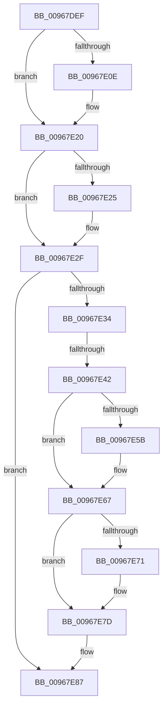

# sub_00967DEF

- RVA: `0x00967DEF`–`0x00967EA0` (길이 `177` bytes)
- VA: `0x0000000140967DEF`
- 실행 섹션: `PAGE`
- PDB 이름 있음: `아니요`; PDB Function 태그: `아니요`
- unwind 정보 RVA: `0x00095138`
- 디코드: `45`개 명령, `177/177` bytes 표시
- 미해석 바이트: `0` (있으면 어셈블리에 `.byte`로 보존)

> 이 문서는 커널 이미지의 기계어와 PDB 기호를 분석해 생성했습니다. 4번과 5번은 함수 원형과 자료형을 바이너리 사용 방식에서 추정한 C 해석이며 원본 소스 복구 결과는 아닙니다.

## 1. Dependencies

- 직접 호출 지점: **7**; 고유 호출 대상: **1**
- 직접 호출자로 확인된 함수: **0**
- RIP 상대 이미지 참조: **0**

### Outgoing calls
- `0x00967DF1` → [ExFreePoolWithTag](../../poolcode/B8/ExFreePoolWithTag_function_00B82870.md) (function, `0x00B82870`)
- `0x00967E13` → [ExFreePoolWithTag](../../poolcode/B8/ExFreePoolWithTag_function_00B82870.md) (function, `0x00B82870`)
- `0x00967E2A` → [ExFreePoolWithTag](../../poolcode/B8/ExFreePoolWithTag_function_00B82870.md) (function, `0x00B82870`)
- `0x00967E44` → [ExFreePoolWithTag](../../poolcode/B8/ExFreePoolWithTag_function_00B82870.md) (function, `0x00B82870`)
- `0x00967E5D` → [ExFreePoolWithTag](../../poolcode/B8/ExFreePoolWithTag_function_00B82870.md) (function, `0x00B82870`)
- `0x00967E73` → [ExFreePoolWithTag](../../poolcode/B8/ExFreePoolWithTag_function_00B82870.md) (function, `0x00B82870`)
- `0x00967E82` → [ExFreePoolWithTag](../../poolcode/B8/ExFreePoolWithTag_function_00B82870.md) (function, `0x00B82870`)

### Direct callers
- 이 함수 시작 RVA로 연결되는 직접 call은 확인되지 않았습니다. 간접 호출은 완전히 역산할 수 없습니다.

### Static image references
- 디코드된 RIP-relative 메모리 참조가 없습니다.

## 2. Other-region calls and transfers

- 다른 실행 섹션으로 향하는 call: **7**
  - `0x00967DF1` → [ExFreePoolWithTag](../../poolcode/B8/ExFreePoolWithTag_function_00B82870.md) (`PAGE` → `POOLCODE`)
  - `0x00967E13` → [ExFreePoolWithTag](../../poolcode/B8/ExFreePoolWithTag_function_00B82870.md) (`PAGE` → `POOLCODE`)
  - `0x00967E2A` → [ExFreePoolWithTag](../../poolcode/B8/ExFreePoolWithTag_function_00B82870.md) (`PAGE` → `POOLCODE`)
  - `0x00967E44` → [ExFreePoolWithTag](../../poolcode/B8/ExFreePoolWithTag_function_00B82870.md) (`PAGE` → `POOLCODE`)
  - `0x00967E5D` → [ExFreePoolWithTag](../../poolcode/B8/ExFreePoolWithTag_function_00B82870.md) (`PAGE` → `POOLCODE`)
  - `0x00967E73` → [ExFreePoolWithTag](../../poolcode/B8/ExFreePoolWithTag_function_00B82870.md) (`PAGE` → `POOLCODE`)
  - `0x00967E82` → [ExFreePoolWithTag](../../poolcode/B8/ExFreePoolWithTag_function_00B82870.md) (`PAGE` → `POOLCODE`)
- call이 아닌 외부 분기/꼬리 이동: **2**
  - `0x00967E3C` → [sub_00968AE7](Unknown_function_00968AE7.md) (`tail-transfer`)
  - `0x00967E9A` → [sub_00968ACE](Unknown_function_00968ACE.md) (`tail-transfer`)

## 3. Assembly (complete function range)

```asm
00967DEF  33 D2                           xor edx, edx
00967DF1  E8 7A AA 21 00                  call 0x140b82870
00967DF6  33 C9                           xor ecx, ecx
00967DF8  48 89 4D 98                     mov qword ptr [rbp - 0x68], rcx
00967DFC  48 8B 45 80                     mov rax, qword ptr [rbp - 0x80]
00967E00  48 C7 44 24 78 00 00 00 00      mov qword ptr [rsp + 0x78], 0
00967E09  48 85 C0                        test rax, rax
00967E0C  74 12                           je 0x140967e20
00967E0E  33 D2                           xor edx, edx
00967E10  48 8B C8                        mov rcx, rax
00967E13  E8 58 AA 21 00                  call 0x140b82870
00967E18  48 C7 45 80 00 00 00 00         mov qword ptr [rbp - 0x80], 0
00967E20  4D 85 F6                        test r14, r14
00967E23  74 0A                           je 0x140967e2f
00967E25  33 D2                           xor edx, edx
00967E27  49 8B CE                        mov rcx, r14
00967E2A  E8 41 AA 21 00                  call 0x140b82870
00967E2F  4D 85 E4                        test r12, r12
00967E32  74 53                           je 0x140967e87
00967E34  49 8B 4C 24 08                  mov rcx, qword ptr [r12 + 8]
00967E39  48 85 C9                        test rcx, rcx
00967E3C  0F 84 A5 0C 00 00               je 0x140968ae7
00967E42  33 D2                           xor edx, edx
00967E44  E8 27 AA 21 00                  call 0x140b82870
00967E49  45 33 F6                        xor r14d, r14d
00967E4C  4D 89 74 24 08                  mov qword ptr [r12 + 8], r14
00967E51  49 8B 4C 24 18                  mov rcx, qword ptr [r12 + 0x18]
00967E56  48 85 C9                        test rcx, rcx
00967E59  74 0C                           je 0x140967e67
00967E5B  33 D2                           xor edx, edx
00967E5D  E8 0E AA 21 00                  call 0x140b82870
00967E62  4D 89 74 24 18                  mov qword ptr [r12 + 0x18], r14
00967E67  49 8B 4C 24 28                  mov rcx, qword ptr [r12 + 0x28]
00967E6C  48 85 C9                        test rcx, rcx
00967E6F  74 0C                           je 0x140967e7d
00967E71  33 D2                           xor edx, edx
00967E73  E8 F8 A9 21 00                  call 0x140b82870
00967E78  4D 89 74 24 28                  mov qword ptr [r12 + 0x28], r14
00967E7D  33 D2                           xor edx, edx
00967E7F  49 8B CC                        mov rcx, r12
00967E82  E8 E9 A9 21 00                  call 0x140b82870
00967E87  4C 8B B4 24 30 02 00 00         mov r14, qword ptr [rsp + 0x230]
00967E8F  4C 8B A4 24 40 02 00 00         mov r12, qword ptr [rsp + 0x240]
00967E97  48 85 F6                        test rsi, rsi
00967E9A  0F 85 2E 0C 00 00               jne 0x140968ace
```

## 4. C-style interpretation (structured pseudocode)

```c
__int64 __fastcall sub_00967DEF(int a1, int a2, __int64 a3, __int64 a4, __int64 a5, __int64 a6, __int64 a7, __int64 a8, __int64 a9, __int64 a10, __int64 a11, __int64 a12, __int64 a13, __int64 a14, __int64 a15, __int64 a16, __int64 a17, __int64 a18, __int64 a19, __int64 a20, __int64 a21, __int64 a22, __int64 a23, __int64 a24, __int64 a25, __int64 a26, __int64 a27, __int64 a28, __int64 a29, __int64 a30, __int64 a31, __int64 a32, __int64 a33, __int64 a34, __int64 a35, __int64 a36, __int64 a37, __int64 a38, __int64 a39, __int64 a40, __int64 a41, __int64 a42, __int64 a43, __int64 a44, __int64 a45, __int64 a46, __int64 a47, __int64 a48, __int64 a49, __int64 a50, __int64 a51, __int64 a52, __int64 a53, __int64 a54, __int64 a55, __int64 a56, __int64 a57, __int64 a58, __int64 a59, __int64 a60, __int64 a61, __int64 a62, __int64 a63, __int64 a64, __int64 a65, __int64 a66, __int64 a67, __int64 a68, __int64 a69, __int64 a70, __int64 a71, __int64 a72)
{
    __int64 result;
    __int64 v_r14;
    unsigned __int64 v_stack_p78;

    a2 = 0;
    result = ExFreePoolWithTag(a1, a2, a3, a4);
    a1 = 0;
    *(unsigned __int64 *)(v_rbp - 104) = 0;
    v_stack_p78 = 0;
    result = *(unsigned __int64 *)(v_rbp - 128);
    if (*(unsigned __int64 *)(v_rbp - 128) != 0) {
        a2 = 0;
        a1 = *(unsigned __int64 *)(v_rbp - 128);
        result = ExFreePoolWithTag(a1, a2, a3, a4);
        *(unsigned __int64 *)(v_rbp - 128) = 0;
    }
    if (v_r14 != 0) {
        a2 = 0;
        a1 = v_r14;
        result = ExFreePoolWithTag(a1, a2, a3, a4);
    }
    if (v_r12 == 0) goto loc_00967E87;
    a2 = 0;
    result = ExFreePoolWithTag(*(unsigned __int64 *)(v_r12 + 8), a2, a3, a4);
    v_r14 = 0;
    *(unsigned __int64 *)(v_r12 + 8) = 0;
    if (*(unsigned __int64 *)(v_r12 + 24) != 0) {
        a2 = 0;
        result = ExFreePoolWithTag(*(unsigned __int64 *)(v_r12 + 24), a2, a3, a4);
        *(unsigned __int64 *)(v_r12 + 24) = 0;
    }
    if (*(unsigned __int64 *)(v_r12 + 40) != 0) {
        a2 = 0;
        result = ExFreePoolWithTag(*(unsigned __int64 *)(v_r12 + 40), a2, a3, a4);
        *(unsigned __int64 *)(v_r12 + 40) = 0;
    }
    a2 = 0;
    result = ExFreePoolWithTag(v_r12, a2, a3, a4);
loc_00967E87:
}
```

## 5. (Beta) C Style

```c
int64_t sub_00967DEF(int32_t Arg1, int32_t Arg2, int64_t Arg3, int64_t Arg4, uint64_t Arg5, uint64_t Arg6, uint64_t Arg7, uint64_t Arg8, uint64_t Arg9, uint64_t Arg10, uint64_t Arg11, uint64_t Arg12, uint64_t Arg13, uint64_t Arg14, uint64_t Arg15, uint64_t Arg16, uint64_t Arg17, uint64_t Arg18, uint64_t Arg19, uint64_t Arg20, uint64_t Arg21, uint64_t Arg22, uint64_t Arg23, uint64_t Arg24, uint64_t Arg25, uint64_t Arg26, uint64_t Arg27, uint64_t Arg28, uint64_t Arg29, uint64_t Arg30, uint64_t Arg31, uint64_t Arg32, uint64_t Arg33, uint64_t Arg34, uint64_t Arg35, uint64_t Arg36, uint64_t Arg37, uint64_t Arg38, uint64_t Arg39, uint64_t Arg40, uint64_t Arg41, uint64_t Arg42, uint64_t Arg43, uint64_t Arg44, uint64_t Arg45, uint64_t Arg46, uint64_t Arg47, uint64_t Arg48, uint64_t Arg49, uint64_t Arg50, uint64_t Arg51, uint64_t Arg52, uint64_t Arg53, uint64_t Arg54, uint64_t Arg55, uint64_t Arg56, uint64_t Arg57, uint64_t Arg58, uint64_t Arg59, uint64_t Arg60, uint64_t Arg61, uint64_t Arg62, uint64_t Arg63, uint64_t Arg64, uint64_t Arg65, uint64_t Arg66, uint64_t Arg67, uint64_t Arg68, uint64_t Arg69, int64_t Arg70, uint64_t Arg71, int64_t Arg72)
{
    int64_t result;
    int64_t local_r14;
    uint64_t v_stack_p78;

    Arg2 = 0;
    result = ExFreePoolWithTag(Arg1, Arg2, Arg3, Arg4);
    Arg1 = 0;
    *(uint64_t *)(local_rbp - 0x68) = 0;
    v_stack_p78 = 0;
    result = *(uint64_t *)(local_rbp - 0x80);
    if (*(uint64_t *)(local_rbp - 0x80) != 0) {
        Arg2 = 0;
        Arg1 = *(uint64_t *)(local_rbp - 0x80);
        result = ExFreePoolWithTag(Arg1, Arg2, Arg3, Arg4);
        *(uint64_t *)(local_rbp - 0x80) = 0;
    }
    if (local_r14 != 0) {
        Arg2 = 0;
        Arg1 = local_r14;
        result = ExFreePoolWithTag(Arg1, Arg2, Arg3, Arg4);
    }
    if (local_r12 == 0) goto loc_00967E87;
    Arg2 = 0;
    result = ExFreePoolWithTag(*(uint64_t *)(local_r12 + 0x8), Arg2, Arg3, Arg4);
    local_r14 = 0;
    *(uint64_t *)(local_r12 + 0x8) = 0;
    if (*(uint64_t *)(local_r12 + 0x18) != 0) {
        Arg2 = 0;
        result = ExFreePoolWithTag(*(uint64_t *)(local_r12 + 0x18), Arg2, Arg3, Arg4);
        *(uint64_t *)(local_r12 + 0x18) = 0;
    }
    if (*(uint64_t *)(local_r12 + 0x28) != 0) {
        Arg2 = 0;
        result = ExFreePoolWithTag(*(uint64_t *)(local_r12 + 0x28), Arg2, Arg3, Arg4);
        *(uint64_t *)(local_r12 + 0x28) = 0;
    }
    Arg2 = 0;
    result = ExFreePoolWithTag(local_r12, Arg2, Arg3, Arg4);
loc_00967E87:
}
```

## 6. Execution-region graph

[열기: 2D/3D 그래프와 함수 탐색 컨트롤 패널](../../../control-panel.html?section=page&rva=0x00967DEF&view=graph)

- 2D 그래프는 위에서 아래로 흐르고, 3D 그래프는 빈 공간을 드래그해 회전합니다. Shift+드래그는 이동, 휠은 확대·축소, 함수 노드 선택은 대상 보고서 이동입니다.

### Static fallback


