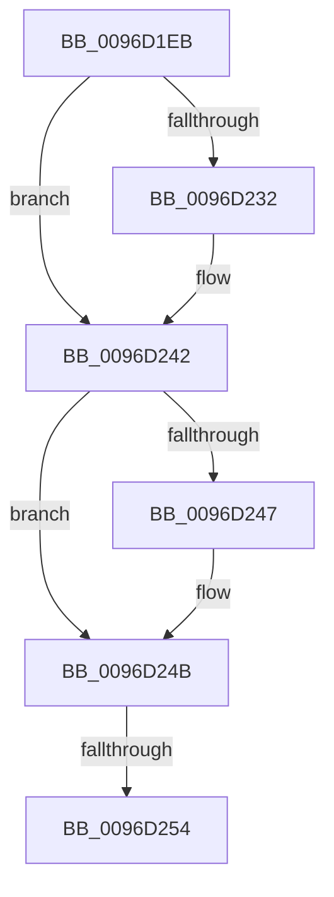

# sub_0096D1EB

- RVA: `0x0096D1EB`–`0x0096D265` (길이 `122` bytes)
- VA: `0x000000014096D1EB`
- 실행 섹션: `PAGE`
- PDB 이름 있음: `아니요`; PDB Function 태그: `아니요`
- unwind 정보 RVA: `0x00095D3C`
- 디코드: `33`개 명령, `122/122` bytes 표시
- 미해석 바이트: `0` (있으면 어셈블리에 `.byte`로 보존)

> 이 문서는 커널 이미지의 기계어와 PDB 기호를 분석해 생성했습니다. 4번과 5번은 함수 원형과 자료형을 바이너리 사용 방식에서 추정한 C 해석이며 원본 소스 복구 결과는 아닙니다.

## 1. Dependencies

- 직접 호출 지점: **3**; 고유 호출 대상: **3**
- 직접 호출자로 확인된 함수: **0**
- RIP 상대 이미지 참조: **0**

### Outgoing calls
- `0x0096D1FA` → [PsGetCurrentServerSiloGlobals](../../text/2F/PsGetCurrentServerSiloGlobals_function_002FE1F0.md) (function, `0x002FE1F0`)
- `0x0096D21C` → [KeAbPreAcquire](../../text/21/KeAbPreAcquire_function_00210230.md) (function, `0x00210230`)
- `0x0096D23D` → [ExfAcquirePushLockSharedEx](../../text/21/ExfAcquirePushLockSharedEx_function_0021044C.md) (function, `0x0021044C`)

### Direct callers
- 이 함수 시작 RVA로 연결되는 직접 call은 확인되지 않았습니다. 간접 호출은 완전히 역산할 수 없습니다.

### Static image references
- 디코드된 RIP-relative 메모리 참조가 없습니다.

## 2. Other-region calls and transfers

- 다른 실행 섹션으로 향하는 call: **3**
  - `0x0096D1FA` → [PsGetCurrentServerSiloGlobals](../../text/2F/PsGetCurrentServerSiloGlobals_function_002FE1F0.md) (`PAGE` → `.text`)
  - `0x0096D21C` → [KeAbPreAcquire](../../text/21/KeAbPreAcquire_function_00210230.md) (`PAGE` → `.text`)
  - `0x0096D23D` → [ExfAcquirePushLockSharedEx](../../text/21/ExfAcquirePushLockSharedEx_function_0021044C.md) (`PAGE` → `.text`)
- call이 아닌 외부 분기/꼬리 이동: **2**
  - `0x0096D252` → [sub_0096D28E](Unknown_function_0096D28E.md) (`tail-transfer`)
  - `0x0096D263` → [sub_0096D265 + 0x8](Unknown_function_0096D265.md) (`tail-transfer`)

## 3. Assembly (complete function range)

```asm
0096D1EB  48 89 6C 24 38                  mov qword ptr [rsp + 0x38], rbp
0096D1F0  48 89 74 24 40                  mov qword ptr [rsp + 0x40], rsi
0096D1F5  48 89 7C 24 48                  mov qword ptr [rsp + 0x48], rdi
0096D1FA  E8 F1 0F 99 FF                  call 0x1402fe1f0
0096D1FF  65 48 8B 0C 25 88 01 00 00      mov rcx, qword ptr gs:[0x188]
0096D208  45 33 C0                        xor r8d, r8d
0096D20B  33 D2                           xor edx, edx
0096D20D  48 8D 70 78                     lea rsi, [rax + 0x78]
0096D211  66 FF 89 E6 01 00 00            dec word ptr [rcx + 0x1e6]
0096D218  48 8B CE                        mov rcx, rsi
0096D21B  90                              nop
0096D21C  E8 0F 30 8A FF                  call 0x140210230
0096D221  48 8B F8                        mov rdi, rax
0096D224  BD 11 00 00 00                  mov ebp, 0x11
0096D229  33 C0                           xor eax, eax
0096D22B  F0 48 0F B1 2E                  lock cmpxchg qword ptr [rsi], rbp
0096D230  74 10                           je 0x14096d242
0096D232  4C 8B CE                        mov r9, rsi
0096D235  4C 8B C7                        mov r8, rdi
0096D238  33 D2                           xor edx, edx
0096D23A  48 8B CE                        mov rcx, rsi
0096D23D  E8 0A 32 8A FF                  call 0x14021044c
0096D242  48 85 FF                        test rdi, rdi
0096D245  74 04                           je 0x14096d24b
0096D247  C6 47 0A 01                     mov byte ptr [rdi + 0xa], 1
0096D24B  48 8B 3B                        mov rdi, qword ptr [rbx]
0096D24E  48 83 E7 F0                     and rdi, 0xfffffffffffffff0
0096D252  75 3A                           jne 0x14096d28e
0096D254  48 8B C5                        mov rax, rbp
0096D257  33 C9                           xor ecx, ecx
0096D259  48 8B 6C 24 38                  mov rbp, qword ptr [rsp + 0x38]
0096D25E  F0 48 0F B1 0E                  lock cmpxchg qword ptr [rsi], rcx
0096D263  74 08                           je 0x14096d26d
```

## 4. C-style interpretation (structured pseudocode)

```c
__int64 __fastcall sub_0096D1EB(__int64 a1, int a2, int a3, __int64 a4, __int64 a5, __int64 a6, __int64 a7)
{
    __int64 result;
    __int64 v_rdi;
    unsigned __int64 v_stack_p38;
    unsigned __int64 v_stack_p40;
    unsigned __int64 v_stack_p48;

    v_stack_p38 = v_rbp;
    v_stack_p40 = v_rsi;
    v_stack_p48 = v_rdi;
    result = PsGetCurrentServerSiloGlobals(a1, a2, a3, a4);
    a3 = 0;
    a2 = 0;
    result = KeAbPreAcquire(result + 120, a2, a3, a4);
    result = 0;
    if (!(condition_is_equal)) {
        a4 = result + 120;
        a3 = 0;
        a2 = 0;
        a1 = result + 120;
        result = ExfAcquirePushLockSharedEx(a1, a2, a3, a4);
    }
    if (result != 0) {
        *(unsigned __int8 *)(result + 10) = 1;
    }
    v_rdi = (*(unsigned __int64 *)(v_rbx)) & (-16);
    a1 = 0;
}
```

## 5. (Beta) C Style

```c
int64_t sub_0096D1EB(int64_t Arg1, int32_t Arg2, int32_t Arg3, int64_t Arg4, uint64_t Arg5, uint64_t Arg6, int64_t Arg7)
{
    int64_t result;
    int64_t local_rdi;
    uint64_t v_stack_p38;
    uint64_t v_stack_p40;
    uint64_t v_stack_p48;

    v_stack_p38 = local_rbp;
    v_stack_p40 = local_rsi;
    v_stack_p48 = local_rdi;
    result = PsGetCurrentServerSiloGlobals(Arg1, Arg2, Arg3, Arg4);
    Arg3 = 0;
    Arg2 = 0;
    result = KeAbPreAcquire(result + 120, Arg2, Arg3, Arg4);
    result = 0;
    if (!(condition_is_equal)) {
        Arg4 = result + 120;
        Arg3 = 0;
        Arg2 = 0;
        Arg1 = result + 120;
        result = ExfAcquirePushLockSharedEx(Arg1, Arg2, Arg3, Arg4);
    }
    if (result != 0) {
        *(uint8_t *)(result + 0xA) = 1;
    }
    local_rdi = (*(uint64_t *)(local_rbx)) & (-16);
    Arg1 = 0;
}
```

## 6. Execution-region graph

[열기: 2D/3D 그래프와 함수 탐색 컨트롤 패널](../../../control-panel.html?section=page&rva=0x0096D1EB&view=graph)

- 2D 그래프는 위에서 아래로 흐르고, 3D 그래프는 빈 공간을 드래그해 회전합니다. Shift+드래그는 이동, 휠은 확대·축소, 함수 노드 선택은 대상 보고서 이동입니다.

### Static fallback


