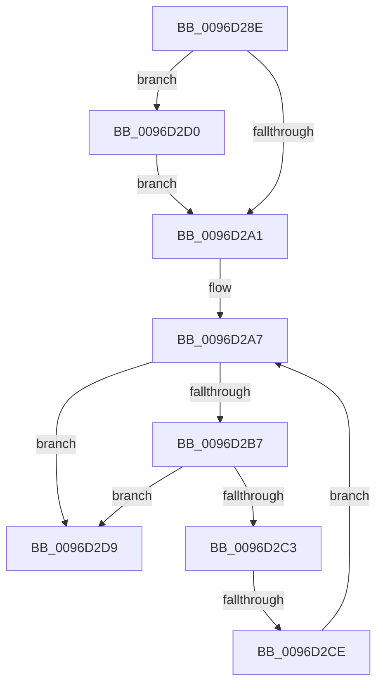

# sub_0096D28E

- RVA: `0x0096D28E`–`0x0096D2EB` (길이 `93` bytes)
- VA: `0x000000014096D28E`
- 실행 섹션: `PAGE`
- PDB 이름 있음: `아니요`; PDB Function 태그: `아니요`
- unwind 정보 RVA: `0x00095D84`
- 디코드: `26`개 명령, `93/93` bytes 표시
- 미해석 바이트: `0` (있으면 어셈블리에 `.byte`로 보존)

> 이 문서는 커널 이미지의 기계어와 PDB 기호를 분석해 생성했습니다. 4번과 5번은 함수 원형과 자료형을 바이너리 사용 방식에서 추정한 C 해석이며 원본 소스 복구 결과는 아닙니다.

## 1. Dependencies

- 직접 호출 지점: **1**; 고유 호출 대상: **1**
- 직접 호출자로 확인된 함수: **0**
- RIP 상대 이미지 참조: **0**

### Outgoing calls
- `0x0096D2E1` → [ObDereferenceDeviceMap](ObDereferenceDeviceMap_function_0096D0E8.md) (function, `0x0096D0E8`)

### Direct callers
- 이 함수 시작 RVA로 연결되는 직접 call은 확인되지 않았습니다. 간접 호출은 완전히 역산할 수 없습니다.

### Static image references
- 디코드된 RIP-relative 메모리 참조가 없습니다.

## 2. Other-region calls and transfers

- 다른 실행 섹션으로 향하는 call: **0**
- call이 아닌 외부 분기/꼬리 이동: **2**
  - `0x0096D2CC` → [sub_0096D1EB + 0x69](Unknown_function_0096D1EB.md) (`tail-transfer`)
  - `0x0096D2E6` → [sub_0096D1EB + 0x69](Unknown_function_0096D1EB.md) (`tail-transfer`)

## 3. Assembly (complete function range)

```asm
0096D28E  B8 0F 00 00 00                  mov eax, 0xf
0096D293  F0 48 0F C1 87 F0 00 00 00      lock xadd qword ptr [rdi + 0xf0], rax
0096D29C  48 85 C0                        test rax, rax
0096D29F  7E 2F                           jle 0x14096d2d0
0096D2A1  0F 0D 0B                        prefetchw byte ptr [rbx]
0096D2A4  48 8B 03                        mov rax, qword ptr [rbx]
0096D2A7  48 8B C8                        mov rcx, rax
0096D2AA  83 E1 0F                        and ecx, 0xf
0096D2AD  48 83 C1 0E                     add rcx, 0xe
0096D2B1  48 83 F9 0F                     cmp rcx, 0xf
0096D2B5  77 22                           ja 0x14096d2d9
0096D2B7  48 8B C8                        mov rcx, rax
0096D2BA  48 83 E1 F0                     and rcx, 0xfffffffffffffff0
0096D2BE  48 3B F9                        cmp rdi, rcx
0096D2C1  75 16                           jne 0x14096d2d9
0096D2C3  48 8D 48 0E                     lea rcx, [rax + 0xe]
0096D2C7  F0 48 0F B1 0B                  lock cmpxchg qword ptr [rbx], rcx
0096D2CC  74 86                           je 0x14096d254
0096D2CE  EB D7                           jmp 0x14096d2a7
0096D2D0  B9 0E 00 00 00                  mov ecx, 0xe
0096D2D5  CD 29                           int 0x29
0096D2D7  EB C8                           jmp 0x14096d2a1
0096D2D9  BA 0E 00 00 00                  mov edx, 0xe
0096D2DE  48 8B CF                        mov rcx, rdi
0096D2E1  E8 02 FE FF FF                  call 0x14096d0e8
0096D2E6  E9 69 FF FF FF                  jmp 0x14096d254
```

## 4. C-style interpretation (structured pseudocode)

```c
__int64 __fastcall sub_0096D28E(void)
{
    __int64 result;

    if (condition_is_less_or_equal) goto loc_0096D2D0;
loc_0096D2A1:
loc_0096D2A7:
    a1 = (unsigned int)((*(unsigned __int64 *)(v_rbx)) & (15));
    a1 = (a1) + (14);
    if (a1 > 15) goto loc_0096D2D9;
    a1 = (*(unsigned __int64 *)(v_rbx)) & (-16);
    if (v_rdi != a1) goto loc_0096D2D9;
    goto loc_0096D2A7;
loc_0096D2D0:
    goto loc_0096D2A1;
loc_0096D2D9:
    result = ObDereferenceDeviceMap(v_rdi, 14, a3, a4);
}
```

## 5. (Beta) C Style

```c
void sub_0096D28E(void)
{
    int64_t result;

    if (condition_is_less_or_equal) goto loc_0096D2D0;
loc_0096D2A1:
loc_0096D2A7:
    a1 = (uint32_t)((*(uint64_t *)(local_rbx)) & (15));
    a1 = (a1) + (14);
    if (a1 > 15) goto loc_0096D2D9;
    a1 = (*(uint64_t *)(local_rbx)) & (-16);
    if (local_rdi != a1) goto loc_0096D2D9;
    goto loc_0096D2A7;
loc_0096D2D0:
    goto loc_0096D2A1;
loc_0096D2D9:
    result = ObDereferenceDeviceMap(local_rdi, 14, a3, a4);
}
```

## 6. Execution-region graph

[열기: 2D/3D 그래프와 함수 탐색 컨트롤 패널](../../../control-panel.html?section=page&rva=0x0096D28E&view=graph)

- 2D 그래프는 위에서 아래로 흐르고, 3D 그래프는 빈 공간을 드래그해 회전합니다. Shift+드래그는 이동, 휠은 확대·축소, 함수 노드 선택은 대상 보고서 이동입니다.

### Static fallback


