# sub_0096E9E9

- RVA: `0x0096E9E9`–`0x0096ED41` (길이 `856` bytes)
- VA: `0x000000014096E9E9`
- 실행 섹션: `PAGE`
- PDB 이름 있음: `아니요`; PDB Function 태그: `아니요`
- unwind 정보 RVA: `0x00095ED4`
- 디코드: `210`개 명령, `856/856` bytes 표시
- 미해석 바이트: `0` (있으면 어셈블리에 `.byte`로 보존)

> 이 문서는 커널 이미지의 기계어와 PDB 기호를 분석해 생성했습니다. 4번과 5번은 함수 원형과 자료형을 바이너리 사용 방식에서 추정한 C 해석이며 원본 소스 복구 결과는 아닙니다.

## 1. Dependencies

- 직접 호출 지점: **18**; 고유 호출 대상: **8**
- 직접 호출자로 확인된 함수: **0**
- RIP 상대 이미지 참조: **0**

### Outgoing calls
- `0x0096EA71` → [CmpCheckKey](CmpCheckKey_function_0096EE2C.md) (function, `0x0096EE2C`)
- `0x0096EAA8` → [CmpCheckLexicographicalOrder](../97/CmpCheckLexicographicalOrder_function_00970B90.md) (function, `0x00970B90`)
- `0x0096EAD3` → [HvpGetCellFlat](../85/HvpGetCellFlat_function_00854C60.md) (function, `0x00854C60`)
- `0x0096EB14` → [HvpGetCellFlat](../85/HvpGetCellFlat_function_00854C60.md) (function, `0x00854C60`)
- `0x0096EB72` → [HvpReleaseCellPaged](../85/HvpReleaseCellPaged_function_00855F40.md) (function, `0x00855F40`)
- `0x0096EBD5` → [HvpReleaseCellPaged](../85/HvpReleaseCellPaged_function_00855F40.md) (function, `0x00855F40`)
- `0x0096EBEA` → [HvpGetCellPaged](../85/HvpGetCellPaged_function_00854CB0.md) (function, `0x00854CB0`)
- `0x0096EC34` → [HvpGetCellFlat](../85/HvpGetCellFlat_function_00854C60.md) (function, `0x00854C60`)
- `0x0096EC5A` → [HvpReleaseCellPaged](../85/HvpReleaseCellPaged_function_00855F40.md) (function, `0x00855F40`)
- `0x0096EC64` → [HvpGetCellPaged](../85/HvpGetCellPaged_function_00854CB0.md) (function, `0x00854CB0`)
- `0x0096EC6B` → [HvpGetCellPaged](../85/HvpGetCellPaged_function_00854CB0.md) (function, `0x00854CB0`)
- `0x0096ECA1` → [HvpReleaseCellPaged](../85/HvpReleaseCellPaged_function_00855F40.md) (function, `0x00855F40`)
- `0x0096ECB5` → [HvpReleaseCellFlat](../85/HvpReleaseCellFlat_function_0085CC20.md) (function, `0x0085CC20`)
- `0x0096ECC2` → [HvpReleaseCellFlat](../85/HvpReleaseCellFlat_function_0085CC20.md) (function, `0x0085CC20`)
- `0x0096ECD7` → [HvpReleaseCellFlat](../85/HvpReleaseCellFlat_function_0085CC20.md) (function, `0x0085CC20`)
- `0x0096ECF0` → [HvpReleaseCellFlat](../85/HvpReleaseCellFlat_function_0085CC20.md) (function, `0x0085CC20`)
- `0x0096ED03` → [CmpCheckAndFixSecurityCellsRefcount](CmpCheckAndFixSecurityCellsRefcount_function_0096E7FC.md) (function, `0x0096E7FC`)
- `0x0096ED2A` → [guard_dispatch_icall](../../text/6B/guard_dispatch_icall_function_006BAAD0.md) (function, `0x006BAAD0`)

### Direct callers
- 이 함수 시작 RVA로 연결되는 직접 call은 확인되지 않았습니다. 간접 호출은 완전히 역산할 수 없습니다.

### Static image references
- 디코드된 RIP-relative 메모리 참조가 없습니다.

## 2. Other-region calls and transfers

- 다른 실행 섹션으로 향하는 call: **1**
  - `0x0096ED2A` → [guard_dispatch_icall](../../text/6B/guard_dispatch_icall_function_006BAAD0.md) (`PAGE` → `.text`)
- call이 아닌 외부 분기/꼬리 이동: **9**
  - `0x0096EA7D` → [sub_0096EDB2](Unknown_function_0096EDB2.md) (`tail-transfer`)
  - `0x0096EA85` → [sub_0096EDB2 + 0x21](Unknown_function_0096EDB2.md) (`tail-transfer`)
  - `0x0096EAB1` → [sub_0096ED4F](Unknown_function_0096ED4F.md) (`tail-transfer`)
  - `0x0096EADB` → [sub_0096ED4F + 0x33](Unknown_function_0096ED4F.md) (`tail-transfer`)
  - `0x0096EB1F` → [sub_0096EDB2 + 0x5F](Unknown_function_0096EDB2.md) (`tail-transfer`)
  - `0x0096EB7A` → [sub_0096EDB2 + 0x53](Unknown_function_0096EDB2.md) (`tail-transfer`)
  - `0x0096EBA0` → [sub_0096EDB2 + 0x41](Unknown_function_0096EDB2.md) (`tail-transfer`)
  - `0x0096ED0C` → [sub_0096ED4F + 0x29](Unknown_function_0096ED4F.md) (`tail-transfer`)
  - `0x0096ED16` → [sub_0096EDB2 + 0x69](Unknown_function_0096EDB2.md) (`tail-transfer`)

## 3. Assembly (complete function range)

```asm
0096E9E9  4C 89 A4 24 B0 00 00 00         mov qword ptr [rsp + 0xb0], r12
0096E9F1  4C 89 6C 24 68                  mov qword ptr [rsp + 0x68], r13
0096E9F6  4C 89 74 24 60                  mov qword ptr [rsp + 0x60], r14
0096E9FB  48 85 D2                        test rdx, rdx
0096E9FE  74 07                           je 0x14096ea07
0096EA00  48 89 82 E8 00 00 00            mov qword ptr [rdx + 0xe8], rax
0096EA07  48 8B 4D 68                     mov rcx, qword ptr [rbp + 0x68]
0096EA0B  4C 8D 68 EC                     lea r13, [rax - 0x14]
0096EA0F  89 18                           mov dword ptr [rax], ebx
0096EA11  45 8B F7                        mov r14d, r15d
0096EA14  48 C7 40 04 FF FF FF FF         mov qword ptr [rax + 4], 0xffffffffffffffff
0096EA1C  4D 8B E7                        mov r12, r15
0096EA1F  44 89 78 0C                     mov dword ptr [rax + 0xc], r15d
0096EA23  48 8B D8                        mov rbx, rax
0096EA26  44 89 39                        mov dword ptr [rcx], r15d
0096EA29  44 88 78 10                     mov byte ptr [rax + 0x10], r15b
0096EA2D  44 89 7D 30                     mov dword ptr [rbp + 0x30], r15d
0096EA31  4D 85 E4                        test r12, r12
0096EA34  0F 88 C0 02 00 00               js 0x14096ecfa
0096EA3A  80 7B 10 00                     cmp byte ptr [rbx + 0x10], 0
0096EA3E  75 7D                           jne 0x14096eabd
0096EA40  8B 01                           mov eax, dword ptr [rcx]
0096EA42  C6 43 10 01                     mov byte ptr [rbx + 0x10], 1
0096EA46  83 F8 FF                        cmp eax, -1
0096EA49  73 04                           jae 0x14096ea4f
0096EA4B  FF C0                           inc eax
0096EA4D  89 01                           mov dword ptr [rcx], eax
0096EA4F  48 8B 45 58                     mov rax, qword ptr [rbp + 0x58]
0096EA53  48 8B CE                        mov rcx, rsi
0096EA56  44 8B 4B 04                     mov r9d, dword ptr [rbx + 4]
0096EA5A  44 8B 03                        mov r8d, dword ptr [rbx]
0096EA5D  48 89 54 24 30                  mov qword ptr [rsp + 0x30], rdx
0096EA62  8B D7                           mov edx, edi
0096EA64  48 89 44 24 28                  mov qword ptr [rsp + 0x28], rax
0096EA69  0F B6 45 50                     movzx eax, byte ptr [rbp + 0x50]
0096EA6D  88 44 24 20                     mov byte ptr [rsp + 0x20], al
0096EA71  E8 B6 03 00 00                  call 0x14096ee2c
0096EA76  8B F8                           mov edi, eax
0096EA78  3D 2A 00 00 80                  cmp eax, 0x8000002a
0096EA7D  0F 84 2F 03 00 00               je 0x14096edb2
0096EA83  85 C0                           test eax, eax
0096EA85  0F 88 48 03 00 00               js 0x14096edd3
0096EA8B  F7 45 38 00 00 10 00            test dword ptr [rbp + 0x38], 0x100000
0096EA92  74 29                           je 0x14096eabd
0096EA94  4D 85 E4                        test r12, r12
0096EA97  7E 24                           jle 0x14096eabd
0096EA99  41 8B 55 08                     mov edx, dword ptr [r13 + 8]
0096EA9D  83 FA FF                        cmp edx, -1
0096EAA0  74 15                           je 0x14096eab7
0096EAA2  44 8B 03                        mov r8d, dword ptr [rbx]
0096EAA5  48 8B CE                        mov rcx, rsi
0096EAA8  E8 E3 20 00 00                  call 0x140970b90
0096EAAD  8B F8                           mov edi, eax
0096EAAF  85 C0                           test eax, eax
0096EAB1  0F 88 98 02 00 00               js 0x14096ed4f
0096EAB7  8B 03                           mov eax, dword ptr [rbx]
0096EAB9  41 89 45 08                     mov dword ptr [r13 + 8], eax
0096EABD  F6 86 8C 00 00 00 01            test byte ptr [rsi + 0x8c], 1
0096EAC4  4C 8D 45 E0                     lea r8, [rbp - 0x20]
0096EAC8  8B 13                           mov edx, dword ptr [rbx]
0096EACA  48 8B CE                        mov rcx, rsi
0096EACD  0F 84 17 01 00 00               je 0x14096ebea
0096EAD3  E8 88 61 EE FF                  call 0x140854c60
0096EAD8  48 85 C0                        test rax, rax
0096EADB  0F 84 A1 02 00 00               je 0x14096ed82
0096EAE1  44 8B 7B 0C                     mov r15d, dword ptr [rbx + 0xc]
0096EAE5  44 3B 78 14                     cmp r15d, dword ptr [rax + 0x14]
0096EAE9  0F 83 05 01 00 00               jae 0x14096ebf4
0096EAEF  8B 50 1C                        mov edx, dword ptr [rax + 0x1c]
0096EAF2  4C 8D 45 E8                     lea r8, [rbp - 0x18]
0096EAF6  45 33 F6                        xor r14d, r14d
0096EAF9  C7 45 E8 FF FF FF FF            mov dword ptr [rbp - 0x18], 0xffffffff
0096EB00  F6 86 8C 00 00 00 01            test byte ptr [rsi + 0x8c], 1
0096EB07  48 8B CE                        mov rcx, rsi
0096EB0A  44 89 75 EC                     mov dword ptr [rbp - 0x14], r14d
0096EB0E  0F 84 57 01 00 00               je 0x14096ec6b
0096EB14  E8 47 61 EE FF                  call 0x140854c60
0096EB19  48 8B F8                        mov rdi, rax
0096EB1C  48 85 C0                        test rax, rax
0096EB1F  0F 84 EC 02 00 00               je 0x14096ee11
0096EB25  B8 72 69 00 00                  mov eax, 0x6972
0096EB2A  C7 45 D0 FF FF FF FF            mov dword ptr [rbp - 0x30], 0xffffffff
0096EB31  44 89 75 D4                     mov dword ptr [rbp - 0x2c], r14d
0096EB35  66 39 07                        cmp word ptr [rdi], ax
0096EB38  0F 84 D2 00 00 00               je 0x14096ec10
0096EB3E  0F B7 07                        movzx eax, word ptr [rdi]
0096EB41  B9 6C 66 00 00                  mov ecx, 0x666c
0096EB46  66 2B C1                        sub ax, cx
0096EB49  B9 FF FD 00 00                  mov ecx, 0xfdff
0096EB4E  66 85 C1                        test cx, ax
0096EB51  41 8B C7                        mov eax, r15d
0096EB54  0F 85 8D 01 00 00               jne 0x14096ece7
0096EB5A  8B 7C C7 04                     mov edi, dword ptr [rdi + rax*8 + 4]
0096EB5E  F6 86 8C 00 00 00 01            test byte ptr [rsi + 0x8c], 1
0096EB65  48 8D 55 E8                     lea rdx, [rbp - 0x18]
0096EB69  48 8B CE                        mov rcx, rsi
0096EB6C  0F 85 65 01 00 00               jne 0x14096ecd7
0096EB72  E8 C9 73 EE FF                  call 0x140855f40
0096EB77  83 FF FF                        cmp edi, -1
0096EB7A  0F 84 85 02 00 00               je 0x14096ee05
0096EB80  44 8B 75 30                     mov r14d, dword ptr [rbp + 0x30]
0096EB84  49 FF C4                        inc r12
0096EB87  FF 43 0C                        inc dword ptr [rbx + 0xc]
0096EB8A  41 FF C6                        inc r14d
0096EB8D  49 83 C5 14                     add r13, 0x14
0096EB91  44 89 75 30                     mov dword ptr [rbp + 0x30], r14d
0096EB95  48 83 C3 14                     add rbx, 0x14
0096EB99  49 81 FC 00 02 00 00            cmp r12, 0x200
0096EBA0  0F 84 4D 02 00 00               je 0x14096edf3
0096EBA6  41 8B 45 00                     mov eax, dword ptr [r13]
0096EBAA  89 43 04                        mov dword ptr [rbx + 4], eax
0096EBAD  89 3B                           mov dword ptr [rbx], edi
0096EBAF  C7 43 08 FF FF FF FF            mov dword ptr [rbx + 8], 0xffffffff
0096EBB6  C7 43 0C 00 00 00 00            mov dword ptr [rbx + 0xc], 0
0096EBBD  C6 43 10 00                     mov byte ptr [rbx + 0x10], 0
0096EBC1  F6 86 8C 00 00 00 01            test byte ptr [rsi + 0x8c], 1
0096EBC8  48 8D 55 E0                     lea rdx, [rbp - 0x20]
0096EBCC  48 8B CE                        mov rcx, rsi
0096EBCF  0F 85 ED 00 00 00               jne 0x14096ecc2
0096EBD5  E8 66 73 EE FF                  call 0x140855f40
0096EBDA  48 8B 4D 68                     mov rcx, qword ptr [rbp + 0x68]
0096EBDE  48 8B 55 60                     mov rdx, qword ptr [rbp + 0x60]
0096EBE2  8B 7D 38                        mov edi, dword ptr [rbp + 0x38]
0096EBE5  E9 47 FE FF FF                  jmp 0x14096ea31
0096EBEA  E8 C1 60 EE FF                  call 0x140854cb0
0096EBEF  E9 E4 FE FF FF                  jmp 0x14096ead8
0096EBF4  41 FF CE                        dec r14d
0096EBF7  49 FF CC                        dec r12
0096EBFA  49 83 ED 14                     sub r13, 0x14
0096EBFE  44 89 75 30                     mov dword ptr [rbp + 0x30], r14d
0096EC02  48 83 EB 14                     sub rbx, 0x14
0096EC06  EB B9                           jmp 0x14096ebc1
0096EC08  0F 1F 84 00 00 00 00 00         nop dword ptr [rax + rax]
0096EC10  0F B7 47 02                     movzx eax, word ptr [rdi + 2]
0096EC14  44 3B F0                        cmp r14d, eax
0096EC17  0F 83 21 FF FF FF               jae 0x14096eb3e
0096EC1D  F6 86 8C 00 00 00 01            test byte ptr [rsi + 0x8c], 1
0096EC24  4C 8D 45 D0                     lea r8, [rbp - 0x30]
0096EC28  41 8B C6                        mov eax, r14d
0096EC2B  48 8B CE                        mov rcx, rsi
0096EC2E  8B 54 87 04                     mov edx, dword ptr [rdi + rax*4 + 4]
0096EC32  74 30                           je 0x14096ec64
0096EC34  E8 27 60 EE FF                  call 0x140854c60
0096EC39  48 85 C0                        test rax, rax
0096EC3C  74 6D                           je 0x14096ecab
0096EC3E  0F B7 48 02                     movzx ecx, word ptr [rax + 2]
0096EC42  44 3B F9                        cmp r15d, ecx
0096EC45  72 2E                           jb 0x14096ec75
0096EC47  44 2B F9                        sub r15d, ecx
0096EC4A  48 8D 55 D0                     lea rdx, [rbp - 0x30]
0096EC4E  F6 86 8C 00 00 00 01            test byte ptr [rsi + 0x8c], 1
0096EC55  48 8B CE                        mov rcx, rsi
0096EC58  75 5B                           jne 0x14096ecb5
0096EC5A  E8 E1 72 EE FF                  call 0x140855f40
0096EC5F  41 FF C6                        inc r14d
0096EC62  EB AC                           jmp 0x14096ec10
0096EC64  E8 47 60 EE FF                  call 0x140854cb0
0096EC69  EB CE                           jmp 0x14096ec39
0096EC6B  E8 40 60 EE FF                  call 0x140854cb0
0096EC70  E9 A4 FE FF FF                  jmp 0x14096eb19
0096EC75  0F B7 08                        movzx ecx, word ptr [rax]
0096EC78  BA 6C 66 00 00                  mov edx, 0x666c
0096EC7D  66 2B CA                        sub cx, dx
0096EC80  BA FF FD 00 00                  mov edx, 0xfdff
0096EC85  66 85 CA                        test dx, cx
0096EC88  41 8B CF                        mov ecx, r15d
0096EC8B  48 8D 55 D0                     lea rdx, [rbp - 0x30]
0096EC8F  75 50                           jne 0x14096ece1
0096EC91  8B 7C C8 04                     mov edi, dword ptr [rax + rcx*8 + 4]
0096EC95  F6 86 8C 00 00 00 01            test byte ptr [rsi + 0x8c], 1
0096EC9C  48 8B CE                        mov rcx, rsi
0096EC9F  75 4F                           jne 0x14096ecf0
0096ECA1  E8 9A 72 EE FF                  call 0x140855f40
0096ECA6  E9 B3 FE FF FF                  jmp 0x14096eb5e
0096ECAB  BF FF FF FF FF                  mov edi, 0xffffffff
0096ECB0  E9 A9 FE FF FF                  jmp 0x14096eb5e
0096ECB5  E8 66 DF EE FF                  call 0x14085cc20
0096ECBA  41 FF C6                        inc r14d
0096ECBD  E9 4E FF FF FF                  jmp 0x14096ec10
0096ECC2  E8 59 DF EE FF                  call 0x14085cc20
0096ECC7  48 8B 4D 68                     mov rcx, qword ptr [rbp + 0x68]
0096ECCB  48 8B 55 60                     mov rdx, qword ptr [rbp + 0x60]
0096ECCF  8B 7D 38                        mov edi, dword ptr [rbp + 0x38]
0096ECD2  E9 5A FD FF FF                  jmp 0x14096ea31
0096ECD7  E8 44 DF EE FF                  call 0x14085cc20
0096ECDC  E9 96 FE FF FF                  jmp 0x14096eb77
0096ECE1  8B 7C 88 04                     mov edi, dword ptr [rax + rcx*4 + 4]
0096ECE5  EB AE                           jmp 0x14096ec95
0096ECE7  8B 7C 87 04                     mov edi, dword ptr [rdi + rax*4 + 4]
0096ECEB  E9 6E FE FF FF                  jmp 0x14096eb5e
0096ECF0  E8 2B DF EE FF                  call 0x14085cc20
0096ECF5  E9 64 FE FF FF                  jmp 0x14096eb5e
0096ECFA  0F BA E7 11                     bt edi, 0x11
0096ECFE  72 0E                           jb 0x14096ed0e
0096ED00  48 8B CE                        mov rcx, rsi
0096ED03  E8 F4 FA FF FF                  call 0x14096e7fc
0096ED08  8B F8                           mov edi, eax
0096ED0A  85 C0                           test eax, eax
0096ED0C  78 6A                           js 0x14096ed78
0096ED0E  80 7D 48 00                     cmp byte ptr [rbp + 0x48], 0
0096ED12  4C 8B 75 D8                     mov r14, qword ptr [rbp - 0x28]
0096ED16  0F 85 FF 00 00 00               jne 0x14096ee1b
0096ED1C  33 FF                           xor edi, edi
0096ED1E  48 8B 46 20                     mov rax, qword ptr [rsi + 0x20]
0096ED22  BA 00 28 00 00                  mov edx, 0x2800
0096ED27  49 8B CE                        mov rcx, r14
0096ED2A  E8 A1 BD D4 FF                  call 0x1406baad0
0096ED2F  4C 8B 74 24 60                  mov r14, qword ptr [rsp + 0x60]
0096ED34  4C 8B 6C 24 68                  mov r13, qword ptr [rsp + 0x68]
0096ED39  4C 8B A4 24 B0 00 00 00         mov r12, qword ptr [rsp + 0xb0]
```

## 4. C-style interpretation (structured pseudocode)

```c
__int64 __fastcall sub_0096E9E9(__int64 a1, __int64 a2, __int64 a3, __int64 a4, __int64 a5, __int64 a6, __int64 a7, __int64 a8, __int64 a9, __int64 a10, __int64 a11, __int64 a12, __int64 a13, __int64 a14, __int64 a15, __int64 a16, __int64 a17, __int64 a18, __int64 a19, __int64 a20, __int64 a21, __int64 a22)
{
    __int64 result;
    __int64 v_r12;
    __int64 v_r13;
    __int64 v_r14;
    __int64 v_r15;
    __int64 v_rbx;
    __int64 v_rdi;
    unsigned __int8 v_stack_p20;
    unsigned __int64 v_stack_p28;
    unsigned __int64 v_stack_p30;
    unsigned __int64 v_stack_p60;
    unsigned __int64 v_stack_p68;
    unsigned __int64 v_stack_pB0;

    v_stack_pB0 = v_r12;
    v_stack_p68 = v_r13;
    v_stack_p60 = v_r14;
    if (a2 != 0) {
        *(unsigned __int64 *)(a2 + 232) = result;
    }
    *(unsigned int *)(result) = (unsigned int)(v_rbx);
    *(unsigned __int64 *)(result + 4) = -1;
    *(unsigned int *)(result + 12) = (unsigned int)(v_r15);
    *(unsigned int *)(*(unsigned __int64 *)(v_rbp + 104)) = (unsigned int)(v_r15);
    *(unsigned __int8 *)(result + 16) = (unsigned __int8)(v_r15);
    *(unsigned int *)(v_rbp + 48) = (unsigned int)(v_r15);
loc_0096EA31:
    if (sign_flag) goto loc_0096ECFA;
    if ((*(unsigned __int8 *)(result + 16)) != 0) goto loc_0096EABD;
    *(unsigned __int8 *)(result + 16) = 1;
    result = (unsigned int)(*(unsigned int *)(*(unsigned __int64 *)(v_rbp + 104)));
    if (((unsigned int)((unsigned int)(*(unsigned int *)(*(unsigned __int64 *)(v_rbp + 104))))) < -1) {
        result = (unsigned int)(((unsigned int)(*(unsigned int *)(*(unsigned __int64 *)(v_rbp + 104)))) + 1);
        *(unsigned int *)(*(unsigned __int64 *)(v_rbp + 104)) = (unsigned int)(result);
    }
    v_stack_p30 = a2;
    v_stack_p28 = *(unsigned __int64 *)(v_rbp + 88);
    v_stack_p20 = (unsigned __int8)(*(unsigned __int8 *)(v_rbp + 80));
    result = CmpCheckKey(v_rsi, (unsigned int)((unsigned int)(v_rdi)), (unsigned int)(*(unsigned int *)(result)), (unsigned int)(*(unsigned int *)(result + 4)));
    if (((*(unsigned int *)(v_rbp + 56)) & (0x100000ULL)) == 0) goto loc_0096EABD;
    if (condition_is_less_or_equal) goto loc_0096EABD;
    if (((unsigned int)((unsigned int)(*(unsigned int *)(result - 20 + 8)))) == -1) goto loc_0096EAB7;
    result = CmpCheckLexicographicalOrder(v_rsi, (unsigned int)(*(unsigned int *)(result - 20 + 8)), (unsigned int)(*(unsigned int *)(result)), (unsigned int)(*(unsigned int *)(result + 4)));
loc_0096EAB7:
    *(unsigned int *)(result - 20 + 8) = (unsigned int)((unsigned int)(*(unsigned int *)(result)));
loc_0096EABD:
    if (((*(unsigned __int8 *)(v_rsi + 140)) & (1)) == 0) goto loc_0096EBEA;
    result = HvpGetCellFlat(v_rsi, (unsigned int)(*(unsigned int *)(result)), v_rbp - 32, (unsigned int)(*(unsigned int *)(result + 4)));
loc_0096EAD8:
    if (((unsigned int)((unsigned int)(*(unsigned int *)(result + 12)))) >= (*(unsigned int *)(result + 20))) goto loc_0096EBF4;
    v_r14 = 0;
    *(unsigned int *)(v_rbp - 24) = 0xFFFFFFFFULL;
    *(unsigned int *)(v_rbp - 20) = 0;
    if (((*(unsigned __int8 *)(v_rsi + 140)) & (1)) == 0) goto loc_0096EC6B;
    result = HvpGetCellFlat(v_rsi, (unsigned int)(*(unsigned int *)(result + 28)), v_rbp - 24, (unsigned int)(*(unsigned int *)(result + 4)));
loc_0096EB19:
    *(unsigned int *)(v_rbp - 48) = 0xFFFFFFFFULL;
    *(unsigned int *)(v_rbp - 44) = 0;
    if ((*(unsigned __int16 *)(result)) == ((unsigned __int16)((unsigned int)(0x6972ULL)))) goto loc_0096EC10;
loc_0096EB3E:
    result = (unsigned __int16)((*(unsigned __int16 *)(result)) - ((unsigned __int16)((unsigned int)(0x666CULL))));
    if ((((unsigned __int16)((unsigned int)(0xFDFFULL))) & ((unsigned __int16)(result))) != 0) goto loc_0096ECE7;
loc_0096EB5E:
    if (((*(unsigned __int8 *)(v_rsi + 140)) & (1)) != 0) goto loc_0096ECD7;
    result = HvpReleaseCellPaged(v_rsi, v_rbp - 24, v_rbp - 24, (unsigned int)(*(unsigned int *)(result + 4)));
loc_0096EB77:
    v_r12 = (v_r15) + 1;
    v_r14 = (unsigned int)(((unsigned int)(*(unsigned int *)(v_rbp + 48))) + 1);
    v_r13 = (result - 20) + (20);
    *(unsigned int *)(v_rbp + 48) = (unsigned int)(v_r14);
    v_rbx = (result) + (20);
    *(unsigned int *)(v_rbx + 4) = (unsigned int)((unsigned int)(*(unsigned int *)(v_r13)));
    *(unsigned int *)(v_rbx) = (unsigned int)((unsigned int)(*(unsigned int *)(result + (unsigned int)((unsigned int)((unsigned int)(*(unsigned int *)(result + 12)))) * 8 + 4)));
    *(unsigned int *)(v_rbx + 8) = 0xFFFFFFFFULL;
    *(unsigned int *)(v_rbx + 12) = 0;
    *(unsigned __int8 *)(v_rbx + 16) = 0;
loc_0096EBC1:
    if (((*(unsigned __int8 *)(v_rsi + 140)) & (1)) != 0) goto loc_0096ECC2;
    result = HvpReleaseCellPaged(v_rsi, v_rbp - 32, v_rbp - 24, (unsigned int)(*(unsigned int *)(result + 4)));
    goto loc_0096EA31;
loc_0096EBEA:
    result = HvpGetCellPaged(*(unsigned __int64 *)(v_rbp + 104), *(unsigned __int64 *)(v_rbp + 96), v_rbp - 24, (unsigned int)(*(unsigned int *)(result + 4)));
    goto loc_0096EAD8;
loc_0096EBF4:
    v_r14 = (unsigned int)((v_r14) - 1);
    v_r12 = (v_r12) - 1;
    v_r13 = (v_r13) - (20);
    *(unsigned int *)(v_rbp + 48) = (unsigned int)(v_r14);
    v_rbx = (v_rbx) - (20);
    goto loc_0096EBC1;
loc_0096EC10:
    if (((unsigned int)(v_r14)) >= ((unsigned int)(*(unsigned __int16 *)((unsigned int)(*(unsigned int *)(v_rbp + 56)) + 2)))) goto loc_0096EB3E;
    if (((*(unsigned __int8 *)(v_rsi + 140)) & (1)) == 0) goto loc_0096EC64;
    result = HvpGetCellFlat(v_rsi, (unsigned int)(*(unsigned int *)((unsigned int)(*(unsigned int *)(v_rbp + 56)) + (unsigned int)((unsigned int)(v_r14)) * 4 + 4)), v_rbp - 48, (unsigned int)(*(unsigned int *)(result + 4)));
loc_0096EC39:
    if (result == 0) goto loc_0096ECAB;
    if (((unsigned int)((unsigned int)(*(unsigned int *)(result + 12)))) < ((unsigned int)(*(unsigned __int16 *)(result + 2)))) goto loc_0096EC75;
    v_r15 = (unsigned int)(((unsigned int)(*(unsigned int *)(result + 12))) - ((unsigned int)(*(unsigned __int16 *)(result + 2))));
    if (((*(unsigned __int8 *)(v_rsi + 140)) & (1)) != 0) goto loc_0096ECB5;
    result = HvpReleaseCellPaged(v_rsi, v_rbp - 48, v_rbp - 48, (unsigned int)(*(unsigned int *)(result + 4)));
    v_r14 = (unsigned int)((v_r14) + 1);
    goto loc_0096EC10;
loc_0096EC64:
    result = HvpGetCellPaged(v_rsi, v_rbp - 48, v_rbp - 48, (unsigned int)(*(unsigned int *)(result + 4)));
    goto loc_0096EC39;
loc_0096EC6B:
    result = HvpGetCellPaged(v_rsi, v_rbp - 48, v_rbp - 48, (unsigned int)(*(unsigned int *)(result + 4)));
    goto loc_0096EB19;
loc_0096EC75:
    a1 = (unsigned __int16)((*(unsigned __int16 *)(result)) - ((unsigned __int16)((unsigned int)(0x666CULL))));
    if ((((unsigned __int16)((unsigned int)(0xFDFFULL))) & ((unsigned __int16)(a1))) != 0) goto loc_0096ECE1;
loc_0096EC95:
    if (((*(unsigned __int8 *)(v_rsi + 140)) & (1)) != 0) goto loc_0096ECF0;
    result = HvpReleaseCellPaged(v_rsi, v_rbp - 48, v_rbp - 48, (unsigned int)(*(unsigned int *)(result + 4)));
    goto loc_0096EB5E;
loc_0096ECAB:
    goto loc_0096EB5E;
loc_0096ECB5:
    result = HvpReleaseCellFlat(v_rsi, v_rbp - 48, v_rbp - 48, (unsigned int)(*(unsigned int *)(result + 4)));
    v_r14 = (unsigned int)((v_r14) + 1);
    goto loc_0096EC10;
loc_0096ECC2:
    result = HvpReleaseCellFlat(v_rsi, v_rbp - 48, v_rbp - 48, (unsigned int)(*(unsigned int *)(result + 4)));
    goto loc_0096EA31;
loc_0096ECD7:
    result = HvpReleaseCellFlat(*(unsigned __int64 *)(v_rbp + 104), *(unsigned __int64 *)(v_rbp + 96), v_rbp - 48, (unsigned int)(*(unsigned int *)(result + 4)));
    goto loc_0096EB77;
loc_0096ECE1:
    goto loc_0096EC95;
loc_0096ECE7:
    goto loc_0096EB5E;
loc_0096ECF0:
    result = HvpReleaseCellFlat(*(unsigned __int64 *)(v_rbp + 104), *(unsigned __int64 *)(v_rbp + 96), v_rbp - 48, (unsigned int)(*(unsigned int *)(result + 4)));
    goto loc_0096EB5E;
loc_0096ECFA:
    if (condition_is_below) goto loc_0096ED0E;
    result = CmpCheckAndFixSecurityCellsRefcount(v_rsi, *(unsigned __int64 *)(v_rbp + 96), v_rbp - 48, (unsigned int)(*(unsigned int *)(result + 4)));
loc_0096ED0E:
    v_rdi = 0;
    result = guard_dispatch_icall(*(unsigned __int64 *)(v_rbp - 40), (unsigned int)(0x2800ULL), v_rbp - 48, (unsigned int)(*(unsigned int *)(result + 4)));
    return result;
}
```

## 5. (Beta) C Style

```c
int64_t sub_0096E9E9(int64_t Arg1, int64_t Arg2, int64_t Arg3, int64_t Arg4, uint64_t Arg5, uint64_t Arg6, uint64_t Arg7, uint64_t Arg8, uint64_t Arg9, uint64_t Arg10, uint64_t Arg11, int64_t Arg12, int64_t Arg13, uint64_t Arg14, uint64_t Arg15, uint64_t Arg16, uint64_t Arg17, uint64_t Arg18, uint64_t Arg19, uint64_t Arg20, uint64_t Arg21, int64_t Arg22)
{
    int64_t result;
    int64_t local_r12;
    int64_t local_r13;
    int64_t local_r14;
    int64_t local_r15;
    int64_t local_rbx;
    int64_t local_rdi;
    uint8_t v_stack_p20;
    uint64_t v_stack_p28;
    uint64_t v_stack_p30;
    uint64_t v_stack_p60;
    uint64_t v_stack_p68;
    uint64_t v_stack_pB0;

    v_stack_pB0 = local_r12;
    v_stack_p68 = local_r13;
    v_stack_p60 = local_r14;
    if (Arg2 != 0) {
        *(uint64_t *)(Arg2 + 0xE8) = result;
    }
    *(uint32_t *)(result) = (uint32_t)(local_rbx);
    *(uint64_t *)(result + 0x4) = -1;
    *(uint32_t *)(result + 0xC) = (uint32_t)(local_r15);
    *(uint32_t *)(*(uint64_t *)(local_rbp + 0x68)) = (uint32_t)(local_r15);
    *(uint8_t *)(result + 0x10) = (uint8_t)(local_r15);
    *(uint32_t *)(local_rbp + 0x30) = (uint32_t)(local_r15);
loc_0096EA31:
    if (sign_flag) goto loc_0096ECFA;
    if ((*(uint8_t *)(result + 0x10)) != 0) goto loc_0096EABD;
    *(uint8_t *)(result + 0x10) = 1;
    result = (uint32_t)(*(uint32_t *)(*(uint64_t *)(local_rbp + 0x68)));
    if (((uint32_t)((uint32_t)(*(uint32_t *)(*(uint64_t *)(local_rbp + 0x68))))) < -1) {
        result = (uint32_t)(((uint32_t)(*(uint32_t *)(*(uint64_t *)(local_rbp + 0x68)))) + 1);
        *(uint32_t *)(*(uint64_t *)(local_rbp + 0x68)) = (uint32_t)(result);
    }
    v_stack_p30 = Arg2;
    v_stack_p28 = *(uint64_t *)(local_rbp + 0x58);
    v_stack_p20 = (uint8_t)(*(uint8_t *)(local_rbp + 0x50));
    result = CmpCheckKey(local_rsi, (uint32_t)((uint32_t)(local_rdi)), (uint32_t)(*(uint32_t *)(result)), (uint32_t)(*(uint32_t *)(result + 0x4)));
    if (((*(uint32_t *)(local_rbp + 0x38)) & (0x100000ULL)) == 0) goto loc_0096EABD;
    if (condition_is_less_or_equal) goto loc_0096EABD;
    if (((uint32_t)((uint32_t)(*(uint32_t *)(result - 0x14 + 0x8)))) == -1) goto loc_0096EAB7;
    result = CmpCheckLexicographicalOrder(local_rsi, (uint32_t)(*(uint32_t *)(result - 0x14 + 0x8)), (uint32_t)(*(uint32_t *)(result)), (uint32_t)(*(uint32_t *)(result + 0x4)));
loc_0096EAB7:
    *(uint32_t *)(result - 0x14 + 0x8) = (uint32_t)((uint32_t)(*(uint32_t *)(result)));
loc_0096EABD:
    if (((*(uint8_t *)(local_rsi + 0x8C)) & (1)) == 0) goto loc_0096EBEA;
    result = HvpGetCellFlat(local_rsi, (uint32_t)(*(uint32_t *)(result)), local_rbp - 32, (uint32_t)(*(uint32_t *)(result + 0x4)));
loc_0096EAD8:
    if (((uint32_t)((uint32_t)(*(uint32_t *)(result + 0xC)))) >= (*(uint32_t *)(result + 0x14))) goto loc_0096EBF4;
    local_r14 = 0;
    *(uint32_t *)(local_rbp - 0x18) = 0xFFFFFFFFULL;
    *(uint32_t *)(local_rbp - 0x14) = 0;
    if (((*(uint8_t *)(local_rsi + 0x8C)) & (1)) == 0) goto loc_0096EC6B;
    result = HvpGetCellFlat(local_rsi, (uint32_t)(*(uint32_t *)(result + 0x1C)), local_rbp - 24, (uint32_t)(*(uint32_t *)(result + 0x4)));
loc_0096EB19:
    *(uint32_t *)(local_rbp - 0x30) = 0xFFFFFFFFULL;
    *(uint32_t *)(local_rbp - 0x2C) = 0;
    if ((*(uint16_t *)(result)) == ((uint16_t)((uint32_t)(0x6972ULL)))) goto loc_0096EC10;
loc_0096EB3E:
    result = (uint16_t)((*(uint16_t *)(result)) - ((uint16_t)((uint32_t)(0x666CULL))));
    if ((((uint16_t)((uint32_t)(0xFDFFULL))) & ((uint16_t)(result))) != 0) goto loc_0096ECE7;
loc_0096EB5E:
    if (((*(uint8_t *)(local_rsi + 0x8C)) & (1)) != 0) goto loc_0096ECD7;
    result = HvpReleaseCellPaged(local_rsi, local_rbp - 24, local_rbp - 24, (uint32_t)(*(uint32_t *)(result + 0x4)));
loc_0096EB77:
    local_r12 = (local_r15) + 1;
    local_r14 = (uint32_t)(((uint32_t)(*(uint32_t *)(local_rbp + 0x30))) + 1);
    local_r13 = (result - 20) + (20);
    *(uint32_t *)(local_rbp + 0x30) = (uint32_t)(local_r14);
    local_rbx = (result) + (20);
    *(uint32_t *)(local_rbx + 0x4) = (uint32_t)((uint32_t)(*(uint32_t *)(local_r13)));
    *(uint32_t *)(local_rbx) = (uint32_t)((uint32_t)(*(uint32_t *)(result + (uint32_t)((uint32_t)((uint32_t)(*(uint32_t *)(result + 0xC)))) * 8 + 0x4)));
    *(uint32_t *)(local_rbx + 0x8) = 0xFFFFFFFFULL;
    *(uint32_t *)(local_rbx + 0xC) = 0;
    *(uint8_t *)(local_rbx + 0x10) = 0;
loc_0096EBC1:
    if (((*(uint8_t *)(local_rsi + 0x8C)) & (1)) != 0) goto loc_0096ECC2;
    result = HvpReleaseCellPaged(local_rsi, local_rbp - 32, local_rbp - 24, (uint32_t)(*(uint32_t *)(result + 0x4)));
    goto loc_0096EA31;
loc_0096EBEA:
    result = HvpGetCellPaged(*(uint64_t *)(local_rbp + 0x68), *(uint64_t *)(local_rbp + 0x60), local_rbp - 24, (uint32_t)(*(uint32_t *)(result + 0x4)));
    goto loc_0096EAD8;
loc_0096EBF4:
    local_r14 = (uint32_t)((local_r14) - 1);
    local_r12 = (local_r12) - 1;
    local_r13 = (local_r13) - (20);
    *(uint32_t *)(local_rbp + 0x30) = (uint32_t)(local_r14);
    local_rbx = (local_rbx) - (20);
    goto loc_0096EBC1;
loc_0096EC10:
    if (((uint32_t)(local_r14)) >= ((uint32_t)(*(uint16_t *)((uint32_t)(*(uint32_t *)(local_rbp + 0x38)) + 0x2)))) goto loc_0096EB3E;
    if (((*(uint8_t *)(local_rsi + 0x8C)) & (1)) == 0) goto loc_0096EC64;
    result = HvpGetCellFlat(local_rsi, (uint32_t)(*(uint32_t *)((uint32_t)(*(uint32_t *)(local_rbp + 0x38)) + (uint32_t)((uint32_t)(local_r14)) * 4 + 0x4)), local_rbp - 48, (uint32_t)(*(uint32_t *)(result + 0x4)));
loc_0096EC39:
    if (result == 0) goto loc_0096ECAB;
    if (((uint32_t)((uint32_t)(*(uint32_t *)(result + 0xC)))) < ((uint32_t)(*(uint16_t *)(result + 0x2)))) goto loc_0096EC75;
    local_r15 = (uint32_t)(((uint32_t)(*(uint32_t *)(result + 0xC))) - ((uint32_t)(*(uint16_t *)(result + 0x2))));
    if (((*(uint8_t *)(local_rsi + 0x8C)) & (1)) != 0) goto loc_0096ECB5;
    result = HvpReleaseCellPaged(local_rsi, local_rbp - 48, local_rbp - 48, (uint32_t)(*(uint32_t *)(result + 0x4)));
    local_r14 = (uint32_t)((local_r14) + 1);
    goto loc_0096EC10;
loc_0096EC64:
    result = HvpGetCellPaged(local_rsi, local_rbp - 48, local_rbp - 48, (uint32_t)(*(uint32_t *)(result + 0x4)));
    goto loc_0096EC39;
loc_0096EC6B:
    result = HvpGetCellPaged(local_rsi, local_rbp - 48, local_rbp - 48, (uint32_t)(*(uint32_t *)(result + 0x4)));
    goto loc_0096EB19;
loc_0096EC75:
    Arg1 = (uint16_t)((*(uint16_t *)(result)) - ((uint16_t)((uint32_t)(0x666CULL))));
    if ((((uint16_t)((uint32_t)(0xFDFFULL))) & ((uint16_t)(Arg1))) != 0) goto loc_0096ECE1;
loc_0096EC95:
    if (((*(uint8_t *)(local_rsi + 0x8C)) & (1)) != 0) goto loc_0096ECF0;
    result = HvpReleaseCellPaged(local_rsi, local_rbp - 48, local_rbp - 48, (uint32_t)(*(uint32_t *)(result + 0x4)));
    goto loc_0096EB5E;
loc_0096ECAB:
    goto loc_0096EB5E;
loc_0096ECB5:
    result = HvpReleaseCellFlat(local_rsi, local_rbp - 48, local_rbp - 48, (uint32_t)(*(uint32_t *)(result + 0x4)));
    local_r14 = (uint32_t)((local_r14) + 1);
    goto loc_0096EC10;
loc_0096ECC2:
    result = HvpReleaseCellFlat(local_rsi, local_rbp - 48, local_rbp - 48, (uint32_t)(*(uint32_t *)(result + 0x4)));
    goto loc_0096EA31;
loc_0096ECD7:
    result = HvpReleaseCellFlat(*(uint64_t *)(local_rbp + 0x68), *(uint64_t *)(local_rbp + 0x60), local_rbp - 48, (uint32_t)(*(uint32_t *)(result + 0x4)));
    goto loc_0096EB77;
loc_0096ECE1:
    goto loc_0096EC95;
loc_0096ECE7:
    goto loc_0096EB5E;
loc_0096ECF0:
    result = HvpReleaseCellFlat(*(uint64_t *)(local_rbp + 0x68), *(uint64_t *)(local_rbp + 0x60), local_rbp - 48, (uint32_t)(*(uint32_t *)(result + 0x4)));
    goto loc_0096EB5E;
loc_0096ECFA:
    if (condition_is_below) goto loc_0096ED0E;
    result = CmpCheckAndFixSecurityCellsRefcount(local_rsi, *(uint64_t *)(local_rbp + 0x60), local_rbp - 48, (uint32_t)(*(uint32_t *)(result + 0x4)));
loc_0096ED0E:
    local_rdi = 0;
    result = guard_dispatch_icall(*(uint64_t *)(local_rbp - 0x28), (uint32_t)(0x2800ULL), local_rbp - 48, (uint32_t)(*(uint32_t *)(result + 0x4)));
    return result;
}
```

## 6. Execution-region graph

[열기: 2D/3D 그래프와 함수 탐색 컨트롤 패널](../../../control-panel.html?section=page&rva=0x0096E9E9&view=graph)

- 2D 그래프는 위에서 아래로 흐르고, 3D 그래프는 빈 공간을 드래그해 회전합니다. Shift+드래그는 이동, 휠은 확대·축소, 함수 노드 선택은 대상 보고서 이동입니다.

### Static fallback

```mermaid
flowchart TD
  bb_0096E9E9[BB_0096E9E9]
  bb_0096EA00[BB_0096EA00]
  bb_0096EA07[BB_0096EA07]
  bb_0096EA31[BB_0096EA31]
  bb_0096EA3A[BB_0096EA3A]
  bb_0096EA40[BB_0096EA40]
  bb_0096EA4B[BB_0096EA4B]
  bb_0096EA4F[BB_0096EA4F]
  bb_0096EA83[BB_0096EA83]
  bb_0096EA8B[BB_0096EA8B]
  bb_0096EA94[BB_0096EA94]
  bb_0096EA99[BB_0096EA99]
  bb_0096EAA2[BB_0096EAA2]
  bb_0096EAB7[BB_0096EAB7]
  bb_0096EABD[BB_0096EABD]
  bb_0096EAD3[BB_0096EAD3]
  bb_0096EAD8[BB_0096EAD8]
  bb_0096EAE1[BB_0096EAE1]
  bb_0096EAEF[BB_0096EAEF]
  bb_0096EB14[BB_0096EB14]
  bb_0096EB19[BB_0096EB19]
  bb_0096EB25[BB_0096EB25]
  bb_0096EB3E[BB_0096EB3E]
  bb_0096EB5A[BB_0096EB5A]
  bb_0096EB5E[BB_0096EB5E]
  bb_0096EB72[BB_0096EB72]
  bb_0096EB77[BB_0096EB77]
  bb_0096EB80[BB_0096EB80]
  bb_0096EBA6[BB_0096EBA6]
  bb_0096EBC1[BB_0096EBC1]
  bb_0096EBD5[BB_0096EBD5]
  bb_0096EBEA[BB_0096EBEA]
  bb_0096EBF4[BB_0096EBF4]
  bb_0096EC08[BB_0096EC08]
  bb_0096EC10[BB_0096EC10]
  bb_0096EC1D[BB_0096EC1D]
  bb_0096EC34[BB_0096EC34]
  bb_0096EC39[BB_0096EC39]
  bb_0096EC3E[BB_0096EC3E]
  bb_0096EC47[BB_0096EC47]
  bb_0096EC5A[BB_0096EC5A]
  bb_0096EC64[BB_0096EC64]
  bb_0096EC6B[BB_0096EC6B]
  bb_0096EC75[BB_0096EC75]
  bb_0096EC91[BB_0096EC91]
  bb_0096EC95[BB_0096EC95]
  bb_0096ECA1[BB_0096ECA1]
  bb_0096ECAB[BB_0096ECAB]
  bb_0096ECB5[BB_0096ECB5]
  bb_0096ECC2[BB_0096ECC2]
  bb_0096ECD7[BB_0096ECD7]
  bb_0096ECE1[BB_0096ECE1]
  bb_0096ECE7[BB_0096ECE7]
  bb_0096ECF0[BB_0096ECF0]
  bb_0096ECFA[BB_0096ECFA]
  bb_0096ED00[BB_0096ED00]
  bb_0096ED0E[BB_0096ED0E]
  bb_0096ED1C[BB_0096ED1C]
  bb_0096E9E9 -->|branch| bb_0096EA07
  bb_0096E9E9 -->|fallthrough| bb_0096EA00
  bb_0096EA00 -->|flow| bb_0096EA07
  bb_0096EA07 -->|flow| bb_0096EA31
  bb_0096EA31 -->|branch| bb_0096ECFA
  bb_0096EA31 -->|fallthrough| bb_0096EA3A
  bb_0096EA3A -->|branch| bb_0096EABD
  bb_0096EA3A -->|fallthrough| bb_0096EA40
  bb_0096EA40 -->|branch| bb_0096EA4F
  bb_0096EA40 -->|fallthrough| bb_0096EA4B
  bb_0096EA4B -->|flow| bb_0096EA4F
  bb_0096EA4F -->|fallthrough| bb_0096EA83
  bb_0096EA83 -->|fallthrough| bb_0096EA8B
  bb_0096EA8B -->|branch| bb_0096EABD
  bb_0096EA8B -->|fallthrough| bb_0096EA94
  bb_0096EA94 -->|branch| bb_0096EABD
  bb_0096EA94 -->|fallthrough| bb_0096EA99
  bb_0096EA99 -->|branch| bb_0096EAB7
  bb_0096EA99 -->|fallthrough| bb_0096EAA2
  bb_0096EAA2 -->|fallthrough| bb_0096EAB7
  bb_0096EAB7 -->|flow| bb_0096EABD
  bb_0096EABD -->|branch| bb_0096EBEA
  bb_0096EABD -->|fallthrough| bb_0096EAD3
  bb_0096EAD3 -->|flow| bb_0096EAD8
  bb_0096EAD8 -->|fallthrough| bb_0096EAE1
  bb_0096EAE1 -->|branch| bb_0096EBF4
  bb_0096EAE1 -->|fallthrough| bb_0096EAEF
  bb_0096EAEF -->|branch| bb_0096EC6B
  bb_0096EAEF -->|fallthrough| bb_0096EB14
  bb_0096EB14 -->|flow| bb_0096EB19
  bb_0096EB19 -->|fallthrough| bb_0096EB25
  bb_0096EB25 -->|branch| bb_0096EC10
  bb_0096EB25 -->|fallthrough| bb_0096EB3E
  bb_0096EB3E -->|branch| bb_0096ECE7
  bb_0096EB3E -->|fallthrough| bb_0096EB5A
  bb_0096EB5A -->|flow| bb_0096EB5E
  bb_0096EB5E -->|branch| bb_0096ECD7
  bb_0096EB5E -->|fallthrough| bb_0096EB72
  bb_0096EB72 -->|flow| bb_0096EB77
  bb_0096EB77 -->|fallthrough| bb_0096EB80
  bb_0096EB80 -->|fallthrough| bb_0096EBA6
  bb_0096EBA6 -->|flow| bb_0096EBC1
  bb_0096EBC1 -->|branch| bb_0096ECC2
  bb_0096EBC1 -->|fallthrough| bb_0096EBD5
  bb_0096EBD5 -->|branch| bb_0096EA31
  bb_0096EBEA -->|branch| bb_0096EAD8
  bb_0096EBF4 -->|branch| bb_0096EBC1
  bb_0096EC08 -->|flow| bb_0096EC10
  bb_0096EC10 -->|branch| bb_0096EB3E
  bb_0096EC10 -->|fallthrough| bb_0096EC1D
  bb_0096EC1D -->|branch| bb_0096EC64
  bb_0096EC1D -->|fallthrough| bb_0096EC34
  bb_0096EC34 -->|flow| bb_0096EC39
  bb_0096EC39 -->|branch| bb_0096ECAB
  bb_0096EC39 -->|fallthrough| bb_0096EC3E
  bb_0096EC3E -->|branch| bb_0096EC75
  bb_0096EC3E -->|fallthrough| bb_0096EC47
  bb_0096EC47 -->|branch| bb_0096ECB5
  bb_0096EC47 -->|fallthrough| bb_0096EC5A
  bb_0096EC5A -->|branch| bb_0096EC10
  bb_0096EC64 -->|branch| bb_0096EC39
  bb_0096EC6B -->|branch| bb_0096EB19
  bb_0096EC75 -->|branch| bb_0096ECE1
  bb_0096EC75 -->|fallthrough| bb_0096EC91
  bb_0096EC91 -->|flow| bb_0096EC95
  bb_0096EC95 -->|branch| bb_0096ECF0
  bb_0096EC95 -->|fallthrough| bb_0096ECA1
  bb_0096ECA1 -->|branch| bb_0096EB5E
  bb_0096ECAB -->|branch| bb_0096EB5E
  bb_0096ECB5 -->|branch| bb_0096EC10
  bb_0096ECC2 -->|branch| bb_0096EA31
  bb_0096ECD7 -->|branch| bb_0096EB77
  bb_0096ECE1 -->|branch| bb_0096EC95
  bb_0096ECE7 -->|branch| bb_0096EB5E
  bb_0096ECF0 -->|branch| bb_0096EB5E
  bb_0096ECFA -->|branch| bb_0096ED0E
  bb_0096ECFA -->|fallthrough| bb_0096ED00
  bb_0096ED00 -->|fallthrough| bb_0096ED0E
  bb_0096ED0E -->|fallthrough| bb_0096ED1C
```


