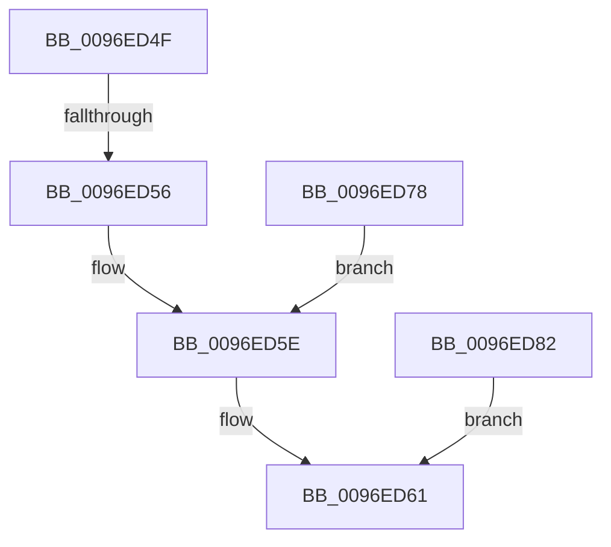

# sub_0096ED4F

- RVA: `0x0096ED4F`–`0x0096ED94` (길이 `69` bytes)
- VA: `0x000000014096ED4F`
- 실행 섹션: `PAGE`
- PDB 이름 있음: `아니요`; PDB Function 태그: `아니요`
- unwind 정보 RVA: `0x00095F04`
- 디코드: `16`개 명령, `69/69` bytes 표시
- 미해석 바이트: `0` (있으면 어셈블리에 `.byte`로 보존)

> 이 문서는 커널 이미지의 기계어와 PDB 기호를 분석해 생성했습니다. 4번과 5번은 함수 원형과 자료형을 바이너리 사용 방식에서 추정한 C 해석이며 원본 소스 복구 결과는 아닙니다.

## 1. Dependencies

- 직접 호출 지점: **1**; 고유 호출 대상: **1**
- 직접 호출자로 확인된 함수: **0**
- RIP 상대 이미지 참조: **0**

### Outgoing calls
- `0x0096ED6D` → [SetFailureLocation](../../text/46/SetFailureLocation_function_0046EF54.md) (function, `0x0046EF54`)

### Direct callers
- 이 함수 시작 RVA로 연결되는 직접 call은 확인되지 않았습니다. 간접 호출은 완전히 역산할 수 없습니다.

### Static image references
- 디코드된 RIP-relative 메모리 참조가 없습니다.

## 2. Other-region calls and transfers

- 다른 실행 섹션으로 향하는 call: **1**
  - `0x0096ED6D` → [SetFailureLocation](../../text/46/SetFailureLocation_function_0046EF54.md) (`PAGE` → `.text`)
- call이 아닌 외부 분기/꼬리 이동: **2**
  - `0x0096ED54` → [sub_0096EDB2 + 0x9](Unknown_function_0096EDB2.md) (`tail-transfer`)
  - `0x0096ED76` → [sub_0096E9E9 + 0x335](Unknown_function_0096E9E9.md) (`tail-transfer`)

## 3. Assembly (complete function range)

```asm
0096ED4F  3D 4C 01 00 C0                  cmp eax, 0xc000014c
0096ED54  74 65                           je 0x14096edbb
0096ED56  C7 44 24 20 25 00 00 00         mov dword ptr [rsp + 0x20], 0x25
0096ED5E  44 8B C8                        mov r9d, eax
0096ED61  48 8B 4D 60                     mov rcx, qword ptr [rbp + 0x60]
0096ED65  41 B8 0D 00 00 00               mov r8d, 0xd
0096ED6B  33 D2                           xor edx, edx
0096ED6D  E8 E2 01 B0 FF                  call 0x14046ef54
0096ED72  4C 8B 75 D8                     mov r14, qword ptr [rbp - 0x28]
0096ED76  EB A6                           jmp 0x14096ed1e
0096ED78  C7 44 24 20 70 00 00 00         mov dword ptr [rsp + 0x20], 0x70
0096ED80  EB DC                           jmp 0x14096ed5e
0096ED82  BF 4C 01 00 C0                  mov edi, 0xc000014c
0096ED87  C7 44 24 20 40 00 00 00         mov dword ptr [rsp + 0x20], 0x40
0096ED8F  44 8B CF                        mov r9d, edi
0096ED92  EB CD                           jmp 0x14096ed61
```

## 4. C-style interpretation (structured pseudocode)

```c
__int64 __fastcall sub_0096ED4F(__int64 a1, int a2)
{
    __int64 result;
    unsigned int v_stack_p20;

    v_stack_p20 = 37;
loc_0096ED5E:
loc_0096ED61:
    a2 = 0;
    result = SetFailureLocation(*(unsigned __int64 *)(v_rbp + 96), a2, 13, (unsigned int)((unsigned int)(result)));
}
```

## 5. (Beta) C Style

```c
int64_t sub_0096ED4F(int64_t Arg1, int32_t Arg2)
{
    int64_t result;
    uint32_t v_stack_p20;

    v_stack_p20 = 37;
loc_0096ED5E:
loc_0096ED61:
    Arg2 = 0;
    result = SetFailureLocation(*(uint64_t *)(local_rbp + 0x60), Arg2, 13, (uint32_t)((uint32_t)(result)));
}
```

## 6. Execution-region graph

[열기: 2D/3D 그래프와 함수 탐색 컨트롤 패널](../../../control-panel.html?section=page&rva=0x0096ED4F&view=graph)

- 2D 그래프는 위에서 아래로 흐르고, 3D 그래프는 빈 공간을 드래그해 회전합니다. Shift+드래그는 이동, 휠은 확대·축소, 함수 노드 선택은 대상 보고서 이동입니다.

### Static fallback


