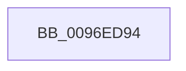

# sub_0096ED94

- RVA: `0x0096ED94`–`0x0096EDB2` (길이 `30` bytes)
- VA: `0x000000014096ED94`
- 실행 섹션: `PAGE`
- PDB 이름 있음: `아니요`; PDB Function 태그: `아니요`
- unwind 정보 RVA: `0x00095F20`
- 디코드: `8`개 명령, `30/30` bytes 표시
- 미해석 바이트: `0` (있으면 어셈블리에 `.byte`로 보존)

> 이 문서는 커널 이미지의 기계어와 PDB 기호를 분석해 생성했습니다. 4번과 5번은 함수 원형과 자료형을 바이너리 사용 방식에서 추정한 C 해석이며 원본 소스 복구 결과는 아닙니다.

## 1. Dependencies

- 직접 호출 지점: **1**; 고유 호출 대상: **1**
- 직접 호출자로 확인된 함수: **0**
- RIP 상대 이미지 참조: **0**

### Outgoing calls
- `0x0096EDAB` → [SetFailureLocation](../../text/46/SetFailureLocation_function_0046EF54.md) (function, `0x0046EF54`)

### Direct callers
- 이 함수 시작 RVA로 연결되는 직접 call은 확인되지 않았습니다. 간접 호출은 완전히 역산할 수 없습니다.

### Static image references
- 디코드된 RIP-relative 메모리 참조가 없습니다.

## 2. Other-region calls and transfers

- 다른 실행 섹션으로 향하는 call: **1**
  - `0x0096EDAB` → [SetFailureLocation](../../text/46/SetFailureLocation_function_0046EF54.md) (`PAGE` → `.text`)
- call이 아닌 외부 분기/꼬리 이동: **1**
  - `0x0096EDB0` → [sub_0096ED41](Unknown_function_0096ED41.md) (`tail-transfer`)

## 3. Assembly (complete function range)

```asm
0096ED94  48 8B 4D 60                     mov rcx, qword ptr [rbp + 0x60]
0096ED98  33 D2                           xor edx, edx
0096ED9A  BF 9A 00 00 C0                  mov edi, 0xc000009a
0096ED9F  44 89 7C 24 20                  mov dword ptr [rsp + 0x20], r15d
0096EDA4  44 8B CF                        mov r9d, edi
0096EDA7  44 8D 42 0D                     lea r8d, [rdx + 0xd]
0096EDAB  E8 A4 01 B0 FF                  call 0x14046ef54
0096EDB0  EB 8F                           jmp 0x14096ed41
```

## 4. C-style interpretation (structured pseudocode)

```c
__int64 __fastcall sub_0096ED94(__int64 a1, int a2)
{
    __int64 result;
    unsigned int v_stack_p20;

    a2 = 0;
    v_stack_p20 = (unsigned int)(v_r15);
    result = SetFailureLocation(*(unsigned __int64 *)(v_rbp + 96), a2, a2 + 13, (unsigned int)((unsigned int)((unsigned int)(0xC000009AULL))));
}
```

## 5. (Beta) C Style

```c
int64_t sub_0096ED94(int64_t Arg1, int32_t Arg2)
{
    int64_t result;
    uint32_t v_stack_p20;

    Arg2 = 0;
    v_stack_p20 = (uint32_t)(local_r15);
    result = SetFailureLocation(*(uint64_t *)(local_rbp + 0x60), Arg2, Arg2 + 13, (uint32_t)((uint32_t)((uint32_t)(0xC000009AULL))));
}
```

## 6. Execution-region graph

[열기: 2D/3D 그래프와 함수 탐색 컨트롤 패널](../../../control-panel.html?section=page&rva=0x0096ED94&view=graph)

- 2D 그래프는 위에서 아래로 흐르고, 3D 그래프는 빈 공간을 드래그해 회전합니다. Shift+드래그는 이동, 휠은 확대·축소, 함수 노드 선택은 대상 보고서 이동입니다.

### Static fallback


