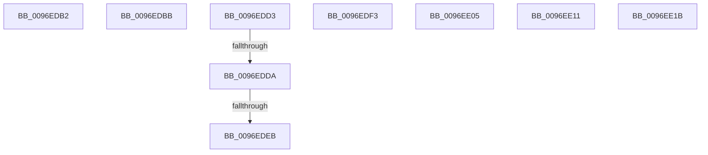

# sub_0096EDB2

- RVA: `0x0096EDB2`–`0x0096EE25` (길이 `115` bytes)
- VA: `0x000000014096EDB2`
- 실행 섹션: `PAGE`
- PDB 이름 있음: `아니요`; PDB Function 태그: `아니요`
- unwind 정보 RVA: `0x00095F30`
- 디코드: `25`개 명령, `115/115` bytes 표시
- 미해석 바이트: `0` (있으면 어셈블리에 `.byte`로 보존)

> 이 문서는 커널 이미지의 기계어와 PDB 기호를 분석해 생성했습니다. 4번과 5번은 함수 원형과 자료형을 바이너리 사용 방식에서 추정한 C 해석이며 원본 소스 복구 결과는 아닙니다.

## 1. Dependencies

- 직접 호출 지점: **0**; 고유 호출 대상: **0**
- 직접 호출자로 확인된 함수: **0**
- RIP 상대 이미지 참조: **0**

### Outgoing calls
- 직접 디코드된 call 명령이 없습니다.

### Direct callers
- 이 함수 시작 RVA로 연결되는 직접 call은 확인되지 않았습니다. 간접 호출은 완전히 역산할 수 없습니다.

### Static image references
- 디코드된 RIP-relative 메모리 참조가 없습니다.

## 2. Other-region calls and transfers

- 다른 실행 섹션으로 향하는 call: **0**
- call이 아닌 외부 분기/꼬리 이동: **9**
  - `0x0096EDB6` → [sub_0096E9E9 + 0xA2](Unknown_function_0096E9E9.md) (`tail-transfer`)
  - `0x0096EDCE` → [sub_00B28CFC + 0x27](../B2/Unknown_function_00B28CFC.md) (`tail-transfer`)
  - `0x0096EDD8` → [sub_0096ED4F + 0x23](Unknown_function_0096ED4F.md) (`tail-transfer`)
  - `0x0096EDE5` → [sub_00B28CFC](../B2/Unknown_function_00B28CFC.md) (`tail-transfer`)
  - `0x0096EDEE` → [sub_00B28CFC + 0x22](../B2/Unknown_function_00B28CFC.md) (`tail-transfer`)
  - `0x0096EE00` → [sub_00B28CFC + 0xD7](../B2/Unknown_function_00B28CFC.md) (`tail-transfer`)
  - `0x0096EE0C` → [sub_00B28CFC + 0xD2](../B2/Unknown_function_00B28CFC.md) (`tail-transfer`)
  - `0x0096EE16` → [sub_00B28CFC + 0xD2](../B2/Unknown_function_00B28CFC.md) (`tail-transfer`)
  - `0x0096EE20` → [sub_0096E9E9 + 0x335](Unknown_function_0096E9E9.md) (`tail-transfer`)

## 3. Assembly (complete function range)

```asm
0096EDB2  C6 45 48 01                     mov byte ptr [rbp + 0x48], 1
0096EDB6  E9 D0 FC FF FF                  jmp 0x14096ea8b
0096EDBB  44 8B 65 38                     mov r12d, dword ptr [rbp + 0x38]
0096EDBF  B8 30 00 00 00                  mov eax, 0x30
0096EDC4  41 81 E4 00 00 02 00            and r12d, 0x20000
0096EDCB  45 33 FF                        xor r15d, r15d
0096EDCE  E9 50 9F 1B 00                  jmp 0x140b28d23
0096EDD3  3D 4C 01 00 C0                  cmp eax, 0xc000014c
0096EDD8  75 98                           jne 0x14096ed72
0096EDDA  44 8B 65 38                     mov r12d, dword ptr [rbp + 0x38]
0096EDDE  41 81 E4 00 00 02 00            and r12d, 0x20000
0096EDE5  0F 84 11 9F 1B 00               je 0x140b28cfc
0096EDEB  45 33 FF                        xor r15d, r15d
0096EDEE  E9 2B 9F 1B 00                  jmp 0x140b28d1e
0096EDF3  BF 4C 01 00 C0                  mov edi, 0xc000014c
0096EDF8  B8 60 00 00 00                  mov eax, 0x60
0096EDFD  45 33 F6                        xor r14d, r14d
0096EE00  E9 CE 9F 1B 00                  jmp 0x140b28dd3
0096EE05  45 33 F6                        xor r14d, r14d
0096EE08  41 8D 46 58                     lea eax, [r14 + 0x58]
0096EE0C  E9 BD 9F 1B 00                  jmp 0x140b28dce
0096EE11  B8 50 00 00 00                  mov eax, 0x50
0096EE16  E9 B3 9F 1B 00                  jmp 0x140b28dce
0096EE1B  BF 2A 00 00 80                  mov edi, 0x8000002a
0096EE20  E9 F9 FE FF FF                  jmp 0x14096ed1e
```

## 4. C-style interpretation (structured pseudocode)

```c
__int64 __fastcall sub_0096EDB2(void)
{
    *(unsigned __int8 *)(v_rbp + 72) = 1;
}
```

## 5. (Beta) C Style

```c
void sub_0096EDB2(void)
{
    *(uint8_t *)(local_rbp + 0x48) = 1;
}
```

## 6. Execution-region graph

[열기: 2D/3D 그래프와 함수 탐색 컨트롤 패널](../../../control-panel.html?section=page&rva=0x0096EDB2&view=graph)

- 2D 그래프는 위에서 아래로 흐르고, 3D 그래프는 빈 공간을 드래그해 회전합니다. Shift+드래그는 이동, 휠은 확대·축소, 함수 노드 선택은 대상 보고서 이동입니다.

### Static fallback


