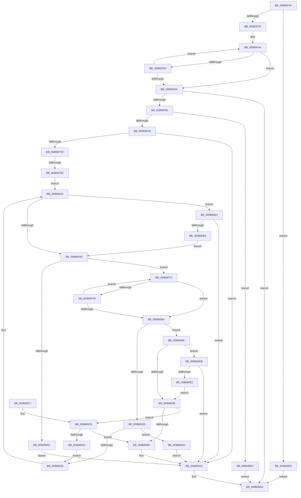

# _RegRtlDeletePathInternal

- RVA: `0x00965F04`–`0x00966100` (길이 `508` bytes)
- VA: `0x0000000140965F04`
- 실행 섹션: `PAGE`
- PDB 이름 있음: `예`; PDB Function 태그: `예`
- unwind 정보 RVA: `0x00093818`
- 디코드: `145`개 명령, `508/508` bytes 표시
- 미해석 바이트: `0` (있으면 어셈블리에 `.byte`로 보존)

> 이 문서는 커널 이미지의 기계어와 PDB 기호를 분석해 생성했습니다. 4번과 5번은 함수 원형과 자료형을 바이너리 사용 방식에서 추정한 C 해석이며 원본 소스 복구 결과는 아닙니다.

## 1. Dependencies

- 직접 호출 지점: **9**; 고유 호출 대상: **9**
- 직접 호출자로 확인된 함수: **1**
- RIP 상대 이미지 참조: **0**

### Outgoing calls
- `0x00965F95` → [ExAllocatePool2](../../poolcode/B8/ExAllocatePool2_function_00B820F0.md) (function, `0x00B820F0`)
- `0x00965FBF` → [RtlStringCchCopyExW](../../text/41/RtlStringCchCopyExW_function_0041E1C0.md) (function, `0x0041E1C0`)
- `0x00965FE8` → [RegRtlDeleteTreeInternal](../99/RegRtlDeleteTreeInternal_function_00994700.md) (function, `0x00994700`)
- `0x00966022` → [_RegRtlOpenKeyTransacted](../8E/_RegRtlOpenKeyTransacted_function_008EF810.md) (function, `0x008EF810`)
- `0x0096603E` → [RegRtlDeleteKeyTransacted](RegRtlDeleteKeyTransacted_function_00966108.md) (function, `0x00966108`)
- `0x00966052` → [wcsrchr](../../text/50/wcsrchr_function_00501E50.md) (function, `0x00501E50`)
- `0x0096607D` → [RegRtlQueryInfoKey](../99/RegRtlQueryInfoKey_function_0099463C.md) (function, `0x0099463C`)
- `0x00966089` → [ZwClose](../../text/6A/ZwClose_function_006AD2B0.md) (function, `0x006AD2B0`)
- `0x009660A7` → [ExFreePoolWithTag](../../poolcode/B8/ExFreePoolWithTag_function_00B82870.md) (function, `0x00B82870`)

### Direct callers
- [PnpCtxRegDeletePath](PnpCtxRegDeletePath_function_00965AD8.md) at `0x00965B11`

### Static image references
- 디코드된 RIP-relative 메모리 참조가 없습니다.

## 2. Other-region calls and transfers

- 다른 실행 섹션으로 향하는 call: **5**
  - `0x00965F95` → [ExAllocatePool2](../../poolcode/B8/ExAllocatePool2_function_00B820F0.md) (`PAGE` → `POOLCODE`)
  - `0x00965FBF` → [RtlStringCchCopyExW](../../text/41/RtlStringCchCopyExW_function_0041E1C0.md) (`PAGE` → `.text`)
  - `0x00966052` → [wcsrchr](../../text/50/wcsrchr_function_00501E50.md) (`PAGE` → `.text`)
  - `0x00966089` → [ZwClose](../../text/6A/ZwClose_function_006AD2B0.md) (`PAGE` → `.text`)
  - `0x009660A7` → [ExFreePoolWithTag](../../poolcode/B8/ExFreePoolWithTag_function_00B82870.md) (`PAGE` → `POOLCODE`)
- call이 아닌 외부 분기/꼬리 이동: **1**
  - `0x00965FD6` → [sub_00B287FC](../B2/Unknown_function_00B287FC.md) (`tail-transfer`)

## 3. Assembly (complete function range)

```asm
00965F04  48 8B C4                        mov rax, rsp
00965F07  48 89 58 08                     mov qword ptr [rax + 8], rbx
00965F0B  48 89 68 18                     mov qword ptr [rax + 0x18], rbp
00965F0F  56                              push rsi
00965F10  57                              push rdi
00965F11  41 54                           push r12
00965F13  41 56                           push r14
00965F15  41 57                           push r15
00965F17  48 83 EC 40                     sub rsp, 0x40
00965F1B  45 33 E4                        xor r12d, r12d
00965F1E  4D 8B F9                        mov r15, r9
00965F21  4C 89 60 C8                     mov qword ptr [rax - 0x38], r12
00965F25  41 8A E8                        mov bpl, r8b
00965F28  44 89 60 28                     mov dword ptr [rax + 0x28], r12d
00965F2C  48 8B F2                        mov rsi, rdx
00965F2F  44 89 60 10                     mov dword ptr [rax + 0x10], r12d
00965F33  4C 8B F1                        mov r14, rcx
00965F36  48 85 D2                        test rdx, rdx
00965F39  0F 84 BA 01 00 00               je 0x1409660f9
00965F3F  BA FF 7F 00 00                  mov edx, 0x7fff
00965F44  48 8B C6                        mov rax, rsi
00965F47  44 8B D2                        mov r10d, edx
00965F4A  66 44 39 20                     cmp word ptr [rax], r12w
00965F4E  74 0A                           je 0x140965f5a
00965F50  48 83 C0 02                     add rax, 2
00965F54  49 83 EA 01                     sub r10, 1
00965F58  75 F0                           jne 0x140965f4a
00965F5A  49 8B C2                        mov rax, r10
00965F5D  48 F7 D8                        neg rax
00965F60  49 8B C2                        mov rax, r10
00965F63  1B DB                           sbb ebx, ebx
00965F65  49 2B D2                        sub rdx, r10
00965F68  F7 D3                           not ebx
00965F6A  81 E3 0D 00 00 C0               and ebx, 0xc000000d
00965F70  48 F7 D8                        neg rax
00965F73  48 1B C9                        sbb rcx, rcx
00965F76  48 23 CA                        and rcx, rdx
00965F79  4D 85 D2                        test r10, r10
00965F7C  0F 84 2A 01 00 00               je 0x1409660ac
00965F82  48 8D 59 01                     lea rbx, [rcx + 1]
00965F86  41 B8 52 45 47 4C               mov r8d, 0x4c474552
00965F8C  48 8D 14 1B                     lea rdx, [rbx + rbx]
00965F90  B9 00 01 00 00                  mov ecx, 0x100
00965F95  E8 56 C1 21 00                  call 0x140b820f0
00965F9A  48 8B F8                        mov rdi, rax
00965F9D  48 85 C0                        test rax, rax
00965FA0  0F 84 31 01 00 00               je 0x1409660d7
00965FA6  C7 44 24 28 00 01 00 00         mov dword ptr [rsp + 0x28], 0x100
00965FAE  45 33 C9                        xor r9d, r9d
00965FB1  4C 8B C6                        mov r8, rsi
00965FB4  4C 89 64 24 20                  mov qword ptr [rsp + 0x20], r12
00965FB9  48 8B D3                        mov rdx, rbx
00965FBC  48 8B C8                        mov rcx, rax
00965FBF  E8 FC 81 AB FF                  call 0x14041e1c0
00965FC4  8B D8                           mov ebx, eax
00965FC6  85 C0                           test eax, eax
00965FC8  0F 85 D4 00 00 00               jne 0x1409660a2
00965FCE  BE 34 00 00 C0                  mov esi, 0xc0000034
00965FD3  40 84 ED                        test bpl, bpl
00965FD6  0F 84 20 28 1C 00               je 0x140b287fc
00965FDC  45 33 C9                        xor r9d, r9d
00965FDF  4D 8B C7                        mov r8, r15
00965FE2  48 8B D7                        mov rdx, rdi
00965FE5  49 8B CE                        mov rcx, r14
00965FE8  E8 13 E7 02 00                  call 0x140994700
00965FED  8D 6B 5C                        lea ebp, [rbx + 0x5c]
00965FF0  EB 51                           jmp 0x140966043
00965FF2  66 44 89 20                     mov word ptr [rax], r12w
00965FF6  48 3B C7                        cmp rax, rdi
00965FF9  74 09                           je 0x140966004
00965FFB  48 83 E8 02                     sub rax, 2
00965FFF  66 39 28                        cmp word ptr [rax], bp
00966002  74 EE                           je 0x140965ff2
00966004  48 8D 44 24 30                  lea rax, [rsp + 0x30]
00966009  4C 89 7C 24 28                  mov qword ptr [rsp + 0x28], r15
0096600E  41 B9 01 00 00 00               mov r9d, 1
00966014  48 89 44 24 20                  mov qword ptr [rsp + 0x20], rax
00966019  45 33 C0                        xor r8d, r8d
0096601C  48 8B D7                        mov rdx, rdi
0096601F  49 8B CE                        mov rcx, r14
00966022  E8 E9 97 F8 FF                  call 0x1408ef810
00966027  8B D8                           mov ebx, eax
00966029  85 C0                           test eax, eax
0096602B  74 31                           je 0x14096605e
0096602D  3B C6                           cmp eax, esi
0096602F  0F 85 B8 00 00 00               jne 0x1409660ed
00966035  45 33 C0                        xor r8d, r8d
00966038  48 8B D7                        mov rdx, rdi
0096603B  49 8B CE                        mov rcx, r14
0096603E  E8 C5 00 00 00                  call 0x140966108
00966043  8B D8                           mov ebx, eax
00966045  85 C0                           test eax, eax
00966047  0F 85 97 00 00 00               jne 0x1409660e4
0096604D  8B D5                           mov edx, ebp
0096604F  48 8B CF                        mov rcx, rdi
00966052  E8 F9 BD B9 FF                  call 0x140501e50
00966057  48 85 C0                        test rax, rax
0096605A  75 96                           jne 0x140965ff2
0096605C  EB 44                           jmp 0x1409660a2
0096605E  48 8B 4C 24 30                  mov rcx, qword ptr [rsp + 0x30]
00966063  4C 8D 4C 24 78                  lea r9, [rsp + 0x78]
00966068  4C 89 64 24 28                  mov qword ptr [rsp + 0x28], r12
0096606D  48 8D 94 24 90 00 00 00         lea rdx, [rsp + 0x90]
00966075  45 33 C0                        xor r8d, r8d
00966078  4C 89 64 24 20                  mov qword ptr [rsp + 0x20], r12
0096607D  E8 BA E5 02 00                  call 0x14099463c
00966082  48 8B 4C 24 30                  mov rcx, qword ptr [rsp + 0x30]
00966087  8B D8                           mov ebx, eax
00966089  E8 22 72 D4 FF                  call 0x1406ad2b0
0096608E  81 FB 7C 01 00 C0               cmp ebx, 0xc000017c
00966094  75 48                           jne 0x1409660de
00966096  44 39 64 24 78                  cmp dword ptr [rsp + 0x78], r12d
0096609B  74 2B                           je 0x1409660c8
0096609D  BB 21 01 00 C0                  mov ebx, 0xc0000121
009660A2  33 D2                           xor edx, edx
009660A4  48 8B CF                        mov rcx, rdi
009660A7  E8 C4 C7 21 00                  call 0x140b82870
009660AC  4C 8D 5C 24 40                  lea r11, [rsp + 0x40]
009660B1  8B C3                           mov eax, ebx
009660B3  49 8B 5B 30                     mov rbx, qword ptr [r11 + 0x30]
009660B7  49 8B 6B 40                     mov rbp, qword ptr [r11 + 0x40]
009660BB  49 8B E3                        mov rsp, r11
009660BE  41 5F                           pop r15
009660C0  41 5E                           pop r14
009660C2  41 5C                           pop r12
009660C4  5F                              pop rdi
009660C5  5E                              pop rsi
009660C6  C3                              ret
009660C7  CC                              int3
009660C8  44 39 A4 24 90 00 00 00         cmp dword ptr [rsp + 0x90], r12d
009660D0  75 CB                           jne 0x14096609d
009660D2  E9 5E FF FF FF                  jmp 0x140966035
009660D7  BB 17 00 00 C0                  mov ebx, 0xc0000017
009660DC  EB CE                           jmp 0x1409660ac
009660DE  85 DB                           test ebx, ebx
009660E0  75 C0                           jne 0x1409660a2
009660E2  EB B2                           jmp 0x140966096
009660E4  3B DE                           cmp ebx, esi
009660E6  75 BA                           jne 0x1409660a2
009660E8  E9 60 FF FF FF                  jmp 0x14096604d
009660ED  81 FB 7C 01 00 C0               cmp ebx, 0xc000017c
009660F3  41 0F 44 DC                     cmove ebx, r12d
009660F7  EB A9                           jmp 0x1409660a2
009660F9  BB 0D 00 00 C0                  mov ebx, 0xc000000d
009660FE  EB AC                           jmp 0x1409660ac
```

## 4. C-style interpretation (structured pseudocode)

```c
__int64 __fastcall _RegRtlDeletePathInternal(__int64 a1, __int64 a2, unsigned __int8 a3, __int64 a4, unsigned int a5)
{
    __int64 result;
    __int64 v_r10;
    __int64 v_r12;
    __int64 v_rbx;
    __int64 v_rsp;
    unsigned __int64 v_stack_m28;
    unsigned __int64 v_stack_m38;
    unsigned int v_stack_m40;
    unsigned __int64 v_stack_m48;
    unsigned __int64 v_stack_p10;

    *(unsigned __int64 *)(v_rsp + 8) = v_rbx;
    *(unsigned __int64 *)(v_rsp + 24) = v_rbp;
    v_rsp = (v_rsp) - (64);
    v_r12 = 0;
    *(unsigned __int64 *)(v_rsp - 56) = 0;
    *(unsigned int *)(v_rsp + 40) = 0;
    *(unsigned int *)(v_rsp + 16) = 0;
    if (a2 == 0) goto loc_009660F9;
loc_00965F4A:
    if ((*(unsigned __int16 *)(a2)) == 0) goto loc_00965F5A;
    result = (a2) + (2);
    v_r10 = ((unsigned int)((unsigned int)((unsigned int)(0x7FFFULL)))) - (1);
    if (condition_is_not_equal) goto loc_00965F4A;
loc_00965F5A:
    result = -(v_r10);
    a2 = ((unsigned int)(0x7FFFULL)) - (v_r10);
    v_rbx = (unsigned int)(~(v_rbx));
    v_rbx = (unsigned int)((v_rbx) & (0xC000000DULL));
    result = -(v_r10);
    a1 = (a1) & (a2);
    if (v_r10 == 0) goto loc_009660AC;
    result = ExAllocatePool2(256, a1 + 1 + a1 + 1 * 1, (unsigned int)(0x4C474552ULL), a4);
    if (result == 0) goto loc_009660D7;
    v_stack_m40 = 256;
    a4 = 0;
    v_stack_m48 = 0;
    result = RtlStringCchCopyExW(result, a1 + 1, a2, a4);
    if ((unsigned int)(result) != 0) goto loc_009660A2;
    a4 = 0;
    result = RegRtlDeleteTreeInternal(a1, result, 0, a4);
    goto loc_00966043;
loc_00965FF2:
    *(unsigned __int16 *)(result) = 0;
    if (result == result) goto loc_00966004;
    result = (result) - (2);
    if ((*(unsigned __int16 *)(result)) == ((unsigned __int16)((unsigned int)((unsigned int)(result)) + 92))) goto loc_00965FF2;
loc_00966004:
    v_stack_m40 = 0;
    v_stack_m48 = v_stack_m38;
    a3 = 0;
    result = _RegRtlOpenKeyTransacted(a1, result, a3, 1);
    if ((unsigned int)(result) == 0) goto loc_0096605E;
    if (((unsigned int)(result)) != ((unsigned int)((unsigned int)(0xC0000034ULL)))) goto loc_009660ED;
loc_00966035:
    a3 = 0;
    result = RegRtlDeleteKeyTransacted(a1, result, a3, 1);
loc_00966043:
    if ((unsigned int)(result) != 0) goto loc_009660E4;
loc_0096604D:
    result = wcsrchr(result, (unsigned int)((unsigned int)((unsigned int)((unsigned int)(result)) + 92)), a3, 1);
    if (result != 0) goto loc_00965FF2;
    goto loc_009660A2;
loc_0096605E:
    v_stack_m40 = 0;
    a3 = 0;
    v_stack_m48 = 0;
    result = RegRtlQueryInfoKey(v_stack_m38, a5, a3, v_stack_p10);
    result = ZwClose(v_stack_m38, a5, a3, v_stack_p10);
    if (((unsigned int)((unsigned int)((unsigned int)(result)))) != 0xC000017CULL) goto loc_009660DE;
loc_00966096:
    if (v_stack_p10 == 0) goto loc_009660C8;
loc_0096609D:
loc_009660A2:
    a2 = 0;
    result = ExFreePoolWithTag(result, a2, a3, v_stack_p10);
loc_009660AC:
    return (unsigned int)((unsigned int)((unsigned int)(0xC0000121ULL)));
loc_009660C8:
    if (a5 != 0) goto loc_0096609D;
    goto loc_00966035;
loc_009660D7:
    goto loc_009660AC;
loc_009660DE:
    if ((unsigned int)((unsigned int)(0xC0000017ULL)) != 0) goto loc_009660A2;
    goto loc_00966096;
loc_009660E4:
    if (((unsigned int)((unsigned int)(0xC0000017ULL))) != ((unsigned int)((unsigned int)(0xC0000034ULL)))) goto loc_009660A2;
    goto loc_0096604D;
loc_009660ED:
    v_rbx = (unsigned int)(0xC0000017ULL);
    if (((unsigned int)((unsigned int)(0xC0000017ULL))) == 0xC000017CULL) { v_rbx = 0; }
    goto loc_009660A2;
loc_009660F9:
    goto loc_009660AC;
}
```

## 5. (Beta) C Style

```c
int64_t _RegRtlDeletePathInternal(int64_t Arg1, void *Arg2, uint8_t Arg3, int64_t Arg4, uint32_t Arg5)
{
    uint8_t *arg2 = (uint8_t *)Arg2;

    int64_t result;
    int64_t local_r10;
    int64_t local_r12;
    int64_t local_rbx;
    int64_t local_rsp;
    uint64_t v_stack_m28;
    uint64_t v_stack_m38;
    uint32_t v_stack_m40;
    uint64_t v_stack_m48;
    uint64_t v_stack_p10;

    *(uint64_t *)(local_rsp + 0x8) = local_rbx;
    *(uint64_t *)(local_rsp + 0x18) = local_rbp;
    local_rsp = (local_rsp) - (64);
    local_r12 = 0;
    *(uint64_t *)(local_rsp - 0x38) = 0;
    *(uint32_t *)(local_rsp + 0x28) = 0;
    *(uint32_t *)(local_rsp + 0x10) = 0;
    if (Arg2 == NULL) goto loc_009660F9;
loc_00965F4A:
    if ((*(uint16_t *)(arg2)) == 0) goto loc_00965F5A;
    result = (Arg2) + (2);
    local_r10 = ((uint32_t)((uint32_t)((uint32_t)(0x7FFFULL)))) - (1);
    if (condition_is_not_equal) goto loc_00965F4A;
loc_00965F5A:
    result = -(local_r10);
    Arg2 = ((uint32_t)(0x7FFFULL)) - (local_r10);
    local_rbx = (uint32_t)(~(local_rbx));
    local_rbx = (uint32_t)((local_rbx) & (0xC000000DULL));
    result = -(local_r10);
    Arg1 = (Arg1) & (Arg2);
    if (local_r10 == 0) goto loc_009660AC;
    result = ExAllocatePool2(256, Arg1 + 1 + Arg1 + 1 * 1, (uint32_t)(0x4C474552ULL), Arg4);
    if (result == 0) goto loc_009660D7;
    v_stack_m40 = 256;
    Arg4 = 0;
    v_stack_m48 = 0;
    result = RtlStringCchCopyExW(result, Arg1 + 1, Arg2, Arg4);
    if ((uint32_t)(result) != 0) goto loc_009660A2;
    Arg4 = 0;
    result = RegRtlDeleteTreeInternal(Arg1, result, 0, Arg4);
    goto loc_00966043;
loc_00965FF2:
    *(uint16_t *)(result) = 0;
    if (result == result) goto loc_00966004;
    result = (result) - (2);
    if ((*(uint16_t *)(result)) == ((uint16_t)((uint32_t)((uint32_t)(result)) + 92))) goto loc_00965FF2;
loc_00966004:
    v_stack_m40 = 0;
    v_stack_m48 = v_stack_m38;
    Arg3 = 0;
    result = _RegRtlOpenKeyTransacted(Arg1, result, Arg3, 1);
    if ((uint32_t)(result) == 0) goto loc_0096605E;
    if (((uint32_t)(result)) != ((uint32_t)((uint32_t)(0xC0000034ULL)))) goto loc_009660ED;
loc_00966035:
    Arg3 = 0;
    result = RegRtlDeleteKeyTransacted(Arg1, result, Arg3, 1);
loc_00966043:
    if ((uint32_t)(result) != 0) goto loc_009660E4;
loc_0096604D:
    result = wcsrchr(result, (uint32_t)((uint32_t)((uint32_t)((uint32_t)(result)) + 92)), Arg3, 1);
    if (result != 0) goto loc_00965FF2;
    goto loc_009660A2;
loc_0096605E:
    v_stack_m40 = 0;
    Arg3 = 0;
    v_stack_m48 = 0;
    result = RegRtlQueryInfoKey(v_stack_m38, Arg5, Arg3, v_stack_p10);
    result = ZwClose(v_stack_m38, Arg5, Arg3, v_stack_p10);
    if (((uint32_t)((uint32_t)((uint32_t)(result)))) != 0xC000017CULL) goto loc_009660DE;
loc_00966096:
    if (v_stack_p10 == 0) goto loc_009660C8;
loc_0096609D:
loc_009660A2:
    Arg2 = 0;
    result = ExFreePoolWithTag(result, Arg2, Arg3, v_stack_p10);
loc_009660AC:
    return (uint32_t)((uint32_t)((uint32_t)(0xC0000121ULL)));
loc_009660C8:
    if (Arg5 != 0) goto loc_0096609D;
    goto loc_00966035;
loc_009660D7:
    goto loc_009660AC;
loc_009660DE:
    if ((uint32_t)((uint32_t)(0xC0000017ULL)) != 0) goto loc_009660A2;
    goto loc_00966096;
loc_009660E4:
    if (((uint32_t)((uint32_t)(0xC0000017ULL))) != ((uint32_t)((uint32_t)(0xC0000034ULL)))) goto loc_009660A2;
    goto loc_0096604D;
loc_009660ED:
    local_rbx = (uint32_t)(0xC0000017ULL);
    if (((uint32_t)((uint32_t)(0xC0000017ULL))) == 0xC000017CULL) { local_rbx = 0; }
    goto loc_009660A2;
loc_009660F9:
    goto loc_009660AC;
}
```

### 관측된 메모리 오프셋

구조체 형식이 확인되지 않은 접근은 인자 기준의 오프셋으로만 기록했습니다.

| 기준 인자 | 오프셋 표현 | 폭 (bit) | 접근 |
|---|---:|---:|---|
| `Arg2` | `+ 0x0` | `16` | `R` |

## 6. Execution-region graph

[열기: 2D/3D 그래프와 함수 탐색 컨트롤 패널](../../../control-panel.html?section=page&rva=0x00965F04&view=graph)

- 2D 그래프는 위에서 아래로 흐르고, 3D 그래프는 빈 공간을 드래그해 회전합니다. Shift+드래그는 이동, 휠은 확대·축소, 함수 노드 선택은 대상 보고서 이동입니다.

### Static fallback


