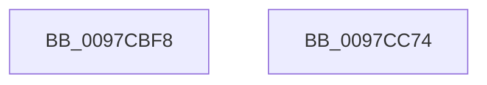

# AstAddBloomFilter

- RVA: `0x0097CBF8`–`0x0097CC75` (길이 `125` bytes)
- VA: `0x000000014097CBF8`
- 실행 섹션: `PAGE`
- PDB 이름 있음: `예`; PDB Function 태그: `아니요`
- unwind 정보 RVA: `0x0005D2F4`
- 디코드: `35`개 명령, `125/125` bytes 표시
- 미해석 바이트: `0` (있으면 어셈블리에 `.byte`로 보존)

> 이 문서는 커널 이미지의 기계어와 PDB 기호를 분석해 생성했습니다. 4번과 5번은 함수 원형과 자료형을 바이너리 사용 방식에서 추정한 C 해석이며 원본 소스 복구 결과는 아닙니다.

## 1. Dependencies

- 직접 호출 지점: **1**; 고유 호출 대상: **1**
- 직접 호출자로 확인된 함수: **1**
- RIP 상대 이미지 참조: **1**

### Outgoing calls
- `0x0097CC12` → [AstGetHashedBitNumbers](AstGetHashedBitNumbers_function_0097CC80.md) (function, `0x0097CC80`)

### Direct callers
- [IopXxxControlFile](../8E/IopXxxControlFile_function_008E9AD0.md) at `0x008EABB9`

### Static image references
- `0x0097CC27` → RVA `0x00F8D048` (`.data`; read)

## 2. Other-region calls and transfers

- 다른 실행 섹션으로 향하는 call: **0**
- 별도 외부 분기/꼬리 이동을 확인하지 못했습니다.

## 3. Assembly (complete function range)

```asm
0097CBF8  48 83 EC 38                     sub rsp, 0x38
0097CBFC  33 C0                           xor eax, eax
0097CBFE  48 8D 4C 24 20                  lea rcx, [rsp + 0x20]
0097CC03  45 8B C8                        mov r9d, r8d
0097CC06  48 89 44 24 20                  mov qword ptr [rsp + 0x20], rax
0097CC0B  4C 8B C2                        mov r8, rdx
0097CC0E  89 44 24 28                     mov dword ptr [rsp + 0x28], eax
0097CC12  E8 69 00 00 00                  call 0x14097cc80
0097CC17  44 8B 4C 24 20                  mov r9d, dword ptr [rsp + 0x20]
0097CC1C  41 8B C9                        mov ecx, r9d
0097CC1F  41 83 E1 07                     and r9d, 7
0097CC23  48 C1 E9 03                     shr rcx, 3
0097CC27  48 03 0D 1A 04 61 00            add rcx, qword ptr [rip + 0x61041a]
0097CC2E  0F BE 01                        movsx eax, byte ptr [rcx]
0097CC31  44 0F AB C8                     bts eax, r9d
0097CC35  88 01                           mov byte ptr [rcx], al
0097CC37  8B 4C 24 24                     mov ecx, dword ptr [rsp + 0x24]
0097CC3B  8B D1                           mov edx, ecx
0097CC3D  83 E1 07                        and ecx, 7
0097CC40  48 C1 EA 03                     shr rdx, 3
0097CC44  48 03 15 FD 03 61 00            add rdx, qword ptr [rip + 0x6103fd]
0097CC4B  0F BE 02                        movsx eax, byte ptr [rdx]
0097CC4E  0F AB C8                        bts eax, ecx
0097CC51  8B 4C 24 28                     mov ecx, dword ptr [rsp + 0x28]
0097CC55  88 02                           mov byte ptr [rdx], al
0097CC57  8B D1                           mov edx, ecx
0097CC59  48 C1 EA 03                     shr rdx, 3
0097CC5D  83 E1 07                        and ecx, 7
0097CC60  48 03 15 E1 03 61 00            add rdx, qword ptr [rip + 0x6103e1]
0097CC67  0F BE 02                        movsx eax, byte ptr [rdx]
0097CC6A  0F AB C8                        bts eax, ecx
0097CC6D  88 02                           mov byte ptr [rdx], al
0097CC6F  48 83 C4 38                     add rsp, 0x38
0097CC73  C3                              ret
0097CC74  CC                              int3
```

## 4. C-style interpretation (structured pseudocode)

```c
__int64 __fastcall AstAddBloomFilter(__int64 a1, __int64 a2, int a3)
{
    __int64 result;
    __int64 v_rsp;
    unsigned int v_stack_m10;
    unsigned int v_stack_m14;
    unsigned __int64 v_stack_m18;

    v_rsp = (v_rsp) - (56);
    result = 0;
    v_stack_m18 = 0;
    v_stack_m10 = 0;
    result = AstGetHashedBitNumbers(v_stack_m18, a2, a2, (unsigned int)(a3));
    a4 = (unsigned int)(((unsigned int)(v_stack_m18)) & (7));
    a1 = ((unsigned int)((unsigned int)((unsigned int)(v_stack_m18)))) >> (3);
    a1 = (a1) + (*(unsigned __int64 *)(v_rip + 6358042));
    *(unsigned __int8 *)(a1) = (unsigned __int8)((__int8)(*(unsigned __int8 *)(a1)));
    a1 = (unsigned int)(((unsigned int)(v_stack_m14)) & (7));
    a2 = ((unsigned int)((unsigned int)((unsigned int)(v_stack_m14)))) >> (3);
    a2 = (a2) + (*(unsigned __int64 *)(v_rip + 6358013));
    *(unsigned __int8 *)(a2) = (unsigned __int8)((__int8)(*(unsigned __int8 *)(a2)));
    a2 = ((unsigned int)((unsigned int)((unsigned int)(v_stack_m10)))) >> (3);
    a1 = (unsigned int)(((unsigned int)(v_stack_m10)) & (7));
    a2 = (a2) + (*(unsigned __int64 *)(v_rip + 6357985));
    *(unsigned __int8 *)(a2) = (unsigned __int8)((__int8)(*(unsigned __int8 *)(a2)));
    v_rsp = (v_rsp) + (56);
    return (__int8)(*(unsigned __int8 *)(a2));
}
```

## 5. (Beta) C Style

```c
int64_t AstAddBloomFilter(int64_t Arg1, int64_t Arg2, int32_t Arg3)
{
    int64_t result;
    int64_t local_rsp;
    uint32_t v_stack_m10;
    uint32_t v_stack_m14;
    uint64_t v_stack_m18;

    local_rsp = (local_rsp) - (56);
    result = 0;
    v_stack_m18 = 0;
    v_stack_m10 = 0;
    result = AstGetHashedBitNumbers(v_stack_m18, Arg2, Arg2, (uint32_t)(Arg3));
    a4 = (uint32_t)(((uint32_t)(v_stack_m18)) & (7));
    Arg1 = ((uint32_t)((uint32_t)((uint32_t)(v_stack_m18)))) >> (3);
    Arg1 = (Arg1) + (*(uint64_t *)(v_rip + 0x61041A));
    *(uint8_t *)(Arg1) = (uint8_t)((int8_t)(*(uint8_t *)(Arg1)));
    Arg1 = (uint32_t)(((uint32_t)(v_stack_m14)) & (7));
    Arg2 = ((uint32_t)((uint32_t)((uint32_t)(v_stack_m14)))) >> (3);
    Arg2 = (Arg2) + (*(uint64_t *)(v_rip + 0x6103FD));
    *(uint8_t *)(Arg2) = (uint8_t)((int8_t)(*(uint8_t *)(Arg2)));
    Arg2 = ((uint32_t)((uint32_t)((uint32_t)(v_stack_m10)))) >> (3);
    Arg1 = (uint32_t)(((uint32_t)(v_stack_m10)) & (7));
    Arg2 = (Arg2) + (*(uint64_t *)(v_rip + 0x6103E1));
    *(uint8_t *)(Arg2) = (uint8_t)((int8_t)(*(uint8_t *)(Arg2)));
    local_rsp = (local_rsp) + (56);
    return (int8_t)(*(uint8_t *)(Arg2));
}
```

## 6. Execution-region graph

[열기: 2D/3D 그래프와 함수 탐색 컨트롤 패널](../../../control-panel.html?section=page&rva=0x0097CBF8&view=graph)

- 2D 그래프는 위에서 아래로 흐르고, 3D 그래프는 빈 공간을 드래그해 회전합니다. Shift+드래그는 이동, 휠은 확대·축소, 함수 노드 선택은 대상 보고서 이동입니다.

### Static fallback


