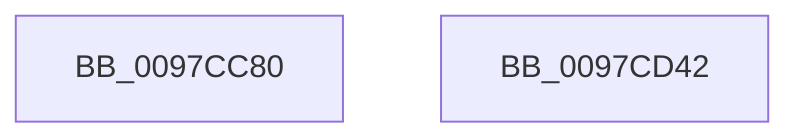

# AstGetHashedBitNumbers

- RVA: `0x0097CC80`–`0x0097CD43` (길이 `195` bytes)
- VA: `0x000000014097CC80`
- 실행 섹션: `PAGE`
- PDB 이름 있음: `예`; PDB Function 태그: `아니요`
- unwind 정보 RVA: `0x000DB714`
- 디코드: `59`개 명령, `195/195` bytes 표시
- 미해석 바이트: `0` (있으면 어셈블리에 `.byte`로 보존)

> 이 문서는 커널 이미지의 기계어와 PDB 기호를 분석해 생성했습니다. 4번과 5번은 함수 원형과 자료형을 바이너리 사용 방식에서 추정한 C 해석이며 원본 소스 복구 결과는 아닙니다.

## 1. Dependencies

- 직접 호출 지점: **0**; 고유 호출 대상: **0**
- 직접 호출자로 확인된 함수: **1**
- RIP 상대 이미지 참조: **2**

### Outgoing calls
- 직접 디코드된 call 명령이 없습니다.

### Direct callers
- [AstAddBloomFilter](AstAddBloomFilter_function_0097CBF8.md) at `0x0097CC12`

### Static image references
- `0x0097CC80` → RVA `0x00F8D050` (`.data`; read)
- `0x0097CC9B` → RVA `0x00F8D040` (`.data`; read)

## 2. Other-region calls and transfers

- 다른 실행 섹션으로 향하는 call: **0**
- 별도 외부 분기/꼬리 이동을 확인하지 못했습니다.

## 3. Assembly (complete function range)

```asm
0097CC80  8B 05 CA 03 61 00               mov eax, dword ptr [rip + 0x6103ca]
0097CC86  4C 8B D9                        mov r11, rcx
0097CC89  48 6B D0 25                     imul rdx, rax, 0x25
0097CC8D  49 C1 E8 04                     shr r8, 4
0097CC91  45 8B D1                        mov r10d, r9d
0097CC94  49 C1 E2 20                     shl r10, 0x20
0097CC98  4D 33 D0                        xor r10, r8
0097CC9B  44 8B 05 9E 03 61 00            mov r8d, dword ptr [rip + 0x61039e]
0097CCA2  41 0F B6 C2                     movzx eax, r10b
0097CCA6  48 03 D0                        add rdx, rax
0097CCA9  49 8B C2                        mov rax, r10
0097CCAC  48 C1 E8 08                     shr rax, 8
0097CCB0  0F B6 C0                        movzx eax, al
0097CCB3  48 6B CA 25                     imul rcx, rdx, 0x25
0097CCB7  48 03 C8                        add rcx, rax
0097CCBA  49 8B C2                        mov rax, r10
0097CCBD  48 C1 E8 10                     shr rax, 0x10
0097CCC1  0F B6 C0                        movzx eax, al
0097CCC4  48 6B D1 25                     imul rdx, rcx, 0x25
0097CCC8  48 03 D0                        add rdx, rax
0097CCCB  49 8B C2                        mov rax, r10
0097CCCE  48 C1 E8 18                     shr rax, 0x18
0097CCD2  0F B6 C0                        movzx eax, al
0097CCD5  48 6B CA 25                     imul rcx, rdx, 0x25
0097CCD9  48 03 C8                        add rcx, rax
0097CCDC  49 8B C2                        mov rax, r10
0097CCDF  48 C1 E8 20                     shr rax, 0x20
0097CCE3  0F B6 C0                        movzx eax, al
0097CCE6  48 6B D1 25                     imul rdx, rcx, 0x25
0097CCEA  48 03 D0                        add rdx, rax
0097CCED  49 8B C2                        mov rax, r10
0097CCF0  48 C1 E8 28                     shr rax, 0x28
0097CCF4  0F B6 C0                        movzx eax, al
0097CCF7  48 6B CA 25                     imul rcx, rdx, 0x25
0097CCFB  48 03 C8                        add rcx, rax
0097CCFE  49 8B C2                        mov rax, r10
0097CD01  48 C1 E8 30                     shr rax, 0x30
0097CD05  0F B6 C0                        movzx eax, al
0097CD08  48 6B D1 25                     imul rdx, rcx, 0x25
0097CD0C  48 03 D0                        add rdx, rax
0097CD0F  49 8B C2                        mov rax, r10
0097CD12  48 6B CA 25                     imul rcx, rdx, 0x25
0097CD16  48 C1 E8 38                     shr rax, 0x38
0097CD1A  33 D2                           xor edx, edx
0097CD1C  48 03 C8                        add rcx, rax
0097CD1F  8B C1                           mov eax, ecx
0097CD21  C1 E9 10                        shr ecx, 0x10
0097CD24  41 F7 F0                        div r8d
0097CD27  8B C1                           mov eax, ecx
0097CD29  41 89 13                        mov dword ptr [r11], edx
0097CD2C  33 D2                           xor edx, edx
0097CD2E  41 F7 F0                        div r8d
0097CD31  49 8B C2                        mov rax, r10
0097CD34  41 89 53 04                     mov dword ptr [r11 + 4], edx
0097CD38  33 D2                           xor edx, edx
0097CD3A  49 F7 F0                        div r8
0097CD3D  41 89 53 08                     mov dword ptr [r11 + 8], edx
0097CD41  C3                              ret
0097CD42  CC                              int3
```

## 4. C-style interpretation (structured pseudocode)

```c
__int64 __fastcall AstGetHashedBitNumbers(__int64 a1, __int64 a2, __int64 a3, int a4)
{
    __int64 result;
    __int64 v_r10;

    a2 = (a2) * ((unsigned int)(*(unsigned int *)(v_rip + 6357962)));
    a3 = (a3) >> (4);
    v_r10 = ((unsigned int)(a4)) << (32);
    v_r10 = (v_r10) ^ (a3);
    a2 = (a2) + ((unsigned __int8)(v_r10));
    result = (v_r10) >> (8);
    a1 = (a1) * (a2);
    a1 = (a1) + ((unsigned __int8)(result));
    result = (v_r10) >> (16);
    a2 = (a2) * (a1);
    a2 = (a2) + ((unsigned __int8)(result));
    result = (v_r10) >> (24);
    a1 = (a1) * (a2);
    a1 = (a1) + ((unsigned __int8)(result));
    result = (v_r10) >> (32);
    a2 = (a2) * (a1);
    a2 = (a2) + ((unsigned __int8)(result));
    result = (v_r10) >> (40);
    a1 = (a1) * (a2);
    a1 = (a1) + ((unsigned __int8)(result));
    result = (v_r10) >> (48);
    a2 = (a2) * (a1);
    a2 = (a2) + ((unsigned __int8)(result));
    a1 = (a1) * (a2);
    result = (v_r10) >> (56);
    a2 = 0;
    a1 = (a1) + (result);
    a1 = (unsigned int)((a1) >> (16));
    *(unsigned int *)(a1) = 0;
    a2 = 0;
    *(unsigned int *)(a1 + 4) = 0;
    a2 = 0;
    *(unsigned int *)(a1 + 8) = 0;
    return v_r10;
}
```

## 5. (Beta) C Style

```c
int64_t AstGetHashedBitNumbers(void *Arg1, int64_t Arg2, int64_t Arg3, int32_t Arg4)
{
    uint8_t *arg1 = (uint8_t *)Arg1;

    int64_t result;
    int64_t local_r10;

    Arg2 = (Arg2) * ((uint32_t)(*(uint32_t *)(v_rip + 0x6103CA)));
    Arg3 = (Arg3) >> (4);
    local_r10 = ((uint32_t)(Arg4)) << (32);
    local_r10 = (local_r10) ^ (Arg3);
    Arg2 = (Arg2) + ((uint8_t)(local_r10));
    result = (local_r10) >> (8);
    Arg1 = (Arg1) * (Arg2);
    Arg1 = (Arg1) + ((uint8_t)(result));
    result = (local_r10) >> (16);
    Arg2 = (Arg2) * (Arg1);
    Arg2 = (Arg2) + ((uint8_t)(result));
    result = (local_r10) >> (24);
    Arg1 = (Arg1) * (Arg2);
    Arg1 = (Arg1) + ((uint8_t)(result));
    result = (local_r10) >> (32);
    Arg2 = (Arg2) * (Arg1);
    Arg2 = (Arg2) + ((uint8_t)(result));
    result = (local_r10) >> (40);
    Arg1 = (Arg1) * (Arg2);
    Arg1 = (Arg1) + ((uint8_t)(result));
    result = (local_r10) >> (48);
    Arg2 = (Arg2) * (Arg1);
    Arg2 = (Arg2) + ((uint8_t)(result));
    Arg1 = (Arg1) * (Arg2);
    result = (local_r10) >> (56);
    Arg2 = 0;
    Arg1 = (Arg1) + (result);
    Arg1 = (uint32_t)((Arg1) >> (16));
    *(uint32_t *)(arg1) = 0;
    Arg2 = 0;
    *(uint32_t *)(arg1 + 0x4) = 0;
    Arg2 = 0;
    *(uint32_t *)(arg1 + 0x8) = 0;
    return local_r10;
}
```

### 관측된 메모리 오프셋

구조체 형식이 확인되지 않은 접근은 인자 기준의 오프셋으로만 기록했습니다.

| 기준 인자 | 오프셋 표현 | 폭 (bit) | 접근 |
|---|---:|---:|---|
| `Arg1` | `+ 0x0` | `32` | `W` |
| `Arg1` | `+ 0x4` | `32` | `W` |
| `Arg1` | `+ 0x8` | `32` | `W` |

## 6. Execution-region graph

[열기: 2D/3D 그래프와 함수 탐색 컨트롤 패널](../../../control-panel.html?section=page&rva=0x0097CC80&view=graph)

- 2D 그래프는 위에서 아래로 흐르고, 3D 그래프는 빈 공간을 드래그해 회전합니다. Shift+드래그는 이동, 휠은 확대·축소, 함수 노드 선택은 대상 보고서 이동입니다.

### Static fallback


