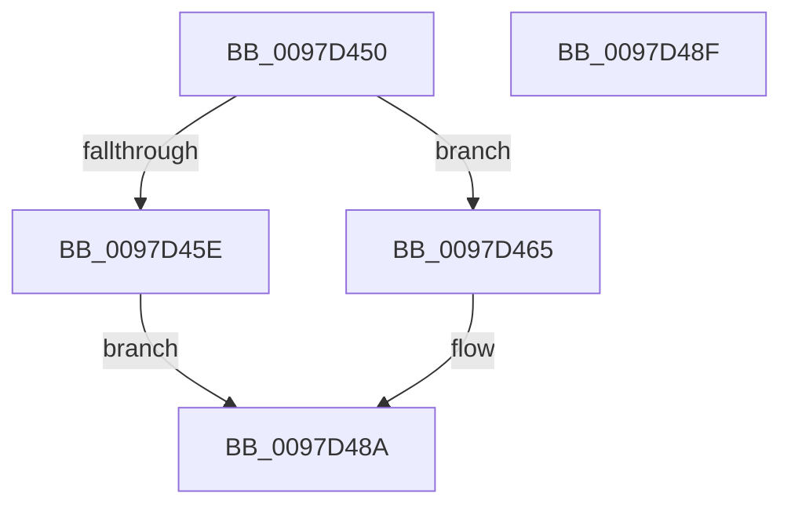

# CmRegisterInternalCallback

- RVA: `0x0097D450`–`0x0097D490` (길이 `64` bytes)
- VA: `0x000000014097D450`
- 실행 섹션: `PAGE`
- PDB 이름 있음: `예`; PDB Function 태그: `아니요`
- unwind 정보 RVA: `0x0005D2F4`
- 디코드: `16`개 명령, `64/64` bytes 표시
- 미해석 바이트: `0` (있으면 어셈블리에 `.byte`로 보존)

> 이 문서는 커널 이미지의 기계어와 PDB 기호를 분석해 생성했습니다. 4번과 5번은 함수 원형과 자료형을 바이너리 사용 방식에서 추정한 C 해석이며 원본 소스 복구 결과는 아닙니다.

## 1. Dependencies

- 직접 호출 지점: **1**; 고유 호출 대상: **1**
- 직접 호출자로 확인된 함수: **1**
- RIP 상대 이미지 참조: **3**

### Outgoing calls
- `0x0097D485` → [CmpRegisterCallbackInternal](CmpRegisterCallbackInternal_function_0097D54C.md) (function, `0x0097D54C`)

### Direct callers
- [VrpIncrementSiloCount](../93/VrpIncrementSiloCount_function_00937594.md) at `0x0093765E`

### Static image references
- `0x0097D454` → RVA `0x00EF0010` (`.data`; read)
- `0x0097D465` → RVA `0x00EF02C8` (`.data`; read)
- `0x0097D474` → RVA `0x00867450` (`VrpRegistryCallback`; read)

## 2. Other-region calls and transfers

- 다른 실행 섹션으로 향하는 call: **0**
- 별도 외부 분기/꼬리 이동을 확인하지 못했습니다.

## 3. Assembly (complete function range)

```asm
0097D450  48 83 EC 38                     sub rsp, 0x38
0097D454  48 83 3D B4 2B 57 00 00         cmp qword ptr [rip + 0x572bb4], 0
0097D45C  75 07                           jne 0x14097d465
0097D45E  B8 F1 00 00 C0                  mov eax, 0xc00000f1
0097D463  EB 25                           jmp 0x14097d48a
0097D465  48 8D 05 5C 2E 57 00            lea rax, [rip + 0x572e5c]
0097D46C  4C 8B C2                        mov r8, rdx
0097D46F  48 89 44 24 28                  mov qword ptr [rsp + 0x28], rax
0097D474  48 8D 0D D5 9F EE FF            lea rcx, [rip - 0x11602b]
0097D47B  45 33 C9                        xor r9d, r9d
0097D47E  C6 44 24 20 01                  mov byte ptr [rsp + 0x20], 1
0097D483  33 D2                           xor edx, edx
0097D485  E8 C2 00 00 00                  call 0x14097d54c
0097D48A  48 83 C4 38                     add rsp, 0x38
0097D48E  C3                              ret
0097D48F  CC                              int3
```

## 4. C-style interpretation (structured pseudocode)

```c
__int64 __fastcall CmRegisterInternalCallback(__int64 a1, __int64 a2, __int64 a3, int a4)
{
    __int64 result;
    __int64 v_rsp;
    unsigned __int64 v_stack_m10;
    unsigned __int8 v_stack_m18;

    v_rsp = (v_rsp) - (56);
    if ((*(unsigned __int64 *)(v_rip + 5712820)) != 0) goto loc_0097D465;
    goto loc_0097D48A;
loc_0097D465:
    v_stack_m10 = v_rip + 5713500;
    a4 = 0;
    v_stack_m18 = 1;
    a2 = 0;
    result = CmpRegisterCallbackInternal(v_rip - 1138731, a2, a2, a4);
loc_0097D48A:
    v_rsp = (v_rsp) + (56);
    return result;
}
```

## 5. (Beta) C Style

```c
int64_t CmRegisterInternalCallback(int64_t Arg1, int64_t Arg2, int64_t Arg3, int32_t Arg4)
{
    int64_t result;
    int64_t local_rsp;
    uint64_t v_stack_m10;
    uint8_t v_stack_m18;

    local_rsp = (local_rsp) - (56);
    if ((*(uint64_t *)(v_rip + 0x572BB4)) != 0) goto loc_0097D465;
    goto loc_0097D48A;
loc_0097D465:
    v_stack_m10 = v_rip + 5713500;
    Arg4 = 0;
    v_stack_m18 = 1;
    Arg2 = 0;
    result = CmpRegisterCallbackInternal(v_rip - 1138731, Arg2, Arg2, Arg4);
loc_0097D48A:
    local_rsp = (local_rsp) + (56);
    return result;
}
```

## 6. Execution-region graph

[열기: 2D/3D 그래프와 함수 탐색 컨트롤 패널](../../../control-panel.html?section=page&rva=0x0097D450&view=graph)

- 2D 그래프는 위에서 아래로 흐르고, 3D 그래프는 빈 공간을 드래그해 회전합니다. Shift+드래그는 이동, 휠은 확대·축소, 함수 노드 선택은 대상 보고서 이동입니다.

### Static fallback


