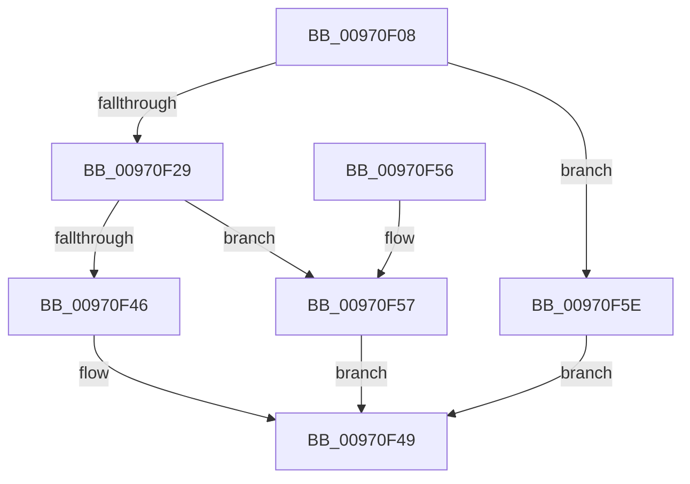

# CmpIncrementCachedSecurityRefcount

- RVA: `0x00970F08`–`0x00970F65` (길이 `93` bytes)
- VA: `0x0000000140970F08`
- 실행 섹션: `PAGE`
- PDB 이름 있음: `예`; PDB Function 태그: `아니요`
- unwind 정보 RVA: `0x0008A6D8`
- 디코드: `29`개 명령, `93/93` bytes 표시
- 미해석 바이트: `0` (있으면 어셈블리에 `.byte`로 보존)

> 이 문서는 커널 이미지의 기계어와 PDB 기호를 분석해 생성했습니다. 4번과 5번은 함수 원형과 자료형을 바이너리 사용 방식에서 추정한 C 해석이며 원본 소스 복구 결과는 아닙니다.

## 1. Dependencies

- 직접 호출 지점: **1**; 고유 호출 대상: **1**
- 직접 호출자로 확인된 함수: **1**
- RIP 상대 이미지 참조: **0**

### Outgoing calls
- `0x00970F20` → [CmpFindSecurityCellCacheIndex](../../text/42/CmpFindSecurityCellCacheIndex_function_00428060.md) (function, `0x00428060`)

### Direct callers
- [CmpCheckKey](../96/CmpCheckKey_function_0096EE2C.md) at `0x0096F177`

### Static image references
- 디코드된 RIP-relative 메모리 참조가 없습니다.

## 2. Other-region calls and transfers

- 다른 실행 섹션으로 향하는 call: **1**
  - `0x00970F20` → [CmpFindSecurityCellCacheIndex](../../text/42/CmpFindSecurityCellCacheIndex_function_00428060.md) (`PAGE` → `.text`)
- 별도 외부 분기/꼬리 이동을 확인하지 못했습니다.

## 3. Assembly (complete function range)

```asm
00970F08  48 89 5C 24 08                  mov qword ptr [rsp + 8], rbx
00970F0D  57                              push rdi
00970F0E  48 83 EC 20                     sub rsp, 0x20
00970F12  33 DB                           xor ebx, ebx
00970F14  4C 8D 44 24 40                  lea r8, [rsp + 0x40]
00970F19  89 5C 24 40                     mov dword ptr [rsp + 0x40], ebx
00970F1D  48 8B F9                        mov rdi, rcx
00970F20  E8 3B 71 AB FF                  call 0x140428060
00970F25  84 C0                           test al, al
00970F27  74 35                           je 0x140970f5e
00970F29  48 8B 87 60 07 00 00            mov rax, qword ptr [rdi + 0x760]
00970F30  8B 4C 24 40                     mov ecx, dword ptr [rsp + 0x40]
00970F34  48 03 C9                        add rcx, rcx
00970F37  48 8B 54 C8 08                  mov rdx, qword ptr [rax + rcx*8 + 8]
00970F3C  8B 42 1C                        mov eax, dword ptr [rdx + 0x1c]
00970F3F  8D 48 01                        lea ecx, [rax + 1]
00970F42  3B C8                           cmp ecx, eax
00970F44  72 11                           jb 0x140970f57
00970F46  89 4A 1C                        mov dword ptr [rdx + 0x1c], ecx
00970F49  8B C3                           mov eax, ebx
00970F4B  48 8B 5C 24 30                  mov rbx, qword ptr [rsp + 0x30]
00970F50  48 83 C4 20                     add rsp, 0x20
00970F54  5F                              pop rdi
00970F55  C3                              ret
00970F56  CC                              int3
00970F57  BB 95 00 00 C0                  mov ebx, 0xc0000095
00970F5C  EB EB                           jmp 0x140970f49
00970F5E  BB 25 02 00 C0                  mov ebx, 0xc0000225
00970F63  EB E4                           jmp 0x140970f49
```

## 4. C-style interpretation (structured pseudocode)

```c
__int64 __fastcall CmpIncrementCachedSecurityRefcount(__int64 a1)
{
    __int64 result;
    __int64 v_rbx;
    __int64 v_rsp;
    unsigned __int64 v_stack_p18;
    unsigned __int64 v_stack_p8;

    v_stack_p8 = v_rbx;
    v_rsp = (v_rsp) - (32);
    v_rbx = 0;
    v_stack_p18 = 0;
    result = CmpFindSecurityCellCacheIndex(a1, a2, v_stack_p18, a4);
    if ((unsigned __int8)(result) == 0) goto loc_00970F5E;
    a1 = ((unsigned int)(v_stack_p18)) + ((unsigned int)(v_stack_p18));
    if (((unsigned int)((unsigned int)(*(unsigned int *)(*(unsigned __int64 *)(*(unsigned __int64 *)(a1 + 1888) + a1 * 8 + 8) + 28)) + 1)) < ((unsigned int)((unsigned int)(*(unsigned int *)(*(unsigned __int64 *)(*(unsigned __int64 *)(a1 + 1888) + a1 * 8 + 8) + 28))))) goto loc_00970F57;
    *(unsigned int *)(*(unsigned __int64 *)(*(unsigned __int64 *)(a1 + 1888) + a1 * 8 + 8) + 28) = (unsigned int)((unsigned int)(*(unsigned int *)(*(unsigned __int64 *)(*(unsigned __int64 *)(a1 + 1888) + a1 * 8 + 8) + 28)) + 1);
loc_00970F49:
    v_rsp = (v_rsp) + (32);
    return 0;
loc_00970F57:
    goto loc_00970F49;
loc_00970F5E:
    goto loc_00970F49;
}
```

## 5. (Beta) C Style

```c
int64_t CmpIncrementCachedSecurityRefcount(void *Arg1)
{
    uint8_t *arg1 = (uint8_t *)Arg1;

    int64_t result;
    int64_t local_rbx;
    int64_t local_rsp;
    uint64_t v_stack_p18;
    uint64_t v_stack_p8;

    v_stack_p8 = local_rbx;
    local_rsp = (local_rsp) - (32);
    local_rbx = 0;
    v_stack_p18 = 0;
    result = CmpFindSecurityCellCacheIndex(Arg1, a2, v_stack_p18, a4);
    if ((uint8_t)(result) == 0) goto loc_00970F5E;
    Arg1 = ((uint32_t)(v_stack_p18)) + ((uint32_t)(v_stack_p18));
    if (((uint32_t)((uint32_t)(*(uint32_t *)(*(uint64_t *)(*(uint64_t *)(arg1 + 0x760) + arg1 * 8 + 0x8) + 0x1C)) + 1)) < ((uint32_t)((uint32_t)(*(uint32_t *)(*(uint64_t *)(*(uint64_t *)(arg1 + 0x760) + arg1 * 8 + 0x8) + 0x1C))))) goto loc_00970F57;
    *(uint32_t *)(*(uint64_t *)(*(uint64_t *)(arg1 + 0x760) + arg1 * 8 + 0x8) + 0x1C) = (uint32_t)((uint32_t)(*(uint32_t *)(*(uint64_t *)(*(uint64_t *)(arg1 + 0x760) + arg1 * 8 + 0x8) + 0x1C)) + 1);
loc_00970F49:
    local_rsp = (local_rsp) + (32);
    return 0;
loc_00970F57:
    goto loc_00970F49;
loc_00970F5E:
    goto loc_00970F49;
}
```

### 관측된 메모리 오프셋

구조체 형식이 확인되지 않은 접근은 인자 기준의 오프셋으로만 기록했습니다.

| 기준 인자 | 오프셋 표현 | 폭 (bit) | 접근 |
|---|---:|---:|---|
| `Arg1` | `+ 0x760` | `64` | `R` |

## 6. Execution-region graph

[열기: 2D/3D 그래프와 함수 탐색 컨트롤 패널](../../../control-panel.html?section=page&rva=0x00970F08&view=graph)

- 2D 그래프는 위에서 아래로 흐르고, 3D 그래프는 빈 공간을 드래그해 회전합니다. Shift+드래그는 이동, 휠은 확대·축소, 함수 노드 선택은 대상 보고서 이동입니다.

### Static fallback


