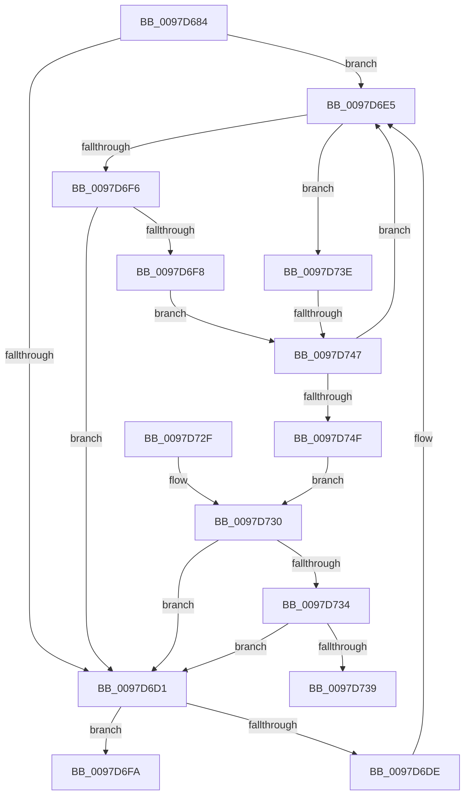

# CmpInsertCallbackInListByAltitude

- RVA: `0x0097D684`–`0x0097D751` (길이 `205` bytes)
- VA: `0x000000014097D684`
- 실행 섹션: `PAGE`
- PDB 이름 있음: `예`; PDB Function 태그: `예`
- unwind 정보 RVA: `0x0007D214`
- 디코드: `59`개 명령, `205/205` bytes 표시
- 미해석 바이트: `0` (있으면 어셈블리에 `.byte`로 보존)

> 이 문서는 커널 이미지의 기계어와 PDB 기호를 분석해 생성했습니다. 4번과 5번은 함수 원형과 자료형을 바이너리 사용 방식에서 추정한 C 해석이며 원본 소스 복구 결과는 아닙니다.

## 1. Dependencies

- 직접 호출 지점: **3**; 고유 호출 대상: **3**
- 직접 호출자로 확인된 함수: **1**
- RIP 상대 이미지 참조: **4**

### Outgoing calls
- `0x0097D6A4` → [CmpLockCallbackListExclusive](../6F/CmpLockCallbackListExclusive_function_006FEDDC.md) (function, `0x006FEDDC`)
- `0x0097D6ED` → [RtlCompareAltitudes](../../text/45/RtlCompareAltitudes_function_0045D410.md) (function, `0x0045D410`)
- `0x0097D70F` → [CmpUnlockCallbackList](CmpUnlockCallbackList_function_0097D760.md) (function, `0x0097D760`)

### Direct callers
- [CmpRegisterCallbackInternal](CmpRegisterCallbackInternal_function_0097D54C.md) at `0x0097D619`

### Static image references
- `0x0097D6A9` → RVA `0x00EF7BC0` (`.data`; read)
- `0x0097D6B0` → RVA `0x00EF7BE0` (`.data`; read)
- `0x0097D6BA` → RVA `0x00EF7BC0` (`.data`; write)
- `0x0097D708` → RVA `0x00EEFB88` (`.data`; read/write)

## 2. Other-region calls and transfers

- 다른 실행 섹션으로 향하는 call: **1**
  - `0x0097D6ED` → [RtlCompareAltitudes](../../text/45/RtlCompareAltitudes_function_0045D410.md) (`PAGE` → `.text`)
- call이 아닌 외부 분기/꼬리 이동: **2**
  - `0x0097D739` → [sub_00B29D78](../B2/Unknown_function_00B29D78.md) (`tail-transfer`)
  - `0x0097D741` → [sub_00B29D78](../B2/Unknown_function_00B29D78.md) (`tail-transfer`)

## 3. Assembly (complete function range)

```asm
0097D684  48 89 5C 24 08                  mov qword ptr [rsp + 8], rbx
0097D689  48 89 6C 24 10                  mov qword ptr [rsp + 0x10], rbp
0097D68E  48 89 74 24 18                  mov qword ptr [rsp + 0x18], rsi
0097D693  57                              push rdi
0097D694  41 56                           push r14
0097D696  41 57                           push r15
0097D698  48 83 EC 20                     sub rsp, 0x20
0097D69C  40 8A EA                        mov bpl, dl
0097D69F  48 8B F1                        mov rsi, rcx
0097D6A2  33 DB                           xor ebx, ebx
0097D6A4  E8 33 17 D8 FF                  call 0x1406feddc
0097D6A9  48 8B 05 10 A5 57 00            mov rax, qword ptr [rip + 0x57a510]
0097D6B0  4C 8D 3D 29 A5 57 00            lea r15, [rip + 0x57a529]
0097D6B7  48 FF C0                        inc rax
0097D6BA  48 89 05 FF A4 57 00            mov qword ptr [rip + 0x57a4ff], rax
0097D6C1  48 89 46 18                     mov qword ptr [rsi + 0x18], rax
0097D6C5  48 8B 3D 14 A5 57 00            mov rdi, qword ptr [rip + 0x57a514]
0097D6CC  49 3B FF                        cmp rdi, r15
0097D6CF  75 14                           jne 0x14097d6e5
0097D6D1  48 8B 47 08                     mov rax, qword ptr [rdi + 8]
0097D6D5  48 8B 08                        mov rcx, qword ptr [rax]
0097D6D8  48 39 41 08                     cmp qword ptr [rcx + 8], rax
0097D6DC  74 1C                           je 0x14097d6fa
0097D6DE  B9 03 00 00 00                  mov ecx, 3
0097D6E3  CD 29                           int 0x29
0097D6E5  48 8D 4F 30                     lea rcx, [rdi + 0x30]
0097D6E9  48 8D 56 30                     lea rdx, [rsi + 0x30]
0097D6ED  E8 1E FD AD FF                  call 0x14045d410
0097D6F2  85 C0                           test eax, eax
0097D6F4  74 48                           je 0x14097d73e
0097D6F6  78 D9                           js 0x14097d6d1
0097D6F8  EB 4D                           jmp 0x14097d747
0097D6FA  48 89 0E                        mov qword ptr [rsi], rcx
0097D6FD  48 89 46 08                     mov qword ptr [rsi + 8], rax
0097D701  48 89 71 08                     mov qword ptr [rcx + 8], rsi
0097D705  48 89 30                        mov qword ptr [rax], rsi
0097D708  F0 FF 05 79 24 57 00            lock inc dword ptr [rip + 0x572479]
0097D70F  E8 4C 00 00 00                  call 0x14097d760
0097D714  48 8B 6C 24 48                  mov rbp, qword ptr [rsp + 0x48]
0097D719  8B C3                           mov eax, ebx
0097D71B  48 8B 5C 24 40                  mov rbx, qword ptr [rsp + 0x40]
0097D720  48 8B 74 24 50                  mov rsi, qword ptr [rsp + 0x50]
0097D725  48 83 C4 20                     add rsp, 0x20
0097D729  41 5F                           pop r15
0097D72B  41 5E                           pop r14
0097D72D  5F                              pop rdi
0097D72E  C3                              ret
0097D72F  CC                              int3
0097D730  85 C0                           test eax, eax
0097D732  75 9D                           jne 0x14097d6d1
0097D734  40 84 ED                        test bpl, bpl
0097D737  75 98                           jne 0x14097d6d1
0097D739  E9 3A C6 1A 00                  jmp 0x140b29d78
0097D73E  40 84 ED                        test bpl, bpl
0097D741  0F 84 31 C6 1A 00               je 0x140b29d78
0097D747  48 8B 3F                        mov rdi, qword ptr [rdi]
0097D74A  49 3B FF                        cmp rdi, r15
0097D74D  75 96                           jne 0x14097d6e5
0097D74F  EB DF                           jmp 0x14097d730
```

## 4. C-style interpretation (structured pseudocode)

```c
__int64 __fastcall CmpInsertCallbackInListByAltitude(__int64 a1, unsigned __int8 a2)
{
    __int64 result;
    __int64 v_rbx;
    __int64 v_rsp;
    unsigned __int64 v_stack_p10;
    unsigned __int64 v_stack_p18;
    unsigned __int64 v_stack_p8;

    v_stack_p8 = v_rbx;
    v_stack_p10 = v_rbp;
    v_stack_p18 = v_rsi;
    v_rsp = (v_rsp) - (32);
    v_rbx = 0;
    result = CmpLockCallbackListExclusive(a1, a2, a3, a4);
    result = (*(unsigned __int64 *)(v_rip + 5743888)) + 1;
    *(unsigned __int64 *)(v_rip + 5743871) = result;
    *(unsigned __int64 *)(a1 + 24) = result;
    if ((*(unsigned __int64 *)(v_rip + 5743892)) != (v_rip + 5743913)) goto loc_0097D6E5;
loc_0097D6D1:
    if ((*(unsigned __int64 *)(*(unsigned __int64 *)(*(unsigned __int64 *)(*(unsigned __int64 *)(v_rip + 5743892) + 8)) + 8)) == (*(unsigned __int64 *)(*(unsigned __int64 *)(v_rip + 5743892) + 8))) goto loc_0097D6FA;
loc_0097D6E5:
    result = RtlCompareAltitudes(*(unsigned __int64 *)(v_rip + 5743892) + 48, a1 + 48, a3, a4);
    if ((unsigned int)(result) == 0) goto loc_0097D73E;
    if (sign_flag) goto loc_0097D6D1;
    goto loc_0097D747;
loc_0097D6FA:
    *(unsigned __int64 *)(a1) = *(unsigned __int64 *)(v_rip + 5743892) + 48;
    *(unsigned __int64 *)(a1 + 8) = result;
    *(unsigned __int64 *)(*(unsigned __int64 *)(v_rip + 5743892) + 48 + 8) = a1;
    *(unsigned __int64 *)(result) = a1;
    result = CmpUnlockCallbackList(*(unsigned __int64 *)(v_rip + 5743892) + 48, a1 + 48, a3, a4);
    v_rsp = (v_rsp) + (32);
    return 0;
loc_0097D730:
    if (0 != 0) goto loc_0097D6D1;
    if ((unsigned __int8)(v_stack_p10) != 0) goto loc_0097D6D1;
loc_0097D73E:
loc_0097D747:
    if ((*(unsigned __int64 *)(*(unsigned __int64 *)(v_rip + 5743892))) != (v_rip + 5743913)) goto loc_0097D6E5;
    goto loc_0097D730;
}
```

## 5. (Beta) C Style

```c
int64_t CmpInsertCallbackInListByAltitude(void *Arg1, uint8_t Arg2)
{
    uint8_t *arg1 = (uint8_t *)Arg1;

    int64_t result;
    int64_t local_rbx;
    int64_t local_rsp;
    uint64_t v_stack_p10;
    uint64_t v_stack_p18;
    uint64_t v_stack_p8;

    v_stack_p8 = local_rbx;
    v_stack_p10 = local_rbp;
    v_stack_p18 = local_rsi;
    local_rsp = (local_rsp) - (32);
    local_rbx = 0;
    result = CmpLockCallbackListExclusive(Arg1, Arg2, a3, a4);
    result = (*(uint64_t *)(v_rip + 0x57A510)) + 1;
    *(uint64_t *)(v_rip + 0x57A4FF) = result;
    *(uint64_t *)(arg1 + 0x18) = result;
    if ((*(uint64_t *)(v_rip + 0x57A514)) != (v_rip + 5743913)) goto loc_0097D6E5;
loc_0097D6D1:
    if ((*(uint64_t *)(*(uint64_t *)(*(uint64_t *)(*(uint64_t *)(v_rip + 0x57A514) + 0x8)) + 0x8)) == (*(uint64_t *)(*(uint64_t *)(v_rip + 0x57A514) + 0x8))) goto loc_0097D6FA;
loc_0097D6E5:
    result = RtlCompareAltitudes(*(uint64_t *)(v_rip + 0x57A514) + 48, Arg1 + 48, a3, a4);
    if ((uint32_t)(result) == 0) goto loc_0097D73E;
    if (sign_flag) goto loc_0097D6D1;
    goto loc_0097D747;
loc_0097D6FA:
    *(uint64_t *)(arg1) = *(uint64_t *)(v_rip + 0x57A514) + 48;
    *(uint64_t *)(arg1 + 0x8) = result;
    *(void **)(*(uint64_t *)(v_rip + 0x57A514) + 0x30 + 0x8) = Arg1;
    *(void **)(result) = Arg1;
    result = CmpUnlockCallbackList(*(uint64_t *)(v_rip + 0x57A514) + 48, Arg1 + 48, a3, a4);
    local_rsp = (local_rsp) + (32);
    return 0;
loc_0097D730:
    if (0 != 0) goto loc_0097D6D1;
    if ((uint8_t)(v_stack_p10) != 0) goto loc_0097D6D1;
loc_0097D73E:
loc_0097D747:
    if ((*(uint64_t *)(*(uint64_t *)(v_rip + 0x57A514))) != (v_rip + 5743913)) goto loc_0097D6E5;
    goto loc_0097D730;
}
```

### 관측된 메모리 오프셋

구조체 형식이 확인되지 않은 접근은 인자 기준의 오프셋으로만 기록했습니다.

| 기준 인자 | 오프셋 표현 | 폭 (bit) | 접근 |
|---|---:|---:|---|
| `Arg1` | `+ 0x0` | `64` | `W` |
| `Arg1` | `+ 0x8` | `64` | `W` |
| `Arg1` | `+ 0x18` | `64` | `W` |
| `Arg1` | `+ 0x30` | `64` | `R` |

## 6. Execution-region graph

[열기: 2D/3D 그래프와 함수 탐색 컨트롤 패널](../../../control-panel.html?section=page&rva=0x0097D684&view=graph)

- 2D 그래프는 위에서 아래로 흐르고, 3D 그래프는 빈 공간을 드래그해 회전합니다. Shift+드래그는 이동, 휠은 확대·축소, 함수 노드 선택은 대상 보고서 이동입니다.

### Static fallback


