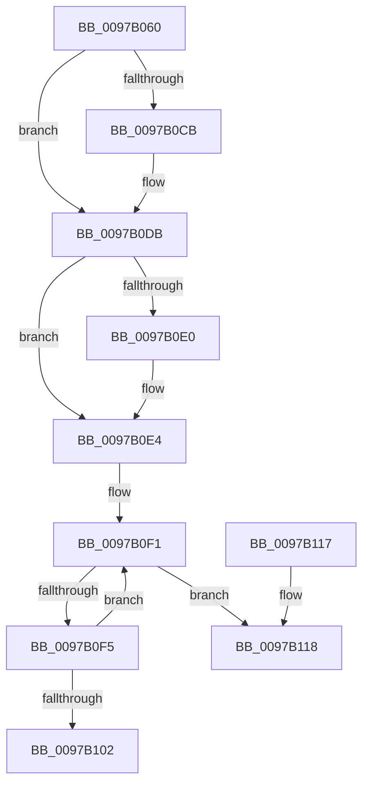

# CmpLockHashEntryShared

- RVA: `0x0097B060`–`0x0097B133` (길이 `211` bytes)
- VA: `0x000000014097B060`
- 실행 섹션: `PAGE`
- PDB 이름 있음: `예`; PDB Function 태그: `아니요`
- unwind 정보 RVA: `0x00096B6C`
- 디코드: `59`개 명령, `211/211` bytes 표시
- 미해석 바이트: `0` (있으면 어셈블리에 `.byte`로 보존)

> 이 문서는 커널 이미지의 기계어와 PDB 기호를 분석해 생성했습니다. 4번과 5번은 함수 원형과 자료형을 바이너리 사용 방식에서 추정한 C 해석이며 원본 소스 복구 결과는 아닙니다.

## 1. Dependencies

- 직접 호출 지점: **3**; 고유 호출 대상: **3**
- 직접 호출자로 확인된 함수: **1**
- RIP 상대 이미지 참조: **0**

### Outgoing calls
- `0x0097B0B4` → [KeAbPreAcquire](../../text/21/KeAbPreAcquire_function_00210230.md) (function, `0x00210230`)
- `0x0097B0D6` → [ExfAcquirePushLockSharedEx](../../text/21/ExfAcquirePushLockSharedEx_function_0021044C.md) (function, `0x0021044C`)
- `0x0097B12D` → [KeBugCheckEx](../../text/4F/KeBugCheckEx_function_004FD660.md) (function, `0x004FD660`)

### Direct callers
- [CmpWalkOneLevel](../85/CmpWalkOneLevel_function_00852BA0.md) at `0x00853314`

### Static image references
- 디코드된 RIP-relative 메모리 참조가 없습니다.

## 2. Other-region calls and transfers

- 다른 실행 섹션으로 향하는 call: **3**
  - `0x0097B0B4` → [KeAbPreAcquire](../../text/21/KeAbPreAcquire_function_00210230.md) (`PAGE` → `.text`)
  - `0x0097B0D6` → [ExfAcquirePushLockSharedEx](../../text/21/ExfAcquirePushLockSharedEx_function_0021044C.md) (`PAGE` → `.text`)
  - `0x0097B12D` → [KeBugCheckEx](../../text/4F/KeBugCheckEx_function_004FD660.md) (`PAGE` → `.text`)
- 별도 외부 분기/꼬리 이동을 확인하지 못했습니다.

## 3. Assembly (complete function range)

```asm
0097B060  48 89 5C 24 10                  mov qword ptr [rsp + 0x10], rbx
0097B065  48 89 6C 24 18                  mov qword ptr [rsp + 0x18], rbp
0097B06A  48 89 74 24 20                  mov qword ptr [rsp + 0x20], rsi
0097B06F  57                              push rdi
0097B070  48 83 EC 30                     sub rsp, 0x30
0097B074  8B C2                           mov eax, edx
0097B076  8B DA                           mov ebx, edx
0097B078  C1 E8 09                        shr eax, 9
0097B07B  48 8B F9                        mov rdi, rcx
0097B07E  33 C2                           xor eax, edx
0097B080  69 C0 A3 8A 01 00               imul eax, eax, 0x18aa3
0097B086  8B D0                           mov edx, eax
0097B088  44 8B C0                        mov r8d, eax
0097B08B  48 8B 87 70 06 00 00            mov rax, qword ptr [rdi + 0x670]
0097B092  49 C1 E8 09                     shr r8, 9
0097B096  4C 33 C2                        xor r8, rdx
0097B099  8B 91 78 06 00 00               mov edx, dword ptr [rcx + 0x678]
0097B09F  FF CA                           dec edx
0097B0A1  4C 23 C2                        and r8, rdx
0097B0A4  33 D2                           xor edx, edx
0097B0A6  4B 8D 0C 40                     lea rcx, [r8 + r8*2]
0097B0AA  45 33 C0                        xor r8d, r8d
0097B0AD  48 8D 2C C8                     lea rbp, [rax + rcx*8]
0097B0B1  48 8B CD                        mov rcx, rbp
0097B0B4  E8 77 51 89 FF                  call 0x140210230
0097B0B9  48 8B F0                        mov rsi, rax
0097B0BC  B9 11 00 00 00                  mov ecx, 0x11
0097B0C1  33 C0                           xor eax, eax
0097B0C3  F0 48 0F B1 4D 00               lock cmpxchg qword ptr [rbp], rcx
0097B0C9  74 10                           je 0x14097b0db
0097B0CB  4C 8B CD                        mov r9, rbp
0097B0CE  4C 8B C6                        mov r8, rsi
0097B0D1  33 D2                           xor edx, edx
0097B0D3  48 8B CD                        mov rcx, rbp
0097B0D6  E8 71 53 89 FF                  call 0x14021044c
0097B0DB  48 85 F6                        test rsi, rsi
0097B0DE  74 04                           je 0x14097b0e4
0097B0E0  C6 46 0A 01                     mov byte ptr [rsi + 0xa], 1
0097B0E4  0F 0D 8F 88 10 00 00            prefetchw byte ptr [rdi + 0x1088]
0097B0EB  8B 87 88 10 00 00               mov eax, dword ptr [rdi + 0x1088]
0097B0F1  85 C0                           test eax, eax
0097B0F3  74 23                           je 0x14097b118
0097B0F5  8D 48 01                        lea ecx, [rax + 1]
0097B0F8  F0 0F B1 8F 88 10 00 00         lock cmpxchg dword ptr [rdi + 0x1088], ecx
0097B100  75 EF                           jne 0x14097b0f1
0097B102  48 8B 5C 24 48                  mov rbx, qword ptr [rsp + 0x48]
0097B107  48 8B 6C 24 50                  mov rbp, qword ptr [rsp + 0x50]
0097B10C  48 8B 74 24 58                  mov rsi, qword ptr [rsp + 0x58]
0097B111  48 83 C4 30                     add rsp, 0x30
0097B115  5F                              pop rdi
0097B116  C3                              ret
0097B117  CC                              int3
0097B118  41 B9 09 00 00 00               mov r9d, 9
0097B11E  48 89 5C 24 20                  mov qword ptr [rsp + 0x20], rbx
0097B123  4C 8B C7                        mov r8, rdi
0097B126  41 8D 51 0E                     lea edx, [r9 + 0xe]
0097B12A  8D 4A 3A                        lea ecx, [rdx + 0x3a]
0097B12D  E8 2E 25 B8 FF                  call 0x1404fd660
0097B132  CC                              int3
```

## 4. C-style interpretation (structured pseudocode)

```c
__int64 __fastcall CmpLockHashEntryShared(__int64 a1, int a2)
{
    __int64 result;
    __int64 v_rsp;
    unsigned __int64 v_stack_p10;
    unsigned __int64 v_stack_p18;
    unsigned __int64 v_stack_p20;

    v_stack_p10 = v_rbx;
    v_stack_p18 = v_rbp;
    v_stack_p20 = v_rsi;
    v_rsp = (v_rsp) - (48);
    result = (unsigned int)(((unsigned int)(a2)) >> (9));
    result = (unsigned int)((result) ^ (a2));
    result = (unsigned int)((result) * ((unsigned int)(result)));
    a3 = ((unsigned int)((unsigned int)(result))) >> (9);
    a3 = (a3) ^ ((unsigned int)((unsigned int)(result)));
    a2 = (unsigned int)(((unsigned int)(*(unsigned int *)(a1 + 1656))) - 1);
    a3 = (a3) & (a2);
    a2 = 0;
    a3 = 0;
    result = KeAbPreAcquire(*(unsigned __int64 *)(a1 + 1648) + a3 + a3 * 2 * 8, a2, a3, a4);
    result = 0;
    if (!(condition_is_equal)) {
        a4 = *(unsigned __int64 *)(a1 + 1648) + a3 + a3 * 2 * 8;
        a3 = 0;
        a2 = 0;
        a1 = *(unsigned __int64 *)(a1 + 1648) + a3 + a3 * 2 * 8;
        result = ExfAcquirePushLockSharedEx(a1, a2, a3, a4);
    }
    if (result != 0) {
        *(unsigned __int8 *)(result + 10) = 1;
    }
loc_0097B0F1:
    if ((unsigned int)((unsigned int)(*(unsigned int *)(a1 + 4232))) == 0) goto loc_0097B118;
    if ((unsigned int)((unsigned int)(*(unsigned int *)(a1 + 4232))) != 0) goto loc_0097B0F1;
    v_rsp = (v_rsp) + (48);
    return (unsigned int)(*(unsigned int *)(a1 + 4232));
loc_0097B118:
    v_stack_p20 = v_stack_p10;
    result = KeBugCheckEx(9 + 14 + 58, 9 + 14, a1, 9);
    return result;
}
```

## 5. (Beta) C Style

```c
int64_t CmpLockHashEntryShared(void *Arg1, int32_t Arg2)
{
    uint8_t *arg1 = (uint8_t *)Arg1;

    int64_t result;
    int64_t local_rsp;
    uint64_t v_stack_p10;
    uint64_t v_stack_p18;
    uint64_t v_stack_p20;

    v_stack_p10 = local_rbx;
    v_stack_p18 = local_rbp;
    v_stack_p20 = local_rsi;
    local_rsp = (local_rsp) - (48);
    result = (uint32_t)(((uint32_t)(Arg2)) >> (9));
    result = (uint32_t)((result) ^ (Arg2));
    result = (uint32_t)((result) * ((uint32_t)(result)));
    a3 = ((uint32_t)((uint32_t)(result))) >> (9);
    a3 = (a3) ^ ((uint32_t)((uint32_t)(result)));
    Arg2 = (uint32_t)(((uint32_t)(*(uint32_t *)(arg1 + 0x678))) - 1);
    a3 = (a3) & (Arg2);
    Arg2 = 0;
    a3 = 0;
    result = KeAbPreAcquire(*(uint64_t *)(arg1 + 0x670) + a3 + a3 * 2 * 8, Arg2, a3, a4);
    result = 0;
    if (!(condition_is_equal)) {
        a4 = *(uint64_t *)(arg1 + 0x670) + a3 + a3 * 2 * 8;
        a3 = 0;
        Arg2 = 0;
        Arg1 = *(uint64_t *)(arg1 + 0x670) + a3 + a3 * 2 * 8;
        result = ExfAcquirePushLockSharedEx(Arg1, Arg2, a3, a4);
    }
    if (result != 0) {
        *(uint8_t *)(result + 0xA) = 1;
    }
loc_0097B0F1:
    if ((uint32_t)((uint32_t)(*(uint32_t *)(arg1 + 0x1088))) == 0) goto loc_0097B118;
    if ((uint32_t)((uint32_t)(*(uint32_t *)(arg1 + 0x1088))) != 0) goto loc_0097B0F1;
    local_rsp = (local_rsp) + (48);
    return (uint32_t)(*(uint32_t *)(arg1 + 0x1088));
loc_0097B118:
    v_stack_p20 = v_stack_p10;
    result = KeBugCheckEx(9 + 14 + 58, 9 + 14, Arg1, 9);
    return result;
}
```

### 관측된 메모리 오프셋

구조체 형식이 확인되지 않은 접근은 인자 기준의 오프셋으로만 기록했습니다.

| 기준 인자 | 오프셋 표현 | 폭 (bit) | 접근 |
|---|---:|---:|---|
| `Arg1` | `+ 0x670` | `64` | `R` |
| `Arg1` | `+ 0x678` | `32` | `R` |
| `Arg1` | `+ 0x1088` | `8` | `R` |
| `Arg1` | `+ 0x1088` | `32` | `R` |

## 6. Execution-region graph

[열기: 2D/3D 그래프와 함수 탐색 컨트롤 패널](../../../control-panel.html?section=page&rva=0x0097B060&view=graph)

- 2D 그래프는 위에서 아래로 흐르고, 3D 그래프는 빈 공간을 드래그해 회전합니다. Shift+드래그는 이동, 휠은 확대·축소, 함수 노드 선택은 대상 보고서 이동입니다.

### Static fallback


