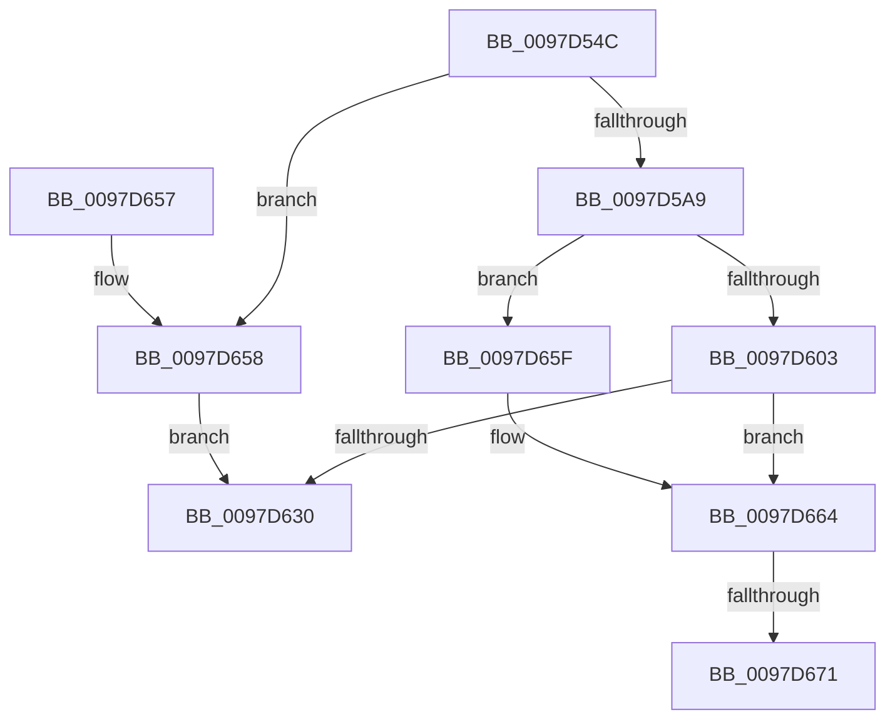

# CmpRegisterCallbackInternal

- RVA: `0x0097D54C`–`0x0097D67E` (길이 `306` bytes)
- VA: `0x000000014097D54C`
- 실행 섹션: `PAGE`
- PDB 이름 있음: `예`; PDB Function 태그: `예`
- unwind 정보 RVA: `0x000892FC`
- 디코드: `82`개 명령, `306/306` bytes 표시
- 미해석 바이트: `0` (있으면 어셈블리에 `.byte`로 보존)

> 이 문서는 커널 이미지의 기계어와 PDB 기호를 분석해 생성했습니다. 4번과 5번은 함수 원형과 자료형을 바이너리 사용 방식에서 추정한 C 해석이며 원본 소스 복구 결과는 아닙니다.

## 1. Dependencies

- 직접 호출 지점: **7**; 고유 호출 대상: **6**
- 직접 호출자로 확인된 함수: **4**
- RIP 상대 이미지 참조: **0**

### Outgoing calls
- `0x0097D583` → [CmpInitializeThreadInfo](../../text/3F/CmpInitializeThreadInfo_function_003FBE70.md) (function, `0x003FBE70`)
- `0x0097D598` → [ExAllocatePool2](../../poolcode/B8/ExAllocatePool2_function_00B820F0.md) (function, `0x00B820F0`)
- `0x0097D5F5` → [ExAllocatePool2](../../poolcode/B8/ExAllocatePool2_function_00B820F0.md) (function, `0x00B820F0`)
- `0x0097D60E` → [memcpy](../../text/6C/memcpy_function_006C6840.md) (function, `0x006C6840`)
- `0x0097D619` → [CmpInsertCallbackInListByAltitude](CmpInsertCallbackInListByAltitude_function_0097D684.md) (function, `0x0097D684`)
- `0x0097D635` → [CmCleanupThreadInfo](../../text/41/CmCleanupThreadInfo_function_0041FD50.md) (function, `0x0041FD50`)
- `0x0097D673` → [ExFreePoolWithTag](../../poolcode/B8/ExFreePoolWithTag_function_00B82870.md) (function, `0x00B82870`)

### Direct callers
- [CmRegisterCallback](../7E/CmRegisterCallback_function_007E14E0.md) at `0x007E14F8`
- [CmRegisterInternalCallback](CmRegisterInternalCallback_function_0097D450.md) at `0x0097D485`
- [EtwpRegTraceEnableCallback](EtwpRegTraceEnableCallback_function_0097D4A0.md) at `0x0097D4FB`
- [sub_00B4A8AE](../B4/Unknown_function_00B4A8AE.md) at `0x00B4A8C6`

### Static image references
- 디코드된 RIP-relative 메모리 참조가 없습니다.

## 2. Other-region calls and transfers

- 다른 실행 섹션으로 향하는 call: **6**
  - `0x0097D583` → [CmpInitializeThreadInfo](../../text/3F/CmpInitializeThreadInfo_function_003FBE70.md) (`PAGE` → `.text`)
  - `0x0097D598` → [ExAllocatePool2](../../poolcode/B8/ExAllocatePool2_function_00B820F0.md) (`PAGE` → `POOLCODE`)
  - `0x0097D5F5` → [ExAllocatePool2](../../poolcode/B8/ExAllocatePool2_function_00B820F0.md) (`PAGE` → `POOLCODE`)
  - `0x0097D60E` → [memcpy](../../text/6C/memcpy_function_006C6840.md) (`PAGE` → `.text`)
  - `0x0097D635` → [CmCleanupThreadInfo](../../text/41/CmCleanupThreadInfo_function_0041FD50.md) (`PAGE` → `.text`)
  - `0x0097D673` → [ExFreePoolWithTag](../../poolcode/B8/ExFreePoolWithTag_function_00B82870.md) (`PAGE` → `POOLCODE`)
- call이 아닌 외부 분기/꼬리 이동: **2**
  - `0x0097D66B` → [sub_00B29D68](../B2/Unknown_function_00B29D68.md) (`tail-transfer`)
  - `0x0097D679` → [sub_00B29D68](../B2/Unknown_function_00B29D68.md) (`tail-transfer`)

## 3. Assembly (complete function range)

```asm
0097D54C  4C 8B DC                        mov r11, rsp
0097D54F  49 89 5B 08                     mov qword ptr [r11 + 8], rbx
0097D553  49 89 6B 10                     mov qword ptr [r11 + 0x10], rbp
0097D557  49 89 73 18                     mov qword ptr [r11 + 0x18], rsi
0097D55B  49 89 7B 20                     mov qword ptr [r11 + 0x20], rdi
0097D55F  41 56                           push r14
0097D561  48 83 EC 40                     sub rsp, 0x40
0097D565  0F 57 C0                        xorps xmm0, xmm0
0097D568  33 C0                           xor eax, eax
0097D56A  0F 11 44 24 20                  movups xmmword ptr [rsp + 0x20], xmm0
0097D56F  4C 8B F1                        mov r14, rcx
0097D572  49 89 43 E8                     mov qword ptr [r11 - 0x18], rax
0097D576  49 8D 4B D8                     lea rcx, [r11 - 0x28]
0097D57A  41 8A F1                        mov sil, r9b
0097D57D  49 8B F8                        mov rdi, r8
0097D580  48 8B EA                        mov rbp, rdx
0097D583  E8 E8 E8 A7 FF                  call 0x1403fbe70
0097D588  BA 50 00 00 00                  mov edx, 0x50
0097D58D  41 B8 43 4D 63 62               mov r8d, 0x62634d43
0097D593  B9 00 01 00 00                  mov ecx, 0x100
0097D598  E8 53 4B 20 00                  call 0x140b820f0
0097D59D  48 8B D8                        mov rbx, rax
0097D5A0  48 85 C0                        test rax, rax
0097D5A3  0F 84 AF 00 00 00               je 0x14097d658
0097D5A9  0F B6 54 24 70                  movzx edx, byte ptr [rsp + 0x70]
0097D5AE  B9 00 01 00 00                  mov ecx, 0x100
0097D5B3  48 89 40 08                     mov qword ptr [rax + 8], rax
0097D5B7  41 B8 43 4D 63 61               mov r8d, 0x61634d43
0097D5BD  48 89 00                        mov qword ptr [rax], rax
0097D5C0  48 83 C0 40                     add rax, 0x40
0097D5C4  48 89 40 08                     mov qword ptr [rax + 8], rax
0097D5C8  48 89 00                        mov qword ptr [rax], rax
0097D5CB  8B 43 14                        mov eax, dword ptr [rbx + 0x14]
0097D5CE  33 D0                           xor edx, eax
0097D5D0  83 E2 01                        and edx, 1
0097D5D3  C7 43 10 00 00 00 00            mov dword ptr [rbx + 0x10], 0
0097D5DA  33 D0                           xor edx, eax
0097D5DC  48 89 6B 20                     mov qword ptr [rbx + 0x20], rbp
0097D5E0  89 53 14                        mov dword ptr [rbx + 0x14], edx
0097D5E3  4C 89 73 28                     mov qword ptr [rbx + 0x28], r14
0097D5E7  0F B7 07                        movzx eax, word ptr [rdi]
0097D5EA  66 89 43 32                     mov word ptr [rbx + 0x32], ax
0097D5EE  66 89 43 30                     mov word ptr [rbx + 0x30], ax
0097D5F2  0F B7 17                        movzx edx, word ptr [rdi]
0097D5F5  E8 F6 4A 20 00                  call 0x140b820f0
0097D5FA  48 89 43 38                     mov qword ptr [rbx + 0x38], rax
0097D5FE  48 85 C0                        test rax, rax
0097D601  74 5C                           je 0x14097d65f
0097D603  44 0F B7 07                     movzx r8d, word ptr [rdi]
0097D607  48 8B C8                        mov rcx, rax
0097D60A  48 8B 57 08                     mov rdx, qword ptr [rdi + 8]
0097D60E  E8 2D 92 D4 FF                  call 0x1406c6840
0097D613  40 8A D6                        mov dl, sil
0097D616  48 8B CB                        mov rcx, rbx
0097D619  E8 66 00 00 00                  call 0x14097d684
0097D61E  48 8B 4C 24 78                  mov rcx, qword ptr [rsp + 0x78]
0097D623  8B F8                           mov edi, eax
0097D625  48 8B 53 18                     mov rdx, qword ptr [rbx + 0x18]
0097D629  48 89 11                        mov qword ptr [rcx], rdx
0097D62C  85 C0                           test eax, eax
0097D62E  78 34                           js 0x14097d664
0097D630  48 8D 4C 24 20                  lea rcx, [rsp + 0x20]
0097D635  E8 16 27 AA FF                  call 0x14041fd50
0097D63A  48 8B 5C 24 50                  mov rbx, qword ptr [rsp + 0x50]
0097D63F  8B C7                           mov eax, edi
0097D641  48 8B 7C 24 68                  mov rdi, qword ptr [rsp + 0x68]
0097D646  48 8B 6C 24 58                  mov rbp, qword ptr [rsp + 0x58]
0097D64B  48 8B 74 24 60                  mov rsi, qword ptr [rsp + 0x60]
0097D650  48 83 C4 40                     add rsp, 0x40
0097D654  41 5E                           pop r14
0097D656  C3                              ret
0097D657  CC                              int3
0097D658  BF 9A 00 00 C0                  mov edi, 0xc000009a
0097D65D  EB D1                           jmp 0x14097d630
0097D65F  BF 9A 00 00 C0                  mov edi, 0xc000009a
0097D664  48 8B 4B 38                     mov rcx, qword ptr [rbx + 0x38]
0097D668  48 85 C9                        test rcx, rcx
0097D66B  0F 84 F7 C6 1A 00               je 0x140b29d68
0097D671  33 D2                           xor edx, edx
0097D673  E8 F8 51 20 00                  call 0x140b82870
0097D678  90                              nop
0097D679  E9 EA C6 1A 00                  jmp 0x140b29d68
```

## 4. C-style interpretation (structured pseudocode)

```c
__int64 __fastcall CmpRegisterCallbackInternal(__int64 a1, __int64 a2, __int64 a3, unsigned __int8 a4, unsigned __int8 a5, __int64 a6)
{
    __int64 result;
    __int64 v_rsp;
    unsigned __int64 v_stack_m28;
    unsigned __int64 v_stack_p10;
    unsigned __int64 v_stack_p18;
    unsigned __int64 v_stack_p20;
    unsigned __int64 v_stack_p8;

    *(unsigned __int64 *)(v_rsp + 8) = v_rbx;
    *(unsigned __int64 *)(v_rsp + 16) = v_rbp;
    *(unsigned __int64 *)(v_rsp + 24) = v_rsi;
    *(unsigned __int64 *)(v_rsp + 32) = v_rdi;
    v_rsp = (v_rsp) - (64);
    result = 0;
    v_stack_m28 = v_xmm0;
    *(unsigned __int64 *)(v_rsp - 24) = 0;
    result = CmpInitializeThreadInfo(v_rsp - 40, a2, a3, a4);
    result = ExAllocatePool2(256, 80, (unsigned int)(0x62634D43ULL), a4);
    if (result == 0) goto loc_0097D658;
    *(unsigned __int64 *)(result + 8) = result;
    *(unsigned __int64 *)(result) = result;
    result = (result) + (64);
    *(unsigned __int64 *)(result + 8) = result;
    *(unsigned __int64 *)(result) = result;
    a2 = (unsigned int)((a5) ^ ((unsigned int)((unsigned int)(*(unsigned int *)(result + 20)))));
    a2 = (unsigned int)((a2) & (1));
    *(unsigned int *)(result + 16) = 0;
    a2 = (unsigned int)((a2) ^ ((unsigned int)((unsigned int)(*(unsigned int *)(result + 20)))));
    *(unsigned __int64 *)(result + 32) = a2;
    *(unsigned int *)(result + 20) = (unsigned int)(a2);
    *(unsigned __int64 *)(result + 40) = a1;
    *(unsigned __int16 *)(result + 50) = (unsigned __int16)(*(unsigned __int16 *)(a3));
    *(unsigned __int16 *)(result + 48) = (unsigned __int16)(*(unsigned __int16 *)(a3));
    result = ExAllocatePool2(256, *(unsigned __int16 *)(a3), (unsigned int)(0x61634D43ULL), a4);
    *(unsigned __int64 *)(result + 56) = result;
    if (result == 0) goto loc_0097D65F;
    result = memcpy(result, *(unsigned __int64 *)(a3 + 8), *(unsigned __int16 *)(a3), a4);
    result = CmpInsertCallbackInListByAltitude(result, a4, *(unsigned __int16 *)(a3), a4);
    *(unsigned __int64 *)(a6) = *(unsigned __int64 *)(result + 24);
    if (sign_flag) goto loc_0097D664;
loc_0097D630:
    result = CmCleanupThreadInfo(v_stack_m28, *(unsigned __int64 *)(result + 24), *(unsigned __int16 *)(a3), a4);
    v_rsp = (v_rsp) + (64);
    return (unsigned int)((unsigned int)((unsigned int)((unsigned int)(result))));
loc_0097D658:
    goto loc_0097D630;
loc_0097D65F:
loc_0097D664:
    a2 = 0;
    result = ExFreePoolWithTag(*(unsigned __int64 *)(v_stack_p8 + 56), a2, *(unsigned __int16 *)(a3), a4);
}
```

## 5. (Beta) C Style

```c
int64_t CmpRegisterCallbackInternal(int64_t Arg1, int64_t Arg2, void *Arg3, uint8_t Arg4, uint8_t Arg5, void *Arg6)
{
    uint8_t *arg3 = (uint8_t *)Arg3;
    uint8_t *arg6 = (uint8_t *)Arg6;

    int64_t result;
    int64_t local_rsp;
    uint64_t v_stack_m28;
    uint64_t v_stack_p10;
    uint64_t v_stack_p18;
    uint64_t v_stack_p20;
    uint64_t v_stack_p8;

    *(uint64_t *)(local_rsp + 0x8) = local_rbx;
    *(uint64_t *)(local_rsp + 0x10) = local_rbp;
    *(uint64_t *)(local_rsp + 0x18) = local_rsi;
    *(uint64_t *)(local_rsp + 0x20) = local_rdi;
    local_rsp = (local_rsp) - (64);
    result = 0;
    v_stack_m28 = v_xmm0;
    *(uint64_t *)(local_rsp - 0x18) = 0;
    result = CmpInitializeThreadInfo(local_rsp - 40, Arg2, Arg3, Arg4);
    result = ExAllocatePool2(256, 80, (uint32_t)(0x62634D43ULL), Arg4);
    if (result == 0) goto loc_0097D658;
    *(uint64_t *)(result + 0x8) = result;
    *(uint64_t *)(result) = result;
    result = (result) + (64);
    *(uint64_t *)(result + 0x8) = result;
    *(uint64_t *)(result) = result;
    Arg2 = (uint32_t)((Arg5) ^ ((uint32_t)((uint32_t)(*(uint32_t *)(result + 0x14)))));
    Arg2 = (uint32_t)((Arg2) & (1));
    *(uint32_t *)(result + 0x10) = 0;
    Arg2 = (uint32_t)((Arg2) ^ ((uint32_t)((uint32_t)(*(uint32_t *)(result + 0x14)))));
    *(uint64_t *)(result + 0x20) = Arg2;
    *(uint32_t *)(result + 0x14) = (uint32_t)(Arg2);
    *(uint64_t *)(result + 0x28) = Arg1;
    *(uint16_t *)(result + 0x32) = (uint16_t)(*(uint16_t *)(arg3));
    *(uint16_t *)(result + 0x30) = (uint16_t)(*(uint16_t *)(arg3));
    result = ExAllocatePool2(256, *(uint16_t *)(arg3), (uint32_t)(0x61634D43ULL), Arg4);
    *(uint64_t *)(result + 0x38) = result;
    if (result == 0) goto loc_0097D65F;
    result = memcpy(result, *(uint64_t *)(arg3 + 0x8), *(uint16_t *)(arg3), Arg4);
    result = CmpInsertCallbackInListByAltitude(result, Arg4, *(uint16_t *)(arg3), Arg4);
    *(uint64_t *)(arg6) = *(uint64_t *)(result + 0x18);
    if (sign_flag) goto loc_0097D664;
loc_0097D630:
    result = CmCleanupThreadInfo(v_stack_m28, *(uint64_t *)(result + 0x18), *(uint16_t *)(arg3), Arg4);
    local_rsp = (local_rsp) + (64);
    return (uint32_t)((uint32_t)((uint32_t)((uint32_t)(result))));
loc_0097D658:
    goto loc_0097D630;
loc_0097D65F:
loc_0097D664:
    Arg2 = 0;
    result = ExFreePoolWithTag(*(uint64_t *)(v_stack_p8 + 0x38), Arg2, *(uint16_t *)(arg3), Arg4);
}
```

### 관측된 메모리 오프셋

구조체 형식이 확인되지 않은 접근은 인자 기준의 오프셋으로만 기록했습니다.

| 기준 인자 | 오프셋 표현 | 폭 (bit) | 접근 |
|---|---:|---:|---|
| `Arg3` | `+ 0x0` | `16` | `R` |
| `Arg3` | `+ 0x8` | `64` | `R` |
| `Arg6` | `+ 0x0` | `64` | `W` |

## 6. Execution-region graph

[열기: 2D/3D 그래프와 함수 탐색 컨트롤 패널](../../../control-panel.html?section=page&rva=0x0097D54C&view=graph)

- 2D 그래프는 위에서 아래로 흐르고, 3D 그래프는 빈 공간을 드래그해 회전합니다. Shift+드래그는 이동, 휠은 확대·축소, 함수 노드 선택은 대상 보고서 이동입니다.

### Static fallback


