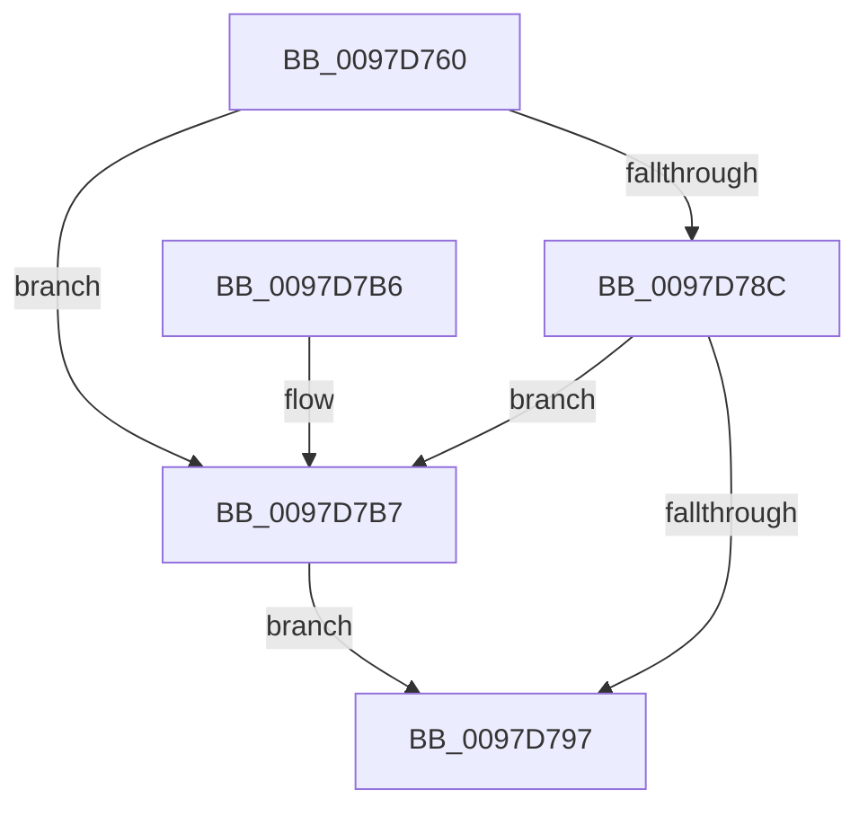

# CmpUnlockCallbackList

- RVA: `0x0097D760`–`0x0097D7C5` (길이 `101` bytes)
- VA: `0x000000014097D760`
- 실행 섹션: `PAGE`
- PDB 이름 있음: `예`; PDB Function 태그: `아니요`
- unwind 정보 RVA: `0x00064C74`
- 디코드: `23`개 명령, `101/101` bytes 표시
- 미해석 바이트: `0` (있으면 어셈블리에 `.byte`로 보존)

> 이 문서는 커널 이미지의 기계어와 PDB 기호를 분석해 생성했습니다. 4번과 5번은 함수 원형과 자료형을 바이너리 사용 방식에서 추정한 C 해석이며 원본 소스 복구 결과는 아닙니다.

## 1. Dependencies

- 직접 호출 지점: **3**; 고유 호출 대상: **3**
- 직접 호출자로 확인된 함수: **3**
- RIP 상대 이미지 참조: **1**

### Outgoing calls
- `0x0097D79E` → [KeAbPostRelease](../../text/2E/KeAbPostRelease_function_002E1600.md) (function, `0x002E1600`)
- `0x0097D7AC` → [KeLeaveCriticalRegionThread](../../text/25/KeLeaveCriticalRegionThread_function_0025EFF0.md) (function, `0x0025EFF0`)
- `0x0097D7BE` → [ExfReleasePushLock](../../text/26/ExfReleasePushLock_function_002638D0.md) (function, `0x002638D0`)

### Direct callers
- [CmUnRegisterCallback](../7E/CmUnRegisterCallback_function_007E1510.md) at `0x007E15A4`
- [CmUnRegisterCallback](../7E/CmUnRegisterCallback_function_007E1510.md) at `0x007E1608`
- [CmUnRegisterCallback](../7E/CmUnRegisterCallback_function_007E1510.md) at `0x007E161A`
- [CmUnRegisterCallback](../7E/CmUnRegisterCallback_function_007E1510.md) at `0x007E1660`
- [CmpEnumerateCallback](../7E/CmpEnumerateCallback_function_007E18D0.md) at `0x007E1940`
- [CmpInsertCallbackInListByAltitude](CmpInsertCallbackInListByAltitude_function_0097D684.md) at `0x0097D70F`

### Static image references
- `0x0097D764` → RVA `0x00EF7BD0` (`.data`; read)

## 2. Other-region calls and transfers

- 다른 실행 섹션으로 향하는 call: **3**
  - `0x0097D79E` → [KeAbPostRelease](../../text/2E/KeAbPostRelease_function_002E1600.md) (`PAGE` → `.text`)
  - `0x0097D7AC` → [KeLeaveCriticalRegionThread](../../text/25/KeLeaveCriticalRegionThread_function_0025EFF0.md) (`PAGE` → `.text`)
  - `0x0097D7BE` → [ExfReleasePushLock](../../text/26/ExfReleasePushLock_function_002638D0.md) (`PAGE` → `.text`)
- 별도 외부 분기/꼬리 이동을 확인하지 못했습니다.

## 3. Assembly (complete function range)

```asm
0097D760  48 83 EC 28                     sub rsp, 0x28
0097D764  0F 0D 0D 65 A4 57 00            prefetchw byte ptr [rip + 0x57a465]
0097D76B  48 8B 05 5E A4 57 00            mov rax, qword ptr [rip + 0x57a45e]
0097D772  45 33 C0                        xor r8d, r8d
0097D775  48 8B C8                        mov rcx, rax
0097D778  48 83 E1 F0                     and rcx, 0xfffffffffffffff0
0097D77C  48 83 F9 10                     cmp rcx, 0x10
0097D780  48 8D 50 F0                     lea rdx, [rax - 0x10]
0097D784  49 0F 46 D0                     cmovbe rdx, r8
0097D788  A8 02                           test al, 2
0097D78A  75 2B                           jne 0x14097d7b7
0097D78C  F0 48 0F B1 15 3B A4 57 00      lock cmpxchg qword ptr [rip + 0x57a43b], rdx
0097D795  75 20                           jne 0x14097d7b7
0097D797  48 8D 0D 32 A4 57 00            lea rcx, [rip + 0x57a432]
0097D79E  E8 5D 3E 96 FF                  call 0x1402e1600
0097D7A3  65 48 8B 0C 25 88 01 00 00      mov rcx, qword ptr gs:[0x188]
0097D7AC  E8 3F 18 8E FF                  call 0x14025eff0
0097D7B1  48 83 C4 28                     add rsp, 0x28
0097D7B5  C3                              ret
0097D7B6  CC                              int3
0097D7B7  48 8D 0D 12 A4 57 00            lea rcx, [rip + 0x57a412]
0097D7BE  E8 0D 61 8E FF                  call 0x1402638d0
0097D7C3  EB D2                           jmp 0x14097d797
```

## 4. C-style interpretation (structured pseudocode)

```c
__int64 __fastcall CmpUnlockCallbackList(__int64 a1, __int64 a2, int a3)
{
    __int64 result;
    __int64 v_rsp;

    v_rsp = (v_rsp) - (40);
    a3 = 0;
    a1 = (*(unsigned __int64 *)(v_rip + 5743710)) & (-16);
    a2 = *(unsigned __int64 *)(v_rip + 5743710) - 16;
    if (a1 <= 16) { a2 = 0; }
    if ((((unsigned __int8)(*(unsigned __int64 *)(v_rip + 5743710))) & (2)) != 0) goto loc_0097D7B7;
    if ((((unsigned __int8)(*(unsigned __int64 *)(v_rip + 5743710))) & (2)) != 0) goto loc_0097D7B7;
loc_0097D797:
    result = KeAbPostRelease(v_rip + 5743666, a2, a3, a4);
    result = KeLeaveCriticalRegionThread(*(unsigned __int64 *)(gs_base + (0 + 392)), a2, a3, a4);
    v_rsp = (v_rsp) + (40);
    return result;
loc_0097D7B7:
    result = ExfReleasePushLock(v_rip + 5743634, a2, a3, a4);
    goto loc_0097D797;
}
```

## 5. (Beta) C Style

```c
int64_t CmpUnlockCallbackList(int64_t Arg1, int64_t Arg2, int32_t Arg3)
{
    int64_t result;
    int64_t local_rsp;

    local_rsp = (local_rsp) - (40);
    Arg3 = 0;
    Arg1 = (*(uint64_t *)(v_rip + 0x57A45E)) & (-16);
    Arg2 = *(uint64_t *)(v_rip + 0x57A45E) - 16;
    if (Arg1 <= 16) { Arg2 = 0; }
    if ((((uint8_t)(*(uint64_t *)(v_rip + 0x57A45E))) & (2)) != 0) goto loc_0097D7B7;
    if ((((uint8_t)(*(uint64_t *)(v_rip + 0x57A45E))) & (2)) != 0) goto loc_0097D7B7;
loc_0097D797:
    result = KeAbPostRelease(v_rip + 5743666, Arg2, Arg3, a4);
    result = KeLeaveCriticalRegionThread(*(uint64_t *)(gs_base + (0 + 0x188)), Arg2, Arg3, a4);
    local_rsp = (local_rsp) + (40);
    return result;
loc_0097D7B7:
    result = ExfReleasePushLock(v_rip + 5743634, Arg2, Arg3, a4);
    goto loc_0097D797;
}
```

## 6. Execution-region graph

[열기: 2D/3D 그래프와 함수 탐색 컨트롤 패널](../../../control-panel.html?section=page&rva=0x0097D760&view=graph)

- 2D 그래프는 위에서 아래로 흐르고, 3D 그래프는 빈 공간을 드래그해 회전합니다. Shift+드래그는 이동, 휠은 확대·축소, 함수 노드 선택은 대상 보고서 이동입니다.

### Static fallback


