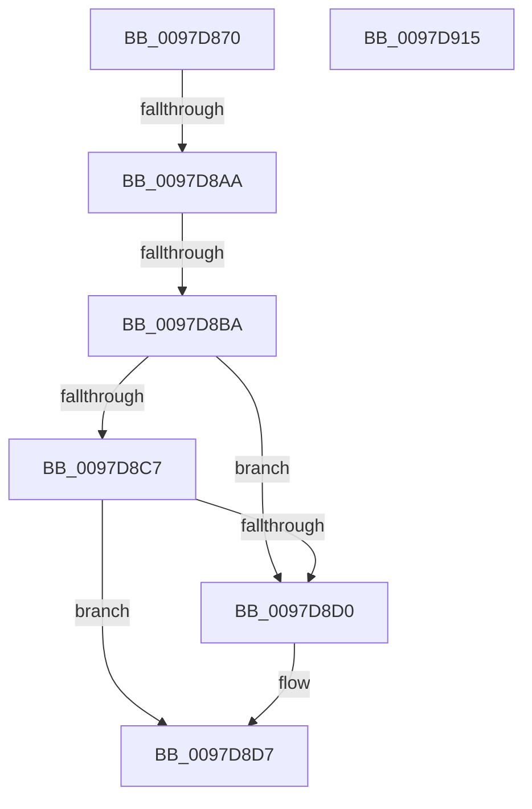

# EtwpCovSampContextRemoveAndFreeModule

- RVA: `0x0097D870`–`0x0097D916` (길이 `166` bytes)
- VA: `0x000000014097D870`
- 실행 섹션: `PAGE`
- PDB 이름 있음: `예`; PDB Function 태그: `예`
- unwind 정보 RVA: `0x000974C4`
- 디코드: `46`개 명령, `166/166` bytes 표시
- 미해석 바이트: `0` (있으면 어셈블리에 `.byte`로 보존)

> 이 문서는 커널 이미지의 기계어와 PDB 기호를 분석해 생성했습니다. 4번과 5번은 함수 원형과 자료형을 바이너리 사용 방식에서 추정한 C 해석이며 원본 소스 복구 결과는 아닙니다.

## 1. Dependencies

- 직접 호출 지점: **2**; 고유 호출 대상: **2**
- 직접 호출자로 확인된 함수: **1**
- RIP 상대 이미지 참조: **0**

### Outgoing calls
- `0x0097D8EF` → [EtwpCovSampModuleCleanup](EtwpCovSampModuleCleanup_function_0097D91C.md) (function, `0x0097D91C`)
- `0x0097D8FC` → [ExFreePoolWithTag](../../poolcode/B8/ExFreePoolWithTag_function_00B82870.md) (function, `0x00B82870`)

### Direct callers
- [EtwpCovSampContextCleanup](../6F/EtwpCovSampContextCleanup_function_006FDF84.md) at `0x006FE1D4`

### Static image references
- 디코드된 RIP-relative 메모리 참조가 없습니다.

## 2. Other-region calls and transfers

- 다른 실행 섹션으로 향하는 call: **1**
  - `0x0097D8FC` → [ExFreePoolWithTag](../../poolcode/B8/ExFreePoolWithTag_function_00B82870.md) (`PAGE` → `POOLCODE`)
- call이 아닌 외부 분기/꼬리 이동: **2**
  - `0x0097D8A4` → [sub_00B29D82](../B2/Unknown_function_00B29D82.md) (`tail-transfer`)
  - `0x0097D8B4` → [sub_00B29D82 + 0xC7](../B2/Unknown_function_00B29D82.md) (`tail-transfer`)

## 3. Assembly (complete function range)

```asm
0097D870  48 89 5C 24 08                  mov qword ptr [rsp + 8], rbx
0097D875  48 89 74 24 18                  mov qword ptr [rsp + 0x18], rsi
0097D87A  57                              push rdi
0097D87B  41 56                           push r14
0097D87D  41 57                           push r15
0097D87F  48 83 EC 20                     sub rsp, 0x20
0097D883  4C 8B 1A                        mov r11, qword ptr [rdx]
0097D886  45 33 F6                        xor r14d, r14d
0097D889  48 83 CE FF                     or rsi, 0xffffffffffffffff
0097D88D  4C 89 72 40                     mov qword ptr [rdx + 0x40], r14
0097D891  48 8B DA                        mov rbx, rdx
0097D894  4C 8B D1                        mov r10, rcx
0097D897  49 BF 02 00 00 00 00 00 00 80   movabs r15, 0x8000000000000002
0097D8A1  4D 85 DB                        test r11, r11
0097D8A4  0F 85 D8 C4 1A 00               jne 0x140b29d82
0097D8AA  4C 8D 5B 10                     lea r11, [rbx + 0x10]
0097D8AE  49 8B 3B                        mov rdi, qword ptr [r11]
0097D8B1  48 85 FF                        test rdi, rdi
0097D8B4  0F 85 8F C5 1A 00               jne 0x140b29e49
0097D8BA  48 8D 43 48                     lea rax, [rbx + 0x48]
0097D8BE  48 8B 08                        mov rcx, qword ptr [rax]
0097D8C1  48 39 41 08                     cmp qword ptr [rcx + 8], rax
0097D8C5  75 09                           jne 0x14097d8d0
0097D8C7  48 8B 50 08                     mov rdx, qword ptr [rax + 8]
0097D8CB  48 39 02                        cmp qword ptr [rdx], rax
0097D8CE  74 07                           je 0x14097d8d7
0097D8D0  B9 03 00 00 00                  mov ecx, 3
0097D8D5  CD 29                           int 0x29
0097D8D7  48 89 0A                        mov qword ptr [rdx], rcx
0097D8DA  48 89 51 08                     mov qword ptr [rcx + 8], rdx
0097D8DE  48 8B CB                        mov rcx, rbx
0097D8E1  48 89 40 08                     mov qword ptr [rax + 8], rax
0097D8E5  48 89 00                        mov qword ptr [rax], rax
0097D8E8  41 FF 8A D8 04 00 00            dec dword ptr [r10 + 0x4d8]
0097D8EF  E8 28 00 00 00                  call 0x14097d91c
0097D8F4  BA 45 74 77 56                  mov edx, 0x56777445
0097D8F9  48 8B CB                        mov rcx, rbx
0097D8FC  E8 6F 4F 20 00                  call 0x140b82870
0097D901  48 8B 5C 24 40                  mov rbx, qword ptr [rsp + 0x40]
0097D906  48 8B 74 24 50                  mov rsi, qword ptr [rsp + 0x50]
0097D90B  48 83 C4 20                     add rsp, 0x20
0097D90F  41 5F                           pop r15
0097D911  41 5E                           pop r14
0097D913  5F                              pop rdi
0097D914  C3                              ret
0097D915  CC                              int3
```

## 4. C-style interpretation (structured pseudocode)

```c
__int64 __fastcall EtwpCovSampContextRemoveAndFreeModule(__int64 a1, __int64 a2)
{
    __int64 result;
    __int64 v_r14;
    __int64 v_rsi;
    __int64 v_rsp;
    unsigned __int64 v_stack_p18;
    unsigned __int64 v_stack_p8;

    v_stack_p8 = v_rbx;
    v_stack_p18 = v_rsi;
    v_rsp = (v_rsp) - (32);
    v_r14 = 0;
    v_rsi = (v_rsi) | (-1);
    *(unsigned __int64 *)(a2 + 64) = 0;
    if ((*(unsigned __int64 *)(*(unsigned __int64 *)(a2 + 72) + 8)) != (a2 + 72)) goto loc_0097D8D0;
    if ((*(unsigned __int64 *)(*(unsigned __int64 *)(a2 + 72 + 8))) != (a2 + 72)) {
        a1 = 3;
    }
    *(unsigned __int64 *)(*(unsigned __int64 *)(a2 + 72 + 8)) = a1;
    *(unsigned __int64 *)(a1 + 8) = *(unsigned __int64 *)(a2 + 72 + 8);
    *(unsigned __int64 *)(a2 + 72 + 8) = a2 + 72;
    *(unsigned __int64 *)(a2 + 72) = a2 + 72;
    result = EtwpCovSampModuleCleanup(a2, *(unsigned __int64 *)(a2 + 72 + 8), a3, a4);
    result = ExFreePoolWithTag(a2, (unsigned int)(0x56777445ULL), a3, a4);
    v_rsp = (v_rsp) + (32);
    return result;
}
```

## 5. (Beta) C Style

```c
int64_t EtwpCovSampContextRemoveAndFreeModule(void *Arg1, void *Arg2)
{
    uint8_t *arg1 = (uint8_t *)Arg1;
    uint8_t *arg2 = (uint8_t *)Arg2;

    int64_t result;
    int64_t local_r14;
    int64_t local_rsi;
    int64_t local_rsp;
    uint64_t v_stack_p18;
    uint64_t v_stack_p8;

    v_stack_p8 = local_rbx;
    v_stack_p18 = local_rsi;
    local_rsp = (local_rsp) - (32);
    local_r14 = 0;
    local_rsi = (local_rsi) | (-1);
    *(uint64_t *)(arg2 + 0x40) = 0;
    if ((*(uint64_t *)(*(uint64_t *)(arg2 + 0x48) + 0x8)) != (Arg2 + 72)) goto loc_0097D8D0;
    if ((*(uint64_t *)(*(uint64_t *)(arg2 + 0x48 + 0x8))) != (Arg2 + 72)) {
        Arg1 = 3;
    }
    *(void **)(*(uint64_t *)(arg2 + 0x48 + 0x8)) = Arg1;
    *(uint64_t *)(arg1 + 0x8) = *(uint64_t *)(arg2 + 0x48 + 0x8);
    *(void **)(arg2 + 0x48 + 0x8) = Arg2 + 72;
    *(void **)(arg2 + 0x48) = Arg2 + 72;
    result = EtwpCovSampModuleCleanup(Arg2, *(uint64_t *)(arg2 + 0x48 + 0x8), a3, a4);
    result = ExFreePoolWithTag(Arg2, (uint32_t)(0x56777445ULL), a3, a4);
    local_rsp = (local_rsp) + (32);
    return result;
}
```

### 관측된 메모리 오프셋

구조체 형식이 확인되지 않은 접근은 인자 기준의 오프셋으로만 기록했습니다.

| 기준 인자 | 오프셋 표현 | 폭 (bit) | 접근 |
|---|---:|---:|---|
| `Arg1` | `+ 0x4D8` | `32` | `R/W` |
| `Arg2` | `+ 0x0` | `64` | `R` |
| `Arg2` | `+ 0x0` | `64` | `W` |
| `Arg2` | `+ 0x8` | `64` | `R` |
| `Arg2` | `+ 0x8` | `64` | `W` |
| `Arg2` | `+ 0x10` | `64` | `R` |
| `Arg2` | `+ 0x40` | `64` | `W` |
| `Arg2` | `+ 0x48` | `64` | `R` |

## 6. Execution-region graph

[열기: 2D/3D 그래프와 함수 탐색 컨트롤 패널](../../../control-panel.html?section=page&rva=0x0097D870&view=graph)

- 2D 그래프는 위에서 아래로 흐르고, 3D 그래프는 빈 공간을 드래그해 회전합니다. Shift+드래그는 이동, 휠은 확대·축소, 함수 노드 선택은 대상 보고서 이동입니다.

### Static fallback


