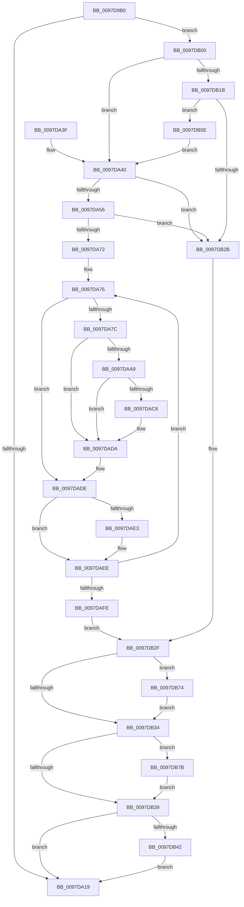

# EtwpCovSampEnumerateProcess

- RVA: `0x0097D9B0`–`0x0097DB87` (길이 `471` bytes)
- VA: `0x000000014097D9B0`
- 실행 섹션: `PAGE`
- PDB 이름 있음: `예`; PDB Function 태그: `아니요`
- unwind 정보 RVA: `0x000974EC`
- 디코드: `122`개 명령, `471/471` bytes 표시
- 미해석 바이트: `0` (있으면 어셈블리에 `.byte`로 보존)

> 이 문서는 커널 이미지의 기계어와 PDB 기호를 분석해 생성했습니다. 4번과 5번은 함수 원형과 자료형을 바이너리 사용 방식에서 추정한 C 해석이며 원본 소스 복구 결과는 아닙니다.

## 1. Dependencies

- 직접 호출 지점: **11**; 고유 호출 대상: **10**
- 직접 호출자로 확인된 함수: **0**
- RIP 상대 이미지 참조: **3**

### Outgoing calls
- `0x0097DA22` → [_security_check_cookie](../../text/6A/_security_check_cookie_function_006AC640.md) (function, `0x006AC640`)
- `0x0097DA45` → [MmEnumerateAddressSpaceAndReferenceImages](MmEnumerateAddressSpaceAndReferenceImages_function_0097DD50.md) (function, `0x0097DD50`)
- `0x0097DABD` → [guard_dispatch_icall](../../text/6B/guard_dispatch_icall_function_006BAAD0.md) (function, `0x006BAAD0`)
- `0x0097DAD5` → [EtwpCovSampImageNotify](../8D/EtwpCovSampImageNotify_function_008D70C0.md) (function, `0x008D70C0`)
- `0x0097DAE3` → [FsRtlReleaseFileNameInformation](FsRtlReleaseFileNameInformation_function_0097DB90.md) (function, `0x0097DB90`)
- `0x0097DB22` → [ExAcquireRundownProtection](../../text/21/ExAcquireRundownProtection_function_00216620.md) (function, `0x00216620`)
- `0x0097DB48` → [KiUnstackDetachProcess](../../text/21/KiUnstackDetachProcess_function_00217D30.md) (function, `0x00217D30`)
- `0x0097DB54` → [ExReleaseRundownProtection](../../text/34/ExReleaseRundownProtection_function_00349E80.md) (function, `0x00349E80`)
- `0x0097DB67` → [KiStackAttachProcess](../../text/21/KiStackAttachProcess_function_00216820.md) (function, `0x00216820`)
- `0x0097DB74` → [FsRtlReleaseFileNameInformation](FsRtlReleaseFileNameInformation_function_0097DB90.md) (function, `0x0097DB90`)
- `0x0097DB80` → [ExFreePoolWithTag](../../poolcode/B8/ExFreePoolWithTag_function_00B82870.md) (function, `0x00B82870`)

### Direct callers
- 이 함수 시작 RVA로 연결되는 직접 call은 확인되지 않았습니다. 간접 호출은 완전히 역산할 수 없습니다.

### Static image references
- `0x0097D9CA` → RVA `0x00E0A740` (`.data`; read)
- `0x0097D9E9` → RVA `0x00FC6AB0` (`ALMOSTRO`; read)
- `0x0097DA9D` → RVA `0x00E65BF0` (`.data`; read)

## 2. Other-region calls and transfers

- 다른 실행 섹션으로 향하는 call: **7**
  - `0x0097DA22` → [_security_check_cookie](../../text/6A/_security_check_cookie_function_006AC640.md) (`PAGE` → `.text`)
  - `0x0097DABD` → [guard_dispatch_icall](../../text/6B/guard_dispatch_icall_function_006BAAD0.md) (`PAGE` → `.text`)
  - `0x0097DB22` → [ExAcquireRundownProtection](../../text/21/ExAcquireRundownProtection_function_00216620.md) (`PAGE` → `.text`)
  - `0x0097DB48` → [KiUnstackDetachProcess](../../text/21/KiUnstackDetachProcess_function_00217D30.md) (`PAGE` → `.text`)
  - `0x0097DB54` → [ExReleaseRundownProtection](../../text/34/ExReleaseRundownProtection_function_00349E80.md) (`PAGE` → `.text`)
  - `0x0097DB67` → [KiStackAttachProcess](../../text/21/KiStackAttachProcess_function_00216820.md) (`PAGE` → `.text`)
  - `0x0097DB80` → [ExFreePoolWithTag](../../poolcode/B8/ExFreePoolWithTag_function_00B82870.md) (`PAGE` → `POOLCODE`)
- 별도 외부 분기/꼬리 이동을 확인하지 못했습니다.

## 3. Assembly (complete function range)

```asm
0097D9B0  48 89 5C 24 10                  mov qword ptr [rsp + 0x10], rbx
0097D9B5  48 89 74 24 18                  mov qword ptr [rsp + 0x18], rsi
0097D9BA  55                              push rbp
0097D9BB  57                              push rdi
0097D9BC  41 56                           push r14
0097D9BE  48 8D 6C 24 B9                  lea rbp, [rsp - 0x47]
0097D9C3  48 81 EC C0 00 00 00            sub rsp, 0xc0
0097D9CA  48 8B 05 6F CD 48 00            mov rax, qword ptr [rip + 0x48cd6f]
0097D9D1  48 33 C4                        xor rax, rsp
0097D9D4  48 89 45 37                     mov qword ptr [rbp + 0x37], rax
0097D9D8  0F 57 C0                        xorps xmm0, xmm0
0097D9DB  0F 57 C9                        xorps xmm1, xmm1
0097D9DE  45 33 F6                        xor r14d, r14d
0097D9E1  33 C0                           xor eax, eax
0097D9E3  4C 21 75 B7                     and qword ptr [rbp - 0x49], r14
0097D9E7  33 FF                           xor edi, edi
0097D9E9  48 3B 0D C0 90 64 00            cmp rcx, qword ptr [rip + 0x6490c0]
0097D9F0  48 8B D9                        mov rbx, rcx
0097D9F3  0F 11 45 07                     movups xmmword ptr [rbp + 7], xmm0
0097D9F7  48 89 45 EF                     mov qword ptr [rbp - 0x11], rax
0097D9FB  0F 11 45 17                     movups xmmword ptr [rbp + 0x17], xmm0
0097D9FF  0F 11 45 27                     movups xmmword ptr [rbp + 0x27], xmm0
0097DA03  0F 11 45 F7                     movups xmmword ptr [rbp - 9], xmm0
0097DA07  0F 11 4D BF                     movups xmmword ptr [rbp - 0x41], xmm1
0097DA0B  0F 11 4D CF                     movups xmmword ptr [rbp - 0x31], xmm1
0097DA0F  0F 11 4D DF                     movups xmmword ptr [rbp - 0x21], xmm1
0097DA13  0F 85 E7 00 00 00               jne 0x14097db00
0097DA19  33 C0                           xor eax, eax
0097DA1B  48 8B 4D 37                     mov rcx, qword ptr [rbp + 0x37]
0097DA1F  48 33 CC                        xor rcx, rsp
0097DA22  E8 19 EC D2 FF                  call 0x1406ac640
0097DA27  4C 8D 9C 24 C0 00 00 00         lea r11, [rsp + 0xc0]
0097DA2F  49 8B 5B 28                     mov rbx, qword ptr [r11 + 0x28]
0097DA33  49 8B 73 30                     mov rsi, qword ptr [r11 + 0x30]
0097DA37  49 8B E3                        mov rsp, r11
0097DA3A  41 5E                           pop r14
0097DA3C  5F                              pop rdi
0097DA3D  5D                              pop rbp
0097DA3E  C3                              ret
0097DA3F  CC                              int3
0097DA40  8B D6                           mov edx, esi
0097DA42  48 8B CB                        mov rcx, rbx
0097DA45  E8 06 03 00 00                  call 0x14097dd50
0097DA4A  48 8B F8                        mov rdi, rax
0097DA4D  48 85 C0                        test rax, rax
0097DA50  0F 84 D5 00 00 00               je 0x14097db2b
0097DA56  0F BA 6D C7 0A                  bts dword ptr [rbp - 0x39], 0xa
0097DA5B  48 8B F0                        mov rsi, rax
0097DA5E  48 C7 45 BF 38 00 00 00         mov qword ptr [rbp - 0x41], 0x38
0097DA66  4C 8B 10                        mov r10, qword ptr [rax]
0097DA69  4D 85 D2                        test r10, r10
0097DA6C  0F 84 B9 00 00 00               je 0x14097db2b
0097DA72  48 8B 4D B7                     mov rcx, qword ptr [rbp - 0x49]
0097DA76  41 F6 C2 03                     test r10b, 3
0097DA7A  75 62                           jne 0x14097dade
0097DA7C  49 83 E2 FC                     and r10, 0xfffffffffffffffc
0097DA80  4C 89 16                        mov qword ptr [rsi], r10
0097DA83  4C 89 55 EF                     mov qword ptr [rbp - 0x11], r10
0097DA87  48 8B 46 08                     mov rax, qword ptr [rsi + 8]
0097DA8B  48 25 00 00 FF FF               and rax, 0xffffffffffff0000
0097DA91  48 89 45 CF                     mov qword ptr [rbp - 0x31], rax
0097DA95  48 8B 46 18                     mov rax, qword ptr [rsi + 0x18]
0097DA99  48 89 45 DF                     mov qword ptr [rbp - 0x21], rax
0097DA9D  48 8B 05 4C 81 4E 00            mov rax, qword ptr [rip + 0x4e814c]
0097DAA4  48 85 C0                        test rax, rax
0097DAA7  74 31                           je 0x14097dada
0097DAA9  48 8B 40 18                     mov rax, qword ptr [rax + 0x18]
0097DAAD  4C 8D 4D B7                     lea r9, [rbp - 0x49]
0097DAB1  4C 8D 45 F7                     lea r8, [rbp - 9]
0097DAB5  BA 00 04 00 00                  mov edx, 0x400
0097DABA  49 8B CA                        mov rcx, r10
0097DABD  E8 0E D0 D3 FF                  call 0x1406baad0
0097DAC2  85 C0                           test eax, eax
0097DAC4  78 14                           js 0x14097dada
0097DAC6  48 8B 93 D0 01 00 00            mov rdx, qword ptr [rbx + 0x1d0]
0097DACD  4C 8D 45 C7                     lea r8, [rbp - 0x39]
0097DAD1  48 8D 4D F7                     lea rcx, [rbp - 9]
0097DAD5  E8 E6 95 F5 FF                  call 0x1408d70c0
0097DADA  48 8B 4D B7                     mov rcx, qword ptr [rbp - 0x49]
0097DADE  48 85 C9                        test rcx, rcx
0097DAE1  74 0B                           je 0x14097daee
0097DAE3  E8 A8 00 00 00                  call 0x14097db90
0097DAE8  33 C9                           xor ecx, ecx
0097DAEA  48 89 4D B7                     mov qword ptr [rbp - 0x49], rcx
0097DAEE  48 83 C6 30                     add rsi, 0x30
0097DAF2  4C 8B 16                        mov r10, qword ptr [rsi]
0097DAF5  4D 85 D2                        test r10, r10
0097DAF8  0F 85 78 FF FF FF               jne 0x14097da76
0097DAFE  EB 2F                           jmp 0x14097db2f
0097DB00  65 48 8B 04 25 88 01 00 00      mov rax, qword ptr gs:[0x188]
0097DB09  BE 01 00 00 00                  mov esi, 1
0097DB0E  48 3B 98 B8 00 00 00            cmp rbx, qword ptr [rax + 0xb8]
0097DB15  0F 84 25 FF FF FF               je 0x14097da40
0097DB1B  48 81 C1 E8 01 00 00            add rcx, 0x1e8
0097DB22  E8 F9 8A 89 FF                  call 0x140216620
0097DB27  84 C0                           test al, al
0097DB29  75 33                           jne 0x14097db5e
0097DB2B  48 8B 4D B7                     mov rcx, qword ptr [rbp - 0x49]
0097DB2F  48 85 C9                        test rcx, rcx
0097DB32  75 40                           jne 0x14097db74
0097DB34  48 85 FF                        test rdi, rdi
0097DB37  75 42                           jne 0x14097db7b
0097DB39  45 85 F6                        test r14d, r14d
0097DB3C  0F 84 D7 FE FF FF               je 0x14097da19
0097DB42  33 D2                           xor edx, edx
0097DB44  48 8D 4D 07                     lea rcx, [rbp + 7]
0097DB48  E8 E3 A1 89 FF                  call 0x140217d30
0097DB4D  48 8D 8B E8 01 00 00            lea rcx, [rbx + 0x1e8]
0097DB54  E8 27 C3 9C FF                  call 0x140349e80
0097DB59  E9 BB FE FF FF                  jmp 0x14097da19
0097DB5E  4C 8D 45 07                     lea r8, [rbp + 7]
0097DB62  33 D2                           xor edx, edx
0097DB64  48 8B CB                        mov rcx, rbx
0097DB67  E8 B4 8C 89 FF                  call 0x140216820
0097DB6C  44 8B F6                        mov r14d, esi
0097DB6F  E9 CC FE FF FF                  jmp 0x14097da40
0097DB74  E8 17 00 00 00                  call 0x14097db90
0097DB79  EB B9                           jmp 0x14097db34
0097DB7B  33 D2                           xor edx, edx
0097DB7D  48 8B CF                        mov rcx, rdi
0097DB80  E8 EB 4C 20 00                  call 0x140b82870
0097DB85  EB B2                           jmp 0x14097db39
```

## 4. C-style interpretation (structured pseudocode)

```c
__int64 __fastcall EtwpCovSampEnumerateProcess(__int64 a1)
{
    __int64 result;
    __int64 v_r10;
    __int64 v_r14;
    __int64 v_rdi;
    __int64 v_rsi;
    __int64 v_rsp;
    unsigned __int64 v_stack_m18;
    unsigned __int64 v_stack_m28;
    unsigned __int64 v_stack_m38;
    unsigned __int64 v_stack_m48;
    unsigned __int64 v_stack_m58;
    unsigned __int64 v_stack_m5F;
    unsigned __int64 v_stack_m68;
    unsigned __int64 v_stack_m70;
    unsigned __int64 v_stack_m80;
    unsigned __int64 v_stack_m90;
    unsigned int v_stack_m98;
    unsigned __int64 v_stack_mA0;
    unsigned __int64 v_stack_mA8;
    unsigned __int64 v_stack_p10;
    unsigned __int64 v_stack_p18;

    v_stack_p10 = v_rbx;
    v_stack_p18 = v_rsi;
    v_rsp = (v_rsp) - (192);
    result = (*(unsigned __int64 *)(v_rip + 4771183)) ^ (v_rsp);
    v_stack_m28 = result;
    v_r14 = 0;
    result = 0;
    v_rdi = 0;
    v_stack_m58 = v_xmm0;
    v_stack_m70 = 0;
    v_stack_m48 = v_xmm0;
    v_stack_m38 = v_xmm0;
    v_stack_m68 = v_xmm0;
    v_stack_mA0 = v_xmm1;
    v_stack_m90 = v_xmm1;
    v_stack_m80 = v_xmm1;
    if (a1 != (*(unsigned __int64 *)(v_rip + 6590656))) goto loc_0097DB00;
loc_0097DA19:
    result = 0;
    a1 = (v_stack_m28) ^ (v_rsp);
    result = _security_check_cookie(a1, a2, a3, a4);
    return result;
loc_0097DA40:
    result = MmEnumerateAddressSpaceAndReferenceImages(*(unsigned __int64 *)(v_stack_m18 + 40), (unsigned int)((unsigned int)(*(unsigned __int64 *)(v_stack_m18 + 48))), a3, a4);
    if (result == 0) goto loc_0097DB2B;
    v_stack_mA0 = 56;
    if (*(unsigned __int64 *)(result) == 0) goto loc_0097DB2B;
loc_0097DA76:
    if ((((unsigned __int8)(*(unsigned __int64 *)(result))) & (3)) != 0) goto loc_0097DADE;
    v_r10 = (*(unsigned __int64 *)(result)) & (-4);
    *(unsigned __int64 *)(result) = v_r10;
    v_stack_m70 = v_r10;
    result = (*(unsigned __int64 *)(result + 8)) & (0xFFFFFFFFFFFF0000ULL);
    v_stack_m90 = result;
    v_stack_m80 = *(unsigned __int64 *)(result + 24);
    if (*(unsigned __int64 *)(v_rip + 5144908) == 0) goto loc_0097DADA;
    result = guard_dispatch_icall(v_r10, (unsigned int)(0x400ULL), v_stack_m68, v_stack_mA8);
    if (!(sign_flag)) {
        a2 = *(unsigned __int64 *)(*(unsigned __int64 *)(v_stack_m18 + 40) + 464);
        a3 = v_stack_m98;
        a1 = v_stack_m68;
        result = EtwpCovSampImageNotify(a1, a2, a3, v_stack_mA8);
    }
loc_0097DADE:
    if (v_stack_mA8 != 0) {
        result = FsRtlReleaseFileNameInformation(v_stack_mA8, a2, a3, v_stack_mA8);
        a1 = 0;
        v_stack_mA8 = 0;
    }
    v_rsi = (result) + (48);
    if (*(unsigned __int64 *)(v_rsi) != 0) goto loc_0097DA76;
    goto loc_0097DB2F;
loc_0097DB00:
    if ((*(unsigned __int64 *)(v_stack_m18 + 40)) == (*(unsigned __int64 *)(*(unsigned __int64 *)(gs_base + (0 + 392)) + 184))) goto loc_0097DA40;
    a1 = (a1) + (488);
    result = ExAcquireRundownProtection(a1, a2, a3, v_stack_mA8);
    if ((unsigned __int8)(result) != 0) goto loc_0097DB5E;
loc_0097DB2B:
loc_0097DB2F:
    if (v_stack_mA8 != 0) goto loc_0097DB74;
loc_0097DB34:
    if (result != 0) goto loc_0097DB7B;
loc_0097DB39:
    if (0 == 0) goto loc_0097DA19;
    a2 = 0;
    result = KiUnstackDetachProcess(v_stack_m58, a2, a3, v_stack_mA8);
    result = ExReleaseRundownProtection(*(unsigned __int64 *)(v_stack_m18 + 40) + 488, a2, a3, v_stack_mA8);
    goto loc_0097DA19;
loc_0097DB5E:
    a2 = 0;
    result = KiStackAttachProcess(*(unsigned __int64 *)(v_stack_m18 + 40), a2, v_stack_m58, v_stack_mA8);
    goto loc_0097DA40;
loc_0097DB74:
    result = FsRtlReleaseFileNameInformation(*(unsigned __int64 *)(v_stack_m18 + 40), a2, v_stack_m58, v_stack_mA8);
    goto loc_0097DB34;
loc_0097DB7B:
    a2 = 0;
    result = ExFreePoolWithTag(result, a2, v_stack_m58, v_stack_mA8);
    goto loc_0097DB39;
}
```

## 5. (Beta) C Style

```c
int64_t EtwpCovSampEnumerateProcess(int64_t Arg1)
{
    int64_t result;
    int64_t local_r10;
    int64_t local_r14;
    int64_t local_rdi;
    int64_t local_rsi;
    int64_t local_rsp;
    uint64_t v_stack_m18;
    uint64_t v_stack_m28;
    uint64_t v_stack_m38;
    uint64_t v_stack_m48;
    uint64_t v_stack_m58;
    uint64_t v_stack_m5F;
    uint64_t v_stack_m68;
    uint64_t v_stack_m70;
    uint64_t v_stack_m80;
    uint64_t v_stack_m90;
    uint32_t v_stack_m98;
    uint64_t v_stack_mA0;
    uint64_t v_stack_mA8;
    uint64_t v_stack_p10;
    uint64_t v_stack_p18;

    v_stack_p10 = local_rbx;
    v_stack_p18 = local_rsi;
    local_rsp = (local_rsp) - (192);
    result = (*(uint64_t *)(v_rip + 0x48CD6F)) ^ (local_rsp);
    v_stack_m28 = result;
    local_r14 = 0;
    result = 0;
    local_rdi = 0;
    v_stack_m58 = v_xmm0;
    v_stack_m70 = 0;
    v_stack_m48 = v_xmm0;
    v_stack_m38 = v_xmm0;
    v_stack_m68 = v_xmm0;
    v_stack_mA0 = v_xmm1;
    v_stack_m90 = v_xmm1;
    v_stack_m80 = v_xmm1;
    if (Arg1 != (*(uint64_t *)(v_rip + 0x6490C0))) goto loc_0097DB00;
loc_0097DA19:
    result = 0;
    Arg1 = (v_stack_m28) ^ (local_rsp);
    result = _security_check_cookie(Arg1, a2, a3, a4);
    return result;
loc_0097DA40:
    result = MmEnumerateAddressSpaceAndReferenceImages(*(uint64_t *)(v_stack_m18 + 0x28), (uint32_t)((uint32_t)(*(uint64_t *)(v_stack_m18 + 0x30))), a3, a4);
    if (result == 0) goto loc_0097DB2B;
    v_stack_mA0 = 56;
    if (*(uint64_t *)(result) == 0) goto loc_0097DB2B;
loc_0097DA76:
    if ((((uint8_t)(*(uint64_t *)(result))) & (3)) != 0) goto loc_0097DADE;
    local_r10 = (*(uint64_t *)(result)) & (-4);
    *(uint64_t *)(result) = local_r10;
    v_stack_m70 = local_r10;
    result = (*(uint64_t *)(result + 0x8)) & (0xFFFFFFFFFFFF0000ULL);
    v_stack_m90 = result;
    v_stack_m80 = *(uint64_t *)(result + 0x18);
    if (*(uint64_t *)(v_rip + 0x4E814C) == 0) goto loc_0097DADA;
    result = guard_dispatch_icall(local_r10, (uint32_t)(0x400ULL), v_stack_m68, v_stack_mA8);
    if (!(sign_flag)) {
        a2 = *(uint64_t *)(*(uint64_t *)(v_stack_m18 + 0x28) + 0x1D0);
        a3 = v_stack_m98;
        Arg1 = v_stack_m68;
        result = EtwpCovSampImageNotify(Arg1, a2, a3, v_stack_mA8);
    }
loc_0097DADE:
    if (v_stack_mA8 != 0) {
        result = FsRtlReleaseFileNameInformation(v_stack_mA8, a2, a3, v_stack_mA8);
        Arg1 = 0;
        v_stack_mA8 = 0;
    }
    local_rsi = (result) + (48);
    if (*(uint64_t *)(local_rsi) != 0) goto loc_0097DA76;
    goto loc_0097DB2F;
loc_0097DB00:
    if ((*(uint64_t *)(v_stack_m18 + 0x28)) == (*(uint64_t *)(*(uint64_t *)(gs_base + (0 + 0x188)) + 0xB8))) goto loc_0097DA40;
    Arg1 = (Arg1) + (488);
    result = ExAcquireRundownProtection(Arg1, a2, a3, v_stack_mA8);
    if ((uint8_t)(result) != 0) goto loc_0097DB5E;
loc_0097DB2B:
loc_0097DB2F:
    if (v_stack_mA8 != 0) goto loc_0097DB74;
loc_0097DB34:
    if (result != 0) goto loc_0097DB7B;
loc_0097DB39:
    if (0 == 0) goto loc_0097DA19;
    a2 = 0;
    result = KiUnstackDetachProcess(v_stack_m58, a2, a3, v_stack_mA8);
    result = ExReleaseRundownProtection(*(uint64_t *)(v_stack_m18 + 0x28) + 488, a2, a3, v_stack_mA8);
    goto loc_0097DA19;
loc_0097DB5E:
    a2 = 0;
    result = KiStackAttachProcess(*(uint64_t *)(v_stack_m18 + 0x28), a2, v_stack_m58, v_stack_mA8);
    goto loc_0097DA40;
loc_0097DB74:
    result = FsRtlReleaseFileNameInformation(*(uint64_t *)(v_stack_m18 + 0x28), a2, v_stack_m58, v_stack_mA8);
    goto loc_0097DB34;
loc_0097DB7B:
    a2 = 0;
    result = ExFreePoolWithTag(result, a2, v_stack_m58, v_stack_mA8);
    goto loc_0097DB39;
}
```

## 6. Execution-region graph

[열기: 2D/3D 그래프와 함수 탐색 컨트롤 패널](../../../control-panel.html?section=page&rva=0x0097D9B0&view=graph)

- 2D 그래프는 위에서 아래로 흐르고, 3D 그래프는 빈 공간을 드래그해 회전합니다. Shift+드래그는 이동, 휠은 확대·축소, 함수 노드 선택은 대상 보고서 이동입니다.

### Static fallback


