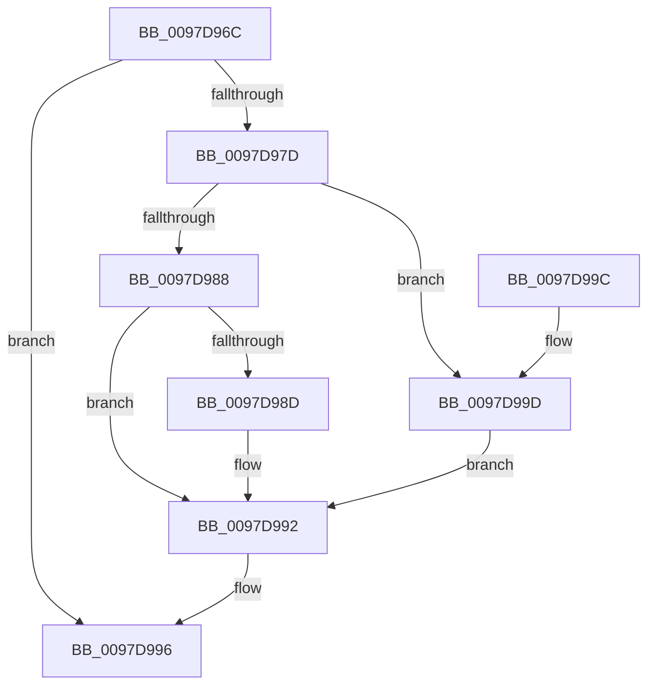

# EtwpCovSampModuleNameInfoCleanup

- RVA: `0x0097D96C`–`0x0097D9A4` (길이 `56` bytes)
- VA: `0x000000014097D96C`
- 실행 섹션: `PAGE`
- PDB 이름 있음: `예`; PDB Function 태그: `아니요`
- unwind 정보 RVA: `0x0005DAC8`
- 디코드: `20`개 명령, `56/56` bytes 표시
- 미해석 바이트: `0` (있으면 어셈블리에 `.byte`로 보존)

> 이 문서는 커널 이미지의 기계어와 PDB 기호를 분석해 생성했습니다. 4번과 5번은 함수 원형과 자료형을 바이너리 사용 방식에서 추정한 C 해석이며 원본 소스 복구 결과는 아닙니다.

## 1. Dependencies

- 직접 호출 지점: **2**; 고유 호출 대상: **2**
- 직접 호출자로 확인된 함수: **3**
- RIP 상대 이미지 참조: **0**

### Outgoing calls
- `0x0097D98D` → [ExFreePool](../../poolcode/B8/ExFreePool_function_00B82850.md) (function, `0x00B82850`)
- `0x0097D99D` → [FsRtlReleaseFileNameInformation](FsRtlReleaseFileNameInformation_function_0097DB90.md) (function, `0x0097DB90`)

### Direct callers
- [EtwpCovSampContextGetModule](../8D/EtwpCovSampContextGetModule_function_008D7FEC.md) at `0x008D8D3B`
- [EtwpCovSampModuleCleanup](EtwpCovSampModuleCleanup_function_0097D91C.md) at `0x0097D934`
- [sub_00B27A94](../B2/Unknown_function_00B27A94.md) at `0x00B27B0D`

### Static image references
- 디코드된 RIP-relative 메모리 참조가 없습니다.

## 2. Other-region calls and transfers

- 다른 실행 섹션으로 향하는 call: **1**
  - `0x0097D98D` → [ExFreePool](../../poolcode/B8/ExFreePool_function_00B82850.md) (`PAGE` → `POOLCODE`)
- 별도 외부 분기/꼬리 이동을 확인하지 못했습니다.

## 3. Assembly (complete function range)

```asm
0097D96C  40 53                           push rbx
0097D96E  48 83 EC 20                     sub rsp, 0x20
0097D972  48 8B 01                        mov rax, qword ptr [rcx]
0097D975  48 8B D9                        mov rbx, rcx
0097D978  48 85 C0                        test rax, rax
0097D97B  74 19                           je 0x14097d996
0097D97D  48 8B C8                        mov rcx, rax
0097D980  48 83 E1 F8                     and rcx, 0xfffffffffffffff8
0097D984  A8 01                           test al, 1
0097D986  75 15                           jne 0x14097d99d
0097D988  48 85 C9                        test rcx, rcx
0097D98B  74 05                           je 0x14097d992
0097D98D  E8 BE 4E 20 00                  call 0x140b82850
0097D992  48 83 23 00                     and qword ptr [rbx], 0
0097D996  48 83 C4 20                     add rsp, 0x20
0097D99A  5B                              pop rbx
0097D99B  C3                              ret
0097D99C  CC                              int3
0097D99D  E8 EE 01 00 00                  call 0x14097db90
0097D9A2  EB EE                           jmp 0x14097d992
```

## 4. C-style interpretation (structured pseudocode)

```c
__int64 __fastcall EtwpCovSampModuleNameInfoCleanup(__int64 a1)
{
    __int64 result;
    __int64 v_rsp;

    v_rsp = (v_rsp) - (32);
    if (*(unsigned __int64 *)(a1) == 0) goto loc_0097D996;
    a1 = (*(unsigned __int64 *)(a1)) & (-8);
    if ((((unsigned __int8)(*(unsigned __int64 *)(a1))) & (1)) != 0) goto loc_0097D99D;
    result = *(unsigned __int64 *)(a1);
    if (a1 != 0) {
        result = ExFreePool(a1, a2, a3, a4);
    }
loc_0097D996:
    v_rsp = (v_rsp) + (32);
    return result;
loc_0097D99D:
    result = FsRtlReleaseFileNameInformation(a1, a2, a3, a4);
    goto loc_0097D992;
}
```

## 5. (Beta) C Style

```c
int64_t EtwpCovSampModuleNameInfoCleanup(void *Arg1)
{
    uint8_t *arg1 = (uint8_t *)Arg1;

    int64_t result;
    int64_t local_rsp;

    local_rsp = (local_rsp) - (32);
    if (*(uint64_t *)(arg1) == 0) goto loc_0097D996;
    Arg1 = (*(uint64_t *)(arg1)) & (-8);
    if ((((uint8_t)(*(uint64_t *)(arg1))) & (1)) != 0) goto loc_0097D99D;
    result = *(uint64_t *)(arg1);
    if (Arg1 != NULL) {
        result = ExFreePool(Arg1, a2, a3, a4);
    }
loc_0097D996:
    local_rsp = (local_rsp) + (32);
    return result;
loc_0097D99D:
    result = FsRtlReleaseFileNameInformation(Arg1, a2, a3, a4);
    goto loc_0097D992;
}
```

### 관측된 메모리 오프셋

구조체 형식이 확인되지 않은 접근은 인자 기준의 오프셋으로만 기록했습니다.

| 기준 인자 | 오프셋 표현 | 폭 (bit) | 접근 |
|---|---:|---:|---|
| `Arg1` | `+ 0x0` | `64` | `R` |
| `Arg1` | `+ 0x0` | `64` | `R/W` |

## 6. Execution-region graph

[열기: 2D/3D 그래프와 함수 탐색 컨트롤 패널](../../../control-panel.html?section=page&rva=0x0097D96C&view=graph)

- 2D 그래프는 위에서 아래로 흐르고, 3D 그래프는 빈 공간을 드래그해 회전합니다. Shift+드래그는 이동, 휠은 확대·축소, 함수 노드 선택은 대상 보고서 이동입니다.

### Static fallback


