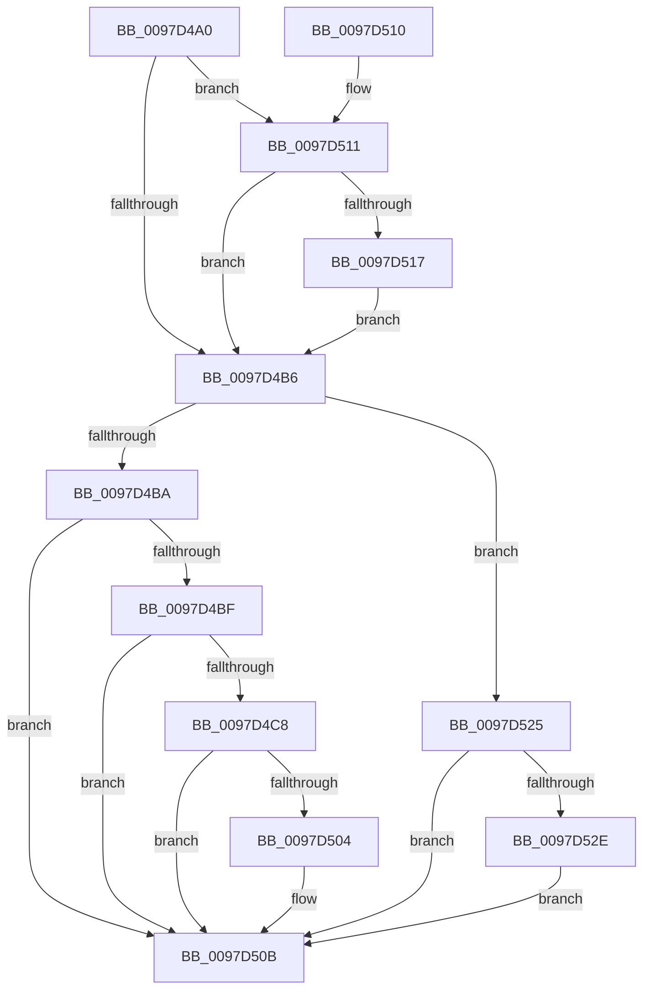

# EtwpRegTraceEnableCallback

- RVA: `0x0097D4A0`–`0x0097D543` (길이 `163` bytes)
- VA: `0x000000014097D4A0`
- 실행 섹션: `PAGE`
- PDB 이름 있음: `예`; PDB Function 태그: `아니요`
- unwind 정보 RVA: `0x0009748C`
- 디코드: `41`개 명령, `163/163` bytes 표시
- 미해석 바이트: `0` (있으면 어셈블리에 `.byte`로 보존)

> 이 문서는 커널 이미지의 기계어와 PDB 기호를 분석해 생성했습니다. 4번과 5번은 함수 원형과 자료형을 바이너리 사용 방식에서 추정한 C 해석이며 원본 소스 복구 결과는 아닙니다.

## 1. Dependencies

- 직접 호출 지점: **3**; 고유 호출 대상: **3**
- 직접 호출자로 확인된 함수: **0**
- RIP 상대 이미지 참조: **6**

### Outgoing calls
- `0x0097D4D4` → [RtlInitUnicodeString](../../text/42/RtlInitUnicodeString_function_0042A780.md) (function, `0x0042A780`)
- `0x0097D4FB` → [CmpRegisterCallbackInternal](CmpRegisterCallbackInternal_function_0097D54C.md) (function, `0x0097D54C`)
- `0x0097D535` → [CmUnRegisterCallback](../7E/CmUnRegisterCallback_function_007E1510.md) (function, `0x007E1510`)

### Direct callers
- 이 함수 시작 RVA로 연결되는 직접 call은 확인되지 않았습니다. 간접 호출은 완전히 역산할 수 없습니다.

### Static image references
- `0x0097D4BF` → RVA `0x00FD8015` (`PAGEDATA`; read)
- `0x0097D4C8` → RVA `0x00B07FE0` (` ?? ::NNGAKEGL::`string'`; read)
- `0x0097D4D9` → RVA `0x00FD8230` (`PAGEDATA`; read)
- `0x0097D4F4` → RVA `0x0099CA70` (`EtwpRegTraceCallback`; read)
- `0x0097D504` → RVA `0x00FD8015` (`PAGEDATA`; write)
- `0x0097D51C` → RVA `0x00FD80C0` (`PAGEDATA`; write)

## 2. Other-region calls and transfers

- 다른 실행 섹션으로 향하는 call: **1**
  - `0x0097D4D4` → [RtlInitUnicodeString](../../text/42/RtlInitUnicodeString_function_0042A780.md) (`PAGE` → `.text`)
- 별도 외부 분기/꼬리 이동을 확인하지 못했습니다.

## 3. Assembly (complete function range)

```asm
0097D4A0  48 83 EC 48                     sub rsp, 0x48
0097D4A4  48 8B 44 24 78                  mov rax, qword ptr [rsp + 0x78]
0097D4A9  0F 57 C0                        xorps xmm0, xmm0
0097D4AC  0F 11 44 24 30                  movups xmmword ptr [rsp + 0x30], xmm0
0097D4B1  48 85 C0                        test rax, rax
0097D4B4  75 5B                           jne 0x14097d511
0097D4B6  85 D2                           test edx, edx
0097D4B8  74 6B                           je 0x14097d525
0097D4BA  83 FA 01                        cmp edx, 1
0097D4BD  75 4C                           jne 0x14097d50b
0097D4BF  80 3D 4F AB 65 00 00            cmp byte ptr [rip + 0x65ab4f], 0
0097D4C6  75 43                           jne 0x14097d50b
0097D4C8  48 8D 15 11 AB 18 00            lea rdx, [rip + 0x18ab11]
0097D4CF  48 8D 4C 24 30                  lea rcx, [rsp + 0x30]
0097D4D4  E8 A7 D2 AA FF                  call 0x14042a780
0097D4D9  48 8D 05 50 AD 65 00            lea rax, [rip + 0x65ad50]
0097D4E0  45 33 C9                        xor r9d, r9d
0097D4E3  48 89 44 24 28                  mov qword ptr [rsp + 0x28], rax
0097D4E8  4C 8D 44 24 30                  lea r8, [rsp + 0x30]
0097D4ED  33 D2                           xor edx, edx
0097D4EF  C6 44 24 20 00                  mov byte ptr [rsp + 0x20], 0
0097D4F4  48 8D 0D 75 F5 01 00            lea rcx, [rip + 0x1f575]
0097D4FB  E8 4C 00 00 00                  call 0x14097d54c
0097D500  85 C0                           test eax, eax
0097D502  78 07                           js 0x14097d50b
0097D504  C6 05 0A AB 65 00 01            mov byte ptr [rip + 0x65ab0a], 1
0097D50B  48 83 C4 48                     add rsp, 0x48
0097D50F  C3                              ret
0097D510  CC                              int3
0097D511  83 78 08 04                     cmp dword ptr [rax + 8], 4
0097D515  75 9F                           jne 0x14097d4b6
0097D517  48 8B 00                        mov rax, qword ptr [rax]
0097D51A  8B 08                           mov ecx, dword ptr [rax]
0097D51C  48 89 0D 9D AB 65 00            mov qword ptr [rip + 0x65ab9d], rcx
0097D523  EB 91                           jmp 0x14097d4b6
0097D525  80 3D E9 AA 65 00 00            cmp byte ptr [rip + 0x65aae9], 0
0097D52C  74 DD                           je 0x14097d50b
0097D52E  48 8B 0D FB AC 65 00            mov rcx, qword ptr [rip + 0x65acfb]
0097D535  E8 D6 3F E6 FF                  call 0x1407e1510
0097D53A  C6 05 D4 AA 65 00 00            mov byte ptr [rip + 0x65aad4], 0
0097D541  EB C8                           jmp 0x14097d50b
```

## 4. C-style interpretation (structured pseudocode)

```c
__int64 __fastcall EtwpRegTraceEnableCallback(__int64 a1, int a2, __int64 a3, int a4, __int64 a5, __int64 a6)
{
    __int64 result;
    __int64 v_rsp;
    unsigned __int64 v_stack_m18;
    unsigned __int64 v_stack_m20;
    unsigned __int8 v_stack_m28;

    v_rsp = (v_rsp) - (72);
    v_stack_m18 = v_xmm0;
    if (a6 != 0) goto loc_0097D511;
loc_0097D4B6:
    if (a2 == 0) goto loc_0097D525;
    if (a2 != 1) goto loc_0097D50B;
    if ((*(unsigned __int8 *)(v_rip + 6662991)) != 0) goto loc_0097D50B;
    result = RtlInitUnicodeString(v_stack_m18, v_rip + 1616657, a3, a4);
    a4 = 0;
    v_stack_m20 = v_rip + 6663504;
    a2 = 0;
    v_stack_m28 = 0;
    result = CmpRegisterCallbackInternal(v_rip + 128373, a2, v_stack_m18, a4);
    if (!(sign_flag)) {
        *(unsigned __int8 *)(v_rip + 6662922) = 1;
    }
    v_rsp = (v_rsp) + (72);
    return result;
loc_0097D511:
    if ((*(unsigned int *)(result + 8)) != 4) goto loc_0097D4B6;
    *(unsigned __int64 *)(v_rip + 6663069) = (unsigned int)(*(unsigned int *)(*(unsigned __int64 *)(result)));
    goto loc_0097D4B6;
loc_0097D525:
    if ((*(unsigned __int8 *)(v_rip + 6662889)) == 0) goto loc_0097D50B;
    result = CmUnRegisterCallback(*(unsigned __int64 *)(v_rip + 6663419), a2, v_stack_m18, a4);
    *(unsigned __int8 *)(v_rip + 6662868) = 0;
    goto loc_0097D50B;
}
```

## 5. (Beta) C Style

```c
int64_t EtwpRegTraceEnableCallback(int64_t Arg1, int32_t Arg2, int64_t Arg3, int32_t Arg4, uint64_t Arg5, int64_t Arg6)
{
    int64_t result;
    int64_t local_rsp;
    uint64_t v_stack_m18;
    uint64_t v_stack_m20;
    uint8_t v_stack_m28;

    local_rsp = (local_rsp) - (72);
    v_stack_m18 = v_xmm0;
    if (Arg6 != 0) goto loc_0097D511;
loc_0097D4B6:
    if (Arg2 == 0) goto loc_0097D525;
    if (Arg2 != 1) goto loc_0097D50B;
    if ((*(uint8_t *)(v_rip + 0x65AB4F)) != 0) goto loc_0097D50B;
    result = RtlInitUnicodeString(v_stack_m18, v_rip + 1616657, Arg3, Arg4);
    Arg4 = 0;
    v_stack_m20 = v_rip + 6663504;
    Arg2 = 0;
    v_stack_m28 = 0;
    result = CmpRegisterCallbackInternal(v_rip + 128373, Arg2, v_stack_m18, Arg4);
    if (!(sign_flag)) {
        *(uint8_t *)(v_rip + 0x65AB0A) = 1;
    }
    local_rsp = (local_rsp) + (72);
    return result;
loc_0097D511:
    if ((*(uint32_t *)(result + 0x8)) != 4) goto loc_0097D4B6;
    *(uint64_t *)(v_rip + 0x65AB9D) = (uint32_t)(*(uint32_t *)(*(uint64_t *)(result)));
    goto loc_0097D4B6;
loc_0097D525:
    if ((*(uint8_t *)(v_rip + 0x65AAE9)) == 0) goto loc_0097D50B;
    result = CmUnRegisterCallback(*(uint64_t *)(v_rip + 0x65ACFB), Arg2, v_stack_m18, Arg4);
    *(uint8_t *)(v_rip + 0x65AAD4) = 0;
    goto loc_0097D50B;
}
```

## 6. Execution-region graph

[열기: 2D/3D 그래프와 함수 탐색 컨트롤 패널](../../../control-panel.html?section=page&rva=0x0097D4A0&view=graph)

- 2D 그래프는 위에서 아래로 흐르고, 3D 그래프는 빈 공간을 드래그해 회전합니다. Shift+드래그는 이동, 휠은 확대·축소, 함수 노드 선택은 대상 보고서 이동입니다.

### Static fallback


