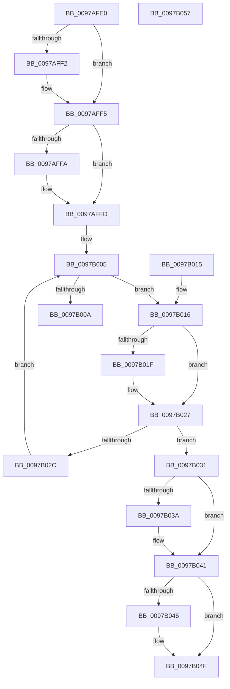

# FsRtlFindExtraCreateParameter

- RVA: `0x0097AFE0`–`0x0097B058` (길이 `120` bytes)
- VA: `0x000000014097AFE0`
- 실행 섹션: `PAGE`
- PDB 이름 있음: `예`; PDB Function 태그: `아니요`
- unwind 정보 RVA: `0x00096B5C`
- 디코드: `41`개 명령, `120/120` bytes 표시
- 미해석 바이트: `0` (있으면 어셈블리에 `.byte`로 보존)

> 이 문서는 커널 이미지의 기계어와 PDB 기호를 분석해 생성했습니다. 4번과 5번은 함수 원형과 자료형을 바이너리 사용 방식에서 추정한 C 해석이며 원본 소스 복구 결과는 아닙니다.

## 1. Dependencies

- 직접 호출 지점: **0**; 고유 호출 대상: **0**
- 직접 호출자로 확인된 함수: **2**
- RIP 상대 이미지 참조: **0**

### Outgoing calls
- 직접 디코드된 call 명령이 없습니다.

### Direct callers
- [sub_0041DDC3](../../text/41/Unknown_function_0041DDC3.md) at `0x0041DDFD`
- [IopSymlinkGetECP](../../text/45/IopSymlinkGetECP_function_00458288.md) at `0x00458299`

### Static image references
- 디코드된 RIP-relative 메모리 참조가 없습니다.

## 2. Other-region calls and transfers

- 다른 실행 섹션으로 향하는 call: **0**
- 별도 외부 분기/꼬리 이동을 확인하지 못했습니다.

## 3. Assembly (complete function range)

```asm
0097AFE0  48 89 5C 24 08                  mov qword ptr [rsp + 8], rbx
0097AFE5  33 DB                           xor ebx, ebx
0097AFE7  4D 8B D0                        mov r10, r8
0097AFEA  4C 8B DA                        mov r11, rdx
0097AFED  4D 85 C0                        test r8, r8
0097AFF0  74 03                           je 0x14097aff5
0097AFF2  49 89 18                        mov qword ptr [r8], rbx
0097AFF5  4D 85 C9                        test r9, r9
0097AFF8  74 03                           je 0x14097affd
0097AFFA  41 89 19                        mov dword ptr [r9], ebx
0097AFFD  48 8B 41 08                     mov rax, qword ptr [rcx + 8]
0097B001  48 8D 51 08                     lea rdx, [rcx + 8]
0097B005  48 3B C2                        cmp rax, rdx
0097B008  75 0C                           jne 0x14097b016
0097B00A  B8 25 02 00 C0                  mov eax, 0xc0000225
0097B00F  48 8B 5C 24 08                  mov rbx, qword ptr [rsp + 8]
0097B014  C3                              ret
0097B015  CC                              int3
0097B016  4C 8B 40 10                     mov r8, qword ptr [rax + 0x10]
0097B01A  4D 2B 03                        sub r8, qword ptr [r11]
0097B01D  75 08                           jne 0x14097b027
0097B01F  4C 8B 40 18                     mov r8, qword ptr [rax + 0x18]
0097B023  4D 2B 43 08                     sub r8, qword ptr [r11 + 8]
0097B027  4D 85 C0                        test r8, r8
0097B02A  74 05                           je 0x14097b031
0097B02C  48 8B 00                        mov rax, qword ptr [rax]
0097B02F  EB D4                           jmp 0x14097b005
0097B031  83 48 28 04                     or dword ptr [rax + 0x28], 4
0097B035  4D 85 D2                        test r10, r10
0097B038  74 07                           je 0x14097b041
0097B03A  48 8D 48 40                     lea rcx, [rax + 0x40]
0097B03E  49 89 0A                        mov qword ptr [r10], rcx
0097B041  4D 85 C9                        test r9, r9
0097B044  74 09                           je 0x14097b04f
0097B046  8B 48 2C                        mov ecx, dword ptr [rax + 0x2c]
0097B049  83 E9 48                        sub ecx, 0x48
0097B04C  41 89 09                        mov dword ptr [r9], ecx
0097B04F  8B C3                           mov eax, ebx
0097B051  48 8B 5C 24 08                  mov rbx, qword ptr [rsp + 8]
0097B056  C3                              ret
0097B057  CC                              int3
```

## 4. C-style interpretation (structured pseudocode)

```c
__int64 __fastcall FsRtlFindExtraCreateParameter(__int64 a1, __int64 a2, __int64 a3, __int64 a4)
{
    __int64 v_rbx;
    unsigned __int64 v_stack_p8;

    v_stack_p8 = v_rbx;
    v_rbx = 0;
    if (a3 != 0) {
        *(unsigned __int64 *)(a3) = 0;
    }
    if (a4 != 0) {
        *(unsigned int *)(a4) = 0;
    }
loc_0097B005:
    if ((*(unsigned __int64 *)(a1 + 8)) != (a1 + 8)) goto loc_0097B016;
    return (unsigned int)(0xC0000225ULL);
loc_0097B016:
    a3 = (*(unsigned __int64 *)((unsigned int)(0xC0000225ULL) + 16)) - (*(unsigned __int64 *)(a2));
    if (!(condition_is_not_equal)) {
        a3 = *(unsigned __int64 *)((unsigned int)(0xC0000225ULL) + 24);
        a3 = (a3) - (*(unsigned __int64 *)(a2 + 8));
    }
    if (a3 == 0) goto loc_0097B031;
    goto loc_0097B005;
loc_0097B031:
    if (a3 != 0) {
        a1 = *(unsigned __int64 *)((unsigned int)(0xC0000225ULL)) + 64;
        *(unsigned __int64 *)(a3) = a1;
    }
    if (a4 != 0) {
        a1 = *(unsigned int *)(*(unsigned __int64 *)((unsigned int)(0xC0000225ULL)) + 44);
        a1 = (unsigned int)((a1) - (72));
        *(unsigned int *)(a4) = (unsigned int)(a1);
    }
    return (unsigned int)((unsigned int)(v_stack_p8));
}
```

## 5. (Beta) C Style

```c
int64_t FsRtlFindExtraCreateParameter(void *Arg1, void *Arg2, int64_t Arg3, int64_t Arg4)
{
    uint8_t *arg1 = (uint8_t *)Arg1;
    uint8_t *arg2 = (uint8_t *)Arg2;

    int64_t local_rbx;
    uint64_t v_stack_p8;

    v_stack_p8 = local_rbx;
    local_rbx = 0;
    if (Arg3 != 0) {
        *(uint64_t *)(Arg3) = 0;
    }
    if (Arg4 != 0) {
        *(uint32_t *)(Arg4) = 0;
    }
loc_0097B005:
    if ((*(uint64_t *)(arg1 + 0x8)) != (Arg1 + 8)) goto loc_0097B016;
    return (uint32_t)(0xC0000225ULL);
loc_0097B016:
    Arg3 = (*(uint64_t *)((uint32_t)(0xC0000225ULL) + 0x10)) - (*(uint64_t *)(arg2));
    if (!(condition_is_not_equal)) {
        Arg3 = *(uint64_t *)((uint32_t)(0xC0000225ULL) + 0x18);
        Arg3 = (Arg3) - (*(uint64_t *)(arg2 + 0x8));
    }
    if (Arg3 == 0) goto loc_0097B031;
    goto loc_0097B005;
loc_0097B031:
    if (Arg3 != 0) {
        Arg1 = *(uint64_t *)((uint32_t)(0xC0000225ULL)) + 64;
        *(void **)(Arg3) = Arg1;
    }
    if (Arg4 != 0) {
        Arg1 = *(uint32_t *)(*(uint64_t *)((uint32_t)(0xC0000225ULL)) + 0x2C);
        Arg1 = (uint32_t)((Arg1) - (72));
        *(uint32_t *)(Arg4) = (uint32_t)(Arg1);
    }
    return (uint32_t)((uint32_t)(v_stack_p8));
}
```

### 관측된 메모리 오프셋

구조체 형식이 확인되지 않은 접근은 인자 기준의 오프셋으로만 기록했습니다.

| 기준 인자 | 오프셋 표현 | 폭 (bit) | 접근 |
|---|---:|---:|---|
| `Arg1` | `+ 0x8` | `64` | `R` |
| `Arg2` | `+ 0x0` | `64` | `R` |
| `Arg2` | `+ 0x8` | `64` | `R` |

## 6. Execution-region graph

[열기: 2D/3D 그래프와 함수 탐색 컨트롤 패널](../../../control-panel.html?section=page&rva=0x0097AFE0&view=graph)

- 2D 그래프는 위에서 아래로 흐르고, 3D 그래프는 빈 공간을 드래그해 회전합니다. Shift+드래그는 이동, 휠은 확대·축소, 함수 노드 선택은 대상 보고서 이동입니다.

### Static fallback


