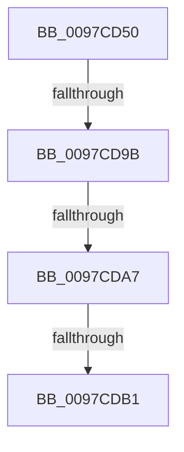

# FsRtlIsDbcsInExpression

- RVA: `0x0097CD50`–`0x0097CDB6` (길이 `102` bytes)
- VA: `0x000000014097CD50`
- 실행 섹션: `PAGE`
- PDB 이름 있음: `예`; PDB Function 태그: `예`
- unwind 정보 RVA: `0x00096EE4`
- 디코드: `25`개 명령, `102/102` bytes 표시
- 미해석 바이트: `0` (있으면 어셈블리에 `.byte`로 보존)

> 이 문서는 커널 이미지의 기계어와 PDB 기호를 분석해 생성했습니다. 4번과 5번은 함수 원형과 자료형을 바이너리 사용 방식에서 추정한 C 해석이며 원본 소스 복구 결과는 아닙니다.

## 1. Dependencies

- 직접 호출 지점: **0**; 고유 호출 대상: **0**
- 직접 호출자로 확인된 함수: **0**
- RIP 상대 이미지 참조: **1**

### Outgoing calls
- 직접 디코드된 call 명령이 없습니다.

### Direct callers
- 이 함수 시작 RVA로 연결되는 직접 call은 확인되지 않았습니다. 간접 호출은 완전히 역산할 수 없습니다.

### Static image references
- `0x0097CD5E` → RVA `0x00E0A740` (`.data`; read)

## 2. Other-region calls and transfers

- 다른 실행 섹션으로 향하는 call: **0**
- call이 아닌 외부 분기/꼬리 이동: **3**
  - `0x0097CD95` → [sub_0097D1D3](Unknown_function_0097D1D3.md) (`tail-transfer`)
  - `0x0097CDA1` → [sub_0097D1D3](Unknown_function_0097D1D3.md) (`tail-transfer`)
  - `0x0097CDAB` → [sub_0097D390](Unknown_function_0097D390.md) (`tail-transfer`)

## 3. Assembly (complete function range)

```asm
0097CD50  40 53                           push rbx
0097CD52  56                              push rsi
0097CD53  41 54                           push r12
0097CD55  41 57                           push r15
0097CD57  48 81 EC B8 00 00 00            sub rsp, 0xb8
0097CD5E  48 8B 05 DB D9 48 00            mov rax, qword ptr [rip + 0x48d9db]
0097CD65  48 33 C4                        xor rax, rsp
0097CD68  48 89 84 24 A0 00 00 00         mov qword ptr [rsp + 0xa0], rax
0097CD70  0F B7 02                        movzx eax, word ptr [rdx]
0097CD73  45 33 FF                        xor r15d, r15d
0097CD76  32 DB                           xor bl, bl
0097CD78  48 89 54 24 40                  mov qword ptr [rsp + 0x40], rdx
0097CD7D  66 44 89 7C 24 28               mov word ptr [rsp + 0x28], r15w
0097CD83  4C 8B C2                        mov r8, rdx
0097CD86  4C 89 7C 24 48                  mov qword ptr [rsp + 0x48], r15
0097CD8B  4C 8B E1                        mov r12, rcx
0097CD8E  88 5C 24 20                     mov byte ptr [rsp + 0x20], bl
0097CD92  66 85 C0                        test ax, ax
0097CD95  0F 84 38 04 00 00               je 0x14097d1d3
0097CD9B  0F B7 09                        movzx ecx, word ptr [rcx]
0097CD9E  66 85 C9                        test cx, cx
0097CDA1  0F 84 2C 04 00 00               je 0x14097d1d3
0097CDA7  66 83 F9 01                     cmp cx, 1
0097CDAB  0F 84 DF 05 00 00               je 0x14097d390
0097CDB1  49 8B 44 24 08                  mov rax, qword ptr [r12 + 8]
```

## 4. C-style interpretation (structured pseudocode)

```c
__int64 __fastcall FsRtlIsDbcsInExpression(__int64 a1, __int64 a2)
{
    __int64 result;
    __int64 v_r15;
    __int64 v_rbx;
    __int64 v_rsp;
    unsigned __int64 v_stack_m38;
    unsigned __int64 v_stack_m90;
    unsigned __int64 v_stack_m98;
    unsigned __int16 v_stack_mB0;
    unsigned __int8 v_stack_mB8;

    v_rsp = (v_rsp) - (184);
    result = (*(unsigned __int64 *)(v_rip + 4774363)) ^ (v_rsp);
    v_stack_m38 = result;
    v_r15 = 0;
    v_rbx = 0;
    v_stack_m98 = a2;
    v_stack_mB0 = 0;
    v_stack_m90 = 0;
    v_stack_mB8 = 0;
    return *(unsigned __int64 *)(a1 + 8);
}
```

## 5. (Beta) C Style

```c
int64_t FsRtlIsDbcsInExpression(void *Arg1, void *Arg2)
{
    uint8_t *arg1 = (uint8_t *)Arg1;
    uint8_t *arg2 = (uint8_t *)Arg2;

    int64_t result;
    int64_t local_r15;
    int64_t local_rbx;
    int64_t local_rsp;
    uint64_t v_stack_m38;
    uint64_t v_stack_m90;
    uint64_t v_stack_m98;
    uint16_t v_stack_mB0;
    uint8_t v_stack_mB8;

    local_rsp = (local_rsp) - (184);
    result = (*(uint64_t *)(v_rip + 0x48D9DB)) ^ (local_rsp);
    v_stack_m38 = result;
    local_r15 = 0;
    local_rbx = 0;
    v_stack_m98 = Arg2;
    v_stack_mB0 = 0;
    v_stack_m90 = 0;
    v_stack_mB8 = 0;
    return *(uint64_t *)(arg1 + 0x8);
}
```

### 관측된 메모리 오프셋

구조체 형식이 확인되지 않은 접근은 인자 기준의 오프셋으로만 기록했습니다.

| 기준 인자 | 오프셋 표현 | 폭 (bit) | 접근 |
|---|---:|---:|---|
| `Arg1` | `+ 0x0` | `16` | `R` |
| `Arg1` | `+ 0x8` | `64` | `R` |
| `Arg2` | `+ 0x0` | `16` | `R` |

## 6. Execution-region graph

[열기: 2D/3D 그래프와 함수 탐색 컨트롤 패널](../../../control-panel.html?section=page&rva=0x0097CD50&view=graph)

- 2D 그래프는 위에서 아래로 흐르고, 3D 그래프는 빈 공간을 드래그해 회전합니다. Shift+드래그는 이동, 휠은 확대·축소, 함수 노드 선택은 대상 보고서 이동입니다.

### Static fallback


