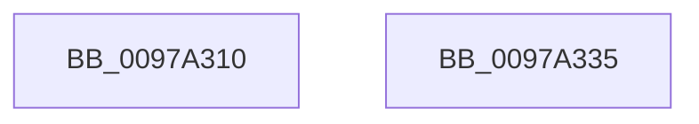

# KsepCacheDeviceHash

- RVA: `0x0097A310`–`0x0097A336` (길이 `38` bytes)
- VA: `0x000000014097A310`
- 실행 섹션: `PAGE`
- PDB 이름 있음: `예`; PDB Function 태그: `아니요`
- unwind 정보 RVA: `0x0005C788`
- 디코드: `11`개 명령, `38/38` bytes 표시
- 미해석 바이트: `0` (있으면 어셈블리에 `.byte`로 보존)

> 이 문서는 커널 이미지의 기계어와 PDB 기호를 분석해 생성했습니다. 4번과 5번은 함수 원형과 자료형을 바이너리 사용 방식에서 추정한 C 해석이며 원본 소스 복구 결과는 아닙니다.

## 1. Dependencies

- 직접 호출 지점: **1**; 고유 호출 대상: **1**
- 직접 호출자로 확인된 함수: **0**
- RIP 상대 이미지 참조: **0**

### Outgoing calls
- `0x0097A327` → [RtlHashUnicodeString](RtlHashUnicodeString_function_0097A780.md) (function, `0x0097A780`)

### Direct callers
- 이 함수 시작 RVA로 연결되는 직접 call은 확인되지 않았습니다. 간접 호출은 완전히 역산할 수 없습니다.

### Static image references
- 디코드된 RIP-relative 메모리 참조가 없습니다.

## 2. Other-region calls and transfers

- 다른 실행 섹션으로 향하는 call: **0**
- 별도 외부 분기/꼬리 이동을 확인하지 못했습니다.

## 3. Assembly (complete function range)

```asm
0097A310  48 83 EC 28                     sub rsp, 0x28
0097A314  83 64 24 30 00                  and dword ptr [rsp + 0x30], 0
0097A319  4C 8D 4C 24 30                  lea r9, [rsp + 0x30]
0097A31E  48 83 C1 28                     add rcx, 0x28
0097A322  45 33 C0                        xor r8d, r8d
0097A325  B2 01                           mov dl, 1
0097A327  E8 54 04 00 00                  call 0x14097a780
0097A32C  8B 44 24 30                     mov eax, dword ptr [rsp + 0x30]
0097A330  48 83 C4 28                     add rsp, 0x28
0097A334  C3                              ret
0097A335  CC                              int3
```

## 4. C-style interpretation (structured pseudocode)

```c
__int64 __fastcall KsepCacheDeviceHash(__int64 a1, __int64 a2, int a3)
{
    __int64 result;
    __int64 v_rsp;
    unsigned int v_stack_p8;

    v_rsp = (v_rsp) - (40);
    a1 = (a1) + (40);
    a3 = 0;
    result = RtlHashUnicodeString(a1, 1, a3, v_stack_p8);
    v_rsp = (v_rsp) + (40);
    return (unsigned int)(v_stack_p8);
}
```

## 5. (Beta) C Style

```c
int64_t KsepCacheDeviceHash(int64_t Arg1, int64_t Arg2, int32_t Arg3)
{
    int64_t result;
    int64_t local_rsp;
    uint32_t v_stack_p8;

    local_rsp = (local_rsp) - (40);
    Arg1 = (Arg1) + (40);
    Arg3 = 0;
    result = RtlHashUnicodeString(Arg1, 1, Arg3, v_stack_p8);
    local_rsp = (local_rsp) + (40);
    return (uint32_t)(v_stack_p8);
}
```

## 6. Execution-region graph

[열기: 2D/3D 그래프와 함수 탐색 컨트롤 패널](../../../control-panel.html?section=page&rva=0x0097A310&view=graph)

- 2D 그래프는 위에서 아래로 흐르고, 3D 그래프는 빈 공간을 드래그해 회전합니다. Shift+드래그는 이동, 휠은 확대·축소, 함수 노드 선택은 대상 보고서 이동입니다.

### Static fallback


