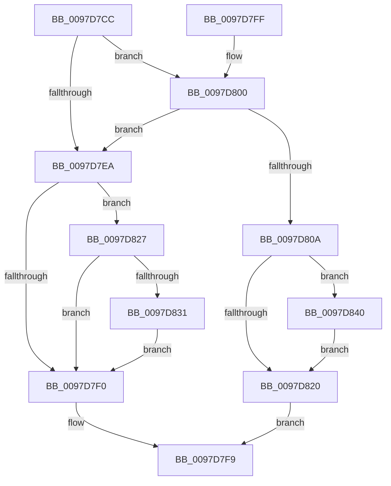

# MiArbitraryCodeBlocked

- RVA: `0x0097D7CC`–`0x0097D868` (길이 `156` bytes)
- VA: `0x000000014097D7CC`
- 실행 섹션: `PAGE`
- PDB 이름 있음: `예`; PDB Function 태그: `아니요`
- unwind 정보 RVA: `0x000974B8`
- 디코드: `38`개 명령, `156/156` bytes 표시
- 미해석 바이트: `0` (있으면 어셈블리에 `.byte`로 보존)

> 이 문서는 커널 이미지의 기계어와 PDB 기호를 분석해 생성했습니다. 4번과 5번은 함수 원형과 자료형을 바이너리 사용 방식에서 추정한 C 해석이며 원본 소스 복구 결과는 아닙니다.

## 1. Dependencies

- 직접 호출 지점: **4**; 고유 호출 대상: **3**
- 직접 호출자로 확인된 함수: **4**
- RIP 상대 이미지 참조: **1**

### Outgoing calls
- `0x0097D7F2` → [EtwTraceMemoryAcg](../../text/45/EtwTraceMemoryAcg_function_0045B3A8.md) (function, `0x0045B3A8`)
- `0x0097D80F` → [EtwTraceMemoryAcg](../../text/45/EtwTraceMemoryAcg_function_0045B3A8.md) (function, `0x0045B3A8`)
- `0x0097D839` → [EtwTimLogProhibitDynamicCode](../A8/EtwTimLogProhibitDynamicCode_function_00A8E9DC.md) (function, `0x00A8E9DC`)
- `0x0097D856` → [EtwpTimLogMitigationForProcess](../A8/EtwpTimLogMitigationForProcess_function_00A81E6C.md) (function, `0x00A81E6C`)

### Direct callers
- [MiAllowProtectionChange](../../text/44/MiAllowProtectionChange_function_00448834.md) at `0x00448952`
- [MiReserveUserMemory](../88/MiReserveUserMemory_function_00884498.md) at `0x0088491C`
- [MiMapViewOfSection](../89/MiMapViewOfSection_function_00898F10.md) at `0x008993BC`
- [MiMapViewOfImageSection](MiMapViewOfImageSection_function_0097E92C.md) at `0x0097F5E0`

### Static image references
- `0x0097D848` → RVA `0x00021310` (`.rdata`; read)

## 2. Other-region calls and transfers

- 다른 실행 섹션으로 향하는 call: **2**
  - `0x0097D7F2` → [EtwTraceMemoryAcg](../../text/45/EtwTraceMemoryAcg_function_0045B3A8.md) (`PAGE` → `.text`)
  - `0x0097D80F` → [EtwTraceMemoryAcg](../../text/45/EtwTraceMemoryAcg_function_0045B3A8.md) (`PAGE` → `.text`)
- 별도 외부 분기/꼬리 이동을 확인하지 못했습니다.

## 3. Assembly (complete function range)

```asm
0097D7CC  40 53                           push rbx
0097D7CE  48 83 EC 30                     sub rsp, 0x30
0097D7D2  48 8B D9                        mov rbx, rcx
0097D7D5  65 48 8B 0C 25 88 01 00 00      mov rcx, qword ptr gs:[0x188]
0097D7DE  8B 93 50 07 00 00               mov edx, dword ptr [rbx + 0x750]
0097D7E4  0F BA E2 08                     bt edx, 8
0097D7E8  72 16                           jb 0x14097d800
0097D7EA  0F BA E2 0B                     bt edx, 0xb
0097D7EE  72 37                           jb 0x14097d827
0097D7F0  33 C9                           xor ecx, ecx
0097D7F2  E8 B1 DB AD FF                  call 0x14045b3a8
0097D7F7  33 C0                           xor eax, eax
0097D7F9  48 83 C4 30                     add rsp, 0x30
0097D7FD  5B                              pop rbx
0097D7FE  C3                              ret
0097D7FF  CC                              int3
0097D800  0F BA A1 A0 05 00 00 12         bt dword ptr [rcx + 0x5a0], 0x12
0097D808  72 E0                           jb 0x14097d7ea
0097D80A  B9 00 00 00 80                  mov ecx, 0x80000000
0097D80F  E8 94 DB AD FF                  call 0x14045b3a8
0097D814  F7 83 50 07 00 00 00 08 00 00   test dword ptr [rbx + 0x750], 0x800
0097D81E  75 20                           jne 0x14097d840
0097D820  B8 04 06 00 C0                  mov eax, 0xc0000604
0097D825  EB D2                           jmp 0x14097d7f9
0097D827  0F BA A1 A0 05 00 00 12         bt dword ptr [rcx + 0x5a0], 0x12
0097D82F  72 BF                           jb 0x14097d7f0
0097D831  48 8B D3                        mov rdx, rbx
0097D834  B9 01 00 00 00                  mov ecx, 1
0097D839  E8 9E 11 11 00                  call 0x140a8e9dc
0097D83E  EB B0                           jmp 0x14097d7f0
0097D840  4C 8B CB                        mov r9, rbx
0097D843  C6 44 24 20 01                  mov byte ptr [rsp + 0x20], 1
0097D848  4C 8D 05 C1 3A 6A FF            lea r8, [rip - 0x95c53f]
0097D84F  BA 02 00 00 00                  mov edx, 2
0097D854  33 C9                           xor ecx, ecx
0097D856  E8 11 46 10 00                  call 0x140a81e6c
0097D85B  F0 81 A3 50 07 00 00 FF F7 FF FF  lock and dword ptr [rbx + 0x750], 0xfffff7ff
0097D866  EB B8                           jmp 0x14097d820
```

## 4. C-style interpretation (structured pseudocode)

```c
__int64 __fastcall MiArbitraryCodeBlocked(__int64 a1)
{
    __int64 result;
    __int64 v_rsp;
    unsigned __int8 v_stack_p20;

    v_rsp = (v_rsp) - (48);
    if (condition_is_below) goto loc_0097D800;
loc_0097D7EA:
    if (condition_is_below) goto loc_0097D827;
loc_0097D7F0:
    a1 = 0;
    result = EtwTraceMemoryAcg(a1, (unsigned int)(*(unsigned int *)(a1 + 1872)), a3, a4);
    result = 0;
loc_0097D7F9:
    v_rsp = (v_rsp) + (48);
    return result;
loc_0097D800:
    if (condition_is_below) goto loc_0097D7EA;
    result = EtwTraceMemoryAcg((unsigned int)(0x80000000ULL), (unsigned int)(*(unsigned int *)(a1 + 1872)), a3, a4);
    if (((*(unsigned int *)(a1 + 1872)) & (0x800ULL)) != 0) goto loc_0097D840;
loc_0097D820:
    goto loc_0097D7F9;
loc_0097D827:
    if (condition_is_below) goto loc_0097D7F0;
    result = EtwTimLogProhibitDynamicCode(1, 0, a3, a4);
    goto loc_0097D7F0;
loc_0097D840:
    v_stack_p20 = 1;
    a1 = 0;
    result = EtwpTimLogMitigationForProcess(a1, 2, v_rip - 9815359, 0);
    goto loc_0097D820;
}
```

## 5. (Beta) C Style

```c
int64_t MiArbitraryCodeBlocked(void *Arg1)
{
    uint8_t *arg1 = (uint8_t *)Arg1;

    int64_t result;
    int64_t local_rsp;
    uint8_t v_stack_p20;

    local_rsp = (local_rsp) - (48);
    if (condition_is_below) goto loc_0097D800;
loc_0097D7EA:
    if (condition_is_below) goto loc_0097D827;
loc_0097D7F0:
    Arg1 = 0;
    result = EtwTraceMemoryAcg(Arg1, (uint32_t)(*(uint32_t *)(arg1 + 0x750)), a3, a4);
    result = 0;
loc_0097D7F9:
    local_rsp = (local_rsp) + (48);
    return result;
loc_0097D800:
    if (condition_is_below) goto loc_0097D7EA;
    result = EtwTraceMemoryAcg((uint32_t)(0x80000000ULL), (uint32_t)(*(uint32_t *)(arg1 + 0x750)), a3, a4);
    if (((*(uint32_t *)(arg1 + 0x750)) & (0x800ULL)) != 0) goto loc_0097D840;
loc_0097D820:
    goto loc_0097D7F9;
loc_0097D827:
    if (condition_is_below) goto loc_0097D7F0;
    result = EtwTimLogProhibitDynamicCode(1, 0, a3, a4);
    goto loc_0097D7F0;
loc_0097D840:
    v_stack_p20 = 1;
    Arg1 = 0;
    result = EtwpTimLogMitigationForProcess(Arg1, 2, v_rip - 9815359, 0);
    goto loc_0097D820;
}
```

### 관측된 메모리 오프셋

구조체 형식이 확인되지 않은 접근은 인자 기준의 오프셋으로만 기록했습니다.

| 기준 인자 | 오프셋 표현 | 폭 (bit) | 접근 |
|---|---:|---:|---|
| `Arg1` | `+ 0x750` | `32` | `R` |
| `Arg1` | `+ 0x750` | `32` | `R/W` |

## 6. Execution-region graph

[열기: 2D/3D 그래프와 함수 탐색 컨트롤 패널](../../../control-panel.html?section=page&rva=0x0097D7CC&view=graph)

- 2D 그래프는 위에서 아래로 흐르고, 3D 그래프는 빈 공간을 드래그해 회전합니다. Shift+드래그는 이동, 휠은 확대·축소, 함수 노드 선택은 대상 보고서 이동입니다.

### Static fallback


