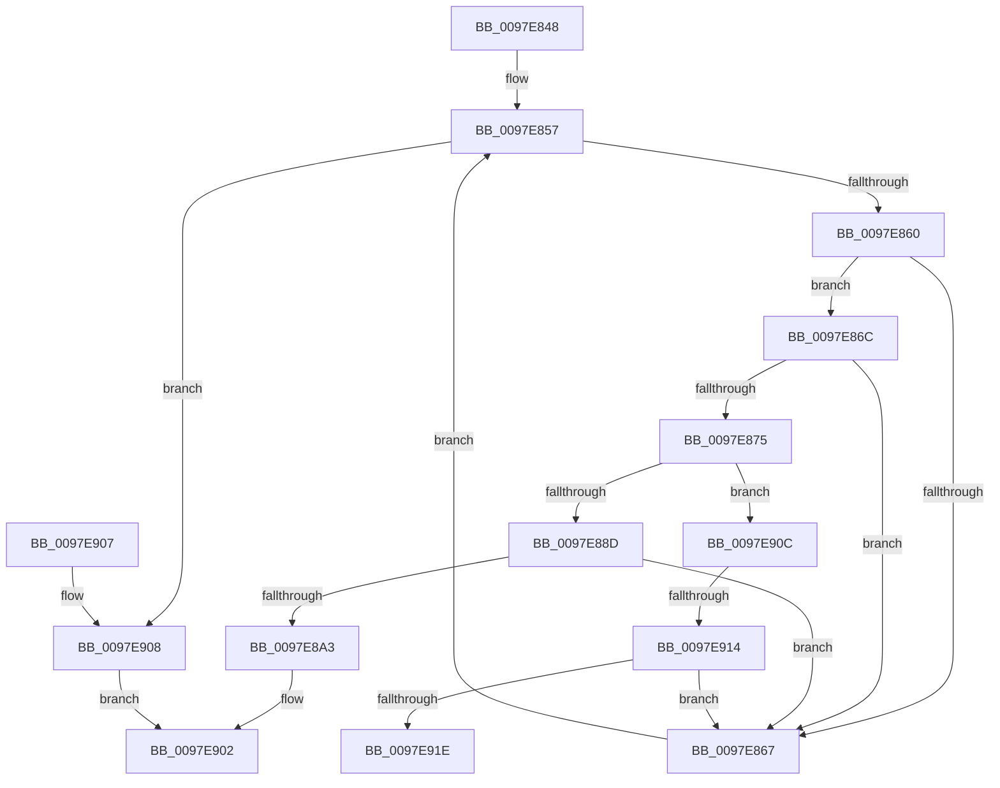

# MiCloneNoChange

- RVA: `0x0097E848`–`0x0097E923` (길이 `219` bytes)
- VA: `0x000000014097E848`
- 실행 섹션: `PAGE`
- PDB 이름 있음: `예`; PDB Function 태그: `예`
- unwind 정보 RVA: `0x00082188`
- 디코드: `63`개 명령, `219/219` bytes 표시
- 미해석 바이트: `0` (있으면 어셈블리에 `.byte`로 보존)

> 이 문서는 커널 이미지의 기계어와 PDB 기호를 분석해 생성했습니다. 4번과 5번은 함수 원형과 자료형을 바이너리 사용 방식에서 추정한 C 해석이며 원본 소스 복구 결과는 아닙니다.

## 1. Dependencies

- 직접 호출 지점: **1**; 고유 호출 대상: **1**
- 직접 호출자로 확인된 함수: **1**
- RIP 상대 이미지 참조: **0**

### Outgoing calls
- `0x0097E8F1` → [MiAddSecureEntry](../98/MiAddSecureEntry_function_00980250.md) (function, `0x00980250`)

### Direct callers
- [MiAllocateChildVads](MiAllocateChildVads_function_0097E380.md) at `0x0097E649`

### Static image references
- 디코드된 RIP-relative 메모리 참조가 없습니다.

## 2. Other-region calls and transfers

- 다른 실행 섹션으로 향하는 call: **0**
- call이 아닌 외부 분기/꼬리 이동: **2**
  - `0x0097E90E` → [sub_00B2A13E](../B2/Unknown_function_00B2A13E.md) (`tail-transfer`)
  - `0x0097E91E` → [sub_00B2A13E](../B2/Unknown_function_00B2A13E.md) (`tail-transfer`)

## 3. Assembly (complete function range)

```asm
0097E848  48 83 EC 38                     sub rsp, 0x38
0097E84C  4C 8B 41 38                     mov r8, qword ptr [rcx + 0x38]
0097E850  4C 8B DA                        mov r11, rdx
0097E853  49 83 E0 F0                     and r8, 0xfffffffffffffff0
0097E857  4D 85 C0                        test r8, r8
0097E85A  0F 84 A8 00 00 00               je 0x14097e908
0097E860  41 83 78 50 02                  cmp dword ptr [r8 + 0x50], 2
0097E865  74 05                           je 0x14097e86c
0097E867  4D 8B 00                        mov r8, qword ptr [r8]
0097E86A  EB EB                           jmp 0x14097e857
0097E86C  45 8B 48 08                     mov r9d, dword ptr [r8 + 8]
0097E870  45 84 C9                        test r9b, r9b
0097E873  78 F2                           js 0x14097e867
0097E875  41 8B D1                        mov edx, r9d
0097E878  83 E2 04                        and edx, 4
0097E87B  8B C2                           mov eax, edx
0097E87D  F7 D8                           neg eax
0097E87F  1B C9                           sbb ecx, ecx
0097E881  81 E1 00 00 00 80               and ecx, 0x80000000
0097E887  41 F6 C1 08                     test r9b, 8
0097E88B  75 7F                           jne 0x14097e90c
0097E88D  44 8B D1                        mov r10d, ecx
0097E890  41 0F BA EA 1D                  bts r10d, 0x1d
0097E895  41 0F BA E1 08                  bt r9d, 8
0097E89A  44 0F 43 D1                     cmovae r10d, ecx
0097E89E  45 85 D2                        test r10d, r10d
0097E8A1  74 C4                           je 0x14097e867
0097E8A3  41 8B 43 1C                     mov eax, dword ptr [r11 + 0x1c]
0097E8A7  41 8B C9                        mov ecx, r9d
0097E8AA  45 0F B6 43 21                  movzx r8d, byte ptr [r11 + 0x21]
0097E8AF  41 0F B6 53 20                  movzx edx, byte ptr [r11 + 0x20]
0097E8B4  49 C1 E0 20                     shl r8, 0x20
0097E8B8  4C 0B C0                        or r8, rax
0097E8BB  C1 E9 05                        shr ecx, 5
0097E8BE  41 8B 43 18                     mov eax, dword ptr [r11 + 0x18]
0097E8C2  83 E1 01                        and ecx, 1
0097E8C5  48 C1 E2 20                     shl rdx, 0x20
0097E8C9  48 0B D0                        or rdx, rax
0097E8CC  8B C1                           mov eax, ecx
0097E8CE  83 C8 04                        or eax, 4
0097E8D1  41 F6 C1 40                     test r9b, 0x40
0097E8D5  45 8B CA                        mov r9d, r10d
0097E8D8  0F 44 C1                        cmove eax, ecx
0097E8DB  49 C1 E0 0C                     shl r8, 0xc
0097E8DF  49 81 C8 FF 0F 00 00            or r8, 0xfff
0097E8E6  48 C1 E2 0C                     shl rdx, 0xc
0097E8EA  49 8B CB                        mov rcx, r11
0097E8ED  89 44 24 20                     mov dword ptr [rsp + 0x20], eax
0097E8F1  E8 5A 19 00 00                  call 0x140980250
0097E8F6  48 F7 D8                        neg rax
0097E8F9  1B C0                           sbb eax, eax
0097E8FB  F7 D0                           not eax
0097E8FD  25 9A 00 00 C0                  and eax, 0xc000009a
0097E902  48 83 C4 38                     add rsp, 0x38
0097E906  C3                              ret
0097E907  CC                              int3
0097E908  33 C0                           xor eax, eax
0097E90A  EB F6                           jmp 0x14097e902
0097E90C  85 D2                           test edx, edx
0097E90E  0F 85 2A B8 1A 00               jne 0x140b2a13e
0097E914  41 F6 C1 03                     test r9b, 3
0097E918  0F 85 49 FF FF FF               jne 0x14097e867
0097E91E  E9 1B B8 1A 00                  jmp 0x140b2a13e
```

## 4. C-style interpretation (structured pseudocode)

```c
__int64 __fastcall MiCloneNoChange(__int64 a1, __int64 a2)
{
    __int64 result;
    __int64 v_r10;
    __int64 v_rsp;
    unsigned int v_stack_m18;

    v_rsp = (v_rsp) - (56);
    a3 = (*(unsigned __int64 *)(a1 + 56)) & (-16);
loc_0097E857:
    if (a3 == 0) goto loc_0097E908;
    if ((*(unsigned int *)(a3 + 80)) == 2) goto loc_0097E86C;
loc_0097E867:
    goto loc_0097E857;
loc_0097E86C:
    if (sign_flag) goto loc_0097E867;
    a2 = (unsigned int)(((unsigned int)((unsigned int)((unsigned int)(*(unsigned int *)(*(unsigned __int64 *)(a3) + 8))))) & (4));
    result = (unsigned int)(-((unsigned int)((unsigned int)(a2))));
    a1 = (unsigned int)((a1) & (0x80000000ULL));
    if ((((unsigned __int8)((unsigned int)(*(unsigned int *)(*(unsigned __int64 *)(a3) + 8)))) & (8)) != 0) goto loc_0097E90C;
    v_r10 = (unsigned int)((unsigned int)(a1));
    if (condition_is_above_or_equal) { v_r10 = (unsigned int)(a1); }
    if ((unsigned int)(v_r10) == 0) goto loc_0097E867;
    a3 = (*(unsigned __int8 *)(a2 + 33)) << (32);
    a3 = (a3) | ((unsigned int)(*(unsigned int *)(a2 + 28)));
    a1 = (unsigned int)(((unsigned int)((unsigned int)((unsigned int)(*(unsigned int *)(*(unsigned __int64 *)(a3) + 8))))) >> (5));
    a1 = (unsigned int)((a1) & (1));
    a2 = (*(unsigned __int8 *)(a2 + 32)) << (32);
    a2 = (a2) | ((unsigned int)(*(unsigned int *)(a2 + 24)));
    result = (unsigned int)(((unsigned int)((unsigned int)(a1))) | (4));
    if ((((unsigned __int8)((unsigned int)(*(unsigned int *)(*(unsigned __int64 *)(a3) + 8)))) & (64)) == 0) { result = (unsigned int)(a1); }
    a3 = (a3) << (12);
    a3 = (a3) | (0xFFFULL);
    a2 = (a2) << (12);
    v_stack_m18 = (unsigned int)(result);
    result = MiAddSecureEntry(a2, a2, a3, (unsigned int)((unsigned int)(v_r10)));
    result = -(result);
    result = (unsigned int)(~(result));
    result = (unsigned int)((result) & (0xC000009AULL));
loc_0097E902:
    v_rsp = (v_rsp) + (56);
    return result;
loc_0097E908:
    result = 0;
    goto loc_0097E902;
loc_0097E90C:
    if ((((unsigned __int8)((unsigned int)((unsigned int)(v_r10)))) & (3)) != 0) goto loc_0097E867;
}
```

## 5. (Beta) C Style

```c
int64_t MiCloneNoChange(void *Arg1, void *Arg2)
{
    uint8_t *arg1 = (uint8_t *)Arg1;
    uint8_t *arg2 = (uint8_t *)Arg2;

    int64_t result;
    int64_t local_r10;
    int64_t local_rsp;
    uint32_t v_stack_m18;

    local_rsp = (local_rsp) - (56);
    a3 = (*(uint64_t *)(arg1 + 0x38)) & (-16);
loc_0097E857:
    if (a3 == 0) goto loc_0097E908;
    if ((*(uint32_t *)(a3 + 0x50)) == 2) goto loc_0097E86C;
loc_0097E867:
    goto loc_0097E857;
loc_0097E86C:
    if (sign_flag) goto loc_0097E867;
    Arg2 = (uint32_t)(((uint32_t)((uint32_t)((uint32_t)(*(uint32_t *)(*(uint64_t *)(a3) + 0x8))))) & (4));
    result = (uint32_t)(-((uint32_t)((uint32_t)(Arg2))));
    Arg1 = (uint32_t)((Arg1) & (0x80000000ULL));
    if ((((uint8_t)((uint32_t)(*(uint32_t *)(*(uint64_t *)(a3) + 0x8)))) & (8)) != 0) goto loc_0097E90C;
    local_r10 = (uint32_t)((uint32_t)(Arg1));
    if (condition_is_above_or_equal) { local_r10 = (uint32_t)(Arg1); }
    if ((uint32_t)(local_r10) == 0) goto loc_0097E867;
    a3 = (*(uint8_t *)(arg2 + 0x21)) << (32);
    a3 = (a3) | ((uint32_t)(*(uint32_t *)(arg2 + 0x1C)));
    Arg1 = (uint32_t)(((uint32_t)((uint32_t)((uint32_t)(*(uint32_t *)(*(uint64_t *)(a3) + 0x8))))) >> (5));
    Arg1 = (uint32_t)((Arg1) & (1));
    Arg2 = (*(uint8_t *)(arg2 + 0x20)) << (32);
    Arg2 = (Arg2) | ((uint32_t)(*(uint32_t *)(arg2 + 0x18)));
    result = (uint32_t)(((uint32_t)((uint32_t)(Arg1))) | (4));
    if ((((uint8_t)((uint32_t)(*(uint32_t *)(*(uint64_t *)(a3) + 0x8)))) & (64)) == 0) { result = (uint32_t)(Arg1); }
    a3 = (a3) << (12);
    a3 = (a3) | (0xFFFULL);
    Arg2 = (Arg2) << (12);
    v_stack_m18 = (uint32_t)(result);
    result = MiAddSecureEntry(Arg2, Arg2, a3, (uint32_t)((uint32_t)(local_r10)));
    result = -(result);
    result = (uint32_t)(~(result));
    result = (uint32_t)((result) & (0xC000009AULL));
loc_0097E902:
    local_rsp = (local_rsp) + (56);
    return result;
loc_0097E908:
    result = 0;
    goto loc_0097E902;
loc_0097E90C:
    if ((((uint8_t)((uint32_t)((uint32_t)(local_r10)))) & (3)) != 0) goto loc_0097E867;
}
```

### 관측된 메모리 오프셋

구조체 형식이 확인되지 않은 접근은 인자 기준의 오프셋으로만 기록했습니다.

| 기준 인자 | 오프셋 표현 | 폭 (bit) | 접근 |
|---|---:|---:|---|
| `Arg1` | `+ 0x38` | `64` | `R` |
| `Arg2` | `+ 0x18` | `32` | `R` |
| `Arg2` | `+ 0x1C` | `32` | `R` |
| `Arg2` | `+ 0x20` | `8` | `R` |
| `Arg2` | `+ 0x21` | `8` | `R` |

## 6. Execution-region graph

[열기: 2D/3D 그래프와 함수 탐색 컨트롤 패널](../../../control-panel.html?section=page&rva=0x0097E848&view=graph)

- 2D 그래프는 위에서 아래로 흐르고, 3D 그래프는 빈 공간을 드래그해 회전합니다. Shift+드래그는 이동, 휠은 확대·축소, 함수 노드 선택은 대상 보고서 이동입니다.

### Static fallback


