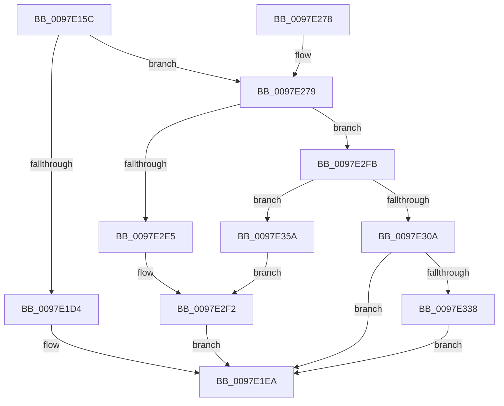

# MiFillMapFileInfo

- RVA: `0x0097E15C`–`0x0097E379` (길이 `541` bytes)
- VA: `0x000000014097E15C`
- 실행 섹션: `PAGE`
- PDB 이름 있음: `예`; PDB Function 태그: `아니요`
- unwind 정보 RVA: `0x00097588`
- 디코드: `135`개 명령, `541/541` bytes 표시
- 미해석 바이트: `0` (있으면 어셈블리에 `.byte`로 보존)

> 이 문서는 커널 이미지의 기계어와 PDB 기호를 분석해 생성했습니다. 4번과 5번은 함수 원형과 자료형을 바이너리 사용 방식에서 추정한 C 해석이며 원본 소스 복구 결과는 아닙니다.

## 1. Dependencies

- 직접 호출 지점: **8**; 고유 호출 대상: **8**
- 직접 호출자로 확인된 함수: **3**
- RIP 상대 이미지 참조: **0**

### Outgoing calls
- `0x0097E1ED` → [MiReadVadFlags2](../../text/45/MiReadVadFlags2_function_00452C1C.md) (function, `0x00452C1C`)
- `0x0097E27C` → [MiReferenceControlAreaFile](../../text/43/MiReferenceControlAreaFile_function_00431554.md) (function, `0x00431554`)
- `0x0097E28F` → [MiDereferenceControlAreaFile](../../text/43/MiDereferenceControlAreaFile_function_004345E0.md) (function, `0x004345E0`)
- `0x0097E2A2` → [MiGetProtoPteAddress](../../text/32/MiGetProtoPteAddress_function_0032E970.md) (function, `0x0032E970`)
- `0x0097E2AA` → [PsGetProcessSessionIdEx](../../text/22/PsGetProcessSessionIdEx_function_0022F8F0.md) (function, `0x0022F8F0`)
- `0x0097E2BB` → [MiStartingOffset](../../text/34/MiStartingOffset_function_003482E0.md) (function, `0x003482E0`)
- `0x0097E32B` → [MiVadMapsLargeImage](../../text/2A/MiVadMapsLargeImage_function_002A70F0.md) (function, `0x002A70F0`)
- `0x0097E33D` → [MiLocateLockedVadEvent](../../text/2A/MiLocateLockedVadEvent_function_002A7A0C.md) (function, `0x002A7A0C`)

### Direct callers
- [sub_0088535F](../88/Unknown_function_0088535F.md) at `0x008854F9`
- [MmEnumerateAddressSpaceAndReferenceImages](MmEnumerateAddressSpaceAndReferenceImages_function_0097DD50.md) at `0x0097E091`
- [MiLogMapFileEvent](MiLogMapFileEvent_function_0097E0FC.md) at `0x0097E12C`

### Static image references
- 디코드된 RIP-relative 메모리 참조가 없습니다.

## 2. Other-region calls and transfers

- 다른 실행 섹션으로 향하는 call: **8**
  - `0x0097E1ED` → [MiReadVadFlags2](../../text/45/MiReadVadFlags2_function_00452C1C.md) (`PAGE` → `.text`)
  - `0x0097E27C` → [MiReferenceControlAreaFile](../../text/43/MiReferenceControlAreaFile_function_00431554.md) (`PAGE` → `.text`)
  - `0x0097E28F` → [MiDereferenceControlAreaFile](../../text/43/MiDereferenceControlAreaFile_function_004345E0.md) (`PAGE` → `.text`)
  - `0x0097E2A2` → [MiGetProtoPteAddress](../../text/32/MiGetProtoPteAddress_function_0032E970.md) (`PAGE` → `.text`)
  - `0x0097E2AA` → [PsGetProcessSessionIdEx](../../text/22/PsGetProcessSessionIdEx_function_0022F8F0.md) (`PAGE` → `.text`)
  - `0x0097E2BB` → [MiStartingOffset](../../text/34/MiStartingOffset_function_003482E0.md) (`PAGE` → `.text`)
  - `0x0097E32B` → [MiVadMapsLargeImage](../../text/2A/MiVadMapsLargeImage_function_002A70F0.md) (`PAGE` → `.text`)
  - `0x0097E33D` → [MiLocateLockedVadEvent](../../text/2A/MiLocateLockedVadEvent_function_002A7A0C.md) (`PAGE` → `.text`)
- 별도 외부 분기/꼬리 이동을 확인하지 못했습니다.

## 3. Assembly (complete function range)

```asm
0097E15C  48 8B C4                        mov rax, rsp
0097E15F  48 89 58 10                     mov qword ptr [rax + 0x10], rbx
0097E163  48 89 68 18                     mov qword ptr [rax + 0x18], rbp
0097E167  48 89 70 20                     mov qword ptr [rax + 0x20], rsi
0097E16B  57                              push rdi
0097E16C  41 54                           push r12
0097E16E  41 55                           push r13
0097E170  41 56                           push r14
0097E172  41 57                           push r15
0097E174  48 83 EC 20                     sub rsp, 0x20
0097E178  48 8B D9                        mov rbx, rcx
0097E17B  48 8B FA                        mov rdi, rdx
0097E17E  33 C9                           xor ecx, ecx
0097E180  48 89 48 08                     mov qword ptr [rax + 8], rcx
0097E184  48 8B 43 48                     mov rax, qword ptr [rbx + 0x48]
0097E188  44 0F B6 73 20                  movzx r14d, byte ptr [rbx + 0x20]
0097E18D  0F B6 73 21                     movzx esi, byte ptr [rbx + 0x21]
0097E191  4C 8B 7B 70                     mov r15, qword ptr [rbx + 0x70]
0097E195  4C 8B 20                        mov r12, qword ptr [rax]
0097E198  49 83 E7 FE                     and r15, 0xfffffffffffffffe
0097E19C  8B 43 18                        mov eax, dword ptr [rbx + 0x18]
0097E19F  44 8B 6B 30                     mov r13d, dword ptr [rbx + 0x30]
0097E1A3  48 C1 E6 20                     shl rsi, 0x20
0097E1A7  49 C1 E6 20                     shl r14, 0x20
0097E1AB  4C 0B F0                        or r14, rax
0097E1AE  8B 43 1C                        mov eax, dword ptr [rbx + 0x1c]
0097E1B1  48 0B F0                        or rsi, rax
0097E1B4  48 89 4A 10                     mov qword ptr [rdx + 0x10], rcx
0097E1B8  49 2B F6                        sub rsi, r14
0097E1BB  49 8B EE                        mov rbp, r14
0097E1BE  48 FF C6                        inc rsi
0097E1C1  48 C1 E5 0C                     shl rbp, 0xc
0097E1C5  48 C1 E6 0C                     shl rsi, 0xc
0097E1C9  49 39 4C 24 40                  cmp qword ptr [r12 + 0x40], rcx
0097E1CE  0F 85 A5 00 00 00               jne 0x14097e279
0097E1D4  48 8B 43 50                     mov rax, qword ptr [rbx + 0x50]
0097E1D8  48 89 42 08                     mov qword ptr [rdx + 8], rax
0097E1DC  48 B8 00 00 00 00 00 00 C0 00   movabs rax, 0xc0000000000000
0097E1E6  48 89 42 10                     mov qword ptr [rdx + 0x10], rax
0097E1EA  48 8B CB                        mov rcx, rbx
0097E1ED  E8 2A 4A AD FF                  call 0x140452c1c
0097E1F2  8B C8                           mov ecx, eax
0097E1F4  48 B8 FF FF FF FF FF FF DF FF   movabs rax, 0xffdfffffffffffff
0097E1FE  48 C1 E1 35                     shl rcx, 0x35
0097E202  48 8B D1                        mov rdx, rcx
0097E205  48 33 57 10                     xor rdx, qword ptr [rdi + 0x10]
0097E209  48 23 D0                        and rdx, rax
0097E20C  48 33 D1                        xor rdx, rcx
0097E20F  48 89 57 10                     mov qword ptr [rdi + 0x10], rdx
0097E213  41 8B 87 D0 01 00 00            mov eax, dword ptr [r15 + 0x1d0]
0097E21A  89 47 28                        mov dword ptr [rdi + 0x28], eax
0097E21D  48 89 2F                        mov qword ptr [rdi], rbp
0097E220  48 8B 6C 24 60                  mov rbp, qword ptr [rsp + 0x60]
0097E225  48 89 77 18                     mov qword ptr [rdi + 0x18], rsi
0097E229  8B 4B 30                        mov ecx, dword ptr [rbx + 0x30]
0097E22C  48 8B 74 24 68                  mov rsi, qword ptr [rsp + 0x68]
0097E231  48 C1 E1 29                     shl rcx, 0x29
0097E235  48 8B C1                        mov rax, rcx
0097E238  48 33 C2                        xor rax, rdx
0097E23B  48 BA FF FF FF FF FF FF E0 FF   movabs rdx, 0xffe0ffffffffffff
0097E245  48 23 C2                        and rax, rdx
0097E248  48 33 C1                        xor rax, rcx
0097E24B  48 89 47 10                     mov qword ptr [rdi + 0x10], rax
0097E24F  8B 4B 34                        mov ecx, dword ptr [rbx + 0x34]
0097E252  0F B6 53 22                     movzx edx, byte ptr [rbx + 0x22]
0097E256  48 8B 5C 24 58                  mov rbx, qword ptr [rsp + 0x58]
0097E25B  48 C1 E2 20                     shl rdx, 0x20
0097E25F  48 0B D1                        or rdx, rcx
0097E262  48 C1 E2 0C                     shl rdx, 0xc
0097E266  48 89 57 20                     mov qword ptr [rdi + 0x20], rdx
0097E26A  48 83 C4 20                     add rsp, 0x20
0097E26E  41 5F                           pop r15
0097E270  41 5E                           pop r14
0097E272  41 5D                           pop r13
0097E274  41 5C                           pop r12
0097E276  5F                              pop rdi
0097E277  C3                              ret
0097E278  CC                              int3
0097E279  49 8B CC                        mov rcx, r12
0097E27C  E8 D3 32 AB FF                  call 0x140431554
0097E281  48 8B D0                        mov rdx, rax
0097E284  49 8B CC                        mov rcx, r12
0097E287  4C 8B 40 18                     mov r8, qword ptr [rax + 0x18]
0097E28B  4C 89 47 08                     mov qword ptr [rdi + 8], r8
0097E28F  E8 4C 63 AB FF                  call 0x1404345e0
0097E294  4C 8D 4C 24 50                  lea r9, [rsp + 0x50]
0097E299  45 33 C0                        xor r8d, r8d
0097E29C  49 8B D6                        mov rdx, r14
0097E29F  48 8B CB                        mov rcx, rbx
0097E2A2  E8 C9 06 9B FF                  call 0x14032e970
0097E2A7  49 8B CF                        mov rcx, r15
0097E2AA  E8 41 16 8B FF                  call 0x14022f8f0
0097E2AF  48 8B 53 50                     mov rdx, qword ptr [rbx + 0x50]
0097E2B3  44 8B C0                        mov r8d, eax
0097E2B6  48 8B 4C 24 50                  mov rcx, qword ptr [rsp + 0x50]
0097E2BB  E8 20 A0 9C FF                  call 0x1403482e0
0097E2C0  48 8B C8                        mov rcx, rax
0097E2C3  48 BA 00 00 00 00 00 00 FF FF   movabs rdx, 0xffff000000000000
0097E2CD  48 33 4F 10                     xor rcx, qword ptr [rdi + 0x10]
0097E2D1  41 80 E5 70                     and r13b, 0x70
0097E2D5  48 23 CA                        and rcx, rdx
0097E2D8  48 33 C8                        xor rcx, rax
0097E2DB  48 89 4F 10                     mov qword ptr [rdi + 0x10], rcx
0097E2DF  41 80 FD 20                     cmp r13b, 0x20
0097E2E3  74 16                           je 0x14097e2fb
0097E2E5  48 B8 FF FF FF FF FF FF 3F FF   movabs rax, 0xff3fffffffffffff
0097E2EF  48 23 C8                        and rcx, rax
0097E2F2  48 89 4F 10                     mov qword ptr [rdi + 0x10], rcx
0097E2F6  E9 EF FE FF FF                  jmp 0x14097e1ea
0097E2FB  8B 43 30                        mov eax, dword ptr [rbx + 0x30]
0097E2FE  25 80 0F 00 00                  and eax, 0xf80
0097E303  3D 80 03 00 00                  cmp eax, 0x380
0097E308  75 50                           jne 0x14097e35a
0097E30A  48 B8 FF FF FF FF FF FF 7F FF   movabs rax, 0xff7fffffffffffff
0097E314  48 23 C8                        and rcx, rax
0097E317  48 B8 00 00 00 00 00 00 40 00   movabs rax, 0x40000000000000
0097E321  48 0B C8                        or rcx, rax
0097E324  48 89 4F 10                     mov qword ptr [rdi + 0x10], rcx
0097E328  48 8B CB                        mov rcx, rbx
0097E32B  E8 C0 8D 92 FF                  call 0x1402a70f0
0097E330  85 C0                           test eax, eax
0097E332  0F 84 B2 FE FF FF               je 0x14097e1ea
0097E338  BA 10 00 00 00                  mov edx, 0x10
0097E33D  E8 CA 96 92 FF                  call 0x1402a7a0c
0097E342  0F B6 48 08                     movzx ecx, byte ptr [rax + 8]
0097E346  48 8B 70 10                     mov rsi, qword ptr [rax + 0x10]
0097E34A  48 C1 E1 10                     shl rcx, 0x10
0097E34E  48 03 E9                        add rbp, rcx
0097E351  48 C1 E6 0C                     shl rsi, 0xc
0097E355  E9 90 FE FF FF                  jmp 0x14097e1ea
0097E35A  48 B8 FF FF FF FF FF FF BF FF   movabs rax, 0xffbfffffffffffff
0097E364  48 23 C8                        and rcx, rax
0097E367  48 B8 00 00 00 00 00 00 80 00   movabs rax, 0x80000000000000
0097E371  48 0B C8                        or rcx, rax
0097E374  E9 79 FF FF FF                  jmp 0x14097e2f2
```

## 4. C-style interpretation (structured pseudocode)

```c
__int64 __fastcall MiFillMapFileInfo(__int64 a1, __int64 a2)
{
    __int64 result;
    __int64 v_r13;
    __int64 v_r14;
    __int64 v_r15;
    __int64 v_rbp;
    __int64 v_rsi;
    __int64 v_rsp;
    unsigned __int64 v_stack_p10;
    unsigned __int64 v_stack_p18;
    unsigned __int64 v_stack_p20;
    unsigned __int64 v_stack_p50;

    *(unsigned __int64 *)(v_rsp + 16) = v_rbx;
    *(unsigned __int64 *)(v_rsp + 24) = v_rbp;
    *(unsigned __int64 *)(v_rsp + 32) = v_rsi;
    v_rsp = (v_rsp) - (32);
    a1 = 0;
    *(unsigned __int64 *)(v_rsp + 8) = 0;
    v_r15 = (*(unsigned __int64 *)(a1 + 112)) & (-2);
    v_rsi = (*(unsigned __int8 *)(a1 + 33)) << (32);
    v_r14 = (*(unsigned __int8 *)(a1 + 32)) << (32);
    v_r14 = (v_r14) | ((unsigned int)(*(unsigned int *)(a1 + 24)));
    v_rsi = (v_rsi) | ((unsigned int)(*(unsigned int *)(a1 + 28)));
    *(unsigned __int64 *)(a2 + 16) = 0;
    v_rsi = (v_rsi) - (v_r14);
    v_rsi = (v_rsi) + 1;
    v_rbp = (v_r14) << (12);
    v_rsi = (v_rsi) << (12);
    if ((*(unsigned __int64 *)(*(unsigned __int64 *)(*(unsigned __int64 *)(a1 + 72)) + 64)) != 0) goto loc_0097E279;
    *(unsigned __int64 *)(a2 + 8) = *(unsigned __int64 *)(a1 + 80);
    *(unsigned __int64 *)(a2 + 16) = *(unsigned __int64 *)(a1 + 80);
loc_0097E1EA:
    result = MiReadVadFlags2(0, a2, a3, a4);
    a1 = ((unsigned int)((unsigned int)(result))) << (53);
    a2 = (a1) ^ (*(unsigned __int64 *)(a2 + 16));
    a2 = (a2) & (result);
    a2 = (a2) ^ (a1);
    *(unsigned __int64 *)(a2 + 16) = a2;
    *(unsigned int *)(a2 + 40) = (unsigned int)((unsigned int)(*(unsigned int *)(v_r15 + 464)));
    *(unsigned __int64 *)(a2) = v_rbp;
    *(unsigned __int64 *)(a2 + 24) = v_rsi;
    a1 = ((unsigned int)(*(unsigned int *)(a1 + 48))) << (41);
    result = (a1) ^ (a2);
    result = (result) & (a2);
    result = (result) ^ (a1);
    *(unsigned __int64 *)(a2 + 16) = result;
    a2 = (*(unsigned __int8 *)(a1 + 34)) << (32);
    a2 = (a2) | ((unsigned int)(*(unsigned int *)(a1 + 52)));
    a2 = (a2) << (12);
    *(unsigned __int64 *)(a2 + 32) = a2;
    v_rsp = (v_rsp) + (32);
    return result;
loc_0097E279:
    result = MiReferenceControlAreaFile(*(unsigned __int64 *)(*(unsigned __int64 *)(a1 + 72)), a2, a3, a4);
    *(unsigned __int64 *)(a2 + 8) = *(unsigned __int64 *)(result + 24);
    result = MiDereferenceControlAreaFile(*(unsigned __int64 *)(*(unsigned __int64 *)(a1 + 72)), result, *(unsigned __int64 *)(result + 24), a4);
    a3 = 0;
    result = MiGetProtoPteAddress(v_stack_p10, v_r14, a3, v_stack_p50);
    result = PsGetProcessSessionIdEx(v_r15, v_r14, a3, v_stack_p50);
    result = MiStartingOffset(v_stack_p50, *(unsigned __int64 *)(v_stack_p10 + 80), (unsigned int)((unsigned int)(result)), v_stack_p50);
    a1 = (result) ^ (*(unsigned __int64 *)(a2 + 16));
    v_r13 = (unsigned __int8)(((unsigned int)(*(unsigned int *)(a1 + 48))) & (112));
    a1 = (a1) & (*(unsigned __int64 *)(v_stack_p10 + 80));
    a1 = (a1) ^ (result);
    *(unsigned __int64 *)(a2 + 16) = a1;
    if (((unsigned __int8)(v_r13)) == 32) goto loc_0097E2FB;
    a1 = (a1) & (result);
loc_0097E2F2:
    *(unsigned __int64 *)(a2 + 16) = a1;
    goto loc_0097E1EA;
loc_0097E2FB:
    result = (unsigned int)(((unsigned int)(*(unsigned int *)(v_stack_p10 + 48))) & (0xF80ULL));
    if (((unsigned int)(result)) != 896) goto loc_0097E35A;
    a1 = (a1) & (result);
    a1 = (a1) | (result);
    *(unsigned __int64 *)(a2 + 16) = a1;
    result = MiVadMapsLargeImage(v_stack_p10, *(unsigned __int64 *)(v_stack_p10 + 80), (unsigned int)((unsigned int)(result)), v_stack_p50);
    if ((unsigned int)(result) == 0) goto loc_0097E1EA;
    result = MiLocateLockedVadEvent(v_stack_p10, 16, (unsigned int)((unsigned int)(result)), v_stack_p50);
    a1 = (*(unsigned __int8 *)(result + 8)) << (16);
    v_rbp = (v_stack_p18) + (a1);
    v_rsi = (*(unsigned __int64 *)(result + 16)) << (12);
    goto loc_0097E1EA;
loc_0097E35A:
    a1 = (a1) & (result);
    a1 = (a1) | (result);
    goto loc_0097E2F2;
}
```

## 5. (Beta) C Style

```c
int64_t MiFillMapFileInfo(void *Arg1, void *Arg2)
{
    uint8_t *arg1 = (uint8_t *)Arg1;
    uint8_t *arg2 = (uint8_t *)Arg2;

    int64_t result;
    int64_t local_r13;
    int64_t local_r14;
    int64_t local_r15;
    int64_t local_rbp;
    int64_t local_rsi;
    int64_t local_rsp;
    uint64_t v_stack_p10;
    uint64_t v_stack_p18;
    uint64_t v_stack_p20;
    uint64_t v_stack_p50;

    *(uint64_t *)(local_rsp + 0x10) = local_rbx;
    *(uint64_t *)(local_rsp + 0x18) = local_rbp;
    *(uint64_t *)(local_rsp + 0x20) = local_rsi;
    local_rsp = (local_rsp) - (32);
    Arg1 = 0;
    *(uint64_t *)(local_rsp + 0x8) = 0;
    local_r15 = (*(uint64_t *)(arg1 + 0x70)) & (-2);
    local_rsi = (*(uint8_t *)(arg1 + 0x21)) << (32);
    local_r14 = (*(uint8_t *)(arg1 + 0x20)) << (32);
    local_r14 = (local_r14) | ((uint32_t)(*(uint32_t *)(arg1 + 0x18)));
    local_rsi = (local_rsi) | ((uint32_t)(*(uint32_t *)(arg1 + 0x1C)));
    *(uint64_t *)(arg2 + 0x10) = 0;
    local_rsi = (local_rsi) - (local_r14);
    local_rsi = (local_rsi) + 1;
    local_rbp = (local_r14) << (12);
    local_rsi = (local_rsi) << (12);
    if ((*(uint64_t *)(*(uint64_t *)(*(uint64_t *)(arg1 + 0x48)) + 0x40)) != 0) goto loc_0097E279;
    *(uint64_t *)(arg2 + 0x8) = *(uint64_t *)(arg1 + 0x50);
    *(uint64_t *)(arg2 + 0x10) = *(uint64_t *)(arg1 + 0x50);
loc_0097E1EA:
    result = MiReadVadFlags2(0, Arg2, a3, a4);
    Arg1 = ((uint32_t)((uint32_t)(result))) << (53);
    Arg2 = (Arg1) ^ (*(uint64_t *)(arg2 + 0x10));
    Arg2 = (Arg2) & (result);
    Arg2 = (Arg2) ^ (Arg1);
    *(void **)(arg2 + 0x10) = Arg2;
    *(uint32_t *)(arg2 + 0x28) = (uint32_t)((uint32_t)(*(uint32_t *)(local_r15 + 0x1D0)));
    *(uint64_t *)(arg2) = local_rbp;
    *(uint64_t *)(arg2 + 0x18) = local_rsi;
    Arg1 = ((uint32_t)(*(uint32_t *)(arg1 + 0x30))) << (41);
    result = (Arg1) ^ (Arg2);
    result = (result) & (Arg2);
    result = (result) ^ (Arg1);
    *(uint64_t *)(arg2 + 0x10) = result;
    Arg2 = (*(uint8_t *)(arg1 + 0x22)) << (32);
    Arg2 = (Arg2) | ((uint32_t)(*(uint32_t *)(arg1 + 0x34)));
    Arg2 = (Arg2) << (12);
    *(void **)(arg2 + 0x20) = Arg2;
    local_rsp = (local_rsp) + (32);
    return result;
loc_0097E279:
    result = MiReferenceControlAreaFile(*(uint64_t *)(*(uint64_t *)(arg1 + 0x48)), Arg2, a3, a4);
    *(uint64_t *)(arg2 + 0x8) = *(uint64_t *)(result + 0x18);
    result = MiDereferenceControlAreaFile(*(uint64_t *)(*(uint64_t *)(arg1 + 0x48)), result, *(uint64_t *)(result + 0x18), a4);
    a3 = 0;
    result = MiGetProtoPteAddress(v_stack_p10, local_r14, a3, v_stack_p50);
    result = PsGetProcessSessionIdEx(local_r15, local_r14, a3, v_stack_p50);
    result = MiStartingOffset(v_stack_p50, *(uint64_t *)(v_stack_p10 + 0x50), (uint32_t)((uint32_t)(result)), v_stack_p50);
    Arg1 = (result) ^ (*(uint64_t *)(arg2 + 0x10));
    local_r13 = (uint8_t)(((uint32_t)(*(uint32_t *)(arg1 + 0x30))) & (112));
    Arg1 = (Arg1) & (*(uint64_t *)(v_stack_p10 + 0x50));
    Arg1 = (Arg1) ^ (result);
    *(void **)(arg2 + 0x10) = Arg1;
    if (((uint8_t)(local_r13)) == 32) goto loc_0097E2FB;
    Arg1 = (Arg1) & (result);
loc_0097E2F2:
    *(void **)(arg2 + 0x10) = Arg1;
    goto loc_0097E1EA;
loc_0097E2FB:
    result = (uint32_t)(((uint32_t)(*(uint32_t *)(v_stack_p10 + 0x30))) & (0xF80ULL));
    if (((uint32_t)(result)) != 896) goto loc_0097E35A;
    Arg1 = (Arg1) & (result);
    Arg1 = (Arg1) | (result);
    *(void **)(arg2 + 0x10) = Arg1;
    result = MiVadMapsLargeImage(v_stack_p10, *(uint64_t *)(v_stack_p10 + 0x50), (uint32_t)((uint32_t)(result)), v_stack_p50);
    if ((uint32_t)(result) == 0) goto loc_0097E1EA;
    result = MiLocateLockedVadEvent(v_stack_p10, 16, (uint32_t)((uint32_t)(result)), v_stack_p50);
    Arg1 = (*(uint8_t *)(result + 0x8)) << (16);
    local_rbp = (v_stack_p18) + (Arg1);
    local_rsi = (*(uint64_t *)(result + 0x10)) << (12);
    goto loc_0097E1EA;
loc_0097E35A:
    Arg1 = (Arg1) & (result);
    Arg1 = (Arg1) | (result);
    goto loc_0097E2F2;
}
```

### 관측된 메모리 오프셋

구조체 형식이 확인되지 않은 접근은 인자 기준의 오프셋으로만 기록했습니다.

| 기준 인자 | 오프셋 표현 | 폭 (bit) | 접근 |
|---|---:|---:|---|
| `Arg1` | `+ 0x18` | `32` | `R` |
| `Arg1` | `+ 0x1C` | `32` | `R` |
| `Arg1` | `+ 0x20` | `8` | `R` |
| `Arg1` | `+ 0x21` | `8` | `R` |
| `Arg1` | `+ 0x22` | `8` | `R` |
| `Arg1` | `+ 0x30` | `32` | `R` |
| `Arg1` | `+ 0x34` | `32` | `R` |
| `Arg1` | `+ 0x48` | `64` | `R` |
| `Arg1` | `+ 0x50` | `64` | `R` |
| `Arg1` | `+ 0x70` | `64` | `R` |
| `Arg2` | `+ 0x0` | `64` | `W` |
| `Arg2` | `+ 0x8` | `64` | `W` |
| `Arg2` | `+ 0x10` | `64` | `R` |
| `Arg2` | `+ 0x10` | `64` | `W` |
| `Arg2` | `+ 0x18` | `64` | `W` |
| `Arg2` | `+ 0x20` | `64` | `W` |
| `Arg2` | `+ 0x28` | `32` | `W` |

## 6. Execution-region graph

[열기: 2D/3D 그래프와 함수 탐색 컨트롤 패널](../../../control-panel.html?section=page&rva=0x0097E15C&view=graph)

- 2D 그래프는 위에서 아래로 흐르고, 3D 그래프는 빈 공간을 드래그해 회전합니다. Shift+드래그는 이동, 휠은 확대·축소, 함수 노드 선택은 대상 보고서 이동입니다.

### Static fallback


