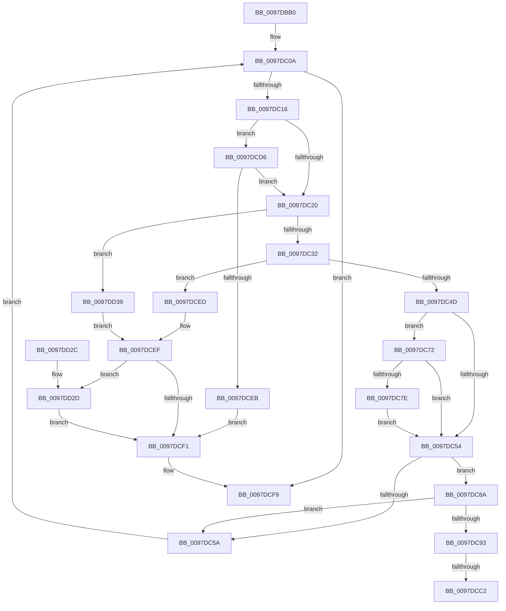

# MiInsertChildVads

- RVA: `0x0097DBB0`–`0x0097DD3F` (길이 `399` bytes)
- VA: `0x000000014097DBB0`
- 실행 섹션: `PAGE`
- PDB 이름 있음: `예`; PDB Function 태그: `예`
- unwind 정보 RVA: `0x00097510`
- 디코드: `114`개 명령, `399/399` bytes 표시
- 미해석 바이트: `0` (있으면 어셈블리에 `.byte`로 보존)

> 이 문서는 커널 이미지의 기계어와 PDB 기호를 분석해 생성했습니다. 4번과 5번은 함수 원형과 자료형을 바이너리 사용 방식에서 추정한 C 해석이며 원본 소스 복구 결과는 아닙니다.

## 1. Dependencies

- 직접 호출 지점: **12**; 고유 호출 대상: **11**
- 직접 호출자로 확인된 함수: **1**
- RIP 상대 이미지 참조: **2**

### Outgoing calls
- `0x0097DBF4` → [KiStackAttachProcess](../../text/21/KiStackAttachProcess_function_00216820.md) (function, `0x00216820`)
- `0x0097DC23` → [MiCommitPageTableRangesForVad](../../text/2A/MiCommitPageTableRangesForVad_function_002A69D4.md) (function, `0x002A69D4`)
- `0x0097DC38` → [MiInsertVadCharges](../88/MiInsertVadCharges_function_00886AA8.md) (function, `0x00886AA8`)
- `0x0097DC6B` → [MiInsertVad](../../text/26/MiInsertVad_function_00265540.md) (function, `0x00265540`)
- `0x0097DC83` → [ObfReferenceObjectWithTag](../../text/21/ObfReferenceObjectWithTag_function_00210710.md) (function, `0x00210710`)
- `0x0097DCAD` → [KeAbPreAcquire](../../text/21/KeAbPreAcquire_function_00210230.md) (function, `0x00210230`)
- `0x0097DCCB` → [ExfAcquirePushLockExclusiveEx](../../text/20/ExfAcquirePushLockExclusiveEx_function_0020FC90.md) (function, `0x0020FC90`)
- `0x0097DCDC` → [MiUpControlAreaRefs](../../text/3B/MiUpControlAreaRefs_function_003B2BF0.md) (function, `0x003B2BF0`)
- `0x0097DCF4` → [MiDeletePartialCloneVads](../81/MiDeletePartialCloneVads_function_008116E4.md) (function, `0x008116E4`)
- `0x0097DD00` → [KiUnstackDetachProcess](../../text/21/KiUnstackDetachProcess_function_00217D30.md) (function, `0x00217D30`)
- `0x0097DD0F` → [_security_check_cookie](../../text/6A/_security_check_cookie_function_006AC640.md) (function, `0x006AC640`)
- `0x0097DD32` → [MiUpControlAreaRefs](../../text/3B/MiUpControlAreaRefs_function_003B2BF0.md) (function, `0x003B2BF0`)

### Direct callers
- [MiAllocateChildVads](MiAllocateChildVads_function_0097E380.md) at `0x0097E6AB`

### Static image references
- `0x0097DBC4` → RVA `0x00E0A740` (`.data`; read)
- `0x0097DC03` → RVA `0x00E2CD10` (`.data`; read)

## 2. Other-region calls and transfers

- 다른 실행 섹션으로 향하는 call: **10**
  - `0x0097DBF4` → [KiStackAttachProcess](../../text/21/KiStackAttachProcess_function_00216820.md) (`PAGE` → `.text`)
  - `0x0097DC23` → [MiCommitPageTableRangesForVad](../../text/2A/MiCommitPageTableRangesForVad_function_002A69D4.md) (`PAGE` → `.text`)
  - `0x0097DC6B` → [MiInsertVad](../../text/26/MiInsertVad_function_00265540.md) (`PAGE` → `.text`)
  - `0x0097DC83` → [ObfReferenceObjectWithTag](../../text/21/ObfReferenceObjectWithTag_function_00210710.md) (`PAGE` → `.text`)
  - `0x0097DCAD` → [KeAbPreAcquire](../../text/21/KeAbPreAcquire_function_00210230.md) (`PAGE` → `.text`)
  - `0x0097DCCB` → [ExfAcquirePushLockExclusiveEx](../../text/20/ExfAcquirePushLockExclusiveEx_function_0020FC90.md) (`PAGE` → `.text`)
  - `0x0097DCDC` → [MiUpControlAreaRefs](../../text/3B/MiUpControlAreaRefs_function_003B2BF0.md) (`PAGE` → `.text`)
  - `0x0097DD00` → [KiUnstackDetachProcess](../../text/21/KiUnstackDetachProcess_function_00217D30.md) (`PAGE` → `.text`)
  - `0x0097DD0F` → [_security_check_cookie](../../text/6A/_security_check_cookie_function_006AC640.md) (`PAGE` → `.text`)
  - `0x0097DD32` → [MiUpControlAreaRefs](../../text/3B/MiUpControlAreaRefs_function_003B2BF0.md) (`PAGE` → `.text`)
- call이 아닌 외부 분기/꼬리 이동: **2**
  - `0x0097DCBC` → [sub_00B29F0E](../B2/Unknown_function_00B29F0E.md) (`tail-transfer`)
  - `0x0097DCD1` → [sub_00B29F0E](../B2/Unknown_function_00B29F0E.md) (`tail-transfer`)

## 3. Assembly (complete function range)

```asm
0097DBB0  48 89 5C 24 18                  mov qword ptr [rsp + 0x18], rbx
0097DBB5  55                              push rbp
0097DBB6  56                              push rsi
0097DBB7  57                              push rdi
0097DBB8  41 54                           push r12
0097DBBA  41 55                           push r13
0097DBBC  41 56                           push r14
0097DBBE  41 57                           push r15
0097DBC0  48 83 EC 60                     sub rsp, 0x60
0097DBC4  48 8B 05 75 CB 48 00            mov rax, qword ptr [rip + 0x48cb75]
0097DBCB  48 33 C4                        xor rax, rsp
0097DBCE  48 89 44 24 50                  mov qword ptr [rsp + 0x50], rax
0097DBD3  0F 57 C0                        xorps xmm0, xmm0
0097DBD6  4C 8D 44 24 20                  lea r8, [rsp + 0x20]
0097DBDB  48 8B DA                        mov rbx, rdx
0097DBDE  33 FF                           xor edi, edi
0097DBE0  33 D2                           xor edx, edx
0097DBE2  4C 8B F9                        mov r15, rcx
0097DBE5  0F 11 44 24 20                  movups xmmword ptr [rsp + 0x20], xmm0
0097DBEA  0F 11 44 24 30                  movups xmmword ptr [rsp + 0x30], xmm0
0097DBEF  0F 11 44 24 40                  movups xmmword ptr [rsp + 0x40], xmm0
0097DBF4  E8 27 8C 89 FF                  call 0x140216820
0097DBF9  41 BD 00 00 20 00               mov r13d, 0x200000
0097DBFF  44 8D 77 01                     lea r14d, [rdi + 1]
0097DC03  4C 8D 25 06 F1 4A 00            lea r12, [rip + 0x4af106]
0097DC0A  48 8B F3                        mov rsi, rbx
0097DC0D  48 85 DB                        test rbx, rbx
0097DC10  0F 84 E3 00 00 00               je 0x14097dcf9
0097DC16  44 85 6B 30                     test dword ptr [rbx + 0x30], r13d
0097DC1A  0F 84 B6 00 00 00               je 0x14097dcd6
0097DC20  48 8B CB                        mov rcx, rbx
0097DC23  E8 AC 8D 92 FF                  call 0x1402a69d4
0097DC28  8B F8                           mov edi, eax
0097DC2A  85 C0                           test eax, eax
0097DC2C  0F 88 07 01 00 00               js 0x14097dd39
0097DC32  49 8B D7                        mov rdx, r15
0097DC35  48 8B CB                        mov rcx, rbx
0097DC38  E8 6B 8E F0 FF                  call 0x140886aa8
0097DC3D  8B F8                           mov edi, eax
0097DC3F  8B 43 30                        mov eax, dword ptr [rbx + 0x30]
0097DC42  41 23 C5                        and eax, r13d
0097DC45  85 FF                           test edi, edi
0097DC47  0F 88 A0 00 00 00               js 0x14097dced
0097DC4D  48 8B 1B                        mov rbx, qword ptr [rbx]
0097DC50  85 C0                           test eax, eax
0097DC52  74 1E                           je 0x14097dc72
0097DC54  44 85 6E 30                     test dword ptr [rsi + 0x30], r13d
0097DC58  74 30                           je 0x14097dc8a
0097DC5A  45 33 C0                        xor r8d, r8d
0097DC5D  48 C7 46 10 FE FF FF FF         mov qword ptr [rsi + 0x10], 0xfffffffffffffffe
0097DC65  49 8B D7                        mov rdx, r15
0097DC68  48 8B CE                        mov rcx, rsi
0097DC6B  E8 D0 78 8E FF                  call 0x140265540
0097DC70  EB 98                           jmp 0x14097dc0a
0097DC72  48 8B 8E 80 00 00 00            mov rcx, qword ptr [rsi + 0x80]
0097DC79  48 85 C9                        test rcx, rcx
0097DC7C  74 D6                           je 0x14097dc54
0097DC7E  BA 4D 6D 53 63                  mov edx, 0x63536d4d
0097DC83  E8 88 2A 89 FF                  call 0x140210710
0097DC88  EB CA                           jmp 0x14097dc54
0097DC8A  48 8B 46 78                     mov rax, qword ptr [rsi + 0x78]
0097DC8E  48 85 C0                        test rax, rax
0097DC91  79 C7                           jns 0x14097dc5a
0097DC93  65 48 8B 2C 25 88 01 00 00      mov rbp, qword ptr gs:[0x188]
0097DC9C  45 33 C0                        xor r8d, r8d
0097DC9F  33 D2                           xor edx, edx
0097DCA1  49 8B CC                        mov rcx, r12
0097DCA4  66 44 29 B5 E6 01 00 00         sub word ptr [rbp + 0x1e6], r14w
0097DCAC  90                              nop
0097DCAD  E8 7E 25 89 FF                  call 0x140210230
0097DCB2  F0 49 0F BA 2C 24 00            lock bts qword ptr [r12], 0
0097DCB9  4C 8B F0                        mov r14, rax
0097DCBC  0F 83 4C C2 1A 00               jae 0x140b29f0e
0097DCC2  4D 8B C4                        mov r8, r12
0097DCC5  48 8B D0                        mov rdx, rax
0097DCC8  49 8B CC                        mov rcx, r12
0097DCCB  E8 C0 1F 89 FF                  call 0x14020fc90
0097DCD0  90                              nop
0097DCD1  E9 38 C2 1A 00                  jmp 0x140b29f0e
0097DCD6  41 8B D6                        mov edx, r14d
0097DCD9  48 8B CB                        mov rcx, rbx
0097DCDC  E8 0F 4F A3 FF                  call 0x1403b2bf0
0097DCE1  8B F8                           mov edi, eax
0097DCE3  85 C0                           test eax, eax
0097DCE5  0F 89 35 FF FF FF               jns 0x14097dc20
0097DCEB  EB 04                           jmp 0x14097dcf1
0097DCED  85 C0                           test eax, eax
0097DCEF  74 3C                           je 0x14097dd2d
0097DCF1  48 8B CB                        mov rcx, rbx
0097DCF4  E8 EB 39 E9 FF                  call 0x1408116e4
0097DCF9  33 D2                           xor edx, edx
0097DCFB  48 8D 4C 24 20                  lea rcx, [rsp + 0x20]
0097DD00  E8 2B A0 89 FF                  call 0x140217d30
0097DD05  8B C7                           mov eax, edi
0097DD07  48 8B 4C 24 50                  mov rcx, qword ptr [rsp + 0x50]
0097DD0C  48 33 CC                        xor rcx, rsp
0097DD0F  E8 2C E9 D2 FF                  call 0x1406ac640
0097DD14  48 8B 9C 24 B0 00 00 00         mov rbx, qword ptr [rsp + 0xb0]
0097DD1C  48 83 C4 60                     add rsp, 0x60
0097DD20  41 5F                           pop r15
0097DD22  41 5E                           pop r14
0097DD24  41 5D                           pop r13
0097DD26  41 5C                           pop r12
0097DD28  5F                              pop rdi
0097DD29  5E                              pop rsi
0097DD2A  5D                              pop rbp
0097DD2B  C3                              ret
0097DD2C  CC                              int3
0097DD2D  33 D2                           xor edx, edx
0097DD2F  48 8B CB                        mov rcx, rbx
0097DD32  E8 B9 4E A3 FF                  call 0x1403b2bf0
0097DD37  EB B8                           jmp 0x14097dcf1
0097DD39  44 85 6B 30                     test dword ptr [rbx + 0x30], r13d
0097DD3D  EB B0                           jmp 0x14097dcef
```

## 4. C-style interpretation (structured pseudocode)

```c
__int64 __fastcall MiInsertChildVads(__int64 a1, __int64 a2)
{
    __int64 result;
    __int64 v_rdi;
    __int64 v_rsp;
    unsigned __int64 v_stack_m48;
    unsigned __int64 v_stack_m58;
    unsigned __int64 v_stack_m68;
    unsigned __int64 v_stack_m78;
    unsigned __int64 v_stack_p18;

    v_stack_p18 = v_rbx;
    v_rsp = (v_rsp) - (96);
    result = (*(unsigned __int64 *)(v_rip + 4770677)) ^ (v_rsp);
    v_stack_m48 = result;
    v_rdi = 0;
    a2 = 0;
    v_stack_m78 = v_xmm0;
    v_stack_m68 = v_xmm0;
    v_stack_m58 = v_xmm0;
    result = KiStackAttachProcess(a1, a2, v_stack_m78, a4);
loc_0097DC0A:
    if (0 == 0) goto loc_0097DCF9;
    if (((*(unsigned int *)(a2 + 48)) & ((unsigned int)((unsigned int)(0x200000ULL)))) == 0) goto loc_0097DCD6;
loc_0097DC20:
    result = MiCommitPageTableRangesForVad(0, a2, v_stack_m78, a4);
    if (sign_flag) goto loc_0097DD39;
    result = MiInsertVadCharges(0, a1, v_stack_m78, a4);
    result = (unsigned int)(((unsigned int)(*(unsigned int *)(a2 + 48))) & ((unsigned int)((unsigned int)(0x200000ULL))));
    if (sign_flag) goto loc_0097DCED;
    if ((unsigned int)(result) == 0) goto loc_0097DC72;
loc_0097DC54:
    if (((*(unsigned int *)(0 + 48)) & ((unsigned int)((unsigned int)(0x200000ULL)))) == 0) goto loc_0097DC8A;
loc_0097DC5A:
    a3 = 0;
    *(unsigned __int64 *)(0 + 16) = -2;
    result = MiInsertVad(0, a1, a3, a4);
    goto loc_0097DC0A;
loc_0097DC72:
    if (*(unsigned __int64 *)(0 + 128) == 0) goto loc_0097DC54;
    result = ObfReferenceObjectWithTag(*(unsigned __int64 *)(0 + 128), (unsigned int)(0x63536D4DULL), a3, a4);
    goto loc_0097DC54;
loc_0097DC8A:
    if (!sign_flag) goto loc_0097DC5A;
    a3 = 0;
    a2 = 0;
    result = KeAbPreAcquire(v_rip + 4911366, a2, a3, a4);
    result = ExfAcquirePushLockExclusiveEx(v_rip + 4911366, result, v_rip + 4911366, a4);
loc_0097DCD6:
    result = MiUpControlAreaRefs(*(unsigned __int64 *)(a2), (unsigned int)((unsigned int)(result)), v_rip + 4911366, a4);
    if (!sign_flag) goto loc_0097DC20;
    goto loc_0097DCF1;
loc_0097DCED:
loc_0097DCEF:
    if ((unsigned int)(result) == 0) goto loc_0097DD2D;
loc_0097DCF1:
    result = MiDeletePartialCloneVads(*(unsigned __int64 *)(a2), (unsigned int)((unsigned int)(result)), v_rip + 4911366, a4);
loc_0097DCF9:
    a2 = 0;
    result = KiUnstackDetachProcess(v_stack_m78, a2, v_rip + 4911366, a4);
    a1 = (v_stack_m48) ^ (v_rsp);
    result = _security_check_cookie(a1, a2, v_rip + 4911366, a4);
    v_rsp = (v_rsp) + (96);
    return result;
loc_0097DD2D:
    a2 = 0;
    result = MiUpControlAreaRefs(v_stack_p18, a2, v_rip + 4911366, a4);
    goto loc_0097DCF1;
loc_0097DD39:
    goto loc_0097DCEF;
}
```

## 5. (Beta) C Style

```c
int64_t MiInsertChildVads(int64_t Arg1, int64_t Arg2)
{
    int64_t result;
    int64_t local_rdi;
    int64_t local_rsp;
    uint64_t v_stack_m48;
    uint64_t v_stack_m58;
    uint64_t v_stack_m68;
    uint64_t v_stack_m78;
    uint64_t v_stack_p18;

    v_stack_p18 = local_rbx;
    local_rsp = (local_rsp) - (96);
    result = (*(uint64_t *)(v_rip + 0x48CB75)) ^ (local_rsp);
    v_stack_m48 = result;
    local_rdi = 0;
    Arg2 = 0;
    v_stack_m78 = v_xmm0;
    v_stack_m68 = v_xmm0;
    v_stack_m58 = v_xmm0;
    result = KiStackAttachProcess(Arg1, Arg2, v_stack_m78, a4);
loc_0097DC0A:
    if (0 == 0) goto loc_0097DCF9;
    if (((*(uint32_t *)(Arg2 + 0x30)) & ((uint32_t)((uint32_t)(0x200000ULL)))) == 0) goto loc_0097DCD6;
loc_0097DC20:
    result = MiCommitPageTableRangesForVad(0, Arg2, v_stack_m78, a4);
    if (sign_flag) goto loc_0097DD39;
    result = MiInsertVadCharges(0, Arg1, v_stack_m78, a4);
    result = (uint32_t)(((uint32_t)(*(uint32_t *)(Arg2 + 0x30))) & ((uint32_t)((uint32_t)(0x200000ULL))));
    if (sign_flag) goto loc_0097DCED;
    if ((uint32_t)(result) == 0) goto loc_0097DC72;
loc_0097DC54:
    if (((*(uint32_t *)(0 + 0x30)) & ((uint32_t)((uint32_t)(0x200000ULL)))) == 0) goto loc_0097DC8A;
loc_0097DC5A:
    a3 = 0;
    *(uint64_t *)(0 + 0x10) = -2;
    result = MiInsertVad(0, Arg1, a3, a4);
    goto loc_0097DC0A;
loc_0097DC72:
    if (*(uint64_t *)(0 + 0x80) == 0) goto loc_0097DC54;
    result = ObfReferenceObjectWithTag(*(uint64_t *)(0 + 0x80), (uint32_t)(0x63536D4DULL), a3, a4);
    goto loc_0097DC54;
loc_0097DC8A:
    if (!sign_flag) goto loc_0097DC5A;
    a3 = 0;
    Arg2 = 0;
    result = KeAbPreAcquire(v_rip + 4911366, Arg2, a3, a4);
    result = ExfAcquirePushLockExclusiveEx(v_rip + 4911366, result, v_rip + 4911366, a4);
loc_0097DCD6:
    result = MiUpControlAreaRefs(*(uint64_t *)(Arg2), (uint32_t)((uint32_t)(result)), v_rip + 4911366, a4);
    if (!sign_flag) goto loc_0097DC20;
    goto loc_0097DCF1;
loc_0097DCED:
loc_0097DCEF:
    if ((uint32_t)(result) == 0) goto loc_0097DD2D;
loc_0097DCF1:
    result = MiDeletePartialCloneVads(*(uint64_t *)(Arg2), (uint32_t)((uint32_t)(result)), v_rip + 4911366, a4);
loc_0097DCF9:
    Arg2 = 0;
    result = KiUnstackDetachProcess(v_stack_m78, Arg2, v_rip + 4911366, a4);
    Arg1 = (v_stack_m48) ^ (local_rsp);
    result = _security_check_cookie(Arg1, Arg2, v_rip + 4911366, a4);
    local_rsp = (local_rsp) + (96);
    return result;
loc_0097DD2D:
    Arg2 = 0;
    result = MiUpControlAreaRefs(v_stack_p18, Arg2, v_rip + 4911366, a4);
    goto loc_0097DCF1;
loc_0097DD39:
    goto loc_0097DCEF;
}
```

## 6. Execution-region graph

[열기: 2D/3D 그래프와 함수 탐색 컨트롤 패널](../../../control-panel.html?section=page&rva=0x0097DBB0&view=graph)

- 2D 그래프는 위에서 아래로 흐르고, 3D 그래프는 빈 공간을 드래그해 회전합니다. Shift+드래그는 이동, 휠은 확대·축소, 함수 노드 선택은 대상 보고서 이동입니다.

### Static fallback


