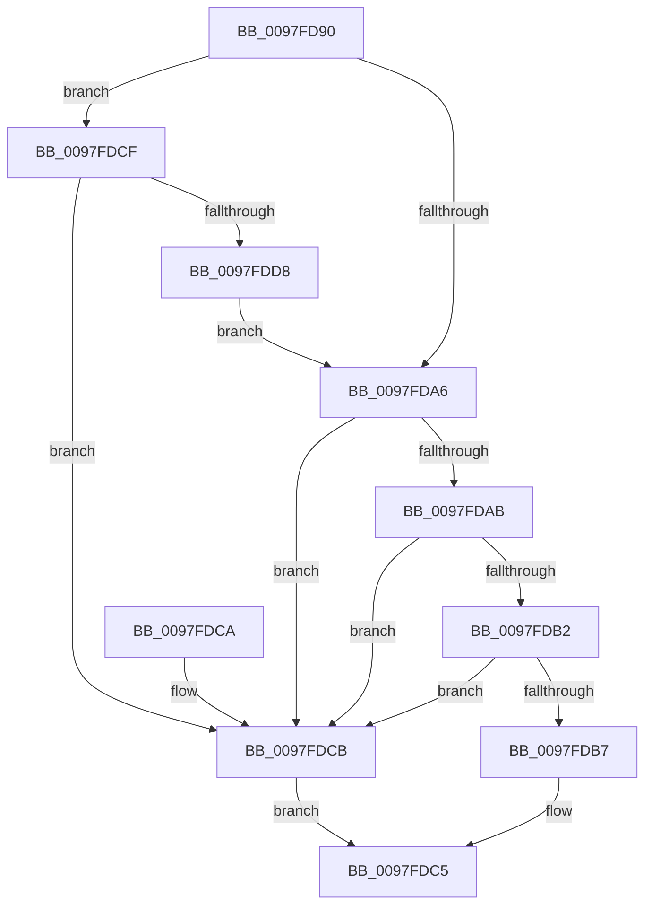

# MiIsVaRangeAvailable

- RVA: `0x0097FD90`–`0x0097FDDA` (길이 `74` bytes)
- VA: `0x000000014097FD90`
- 실행 섹션: `PAGE`
- PDB 이름 있음: `예`; PDB Function 태그: `아니요`
- unwind 정보 RVA: `0x0005D35C`
- 디코드: `24`개 명령, `74/74` bytes 표시
- 미해석 바이트: `0` (있으면 어셈블리에 `.byte`로 보존)

> 이 문서는 커널 이미지의 기계어와 PDB 기호를 분석해 생성했습니다. 4번과 5번은 함수 원형과 자료형을 바이너리 사용 방식에서 추정한 C 해석이며 원본 소스 복구 결과는 아닙니다.

## 1. Dependencies

- 직접 호출 지점: **1**; 고유 호출 대상: **1**
- 직접 호출자로 확인된 함수: **6**
- RIP 상대 이미지 참조: **0**

### Outgoing calls
- `0x0097FDB7` → [MiCheckForConflictingVadExistence](../../text/46/MiCheckForConflictingVadExistence_function_004610EC.md) (function, `0x004610EC`)

### Direct callers
- [MiAllocateEnclaveVad](../80/MiAllocateEnclaveVad_function_008080A4.md) at `0x008082D4`
- [MiReserveUserMemory](../88/MiReserveUserMemory_function_00884498.md) at `0x00884890`
- [sub_00885634](../88/Unknown_function_00885634.md) at `0x0088575C`
- [MiMapViewOfImageSection](MiMapViewOfImageSection_function_0097E92C.md) at `0x0097ED31`
- [MiMapViewOfImageSection](MiMapViewOfImageSection_function_0097E92C.md) at `0x0097EFF4`
- [MiMapViewOfPhysicalSection](MiMapViewOfPhysicalSection_function_0097F984.md) at `0x0097FCDE`
- [MiMapLockedPagesInUserSpace](MiMapLockedPagesInUserSpace_function_0097FE04.md) at `0x00980205`

### Static image references
- 디코드된 RIP-relative 메모리 참조가 없습니다.

## 2. Other-region calls and transfers

- 다른 실행 섹션으로 향하는 call: **1**
  - `0x0097FDB7` → [MiCheckForConflictingVadExistence](../../text/46/MiCheckForConflictingVadExistence_function_004610EC.md) (`PAGE` → `.text`)
- 별도 외부 분기/꼬리 이동을 확인하지 못했습니다.

## 3. Assembly (complete function range)

```asm
0097FD90  48 83 EC 28                     sub rsp, 0x28
0097FD94  49 FF C8                        dec r8
0097FD97  45 33 DB                        xor r11d, r11d
0097FD9A  4C 03 C2                        add r8, rdx
0097FD9D  48 81 FA 00 00 01 00            cmp rdx, 0x10000
0097FDA4  72 29                           jb 0x14097fdcf
0097FDA6  49 3B D1                        cmp rdx, r9
0097FDA9  72 20                           jb 0x14097fdcb
0097FDAB  4C 3B 44 24 50                  cmp r8, qword ptr [rsp + 0x50]
0097FDB0  77 19                           ja 0x14097fdcb
0097FDB2  4C 3B C2                        cmp r8, rdx
0097FDB5  76 14                           jbe 0x14097fdcb
0097FDB7  E8 30 13 AE FF                  call 0x1404610ec
0097FDBC  85 C0                           test eax, eax
0097FDBE  41 0F 94 C3                     sete r11b
0097FDC2  41 8B C3                        mov eax, r11d
0097FDC5  48 83 C4 28                     add rsp, 0x28
0097FDC9  C3                              ret
0097FDCA  CC                              int3
0097FDCB  33 C0                           xor eax, eax
0097FDCD  EB F6                           jmp 0x14097fdc5
0097FDCF  4C 39 99 40 06 00 00            cmp qword ptr [rcx + 0x640], r11
0097FDD6  74 F3                           je 0x14097fdcb
0097FDD8  EB CC                           jmp 0x14097fda6
```

## 4. C-style interpretation (structured pseudocode)

```c
__int64 __fastcall MiIsVaRangeAvailable(__int64 a1, __int64 a2, __int64 a3, __int64 a4, __int64 a5)
{
    __int64 result;
    __int64 v_r11;
    __int64 v_rsp;

    v_rsp = (v_rsp) - (40);
    a3 = (a3) - 1;
    v_r11 = 0;
    a3 = (a3) + (a2);
    if (a2 < 0x10000ULL) goto loc_0097FDCF;
loc_0097FDA6:
    if (a2 < a4) goto loc_0097FDCB;
    if (a3 > a5) goto loc_0097FDCB;
    if (a3 <= a2) goto loc_0097FDCB;
    result = MiCheckForConflictingVadExistence(a1, a2, a3, a4);
    v_r11 = ((unsigned int)(result) == 0) ? 1 : 0;
loc_0097FDC5:
    v_rsp = (v_rsp) + (40);
    return (unsigned int)((unsigned int)(v_r11));
loc_0097FDCB:
    result = 0;
    goto loc_0097FDC5;
loc_0097FDCF:
    if ((*(unsigned __int64 *)(a1 + 1600)) == v_r11) goto loc_0097FDCB;
    goto loc_0097FDA6;
}
```

## 5. (Beta) C Style

```c
int64_t MiIsVaRangeAvailable(void *Arg1, int64_t Arg2, int64_t Arg3, int64_t Arg4, int64_t Arg5)
{
    uint8_t *arg1 = (uint8_t *)Arg1;

    int64_t result;
    int64_t local_r11;
    int64_t local_rsp;

    local_rsp = (local_rsp) - (40);
    Arg3 = (Arg3) - 1;
    local_r11 = 0;
    Arg3 = (Arg3) + (Arg2);
    if (Arg2 < 0x10000ULL) goto loc_0097FDCF;
loc_0097FDA6:
    if (Arg2 < Arg4) goto loc_0097FDCB;
    if (Arg3 > Arg5) goto loc_0097FDCB;
    if (Arg3 <= Arg2) goto loc_0097FDCB;
    result = MiCheckForConflictingVadExistence(Arg1, Arg2, Arg3, Arg4);
    local_r11 = ((uint32_t)(result) == 0) ? 1 : 0;
loc_0097FDC5:
    local_rsp = (local_rsp) + (40);
    return (uint32_t)((uint32_t)(local_r11));
loc_0097FDCB:
    result = 0;
    goto loc_0097FDC5;
loc_0097FDCF:
    if ((*(uint64_t *)(arg1 + 0x640)) == local_r11) goto loc_0097FDCB;
    goto loc_0097FDA6;
}
```

### 관측된 메모리 오프셋

구조체 형식이 확인되지 않은 접근은 인자 기준의 오프셋으로만 기록했습니다.

| 기준 인자 | 오프셋 표현 | 폭 (bit) | 접근 |
|---|---:|---:|---|
| `Arg1` | `+ 0x640` | `64` | `R` |

## 6. Execution-region graph

[열기: 2D/3D 그래프와 함수 탐색 컨트롤 패널](../../../control-panel.html?section=page&rva=0x0097FD90&view=graph)

- 2D 그래프는 위에서 아래로 흐르고, 3D 그래프는 빈 공간을 드래그해 회전합니다. Shift+드래그는 이동, 휠은 확대·축소, 함수 노드 선택은 대상 보고서 이동입니다.

### Static fallback


