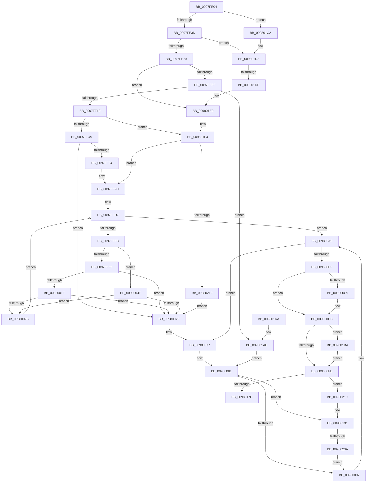

# MiMapLockedPagesInUserSpace

- RVA: `0x0097FE04`–`0x0098023F` (길이 `1,083` bytes)
- VA: `0x000000014097FE04`
- 실행 섹션: `PAGE`
- PDB 이름 있음: `예`; PDB Function 태그: `예`
- unwind 정보 RVA: `0x00097648`
- 디코드: `264`개 명령, `1,083/1,083` bytes 표시
- 미해석 바이트: `0` (있으면 어셈블리에 `.byte`로 보존)

> 이 문서는 커널 이미지의 기계어와 PDB 기호를 분석해 생성했습니다. 4번과 5번은 함수 원형과 자료형을 바이너리 사용 방식에서 추정한 C 해석이며 원본 소스 복구 결과는 아닙니다.

## 1. Dependencies

- 직접 호출 지점: **28**; 고유 호출 대상: **23**
- 직접 호출자로 확인된 함수: **1**
- RIP 상대 이미지 참조: **0**

### Outgoing calls
- `0x0097FE7D` → [MiAllocatePool](../../text/35/MiAllocatePool_function_0035B540.md) (function, `0x0035B540`)
- `0x0097FEA8` → [MiUpdateProtectionMask](../../text/28/MiUpdateProtectionMask_function_002845DC.md) (function, `0x002845DC`)
- `0x0097FEFC` → [LOCK_ADDRESS_SPACE](../../text/2A/LOCK_ADDRESS_SPACE_function_002A4944.md) (function, `0x002A4944`)
- `0x0097FF85` → [MiSelectUserAddress](../88/MiSelectUserAddress_function_00885C40.md) (function, `0x00885C40`)
- `0x0097FFC6` → [MiUpdateVadStartVpn](../../text/45/MiUpdateVadStartVpn_function_00450ED4.md) (function, `0x00450ED4`)
- `0x0097FFEC` → [MiIsPfn](../../text/46/MiIsPfn_function_00462450.md) (function, `0x00462450`)
- `0x00980014` → [MiLegitimatePageForDriversToMap](../../text/23/MiLegitimatePageForDriversToMap_function_0023ECE0.md) (function, `0x0023ECE0`)
- `0x00980022` → [MiDoubleLockMdlPage](../../text/31/MiDoubleLockMdlPage_function_00318324.md) (function, `0x00318324`)
- `0x00980043` → [MiSanitizePage](../../text/47/MiSanitizePage_function_00471BF0.md) (function, `0x00471BF0`)
- `0x00980067` → [MiReferenceIoPages](../../text/23/MiReferenceIoPages_function_0023C804.md) (function, `0x0023C804`)
- `0x00980089` → [UNLOCK_ADDRESS_SPACE](../../text/2A/UNLOCK_ADDRESS_SPACE_function_002A4844.md) (function, `0x002A4844`)
- `0x0098009C` → [ExFreePoolWithTag](../../poolcode/B8/ExFreePoolWithTag_function_00B82870.md) (function, `0x00B82870`)
- `0x009800A3` → [RtlRaiseStatus](../../text/2F/RtlRaiseStatus_function_002F6A50.md) (function, `0x002F6A50`)
- `0x009800B4` → [MiInsertVadCharges](../88/MiInsertVadCharges_function_00886AA8.md) (function, `0x00886AA8`)
- `0x009800D6` → [MiAdvanceVadHint](../88/MiAdvanceVadHint_function_00886C40.md) (function, `0x00886C40`)
- `0x009800E6` → [MiLockVad](../../text/29/MiLockVad_function_00295810.md) (function, `0x00295810`)
- `0x00980104` → [MiInsertVad](../../text/26/MiInsertVad_function_00265540.md) (function, `0x00265540`)
- `0x0098012F` → [MiMapLockedPagesInUserSpaceHelper](../../text/2A/MiMapLockedPagesInUserSpaceHelper_function_002ADFE0.md) (function, `0x002ADFE0`)
- `0x0098013A` → [UNLOCK_ADDRESS_SPACE](../../text/2A/UNLOCK_ADDRESS_SPACE_function_002A4844.md) (function, `0x002A4844`)
- `0x00980142` → [MiReferenceVad](../../text/29/MiReferenceVad_function_00295890.md) (function, `0x00295890`)
- `0x0098016B` → [MiAddSecureEntry](../98/MiAddSecureEntry_function_00980250.md) (function, `0x00980250`)
- `0x0098017C` → [MiUnlockAndDereferenceVad](../../text/31/MiUnlockAndDereferenceVad_function_00316E60.md) (function, `0x00316E60`)
- `0x009801CF` → [RtlRaiseStatus](../../text/2F/RtlRaiseStatus_function_002F6A50.md) (function, `0x002F6A50`)
- `0x009801E3` → [RtlRaiseStatus](../../text/2F/RtlRaiseStatus_function_002F6A50.md) (function, `0x002F6A50`)
- `0x009801EE` → [RtlRaiseStatus](../../text/2F/RtlRaiseStatus_function_002F6A50.md) (function, `0x002F6A50`)
- `0x00980205` → [MiIsVaRangeAvailable](MiIsVaRangeAvailable_function_0097FD90.md) (function, `0x0097FD90`)
- `0x00980221` → [MiDeleteVad](../88/MiDeleteVad_function_00888C80.md) (function, `0x00888C80`)
- `0x0098022B` → [RtlRaiseStatus](../../text/2F/RtlRaiseStatus_function_002F6A50.md) (function, `0x002F6A50`)

### Direct callers
- [MmMapLockedPagesSpecifyCache](../../text/31/MmMapLockedPagesSpecifyCache_function_00318800.md) at `0x00318CA1`

### Static image references
- 디코드된 RIP-relative 메모리 참조가 없습니다.

## 2. Other-region calls and transfers

- 다른 실행 섹션으로 향하는 call: **22**
  - `0x0097FE7D` → [MiAllocatePool](../../text/35/MiAllocatePool_function_0035B540.md) (`PAGE` → `.text`)
  - `0x0097FEA8` → [MiUpdateProtectionMask](../../text/28/MiUpdateProtectionMask_function_002845DC.md) (`PAGE` → `.text`)
  - `0x0097FEFC` → [LOCK_ADDRESS_SPACE](../../text/2A/LOCK_ADDRESS_SPACE_function_002A4944.md) (`PAGE` → `.text`)
  - `0x0097FFC6` → [MiUpdateVadStartVpn](../../text/45/MiUpdateVadStartVpn_function_00450ED4.md) (`PAGE` → `.text`)
  - `0x0097FFEC` → [MiIsPfn](../../text/46/MiIsPfn_function_00462450.md) (`PAGE` → `.text`)
  - `0x00980014` → [MiLegitimatePageForDriversToMap](../../text/23/MiLegitimatePageForDriversToMap_function_0023ECE0.md) (`PAGE` → `.text`)
  - `0x00980022` → [MiDoubleLockMdlPage](../../text/31/MiDoubleLockMdlPage_function_00318324.md) (`PAGE` → `.text`)
  - `0x00980043` → [MiSanitizePage](../../text/47/MiSanitizePage_function_00471BF0.md) (`PAGE` → `.text`)
  - `0x00980067` → [MiReferenceIoPages](../../text/23/MiReferenceIoPages_function_0023C804.md) (`PAGE` → `.text`)
  - `0x00980089` → [UNLOCK_ADDRESS_SPACE](../../text/2A/UNLOCK_ADDRESS_SPACE_function_002A4844.md) (`PAGE` → `.text`)
  - `0x0098009C` → [ExFreePoolWithTag](../../poolcode/B8/ExFreePoolWithTag_function_00B82870.md) (`PAGE` → `POOLCODE`)
  - `0x009800A3` → [RtlRaiseStatus](../../text/2F/RtlRaiseStatus_function_002F6A50.md) (`PAGE` → `.text`)
  - `0x009800E6` → [MiLockVad](../../text/29/MiLockVad_function_00295810.md) (`PAGE` → `.text`)
  - `0x00980104` → [MiInsertVad](../../text/26/MiInsertVad_function_00265540.md) (`PAGE` → `.text`)
  - `0x0098012F` → [MiMapLockedPagesInUserSpaceHelper](../../text/2A/MiMapLockedPagesInUserSpaceHelper_function_002ADFE0.md) (`PAGE` → `.text`)
  - `0x0098013A` → [UNLOCK_ADDRESS_SPACE](../../text/2A/UNLOCK_ADDRESS_SPACE_function_002A4844.md) (`PAGE` → `.text`)
  - `0x00980142` → [MiReferenceVad](../../text/29/MiReferenceVad_function_00295890.md) (`PAGE` → `.text`)
  - `0x0098017C` → [MiUnlockAndDereferenceVad](../../text/31/MiUnlockAndDereferenceVad_function_00316E60.md) (`PAGE` → `.text`)
  - `0x009801CF` → [RtlRaiseStatus](../../text/2F/RtlRaiseStatus_function_002F6A50.md) (`PAGE` → `.text`)
  - `0x009801E3` → [RtlRaiseStatus](../../text/2F/RtlRaiseStatus_function_002F6A50.md) (`PAGE` → `.text`)
  - `0x009801EE` → [RtlRaiseStatus](../../text/2F/RtlRaiseStatus_function_002F6A50.md) (`PAGE` → `.text`)
  - `0x0098022B` → [RtlRaiseStatus](../../text/2F/RtlRaiseStatus_function_002F6A50.md) (`PAGE` → `.text`)
- call이 아닌 외부 분기/꼬리 이동: **2**
  - `0x009801D8` → [sub_00B2A4DA](../B2/Unknown_function_00B2A4DA.md) (`tail-transfer`)
  - `0x00980234` → [sub_00B2A4DA + 0x12](../B2/Unknown_function_00B2A4DA.md) (`tail-transfer`)

## 3. Assembly (complete function range)

```asm
0097FE04  48 8B C4                        mov rax, rsp
0097FE07  48 89 58 10                     mov qword ptr [rax + 0x10], rbx
0097FE0B  4C 89 48 20                     mov qword ptr [rax + 0x20], r9
0097FE0F  44 89 40 18                     mov dword ptr [rax + 0x18], r8d
0097FE13  48 89 48 08                     mov qword ptr [rax + 8], rcx
0097FE17  55                              push rbp
0097FE18  56                              push rsi
0097FE19  57                              push rdi
0097FE1A  41 54                           push r12
0097FE1C  41 55                           push r13
0097FE1E  41 56                           push r14
0097FE20  41 57                           push r15
0097FE22  48 81 EC 90 00 00 00            sub rsp, 0x90
0097FE29  48 8B C1                        mov rax, rcx
0097FE2C  41 8B E8                        mov ebp, r8d
0097FE2F  B9 FF 0F 00 00                  mov ecx, 0xfff
0097FE34  44 85 C9                        test ecx, r9d
0097FE37  0F 85 8D 03 00 00               jne 0x1409801ca
0097FE3D  44 8B 78 28                     mov r15d, dword ptr [rax + 0x28]
0097FE41  48 8D 78 30                     lea rdi, [rax + 0x30]
0097FE45  8B B4 24 F0 00 00 00            mov esi, dword ptr [rsp + 0xf0]
0097FE4C  48 23 D1                        and rdx, rcx
0097FE4F  48 03 D1                        add rdx, rcx
0097FE52  8B C6                           mov eax, esi
0097FE54  4C 03 FA                        add r15, rdx
0097FE57  4C 8B E7                        mov r12, rdi
0097FE5A  49 C1 EF 0C                     shr r15, 0xc
0097FE5E  25 00 00 00 20                  and eax, 0x20000000
0097FE63  4D 8B F7                        mov r14, r15
0097FE66  89 44 24 50                     mov dword ptr [rsp + 0x50], eax
0097FE6A  0F 85 65 03 00 00               jne 0x1409801d5
0097FE70  B9 40 00 00 00                  mov ecx, 0x40
0097FE75  41 B8 56 61 64 6C               mov r8d, 0x6c646156
0097FE7B  8B D1                           mov edx, ecx
0097FE7D  E8 BE B6 9D FF                  call 0x14035b540
0097FE82  48 8B D8                        mov rbx, rax
0097FE85  48 85 C0                        test rax, rax
0097FE88  0F 84 5B 03 00 00               je 0x1409801e9
0097FE8E  48 83 60 28 00                  and qword ptr [rax + 0x28], 0
0097FE93  8B CE                           mov ecx, esi
0097FE95  C1 F9 1F                        sar ecx, 0x1f
0097FE98  8B D5                           mov edx, ebp
0097FE9A  83 E1 FD                        and ecx, 0xfffffffd
0097FE9D  48 C7 40 10 FE FF FF FF         mov qword ptr [rax + 0x10], 0xfffffffffffffffe
0097FEA5  83 C1 04                        add ecx, 4
0097FEA8  E8 2F 47 90 FF                  call 0x1402845dc
0097FEAD  8B 4B 30                        mov ecx, dword ptr [rbx + 0x30]
0097FEB0  8B D0                           mov edx, eax
0097FEB2  83 E2 1F                        and edx, 0x1f
0097FEB5  89 84 24 F8 00 00 00            mov dword ptr [rsp + 0xf8], eax
0097FEBC  C1 E2 07                        shl edx, 7
0097FEBF  81 E1 7F F0 FF FF               and ecx, 0xfffff07f
0097FEC5  33 D1                           xor edx, ecx
0097FEC7  45 33 ED                        xor r13d, r13d
0097FECA  83 E2 9F                        and edx, 0xffffff9f
0097FECD  81 CA 10 00 20 20               or edx, 0x20200010
0097FED3  89 53 30                        mov dword ptr [rbx + 0x30], edx
0097FED6  65 48 8B 04 25 88 01 00 00      mov rax, qword ptr gs:[0x188]
0097FEDF  48 83 64 24 60 00               and qword ptr [rsp + 0x60], 0
0097FEE5  48 8B C8                        mov rcx, rax
0097FEE8  48 89 44 24 70                  mov qword ptr [rsp + 0x70], rax
0097FEED  48 8B B0 B8 00 00 00            mov rsi, qword ptr [rax + 0xb8]
0097FEF4  48 8B D6                        mov rdx, rsi
0097FEF7  48 89 74 24 58                  mov qword ptr [rsp + 0x58], rsi
0097FEFC  E8 43 4A 92 FF                  call 0x1402a4944
0097FF01  8B 86 F4 01 00 00               mov eax, dword ptr [rsi + 0x1f4]
0097FF07  48 BD 00 00 00 00 00 DE FF FF   movabs rbp, 0xffffde0000000000
0097FF11  A8 20                           test al, 0x20
0097FF13  0F 85 92 02 00 00               jne 0x1409801ab
0097FF19  4C 8B 86 68 03 00 00            mov r8, qword ptr [rsi + 0x368]
0097FF20  48 B8 FF FF FE FF FF 7F 00 00   movabs rax, 0x7ffffffeffff
0097FF2A  48 8B AC 24 E8 00 00 00         mov rbp, qword ptr [rsp + 0xe8]
0097FF32  49 FF C8                        dec r8
0097FF35  4C 3B C0                        cmp r8, rax
0097FF38  4C 0F 43 C0                     cmovae r8, rax
0097FF3C  49 C1 E6 0C                     shl r14, 0xc
0097FF40  48 85 ED                        test rbp, rbp
0097FF43  0F 85 AB 02 00 00               jne 0x1409801f4
0097FF49  48 8D 84 24 E8 00 00 00         lea rax, [rsp + 0xe8]
0097FF51  4D 8B CE                        mov r9, r14
0097FF54  48 89 44 24 48                  mov qword ptr [rsp + 0x48], rax
0097FF59  33 D2                           xor edx, edx
0097FF5B  48 8D 44 24 60                  lea rax, [rsp + 0x60]
0097FF60  33 C9                           xor ecx, ecx
0097FF62  48 89 44 24 40                  mov qword ptr [rsp + 0x40], rax
0097FF67  44 21 6C 24 38                  and dword ptr [rsp + 0x38], r13d
0097FF6C  8B 84 24 F8 00 00 00            mov eax, dword ptr [rsp + 0xf8]
0097FF73  89 44 24 30                     mov dword ptr [rsp + 0x30], eax
0097FF77  4C 21 6C 24 28                  and qword ptr [rsp + 0x28], r13
0097FF7C  48 C7 44 24 20 00 00 01 00      mov qword ptr [rsp + 0x20], 0x10000
0097FF85  E8 B6 5C F0 FF                  call 0x140885c40
0097FF8A  8B F0                           mov esi, eax
0097FF8C  85 C0                           test eax, eax
0097FF8E  0F 88 DE 00 00 00               js 0x140980072
0097FF94  48 8B AC 24 E8 00 00 00         mov rbp, qword ptr [rsp + 0xe8]
0097FF9C  48 8D 45 FF                     lea rax, [rbp - 1]
0097FFA0  48 8B CD                        mov rcx, rbp
0097FFA3  48 C1 E9 0C                     shr rcx, 0xc
0097FFA7  49 03 C6                        add rax, r14
0097FFAA  48 8B D1                        mov rdx, rcx
0097FFAD  48 89 44 24 68                  mov qword ptr [rsp + 0x68], rax
0097FFB2  48 C1 E8 0C                     shr rax, 0xc
0097FFB6  48 89 8C 24 80 00 00 00         mov qword ptr [rsp + 0x80], rcx
0097FFBE  48 8B CB                        mov rcx, rbx
0097FFC1  48 89 44 24 78                  mov qword ptr [rsp + 0x78], rax
0097FFC6  E8 09 0F AD FF                  call 0x140450ed4
0097FFCB  89 43 1C                        mov dword ptr [rbx + 0x1c], eax
0097FFCE  48 C1 E8 20                     shr rax, 0x20
0097FFD2  88 43 21                        mov byte ptr [rbx + 0x21], al
0097FFD5  33 C0                           xor eax, eax
0097FFD7  48 89 84 24 E8 00 00 00         mov qword ptr [rsp + 0xe8], rax
0097FFDF  49 3B C7                        cmp rax, r15
0097FFE2  0F 83 C1 00 00 00               jae 0x1409800a9
0097FFE8  49 8B 0C 24                     mov rcx, qword ptr [r12]
0097FFEC  E8 5F 24 AE FF                  call 0x140462450
0097FFF1  85 C0                           test eax, eax
0097FFF3  74 4A                           je 0x14098003f
0097FFF5  49 8B 04 24                     mov rax, qword ptr [r12]
0097FFF9  4C 8D 34 40                     lea r14, [rax + rax*2]
0097FFFD  48 B8 00 00 00 00 00 DE FF FF   movabs rax, 0xffffde0000000000
00980007  49 C1 E6 04                     shl r14, 4
0098000B  48 8B C0                        mov rax, rax
0098000E  4C 03 F0                        add r14, rax
00980011  49 8B CE                        mov rcx, r14
00980014  E8 C7 EC 8B FF                  call 0x14023ece0
00980019  8B F0                           mov esi, eax
0098001B  85 C0                           test eax, eax
0098001D  78 53                           js 0x140980072
0098001F  49 8B CE                        mov rcx, r14
00980022  E8 FD 82 99 FF                  call 0x140318324
00980027  85 C0                           test eax, eax
00980029  74 47                           je 0x140980072
0098002B  48 8B 84 24 E8 00 00 00         mov rax, qword ptr [rsp + 0xe8]
00980033  4D 8B EC                        mov r13, r12
00980036  48 FF C0                        inc rax
00980039  49 83 C4 08                     add r12, 8
0098003D  EB 98                           jmp 0x14097ffd7
0098003F  49 8B 0C 24                     mov rcx, qword ptr [r12]
00980043  E8 A8 1B AF FF                  call 0x140471bf0
00980048  48 83 64 24 28 00               and qword ptr [rsp + 0x28], 0
0098004E  B9 01 00 00 00                  mov ecx, 1
00980053  44 8B 8C 24 E0 00 00 00         mov r9d, dword ptr [rsp + 0xe0]
0098005B  44 8B C1                        mov r8d, ecx
0098005E  48 83 64 24 20 00               and qword ptr [rsp + 0x20], 0
00980064  48 8B D0                        mov rdx, rax
00980067  E8 98 C7 8B FF                  call 0x14023c804
0098006C  8B F0                           mov esi, eax
0098006E  85 C0                           test eax, eax
00980070  79 B9                           jns 0x14098002b
00980072  4C 8B 74 24 58                  mov r14, qword ptr [rsp + 0x58]
00980077  48 BD 00 00 00 00 00 DE FF FF   movabs rbp, 0xffffde0000000000
00980081  48 8B 4C 24 70                  mov rcx, qword ptr [rsp + 0x70]
00980086  49 8B D6                        mov rdx, r14
00980089  E8 B6 47 92 FF                  call 0x1402a4844
0098008E  4D 85 ED                        test r13, r13
00980091  0F 85 9A 01 00 00               jne 0x140980231
00980097  33 D2                           xor edx, edx
00980099  48 8B CB                        mov rcx, rbx
0098009C  E8 CF 27 20 00                  call 0x140b82870
009800A1  8B CE                           mov ecx, esi
009800A3  E8 A8 69 97 FF                  call 0x1402f6a50
009800A8  CC                              int3
009800A9  4C 8B 74 24 58                  mov r14, qword ptr [rsp + 0x58]
009800AE  48 8B CB                        mov rcx, rbx
009800B1  49 8B D6                        mov rdx, r14
009800B4  E8 EF 69 F0 FF                  call 0x140886aa8
009800B9  8B F0                           mov esi, eax
009800BB  85 C0                           test eax, eax
009800BD  78 B8                           js 0x140980077
009800BF  4C 8B 44 24 60                  mov r8, qword ptr [rsp + 0x60]
009800C4  4D 85 C0                        test r8, r8
009800C7  74 12                           je 0x1409800db
009800C9  48 8B 54 24 78                  mov rdx, qword ptr [rsp + 0x78]
009800CE  48 8B 8C 24 80 00 00 00         mov rcx, qword ptr [rsp + 0x80]
009800D6  E8 65 6B F0 FF                  call 0x140886c40
009800DB  4C 8B 64 24 70                  mov r12, qword ptr [rsp + 0x70]
009800E0  48 8B D3                        mov rdx, rbx
009800E3  49 8B CC                        mov rcx, r12
009800E6  E8 25 57 91 FF                  call 0x140295810
009800EB  83 7C 24 50 00                  cmp dword ptr [rsp + 0x50], 0
009800F0  48 8B 74 24 68                  mov rsi, qword ptr [rsp + 0x68]
009800F5  0F 85 BF 00 00 00               jne 0x1409801ba
009800FB  45 33 C0                        xor r8d, r8d
009800FE  49 8B D6                        mov rdx, r14
00980101  48 8B CB                        mov rcx, rbx
00980104  E8 37 54 8E FF                  call 0x140265540
00980109  8B 84 24 F0 00 00 00            mov eax, dword ptr [rsp + 0xf0]
00980110  45 33 C0                        xor r8d, r8d
00980113  44 8B 8C 24 E0 00 00 00         mov r9d, dword ptr [rsp + 0xe0]
0098011B  48 8B D7                        mov rdx, rdi
0098011E  89 44 24 30                     mov dword ptr [rsp + 0x30], eax
00980122  48 8B CD                        mov rcx, rbp
00980125  48 89 5C 24 28                  mov qword ptr [rsp + 0x28], rbx
0098012A  4C 89 7C 24 20                  mov qword ptr [rsp + 0x20], r15
0098012F  E8 AC DE 92 FF                  call 0x1402adfe0
00980134  49 8B D6                        mov rdx, r14
00980137  49 8B CC                        mov rcx, r12
0098013A  E8 05 47 92 FF                  call 0x1402a4844
0098013F  48 8B CB                        mov rcx, rbx
00980142  E8 49 57 91 FF                  call 0x140295890
00980147  83 BC 24 F8 00 00 00 01         cmp dword ptr [rsp + 0xf8], 1
0098014F  41 B9 02 00 00 00               mov r9d, 2
00980155  4C 8B C6                        mov r8, rsi
00980158  48 8B D5                        mov rdx, rbp
0098015B  48 8B CB                        mov rcx, rbx
0098015E  41 8D 41 02                     lea eax, [r9 + 2]
00980162  44 0F 45 C8                     cmovne r9d, eax
00980166  83 64 24 20 00                  and dword ptr [rsp + 0x20], 0
0098016B  E8 E0 00 00 00                  call 0x140980250
00980170  48 8B CB                        mov rcx, rbx
00980173  48 85 C0                        test rax, rax
00980176  0F 84 A0 00 00 00               je 0x14098021c
0098017C  E8 DF 6C 99 FF                  call 0x140316e60
00980181  48 8B 8C 24 D0 00 00 00         mov rcx, qword ptr [rsp + 0xd0]
00980189  48 8B 9C 24 D8 00 00 00         mov rbx, qword ptr [rsp + 0xd8]
00980191  8B 41 2C                        mov eax, dword ptr [rcx + 0x2c]
00980194  48 03 C5                        add rax, rbp
00980197  48 81 C4 90 00 00 00            add rsp, 0x90
0098019E  41 5F                           pop r15
009801A0  41 5E                           pop r14
009801A2  41 5D                           pop r13
009801A4  41 5C                           pop r12
009801A6  5F                              pop rdi
009801A7  5E                              pop rsi
009801A8  5D                              pop rbp
009801A9  C3                              ret
009801AA  CC                              int3
009801AB  4C 8B 74 24 58                  mov r14, qword ptr [rsp + 0x58]
009801B0  BE 0A 01 00 C0                  mov esi, 0xc000010a
009801B5  E9 C7 FE FF FF                  jmp 0x140980081
009801BA  B8 00 10 00 00                  mov eax, 0x1000
009801BF  48 03 E8                        add rbp, rax
009801C2  48 2B F0                        sub rsi, rax
009801C5  E9 31 FF FF FF                  jmp 0x1409800fb
009801CA  B9 41 01 00 C0                  mov ecx, 0xc0000141
009801CF  E8 7C 68 97 FF                  call 0x1402f6a50
009801D4  CC                              int3
009801D5  4D 85 C9                        test r9, r9
009801D8  0F 84 FC A2 1A 00               je 0x140b2a4da
009801DE  B9 0D 00 00 C0                  mov ecx, 0xc000000d
009801E3  E8 68 68 97 FF                  call 0x1402f6a50
009801E8  CC                              int3
009801E9  B9 9A 00 00 C0                  mov ecx, 0xc000009a
009801EE  E8 5D 68 97 FF                  call 0x1402f6a50
009801F3  CC                              int3
009801F4  4C 89 44 24 20                  mov qword ptr [rsp + 0x20], r8
009801F9  45 33 C9                        xor r9d, r9d
009801FC  4D 8B C6                        mov r8, r14
009801FF  48 8B D5                        mov rdx, rbp
00980202  48 8B CE                        mov rcx, rsi
00980205  E8 86 FB FF FF                  call 0x14097fd90
0098020A  85 C0                           test eax, eax
0098020C  0F 85 8A FD FF FF               jne 0x14097ff9c
00980212  BE 18 00 00 C0                  mov esi, 0xc0000018
00980217  E9 56 FE FF FF                  jmp 0x140980072
0098021C  45 33 C0                        xor r8d, r8d
0098021F  33 D2                           xor edx, edx
00980221  E8 5A 8A F0 FF                  call 0x140888c80
00980226  B9 9A 00 00 C0                  mov ecx, 0xc000009a
0098022B  E8 20 68 97 FF                  call 0x1402f6a50
00980230  CC                              int3
00980231  49 3B FD                        cmp rdi, r13
00980234  0F 86 B2 A2 1A 00               jbe 0x140b2a4ec
0098023A  E9 58 FE FF FF                  jmp 0x140980097
```

## 4. C-style interpretation (structured pseudocode)

```c
__int64 __fastcall MiMapLockedPagesInUserSpace(__int64 a1, __int64 a2, int a3, __int64 a4, unsigned int a5, unsigned int a6)
{
    __int64 result;
    __int64 v_r12;
    __int64 v_r13;
    __int64 v_r14;
    __int64 v_r15;
    __int64 v_rbp;
    __int64 v_rsi;
    __int64 v_rsp;
    unsigned __int64 v_stack_m48;
    unsigned __int64 v_stack_m50;
    unsigned __int64 v_stack_m58;
    unsigned __int64 v_stack_m60;
    unsigned __int64 v_stack_m68;
    unsigned __int64 v_stack_m70;
    unsigned int v_stack_m78;
    unsigned __int64 v_stack_m80;
    unsigned __int64 v_stack_m88;
    unsigned int v_stack_m90;
    unsigned int v_stack_m98;
    unsigned __int64 v_stack_mA0;
    unsigned __int64 v_stack_mA8;
    unsigned __int64 v_stack_p10;
    unsigned int v_stack_p18;
    unsigned __int64 v_stack_p20;
    unsigned int v_stack_p30;
    unsigned __int64 v_stack_p58;
    unsigned __int64 v_stack_p8;

    *(unsigned __int64 *)(v_rsp + 16) = v_rbx;
    *(unsigned __int64 *)(v_rsp + 32) = a4;
    *(unsigned int *)(v_rsp + 24) = a3;
    *(unsigned __int64 *)(v_rsp + 8) = a1;
    v_rsp = (v_rsp) - (144);
    if ((((unsigned int)((unsigned int)(0xFFFULL))) & ((unsigned int)(a4))) != 0) goto loc_009801CA;
    a2 = (a2) & ((unsigned int)(0xFFFULL));
    a2 = (a2) + ((unsigned int)(0xFFFULL));
    v_r15 = ((unsigned int)(*(unsigned int *)(a1 + 40))) + (a2);
    v_r15 = (v_r15) >> (12);
    result = (unsigned int)(((unsigned int)((unsigned int)((unsigned int)(a5)))) & (0x20000000ULL));
    v_stack_m78 = (unsigned int)(result);
    if (condition_is_not_equal) goto loc_009801D5;
    result = MiAllocatePool(64, 64, (unsigned int)(0x6C646156ULL), a4);
    if (result == 0) goto loc_009801E9;
    a1 = (unsigned int)(((unsigned int)((unsigned int)((unsigned int)(a5)))) >> (31));
    a1 = (unsigned int)((a1) & (0xFFFFFFFDULL));
    *(unsigned __int64 *)(result + 16) = -2;
    a1 = (unsigned int)((a1) + (4));
    result = MiUpdateProtectionMask(a1, (unsigned int)((unsigned int)((unsigned int)(a3))), (unsigned int)(0x6C646156ULL), a4);
    a2 = (unsigned int)(((unsigned int)((unsigned int)(result))) & (31));
    v_stack_p30 = (unsigned int)(result);
    a2 = (unsigned int)((a2) << (7));
    a1 = (unsigned int)(((unsigned int)(*(unsigned int *)(result + 48))) & (0xFFFFF07FULL));
    a2 = (unsigned int)((a2) ^ ((unsigned int)(a1)));
    v_r13 = 0;
    a2 = (unsigned int)((a2) & (0xFFFFFF9FULL));
    a2 = (unsigned int)((a2) | (0x20200010ULL));
    *(unsigned int *)(result + 48) = (unsigned int)(a2);
    v_stack_m58 = *(unsigned __int64 *)(gs_base + (0 + 392));
    v_stack_m70 = *(unsigned __int64 *)(*(unsigned __int64 *)(gs_base + (0 + 392)) + 184);
    result = LOCK_ADDRESS_SPACE(*(unsigned __int64 *)(gs_base + (0 + 392)), *(unsigned __int64 *)(*(unsigned __int64 *)(gs_base + (0 + 392)) + 184), (unsigned int)(0x6C646156ULL), a4);
    if ((((unsigned __int8)((unsigned int)(*(unsigned int *)(*(unsigned __int64 *)(*(unsigned __int64 *)(gs_base + (0 + 392)) + 184) + 500)))) & (32)) != 0) goto loc_009801AB;
    a3 = (*(unsigned __int64 *)(*(unsigned __int64 *)(*(unsigned __int64 *)(gs_base + (0 + 392)) + 184) + 872)) - 1;
    if (a3 >= ((unsigned int)(*(unsigned int *)(*(unsigned __int64 *)(*(unsigned __int64 *)(gs_base + (0 + 392)) + 184) + 500)))) { a3 = (unsigned int)(*(unsigned int *)(*(unsigned __int64 *)(*(unsigned __int64 *)(gs_base + (0 + 392)) + 184) + 500)); }
    v_r14 = (v_r15) << (12);
    if (v_stack_p20 != 0) goto loc_009801F4;
    v_stack_m80 = v_stack_p20;
    a2 = 0;
    a1 = 0;
    v_stack_m88 = v_stack_m68;
    v_stack_m98 = (unsigned int)((unsigned int)(a6));
    v_stack_mA8 = 0x10000ULL;
    result = MiSelectUserAddress(a1, a2, a3, v_r14);
    if (sign_flag) goto loc_00980072;
loc_0097FF9C:
    a1 = (v_stack_p20) >> (12);
    result = (v_stack_p20 - 1) + (v_r14);
    v_stack_m60 = result;
    result = (result) >> (12);
    v_stack_m48 = a1;
    v_stack_m50 = result;
    result = MiUpdateVadStartVpn(result, a1, a3, v_r14);
    *(unsigned int *)(result + 28) = (unsigned int)(result);
    result = (result) >> (32);
    *(unsigned __int8 *)(result + 33) = (unsigned __int8)(result);
    result = 0;
loc_0097FFD7:
    v_stack_p20 = 0;
    if (0 >= v_r15) goto loc_009800A9;
    result = MiIsPfn(*(unsigned __int64 *)(a1 + 48), a1, a3, v_r14);
    if ((unsigned int)(result) == 0) goto loc_0098003F;
    v_r14 = (*(unsigned __int64 *)(a1 + 48) + *(unsigned __int64 *)(a1 + 48) * 2) << (4);
    v_r14 = (v_r14) + (*(unsigned __int64 *)(a1 + 48));
    result = MiLegitimatePageForDriversToMap(v_r14, a1, a3, v_r14);
    if (sign_flag) goto loc_00980072;
    result = MiDoubleLockMdlPage(v_r14, a1, a3, v_r14);
    if ((unsigned int)(result) == 0) goto loc_00980072;
loc_0098002B:
    result = (v_stack_p20) + 1;
    v_r12 = (a1 + 48) + (8);
    goto loc_0097FFD7;
loc_0098003F:
    result = MiSanitizePage(*(unsigned __int64 *)(v_r12), a1, a3, v_r14);
    result = MiReferenceIoPages(1, result, 1, (unsigned int)(v_stack_p18));
    if (!sign_flag) goto loc_0098002B;
loc_00980072:
loc_00980077:
loc_00980081:
    result = UNLOCK_ADDRESS_SPACE(v_stack_m58, v_stack_m70, 1, (unsigned int)(v_stack_p18));
    if (a1 + 48 != 0) goto loc_00980231;
loc_00980097:
    a2 = 0;
    result = ExFreePoolWithTag(result, a2, 1, (unsigned int)(v_stack_p18));
    result = RtlRaiseStatus((unsigned int)((unsigned int)((unsigned int)((unsigned int)(result)))), a2, 1, (unsigned int)(v_stack_p18));
loc_009800A9:
    result = MiInsertVadCharges(result, v_stack_m70, 1, (unsigned int)(v_stack_p18));
    if (sign_flag) goto loc_00980077;
    if (v_stack_m68 != 0) {
        a2 = v_stack_m50;
        a1 = v_stack_m48;
        result = MiAdvanceVadHint(a1, a2, v_stack_m68, (unsigned int)(v_stack_p18));
    }
    result = MiLockVad(v_stack_m58, result, v_stack_m68, (unsigned int)(v_stack_p18));
    if (v_stack_m78 != 0) goto loc_009801BA;
loc_009800FB:
    a3 = 0;
    result = MiInsertVad(result, v_stack_m70, a3, (unsigned int)(v_stack_p18));
    a3 = 0;
    v_stack_m98 = (unsigned int)((unsigned int)(a5));
    v_stack_mA0 = result;
    v_stack_mA8 = v_r15;
    result = MiMapLockedPagesInUserSpaceHelper(v_stack_p20, a1 + 48, a3, (unsigned int)(v_stack_p18));
    result = UNLOCK_ADDRESS_SPACE(v_stack_m58, v_stack_m70, a3, (unsigned int)(v_stack_p18));
    result = MiReferenceVad(result, v_stack_m70, a3, (unsigned int)(v_stack_p18));
    a4 = 2;
    if (a6 != 1) { a4 = (unsigned int)(2 + 2); }
    result = MiAddSecureEntry(result, v_stack_p20, v_stack_m60, a4);
    if (result == 0) goto loc_0098021C;
    result = MiUnlockAndDereferenceVad(result, v_stack_p20, v_stack_m60, a4);
    result = ((unsigned int)(*(unsigned int *)(v_stack_p8 + 44))) + (v_stack_p20);
    v_rsp = (v_rsp) + (144);
    return result;
loc_009801AB:
    goto loc_00980081;
loc_009801BA:
    v_rbp = (v_stack_p20) + ((unsigned int)(0x1000ULL));
    v_rsi = ((unsigned int)(0xC000010AULL)) - ((unsigned int)(0x1000ULL));
    goto loc_009800FB;
loc_009801CA:
    result = RtlRaiseStatus((unsigned int)(0xC0000141ULL), v_stack_p20, v_stack_m60, a4);
loc_009801D5:
    result = RtlRaiseStatus((unsigned int)(0xC000000DULL), v_stack_p20, v_stack_m60, a4);
loc_009801E9:
    result = RtlRaiseStatus((unsigned int)(0xC000009AULL), v_stack_p20, v_stack_m60, a4);
loc_009801F4:
    v_stack_p20 = v_stack_m60;
    a4 = 0;
    result = MiIsVaRangeAvailable(v_rsi, v_rbp, v_stack_p58, a4);
    if ((unsigned int)(result) != 0) goto loc_0097FF9C;
    goto loc_00980072;
loc_0098021C:
    a3 = 0;
    a2 = 0;
    result = MiDeleteVad(v_rsi, a2, a3, a4);
    result = RtlRaiseStatus((unsigned int)(0xC000009AULL), a2, a3, a4);
loc_00980231:
    goto loc_00980097;
}
```

## 5. (Beta) C Style

```c
int64_t MiMapLockedPagesInUserSpace(void *Arg1, int64_t Arg2, int32_t Arg3, int64_t Arg4, uint32_t Arg5, uint32_t Arg6)
{
    uint8_t *arg1 = (uint8_t *)Arg1;

    int64_t result;
    int64_t local_r12;
    int64_t local_r13;
    int64_t local_r14;
    int64_t local_r15;
    int64_t local_rbp;
    int64_t local_rsi;
    int64_t local_rsp;
    uint64_t v_stack_m48;
    uint64_t v_stack_m50;
    uint64_t v_stack_m58;
    uint64_t v_stack_m60;
    uint64_t v_stack_m68;
    uint64_t v_stack_m70;
    uint32_t v_stack_m78;
    uint64_t v_stack_m80;
    uint64_t v_stack_m88;
    uint32_t v_stack_m90;
    uint32_t v_stack_m98;
    uint64_t v_stack_mA0;
    uint64_t v_stack_mA8;
    uint64_t v_stack_p10;
    uint32_t v_stack_p18;
    uint64_t v_stack_p20;
    uint32_t v_stack_p30;
    uint64_t v_stack_p58;
    uint64_t v_stack_p8;

    *(uint64_t *)(local_rsp + 0x10) = local_rbx;
    *(uint64_t *)(local_rsp + 0x20) = Arg4;
    *(uint32_t *)(local_rsp + 0x18) = Arg3;
    *(void **)(local_rsp + 0x8) = Arg1;
    local_rsp = (local_rsp) - (144);
    if ((((uint32_t)((uint32_t)(0xFFFULL))) & ((uint32_t)(Arg4))) != 0) goto loc_009801CA;
    Arg2 = (Arg2) & ((uint32_t)(0xFFFULL));
    Arg2 = (Arg2) + ((uint32_t)(0xFFFULL));
    local_r15 = ((uint32_t)(*(uint32_t *)(arg1 + 0x28))) + (Arg2);
    local_r15 = (local_r15) >> (12);
    result = (uint32_t)(((uint32_t)((uint32_t)((uint32_t)(Arg5)))) & (0x20000000ULL));
    v_stack_m78 = (uint32_t)(result);
    if (condition_is_not_equal) goto loc_009801D5;
    result = MiAllocatePool(64, 64, (uint32_t)(0x6C646156ULL), Arg4);
    if (result == 0) goto loc_009801E9;
    Arg1 = (uint32_t)(((uint32_t)((uint32_t)((uint32_t)(Arg5)))) >> (31));
    Arg1 = (uint32_t)((Arg1) & (0xFFFFFFFDULL));
    *(uint64_t *)(result + 0x10) = -2;
    Arg1 = (uint32_t)((Arg1) + (4));
    result = MiUpdateProtectionMask(Arg1, (uint32_t)((uint32_t)((uint32_t)(Arg3))), (uint32_t)(0x6C646156ULL), Arg4);
    Arg2 = (uint32_t)(((uint32_t)((uint32_t)(result))) & (31));
    v_stack_p30 = (uint32_t)(result);
    Arg2 = (uint32_t)((Arg2) << (7));
    Arg1 = (uint32_t)(((uint32_t)(*(uint32_t *)(result + 0x30))) & (0xFFFFF07FULL));
    Arg2 = (uint32_t)((Arg2) ^ ((uint32_t)(Arg1)));
    local_r13 = 0;
    Arg2 = (uint32_t)((Arg2) & (0xFFFFFF9FULL));
    Arg2 = (uint32_t)((Arg2) | (0x20200010ULL));
    *(uint32_t *)(result + 0x30) = (uint32_t)(Arg2);
    v_stack_m58 = *(uint64_t *)(gs_base + (0 + 0x188));
    v_stack_m70 = *(uint64_t *)(*(uint64_t *)(gs_base + (0 + 0x188)) + 0xB8);
    result = LOCK_ADDRESS_SPACE(*(uint64_t *)(gs_base + (0 + 0x188)), *(uint64_t *)(*(uint64_t *)(gs_base + (0 + 0x188)) + 0xB8), (uint32_t)(0x6C646156ULL), Arg4);
    if ((((uint8_t)((uint32_t)(*(uint32_t *)(*(uint64_t *)(*(uint64_t *)(gs_base + (0 + 0x188)) + 0xB8) + 0x1F4)))) & (32)) != 0) goto loc_009801AB;
    Arg3 = (*(uint64_t *)(*(uint64_t *)(*(uint64_t *)(gs_base + (0 + 0x188)) + 0xB8) + 0x368)) - 1;
    if (Arg3 >= ((uint32_t)(*(uint32_t *)(*(uint64_t *)(*(uint64_t *)(gs_base + (0 + 0x188)) + 0xB8) + 0x1F4)))) { Arg3 = (uint32_t)(*(uint32_t *)(*(uint64_t *)(*(uint64_t *)(gs_base + (0 + 0x188)) + 0xB8) + 0x1F4)); }
    local_r14 = (local_r15) << (12);
    if (v_stack_p20 != 0) goto loc_009801F4;
    v_stack_m80 = v_stack_p20;
    Arg2 = 0;
    Arg1 = 0;
    v_stack_m88 = v_stack_m68;
    v_stack_m98 = (uint32_t)((uint32_t)(Arg6));
    v_stack_mA8 = 0x10000ULL;
    result = MiSelectUserAddress(Arg1, Arg2, Arg3, local_r14);
    if (sign_flag) goto loc_00980072;
loc_0097FF9C:
    Arg1 = (v_stack_p20) >> (12);
    result = (v_stack_p20 - 1) + (local_r14);
    v_stack_m60 = result;
    result = (result) >> (12);
    v_stack_m48 = Arg1;
    v_stack_m50 = result;
    result = MiUpdateVadStartVpn(result, Arg1, Arg3, local_r14);
    *(uint32_t *)(result + 0x1C) = (uint32_t)(result);
    result = (result) >> (32);
    *(uint8_t *)(result + 0x21) = (uint8_t)(result);
    result = 0;
loc_0097FFD7:
    v_stack_p20 = 0;
    if (0 >= local_r15) goto loc_009800A9;
    result = MiIsPfn(*(uint64_t *)(arg1 + 0x30), Arg1, Arg3, local_r14);
    if ((uint32_t)(result) == 0) goto loc_0098003F;
    local_r14 = (*(uint64_t *)(arg1 + 0x30) + *(uint64_t *)(arg1 + 0x30) * 2) << (4);
    local_r14 = (local_r14) + (*(uint64_t *)(arg1 + 0x30));
    result = MiLegitimatePageForDriversToMap(local_r14, Arg1, Arg3, local_r14);
    if (sign_flag) goto loc_00980072;
    result = MiDoubleLockMdlPage(local_r14, Arg1, Arg3, local_r14);
    if ((uint32_t)(result) == 0) goto loc_00980072;
loc_0098002B:
    result = (v_stack_p20) + 1;
    local_r12 = (Arg1 + 48) + (8);
    goto loc_0097FFD7;
loc_0098003F:
    result = MiSanitizePage(*(uint64_t *)(local_r12), Arg1, Arg3, local_r14);
    result = MiReferenceIoPages(1, result, 1, (uint32_t)(v_stack_p18));
    if (!sign_flag) goto loc_0098002B;
loc_00980072:
loc_00980077:
loc_00980081:
    result = UNLOCK_ADDRESS_SPACE(v_stack_m58, v_stack_m70, 1, (uint32_t)(v_stack_p18));
    if (Arg1 + 48 != 0) goto loc_00980231;
loc_00980097:
    Arg2 = 0;
    result = ExFreePoolWithTag(result, Arg2, 1, (uint32_t)(v_stack_p18));
    result = RtlRaiseStatus((uint32_t)((uint32_t)((uint32_t)((uint32_t)(result)))), Arg2, 1, (uint32_t)(v_stack_p18));
loc_009800A9:
    result = MiInsertVadCharges(result, v_stack_m70, 1, (uint32_t)(v_stack_p18));
    if (sign_flag) goto loc_00980077;
    if (v_stack_m68 != 0) {
        Arg2 = v_stack_m50;
        Arg1 = v_stack_m48;
        result = MiAdvanceVadHint(Arg1, Arg2, v_stack_m68, (uint32_t)(v_stack_p18));
    }
    result = MiLockVad(v_stack_m58, result, v_stack_m68, (uint32_t)(v_stack_p18));
    if (v_stack_m78 != 0) goto loc_009801BA;
loc_009800FB:
    Arg3 = 0;
    result = MiInsertVad(result, v_stack_m70, Arg3, (uint32_t)(v_stack_p18));
    Arg3 = 0;
    v_stack_m98 = (uint32_t)((uint32_t)(Arg5));
    v_stack_mA0 = result;
    v_stack_mA8 = local_r15;
    result = MiMapLockedPagesInUserSpaceHelper(v_stack_p20, Arg1 + 48, Arg3, (uint32_t)(v_stack_p18));
    result = UNLOCK_ADDRESS_SPACE(v_stack_m58, v_stack_m70, Arg3, (uint32_t)(v_stack_p18));
    result = MiReferenceVad(result, v_stack_m70, Arg3, (uint32_t)(v_stack_p18));
    Arg4 = 2;
    if (Arg6 != 1) { Arg4 = (uint32_t)(2 + 2); }
    result = MiAddSecureEntry(result, v_stack_p20, v_stack_m60, Arg4);
    if (result == 0) goto loc_0098021C;
    result = MiUnlockAndDereferenceVad(result, v_stack_p20, v_stack_m60, Arg4);
    result = ((uint32_t)(*(uint32_t *)(v_stack_p8 + 0x2C))) + (v_stack_p20);
    local_rsp = (local_rsp) + (144);
    return result;
loc_009801AB:
    goto loc_00980081;
loc_009801BA:
    local_rbp = (v_stack_p20) + ((uint32_t)(0x1000ULL));
    local_rsi = ((uint32_t)(0xC000010AULL)) - ((uint32_t)(0x1000ULL));
    goto loc_009800FB;
loc_009801CA:
    result = RtlRaiseStatus((uint32_t)(0xC0000141ULL), v_stack_p20, v_stack_m60, Arg4);
loc_009801D5:
    result = RtlRaiseStatus((uint32_t)(0xC000000DULL), v_stack_p20, v_stack_m60, Arg4);
loc_009801E9:
    result = RtlRaiseStatus((uint32_t)(0xC000009AULL), v_stack_p20, v_stack_m60, Arg4);
loc_009801F4:
    v_stack_p20 = v_stack_m60;
    Arg4 = 0;
    result = MiIsVaRangeAvailable(local_rsi, local_rbp, v_stack_p58, Arg4);
    if ((uint32_t)(result) != 0) goto loc_0097FF9C;
    goto loc_00980072;
loc_0098021C:
    Arg3 = 0;
    Arg2 = 0;
    result = MiDeleteVad(local_rsi, Arg2, Arg3, Arg4);
    result = RtlRaiseStatus((uint32_t)(0xC000009AULL), Arg2, Arg3, Arg4);
loc_00980231:
    goto loc_00980097;
}
```

### 관측된 메모리 오프셋

구조체 형식이 확인되지 않은 접근은 인자 기준의 오프셋으로만 기록했습니다.

| 기준 인자 | 오프셋 표현 | 폭 (bit) | 접근 |
|---|---:|---:|---|
| `Arg1` | `+ 0x28` | `32` | `R` |
| `Arg1` | `+ 0x30` | `64` | `R` |

## 6. Execution-region graph

[열기: 2D/3D 그래프와 함수 탐색 컨트롤 패널](../../../control-panel.html?section=page&rva=0x0097FE04&view=graph)

- 2D 그래프는 위에서 아래로 흐르고, 3D 그래프는 빈 공간을 드래그해 회전합니다. Shift+드래그는 이동, 휠은 확대·축소, 함수 노드 선택은 대상 보고서 이동입니다.

### Static fallback


