# MiMapViewOfPhysicalSection

- RVA: `0x0097F984`–`0x0097FD88` (길이 `1,028` bytes)
- VA: `0x000000014097F984`
- 실행 섹션: `PAGE`
- PDB 이름 있음: `예`; PDB Function 태그: `예`
- unwind 정보 RVA: `0x00097618`
- 디코드: `266`개 명령, `1,028/1,028` bytes 표시
- 미해석 바이트: `0` (있으면 어셈블리에 `.byte`로 보존)

> 이 문서는 커널 이미지의 기계어와 PDB 기호를 분석해 생성했습니다. 4번과 5번은 함수 원형과 자료형을 바이너리 사용 방식에서 추정한 C 해석이며 원본 소스 복구 결과는 아닙니다.

## 1. Dependencies

- 직접 호출 지점: **21**; 고유 호출 대상: **19**
- 직접 호출자로 확인된 함수: **1**
- RIP 상대 이미지 참조: **0**

### Outgoing calls
- `0x0097FA0F` → [MiAllocatePool](../../text/35/MiAllocatePool_function_0035B540.md) (function, `0x0035B540`)
- `0x0097FA52` → [MiSanitizePage](../../text/47/MiSanitizePage_function_00471BF0.md) (function, `0x00471BF0`)
- `0x0097FA66` → [LOCK_ADDRESS_SPACE](../../text/2A/LOCK_ADDRESS_SPACE_function_002A4944.md) (function, `0x002A4944`)
- `0x0097FAD2` → [MiSelectUserAddress](../88/MiSelectUserAddress_function_00885C40.md) (function, `0x00885C40`)
- `0x0097FB22` → [MiUpdateVadStartVpn](../../text/45/MiUpdateVadStartVpn_function_00450ED4.md) (function, `0x00450ED4`)
- `0x0097FB60` → [MiProtectionToCacheAttribute](../../text/2B/MiProtectionToCacheAttribute_function_002B8530.md) (function, `0x002B8530`)
- `0x0097FB85` → [MiIsPfn](../../text/46/MiIsPfn_function_00462450.md) (function, `0x00462450`)
- `0x0097FBB0` → [MiInsertVadCharges](../88/MiInsertVadCharges_function_00886AA8.md) (function, `0x00886AA8`)
- `0x0097FBC4` → [MiInsertViewOfPhysicalSection](../../text/2A/MiInsertViewOfPhysicalSection_function_002A57E0.md) (function, `0x002A57E0`)
- `0x0097FBE0` → [MiAdvanceVadHint](../88/MiAdvanceVadHint_function_00886C40.md) (function, `0x00886C40`)
- `0x0097FBF1` → [UNLOCK_ADDRESS_SPACE](../../text/2A/UNLOCK_ADDRESS_SPACE_function_002A4844.md) (function, `0x002A4844`)
- `0x0097FC0B` → [UNLOCK_ADDRESS_SPACE](../../text/2A/UNLOCK_ADDRESS_SPACE_function_002A4844.md) (function, `0x002A4844`)
- `0x0097FC27` → [ExFreePoolWithTag](../../poolcode/B8/ExFreePoolWithTag_function_00B82870.md) (function, `0x00B82870`)
- `0x0097FC4D` → [MiLockVad](../../text/29/MiLockVad_function_00295810.md) (function, `0x00295810`)
- `0x0097FC58` → [UNLOCK_ADDRESS_SPACE](../../text/2A/UNLOCK_ADDRESS_SPACE_function_002A4844.md) (function, `0x002A4844`)
- `0x0097FC66` → [MiCommitVadMetadataBits](../8D/MiCommitVadMetadataBits_function_008D1A00.md) (function, `0x008D1A00`)
- `0x0097FC78` → [MiReferenceVad](../../text/29/MiReferenceVad_function_00295890.md) (function, `0x00295890`)
- `0x0097FC85` → [MiDeleteVad](../88/MiDeleteVad_function_00888C80.md) (function, `0x00888C80`)
- `0x0097FCDE` → [MiIsVaRangeAvailable](MiIsVaRangeAvailable_function_0097FD90.md) (function, `0x0097FD90`)
- `0x0097FD14` → [MiReferenceIoPages](../../text/23/MiReferenceIoPages_function_0023C804.md) (function, `0x0023C804`)
- `0x0097FD7E` → [MiUnlockVad](../../text/2A/MiUnlockVad_function_002A59C8.md) (function, `0x002A59C8`)

### Direct callers
- [MiMapViewOfSection](../89/MiMapViewOfSection_function_00898F10.md) at `0x00899319`

### Static image references
- 디코드된 RIP-relative 메모리 참조가 없습니다.

## 2. Other-region calls and transfers

- 다른 실행 섹션으로 향하는 call: **15**
  - `0x0097FA0F` → [MiAllocatePool](../../text/35/MiAllocatePool_function_0035B540.md) (`PAGE` → `.text`)
  - `0x0097FA52` → [MiSanitizePage](../../text/47/MiSanitizePage_function_00471BF0.md) (`PAGE` → `.text`)
  - `0x0097FA66` → [LOCK_ADDRESS_SPACE](../../text/2A/LOCK_ADDRESS_SPACE_function_002A4944.md) (`PAGE` → `.text`)
  - `0x0097FB22` → [MiUpdateVadStartVpn](../../text/45/MiUpdateVadStartVpn_function_00450ED4.md) (`PAGE` → `.text`)
  - `0x0097FB60` → [MiProtectionToCacheAttribute](../../text/2B/MiProtectionToCacheAttribute_function_002B8530.md) (`PAGE` → `.text`)
  - `0x0097FB85` → [MiIsPfn](../../text/46/MiIsPfn_function_00462450.md) (`PAGE` → `.text`)
  - `0x0097FBC4` → [MiInsertViewOfPhysicalSection](../../text/2A/MiInsertViewOfPhysicalSection_function_002A57E0.md) (`PAGE` → `.text`)
  - `0x0097FBF1` → [UNLOCK_ADDRESS_SPACE](../../text/2A/UNLOCK_ADDRESS_SPACE_function_002A4844.md) (`PAGE` → `.text`)
  - `0x0097FC0B` → [UNLOCK_ADDRESS_SPACE](../../text/2A/UNLOCK_ADDRESS_SPACE_function_002A4844.md) (`PAGE` → `.text`)
  - `0x0097FC27` → [ExFreePoolWithTag](../../poolcode/B8/ExFreePoolWithTag_function_00B82870.md) (`PAGE` → `POOLCODE`)
  - `0x0097FC4D` → [MiLockVad](../../text/29/MiLockVad_function_00295810.md) (`PAGE` → `.text`)
  - `0x0097FC58` → [UNLOCK_ADDRESS_SPACE](../../text/2A/UNLOCK_ADDRESS_SPACE_function_002A4844.md) (`PAGE` → `.text`)
  - `0x0097FC78` → [MiReferenceVad](../../text/29/MiReferenceVad_function_00295890.md) (`PAGE` → `.text`)
  - `0x0097FD14` → [MiReferenceIoPages](../../text/23/MiReferenceIoPages_function_0023C804.md) (`PAGE` → `.text`)
  - `0x0097FD7E` → [MiUnlockVad](../../text/2A/MiUnlockVad_function_002A59C8.md) (`PAGE` → `.text`)
- call이 아닌 외부 분기/꼬리 이동: **1**
  - `0x0097FD73` → [sub_00B2A492 + 0x3E](../B2/Unknown_function_00B2A492.md) (`tail-transfer`)

## 3. Assembly (complete function range)

```asm
0097F984  4C 8B DC                        mov r11, rsp
0097F987  49 89 5B 20                     mov qword ptr [r11 + 0x20], rbx
0097F98B  4D 89 43 18                     mov qword ptr [r11 + 0x18], r8
0097F98F  49 89 53 10                     mov qword ptr [r11 + 0x10], rdx
0097F993  55                              push rbp
0097F994  56                              push rsi
0097F995  57                              push rdi
0097F996  41 54                           push r12
0097F998  41 55                           push r13
0097F99A  41 56                           push r14
0097F99C  41 57                           push r15
0097F99E  48 81 EC 90 00 00 00            sub rsp, 0x90
0097F9A5  8B 41 40                        mov eax, dword ptr [rcx + 0x40]
0097F9A8  33 F6                           xor esi, esi
0097F9AA  49 89 73 08                     mov qword ptr [r11 + 8], rsi
0097F9AE  45 8B E1                        mov r12d, r9d
0097F9B1  4D 8B F0                        mov r14, r8
0097F9B4  48 8B EA                        mov rbp, rdx
0097F9B7  48 8B F9                        mov rdi, rcx
0097F9BA  A8 02                           test al, 2
0097F9BC  0F 85 8E 03 00 00               jne 0x14097fd50
0097F9C2  48 39 71 48                     cmp qword ptr [rcx + 0x48], rsi
0097F9C6  0F 85 84 03 00 00               jne 0x14097fd50
0097F9CC  4C 8B 79 58                     mov r15, qword ptr [rcx + 0x58]
0097F9D0  41 8B C1                        mov eax, r9d
0097F9D3  83 E0 F8                        and eax, 0xfffffff8
0097F9D6  83 F8 10                        cmp eax, 0x10
0097F9D9  0F 84 67 03 00 00               je 0x14097fd46
0097F9DF  41 8B C1                        mov eax, r9d
0097F9E2  83 E0 05                        and eax, 5
0097F9E5  3C 05                           cmp al, 5
0097F9E7  0F 84 59 03 00 00               je 0x14097fd46
0097F9ED  41 83 F9 18                     cmp r9d, 0x18
0097F9F1  0F 84 4F 03 00 00               je 0x14097fd46
0097F9F7  65 4C 8B 2C 25 88 01 00 00      mov r13, qword ptr gs:[0x188]
0097FA00  8D 4E 40                        lea ecx, [rsi + 0x40]
0097FA03  8B D1                           mov edx, ecx
0097FA05  49 89 73 A8                     mov qword ptr [r11 - 0x58], rsi
0097FA09  41 B8 56 61 64 6C               mov r8d, 0x6c646156
0097FA0F  E8 2C BB 9D FF                  call 0x14035b540
0097FA14  48 8B D8                        mov rbx, rax
0097FA17  48 85 C0                        test rax, rax
0097FA1A  0F 84 3A 03 00 00               je 0x14097fd5a
0097FA20  8B 48 30                        mov ecx, dword ptr [rax + 0x30]
0097FA23  48 C7 40 10 FE FF FF FF         mov qword ptr [rax + 0x10], 0xfffffffffffffffe
0097FA2B  83 E1 9F                        and ecx, 0xffffff9f
0097FA2E  83 C9 10                        or ecx, 0x10
0097FA31  48 89 73 28                     mov qword ptr [rbx + 0x28], rsi
0097FA35  41 8B C4                        mov eax, r12d
0097FA38  C1 E0 07                        shl eax, 7
0097FA3B  33 C1                           xor eax, ecx
0097FA3D  25 80 0F 00 00                  and eax, 0xf80
0097FA42  33 C1                           xor eax, ecx
0097FA44  0F BA E8 15                     bts eax, 0x15
0097FA48  89 43 30                        mov dword ptr [rbx + 0x30], eax
0097FA4B  49 8B 0E                        mov rcx, qword ptr [r14]
0097FA4E  48 C1 E9 0C                     shr rcx, 0xc
0097FA52  E8 99 21 AF FF                  call 0x140471bf0
0097FA57  48 83 4C 24 68 FF               or qword ptr [rsp + 0x68], 0xffffffffffffffff
0097FA5D  49 8B D7                        mov rdx, r15
0097FA60  49 8B CD                        mov rcx, r13
0097FA63  48 8B F0                        mov rsi, rax
0097FA66  E8 D9 4E 92 FF                  call 0x1402a4944
0097FA6B  41 8B 8F F4 01 00 00            mov ecx, dword ptr [r15 + 0x1f4]
0097FA72  F6 C1 20                        test cl, 0x20
0097FA75  0F 85 E9 02 00 00               jne 0x14097fd64
0097FA7B  41 8B 06                        mov eax, dword ptr [r14]
0097FA7E  0F B7 C8                        movzx ecx, ax
0097FA81  8B 47 3C                        mov eax, dword ptr [rdi + 0x3c]
0097FA84  A8 01                           test al, 1
0097FA86  0F 85 26 02 00 00               jne 0x14097fcb2
0097FA8C  48 03 4F 18                     add rcx, qword ptr [rdi + 0x18]
0097FA90  48 8D 84 24 D0 00 00 00         lea rax, [rsp + 0xd0]
0097FA98  4C 8B 47 08                     mov r8, qword ptr [rdi + 8]
0097FA9C  4C 8B C9                        mov r9, rcx
0097FA9F  48 8B 17                        mov rdx, qword ptr [rdi]
0097FAA2  48 89 44 24 48                  mov qword ptr [rsp + 0x48], rax
0097FAA7  48 8D 44 24 70                  lea rax, [rsp + 0x70]
0097FAAC  48 89 44 24 40                  mov qword ptr [rsp + 0x40], rax
0097FAB1  83 64 24 38 00                  and dword ptr [rsp + 0x38], 0
0097FAB6  48 8B 47 10                     mov rax, qword ptr [rdi + 0x10]
0097FABA  44 89 64 24 30                  mov dword ptr [rsp + 0x30], r12d
0097FABF  48 83 64 24 28 00               and qword ptr [rsp + 0x28], 0
0097FAC5  48 89 4C 24 60                  mov qword ptr [rsp + 0x60], rcx
0097FACA  8B 4F 28                        mov ecx, dword ptr [rdi + 0x28]
0097FACD  48 89 44 24 20                  mov qword ptr [rsp + 0x20], rax
0097FAD2  E8 69 61 F0 FF                  call 0x140885c40
0097FAD7  8B E8                           mov ebp, eax
0097FAD9  85 C0                           test eax, eax
0097FADB  0F 88 24 01 00 00               js 0x14097fc05
0097FAE1  4C 8B B4 24 D0 00 00 00         mov r14, qword ptr [rsp + 0xd0]
0097FAE9  48 8B 84 24 E0 00 00 00         mov rax, qword ptr [rsp + 0xe0]
0097FAF1  48 8B 6C 24 60                  mov rbp, qword ptr [rsp + 0x60]
0097FAF6  48 FF CD                        dec rbp
0097FAF9  49 03 EE                        add rbp, r14
0097FAFC  8B 00                           mov eax, dword ptr [rax]
0097FAFE  0F B7 C8                        movzx ecx, ax
0097FB01  4C 03 F1                        add r14, rcx
0097FB04  49 8B C6                        mov rax, r14
0097FB07  48 C1 ED 0C                     shr rbp, 0xc
0097FB0B  48 C1 E8 0C                     shr rax, 0xc
0097FB0F  48 8B CB                        mov rcx, rbx
0097FB12  48 8B D0                        mov rdx, rax
0097FB15  48 89 84 24 80 00 00 00         mov qword ptr [rsp + 0x80], rax
0097FB1D  48 89 6C 24 78                  mov qword ptr [rsp + 0x78], rbp
0097FB22  E8 AD 13 AD FF                  call 0x140450ed4
0097FB27  0F B6 4B 20                     movzx ecx, byte ptr [rbx + 0x20]
0097FB2B  48 8B C5                        mov rax, rbp
0097FB2E  48 C1 E8 20                     shr rax, 0x20
0097FB32  44 0F B6 C8                     movzx r9d, al
0097FB36  8B 43 18                        mov eax, dword ptr [rbx + 0x18]
0097FB39  44 88 4B 21                     mov byte ptr [rbx + 0x21], r9b
0097FB3D  49 C1 E1 20                     shl r9, 0x20
0097FB41  48 C1 E1 20                     shl rcx, 0x20
0097FB45  48 0B C8                        or rcx, rax
0097FB48  44 8B C5                        mov r8d, ebp
0097FB4B  4D 0B C8                        or r9, r8
0097FB4E  44 89 43 1C                     mov dword ptr [rbx + 0x1c], r8d
0097FB52  4C 2B C9                        sub r9, rcx
0097FB55  41 8B CC                        mov ecx, r12d
0097FB58  4C 03 CE                        add r9, rsi
0097FB5B  4C 89 4C 24 60                  mov qword ptr [rsp + 0x60], r9
0097FB60  E8 CB 89 93 FF                  call 0x1402b8530
0097FB65  48 83 4C 24 50 FF               or qword ptr [rsp + 0x50], 0xffffffffffffffff
0097FB6B  48 8B EE                        mov rbp, rsi
0097FB6E  45 33 E4                        xor r12d, r12d
0097FB71  89 84 24 D0 00 00 00            mov dword ptr [rsp + 0xd0], eax
0097FB78  48 89 6C 24 58                  mov qword ptr [rsp + 0x58], rbp
0097FB7D  49 3B E9                        cmp rbp, r9
0097FB80  77 28                           ja 0x14097fbaa
0097FB82  48 8B CD                        mov rcx, rbp
0097FB85  E8 C6 28 AE FF                  call 0x140462450
0097FB8A  85 C0                           test eax, eax
0097FB8C  0F 84 FC 00 00 00               je 0x14097fc8e
0097FB92  48 8B 44 24 50                  mov rax, qword ptr [rsp + 0x50]
0097FB97  4D 85 E4                        test r12, r12
0097FB9A  0F 85 55 01 00 00               jne 0x14097fcf5
0097FBA0  4C 8B 4C 24 60                  mov r9, qword ptr [rsp + 0x60]
0097FBA5  48 FF C5                        inc rbp
0097FBA8  EB CE                           jmp 0x14097fb78
0097FBAA  49 8B D7                        mov rdx, r15
0097FBAD  48 8B CB                        mov rcx, rbx
0097FBB0  E8 F3 6E F0 FF                  call 0x140886aa8
0097FBB5  8B E8                           mov ebp, eax
0097FBB7  85 C0                           test eax, eax
0097FBB9  78 4A                           js 0x14097fc05
0097FBBB  4C 8B C6                        mov r8, rsi
0097FBBE  48 8B D3                        mov rdx, rbx
0097FBC1  49 8B CF                        mov rcx, r15
0097FBC4  E8 17 5C 92 FF                  call 0x1402a57e0
0097FBC9  4C 8B 44 24 70                  mov r8, qword ptr [rsp + 0x70]
0097FBCE  4D 85 C0                        test r8, r8
0097FBD1  74 12                           je 0x14097fbe5
0097FBD3  48 8B 54 24 78                  mov rdx, qword ptr [rsp + 0x78]
0097FBD8  48 8B 8C 24 80 00 00 00         mov rcx, qword ptr [rsp + 0x80]
0097FBE0  E8 5B 70 F0 FF                  call 0x140886c40
0097FBE5  83 7F 78 00                     cmp dword ptr [rdi + 0x78], 0
0097FBE9  49 8B CD                        mov rcx, r13
0097FBEC  75 5C                           jne 0x14097fc4a
0097FBEE  49 8B D7                        mov rdx, r15
0097FBF1  E8 4E 4C 92 FF                  call 0x1402a4844
0097FBF6  48 8B 84 24 D8 00 00 00         mov rax, qword ptr [rsp + 0xd8]
0097FBFE  4C 89 30                        mov qword ptr [rax], r14
0097FC01  33 C0                           xor eax, eax
0097FC03  EB 29                           jmp 0x14097fc2e
0097FC05  49 8B D7                        mov rdx, r15
0097FC08  49 8B CD                        mov rcx, r13
0097FC0B  E8 34 4C 92 FF                  call 0x1402a4844
0097FC10  4C 8B 7C 24 68                  mov r15, qword ptr [rsp + 0x68]
0097FC15  49 83 CC FF                     or r12, 0xffffffffffffffff
0097FC19  4D 3B FC                        cmp r15, r12
0097FC1C  0F 85 4C 01 00 00               jne 0x14097fd6e
0097FC22  33 D2                           xor edx, edx
0097FC24  48 8B CB                        mov rcx, rbx
0097FC27  E8 44 2C 20 00                  call 0x140b82870
0097FC2C  8B C5                           mov eax, ebp
0097FC2E  48 8B 9C 24 E8 00 00 00         mov rbx, qword ptr [rsp + 0xe8]
0097FC36  48 81 C4 90 00 00 00            add rsp, 0x90
0097FC3D  41 5F                           pop r15
0097FC3F  41 5E                           pop r14
0097FC41  41 5D                           pop r13
0097FC43  41 5C                           pop r12
0097FC45  5F                              pop rdi
0097FC46  5E                              pop rsi
0097FC47  5D                              pop rbp
0097FC48  C3                              ret
0097FC49  CC                              int3
0097FC4A  48 8B D3                        mov rdx, rbx
0097FC4D  E8 BE 5B 91 FF                  call 0x140295810
0097FC52  49 8B D7                        mov rdx, r15
0097FC55  49 8B CD                        mov rcx, r13
0097FC58  E8 E7 4B 92 FF                  call 0x1402a4844
0097FC5D  44 8B 47 78                     mov r8d, dword ptr [rdi + 0x78]
0097FC61  33 D2                           xor edx, edx
0097FC63  48 8B CB                        mov rcx, rbx
0097FC66  E8 95 1D F5 FF                  call 0x1408d1a00
0097FC6B  8B F8                           mov edi, eax
0097FC6D  85 C0                           test eax, eax
0097FC6F  0F 89 03 01 00 00               jns 0x14097fd78
0097FC75  48 8B CB                        mov rcx, rbx
0097FC78  E8 13 5C 91 FF                  call 0x140295890
0097FC7D  48 8B CB                        mov rcx, rbx
0097FC80  45 33 C0                        xor r8d, r8d
0097FC83  33 D2                           xor edx, edx
0097FC85  E8 F6 8F F0 FF                  call 0x140888c80
0097FC8A  8B C7                           mov eax, edi
0097FC8C  EB A0                           jmp 0x14097fc2e
0097FC8E  4D 85 E4                        test r12, r12
0097FC91  48 8B C5                        mov rax, rbp
0097FC94  48 0F 45 44 24 50               cmovne rax, qword ptr [rsp + 0x50]
0097FC9A  49 FF C4                        inc r12
0097FC9D  48 89 44 24 50                  mov qword ptr [rsp + 0x50], rax
0097FCA2  48 3B 6C 24 60                  cmp rbp, qword ptr [rsp + 0x60]
0097FCA7  0F 85 F3 FE FF FF               jne 0x14097fba0
0097FCAD  E9 E5 FE FF FF                  jmp 0x14097fb97
0097FCB2  4C 8B 75 00                     mov r14, qword ptr [rbp]
0097FCB6  48 8B 47 08                     mov rax, qword ptr [rdi + 8]
0097FCBA  4C 03 F1                        add r14, rcx
0097FCBD  48 8B 6F 18                     mov rbp, qword ptr [rdi + 0x18]
0097FCC1  49 8B D6                        mov rdx, r14
0097FCC4  4C 8B 0F                        mov r9, qword ptr [rdi]
0097FCC7  48 FF CD                        dec rbp
0097FCCA  49 03 EE                        add rbp, r14
0097FCCD  48 89 44 24 20                  mov qword ptr [rsp + 0x20], rax
0097FCD2  4C 8B C5                        mov r8, rbp
0097FCD5  49 8B CF                        mov rcx, r15
0097FCD8  4D 2B C6                        sub r8, r14
0097FCDB  49 FF C0                        inc r8
0097FCDE  E8 AD 00 00 00                  call 0x14097fd90
0097FCE3  85 C0                           test eax, eax
0097FCE5  0F 85 19 FE FF FF               jne 0x14097fb04
0097FCEB  BD 18 00 00 C0                  mov ebp, 0xc0000018
0097FCF0  E9 10 FF FF FF                  jmp 0x14097fc05
0097FCF5  48 83 64 24 28 00               and qword ptr [rsp + 0x28], 0
0097FCFB  4D 8B C4                        mov r8, r12
0097FCFE  44 8B 8C 24 D0 00 00 00         mov r9d, dword ptr [rsp + 0xd0]
0097FD06  48 8B D0                        mov rdx, rax
0097FD09  48 83 64 24 20 00               and qword ptr [rsp + 0x20], 0
0097FD0F  B9 01 00 00 00                  mov ecx, 1
0097FD14  E8 EB CA 8B FF                  call 0x14023c804
0097FD19  8B E8                           mov ebp, eax
0097FD1B  85 C0                           test eax, eax
0097FD1D  0F 88 E2 FE FF FF               js 0x14097fc05
0097FD23  48 8B 44 24 50                  mov rax, qword ptr [rsp + 0x50]
0097FD28  48 83 4C 24 50 FF               or qword ptr [rsp + 0x50], 0xffffffffffffffff
0097FD2E  48 FF C8                        dec rax
0097FD31  48 8B 6C 24 58                  mov rbp, qword ptr [rsp + 0x58]
0097FD36  49 03 C4                        add rax, r12
0097FD39  48 89 44 24 68                  mov qword ptr [rsp + 0x68], rax
0097FD3E  45 33 E4                        xor r12d, r12d
0097FD41  E9 5A FE FF FF                  jmp 0x14097fba0
0097FD46  B8 45 00 00 C0                  mov eax, 0xc0000045
0097FD4B  E9 DE FE FF FF                  jmp 0x14097fc2e
0097FD50  B8 0D 00 00 C0                  mov eax, 0xc000000d
0097FD55  E9 D4 FE FF FF                  jmp 0x14097fc2e
0097FD5A  B8 9A 00 00 C0                  mov eax, 0xc000009a
0097FD5F  E9 CA FE FF FF                  jmp 0x14097fc2e
0097FD64  BD 0A 01 00 C0                  mov ebp, 0xc000010a
0097FD69  E9 97 FE FF FF                  jmp 0x14097fc05
0097FD6E  4D 8B F4                        mov r14, r12
0097FD71  33 FF                           xor edi, edi
0097FD73  E9 58 A7 1A 00                  jmp 0x140b2a4d0
0097FD78  48 8B D3                        mov rdx, rbx
0097FD7B  49 8B CD                        mov rcx, r13
0097FD7E  E8 45 5C 92 FF                  call 0x1402a59c8
0097FD83  E9 6E FE FF FF                  jmp 0x14097fbf6
```

## 4. C-style interpretation (structured pseudocode)

```c
__int64 __fastcall MiMapViewOfPhysicalSection(__int64 a1, __int64 a2, __int64 a3, int a4)
{
    __int64 result;
    __int64 v_r12;
    __int64 v_r14;
    __int64 v_rbp;
    __int64 v_rdi;
    __int64 v_rsi;
    __int64 v_rsp;
    unsigned __int64 v_stack_m48;
    unsigned __int64 v_stack_m50;
    unsigned __int64 v_stack_m58;
    unsigned __int64 v_stack_m60;
    unsigned __int64 v_stack_m68;
    unsigned __int64 v_stack_m70;
    unsigned __int64 v_stack_m78;
    unsigned __int64 v_stack_m80;
    unsigned __int64 v_stack_m88;
    unsigned int v_stack_m90;
    unsigned int v_stack_m98;
    unsigned __int64 v_stack_mA0;
    unsigned __int64 v_stack_mA8;
    unsigned __int64 v_stack_p10;
    unsigned __int64 v_stack_p18;
    unsigned __int64 v_stack_p20;
    unsigned __int64 v_stack_p28;
    unsigned __int64 v_stack_p50;
    unsigned __int64 v_stack_p58;
    unsigned __int64 v_stack_p60;
    unsigned __int64 v_stack_p68;
    unsigned __int64 v_stack_p8;
    unsigned int v_stack_pD0;

    *(unsigned __int64 *)(v_rsp + 32) = v_rbx;
    *(unsigned __int64 *)(v_rsp + 24) = a3;
    *(unsigned __int64 *)(v_rsp + 16) = a2;
    v_rsp = (v_rsp) - (144);
    v_rsi = 0;
    *(unsigned __int64 *)(v_rsp + 8) = 0;
    if ((((unsigned __int8)((unsigned int)(*(unsigned int *)(a1 + 64)))) & (2)) != 0) goto loc_0097FD50;
    if ((*(unsigned __int64 *)(a1 + 72)) != 0) goto loc_0097FD50;
    result = (unsigned int)(((unsigned int)(a4)) & (0xFFFFFFF8ULL));
    if (((unsigned int)(result)) == 16) goto loc_0097FD46;
    result = (unsigned int)(((unsigned int)(a4)) & (5));
    if (((unsigned __int8)(result)) == 5) goto loc_0097FD46;
    if (a4 == 24) goto loc_0097FD46;
    *(unsigned __int64 *)(v_rsp - 88) = 0;
    result = MiAllocatePool(v_rsi + 64, (unsigned int)((unsigned int)(v_rsi + 64)), (unsigned int)(0x6C646156ULL), a4);
    if (result == 0) goto loc_0097FD5A;
    *(unsigned __int64 *)(result + 16) = -2;
    a1 = (unsigned int)(((unsigned int)(*(unsigned int *)(result + 48))) & (0xFFFFFF9FULL));
    a1 = (unsigned int)((a1) | (16));
    *(unsigned __int64 *)(result + 40) = 0;
    result = (unsigned int)(((unsigned int)((unsigned int)((unsigned int)(a4)))) << (7));
    result = (unsigned int)((result) ^ ((unsigned int)(a1)));
    result = (unsigned int)((result) & (0xF80ULL));
    result = (unsigned int)((result) ^ ((unsigned int)(a1)));
    *(unsigned int *)(result + 48) = (unsigned int)(result);
    a1 = (*(unsigned __int64 *)(a3)) >> (12);
    result = MiSanitizePage(a1, (unsigned int)((unsigned int)(v_rsi + 64)), (unsigned int)(0x6C646156ULL), a4);
    result = LOCK_ADDRESS_SPACE(*(unsigned __int64 *)(gs_base + (0 + 392)), *(unsigned __int64 *)(a1 + 88), (unsigned int)(0x6C646156ULL), a4);
    if ((((unsigned __int8)((unsigned int)(*(unsigned int *)(*(unsigned __int64 *)(a1 + 88) + 500)))) & (32)) != 0) goto loc_0097FD64;
    if ((((unsigned __int8)((unsigned int)(*(unsigned int *)(a1 + 60)))) & (1)) != 0) goto loc_0097FCB2;
    a1 = ((unsigned __int16)((unsigned int)(*(unsigned int *)(a3)))) + (*(unsigned __int64 *)(a1 + 24));
    v_stack_m80 = v_stack_p8;
    v_stack_m88 = v_stack_m58;
    v_stack_m98 = (unsigned int)((unsigned int)(a4));
    v_stack_m68 = a1;
    v_stack_mA8 = *(unsigned __int64 *)(a1 + 16);
    result = MiSelectUserAddress((unsigned int)(*(unsigned int *)(a1 + 40)), *(unsigned __int64 *)(a1), *(unsigned __int64 *)(a1 + 8), a1);
    if (sign_flag) goto loc_0097FC05;
    v_rbp = (v_stack_m68) - 1;
    v_rbp = (v_rbp) + (v_stack_p8);
    v_r14 = (v_stack_p8) + ((unsigned __int16)((unsigned int)(*(unsigned int *)(v_stack_p18))));
loc_0097FB04:
    v_rbp = (v_rbp) >> (12);
    result = (v_r14) >> (12);
    v_stack_m48 = result;
    v_stack_m50 = v_rbp;
    result = MiUpdateVadStartVpn(result, result, *(unsigned __int64 *)(a1 + 8), a1);
    result = (v_rbp) >> (32);
    *(unsigned __int8 *)(result + 33) = (unsigned __int8)((unsigned __int8)(result));
    a4 = ((unsigned __int8)(result)) << (32);
    a1 = (*(unsigned __int8 *)(result + 32)) << (32);
    a1 = (a1) | ((unsigned int)(*(unsigned int *)(result + 24)));
    a4 = (a4) | ((unsigned int)((unsigned int)(v_rbp)));
    *(unsigned int *)(result + 28) = (unsigned int)((unsigned int)((unsigned int)(v_rbp)));
    a4 = (a4) - (a1);
    a4 = (a4) + (result);
    v_stack_m68 = a4;
    result = MiProtectionToCacheAttribute((unsigned int)((unsigned int)((unsigned int)(a4))), result, (unsigned int)((unsigned int)(v_rbp)), a4);
    v_r12 = 0;
    v_stack_p8 = (unsigned int)(result);
loc_0097FB78:
    v_stack_m70 = result;
    if (result > a4) goto loc_0097FBAA;
    result = MiIsPfn(result, result, (unsigned int)((unsigned int)(v_rbp)), a4);
    if ((unsigned int)(result) == 0) goto loc_0097FC8E;
loc_0097FB97:
    if (0 != 0) goto loc_0097FCF5;
loc_0097FBA0:
    v_rbp = (result) + 1;
    goto loc_0097FB78;
loc_0097FBAA:
    result = MiInsertVadCharges(result, *(unsigned __int64 *)(a1 + 88), (unsigned int)((unsigned int)(v_rbp)), v_stack_m68);
    if (sign_flag) goto loc_0097FC05;
    result = MiInsertViewOfPhysicalSection(*(unsigned __int64 *)(a1 + 88), result, result, v_stack_m68);
    if (v_stack_m58 != 0) {
        a2 = v_stack_m50;
        a1 = v_stack_m48;
        result = MiAdvanceVadHint(a1, a2, v_stack_m58, v_stack_m68);
    }
    if ((*(unsigned int *)(a1 + 120)) != 0) goto loc_0097FC4A;
    result = UNLOCK_ADDRESS_SPACE(*(unsigned __int64 *)(gs_base + (0 + 392)), *(unsigned __int64 *)(a1 + 88), v_stack_m58, v_stack_m68);
loc_0097FBF6:
    *(unsigned __int64 *)(v_stack_p10) = v_r14;
    result = 0;
    goto loc_0097FC2E;
loc_0097FC05:
    result = UNLOCK_ADDRESS_SPACE(*(unsigned __int64 *)(gs_base + (0 + 392)), *(unsigned __int64 *)(a1 + 88), v_stack_m58, v_stack_m68);
    v_r12 = (v_r12) | (-1);
    if (v_stack_m60 != v_r12) goto loc_0097FD6E;
    a2 = 0;
    result = ExFreePoolWithTag(result, a2, v_stack_m58, v_stack_m68);
loc_0097FC2E:
    v_rsp = (v_rsp) + (144);
    return (unsigned int)((unsigned int)((unsigned int)((unsigned int)(result))));
loc_0097FC4A:
    result = MiLockVad(result, v_stack_p20, v_stack_m58, v_stack_m68);
    result = UNLOCK_ADDRESS_SPACE(*(unsigned __int64 *)(gs_base + (0 + 392)), v_stack_m60, v_stack_m58, v_stack_m68);
    a2 = 0;
    result = MiCommitVadMetadataBits(v_stack_p20, a2, (unsigned int)(*(unsigned int *)(a1 + 120)), v_stack_m68);
    if (!sign_flag) goto loc_0097FD78;
    result = MiReferenceVad(v_stack_p20, a2, (unsigned int)(*(unsigned int *)(a1 + 120)), v_stack_m68);
    a3 = 0;
    a2 = 0;
    result = MiDeleteVad(v_stack_p20, a2, a3, v_stack_m68);
    goto loc_0097FC2E;
loc_0097FC8E:
    result = (unsigned int)((unsigned int)(result));
    if (v_r12 != 0) { result = v_stack_p50; }
    v_r12 = (v_r12) + 1;
    v_stack_p50 = result;
    if (((unsigned int)((unsigned int)(result))) != v_stack_p60) goto loc_0097FBA0;
    goto loc_0097FB97;
loc_0097FCB2:
    v_r14 = (*(unsigned __int64 *)((unsigned int)((unsigned int)(result)))) + (v_stack_p20);
    v_rbp = (*(unsigned __int64 *)((unsigned int)((unsigned int)(result)) + 24)) - 1;
    v_rbp = (v_rbp) + (v_r14);
    v_stack_p20 = *(unsigned __int64 *)((unsigned int)((unsigned int)(result)) + 8);
    a3 = (v_rbp) - (v_r14);
    a3 = (a3) + 1;
    result = MiIsVaRangeAvailable(v_stack_m60, v_r14, a3, *(unsigned __int64 *)((unsigned int)((unsigned int)(result))));
    if ((unsigned int)(result) != 0) goto loc_0097FB04;
    goto loc_0097FC05;
loc_0097FCF5:
    result = MiReferenceIoPages(1, result, v_r12, (unsigned int)(v_stack_pD0));
    if (sign_flag) goto loc_0097FC05;
    result = (v_stack_p50) - 1;
    result = (result) + (v_r12);
    v_stack_p68 = result;
    v_r12 = 0;
    goto loc_0097FBA0;
loc_0097FD46:
    goto loc_0097FC2E;
loc_0097FD50:
    goto loc_0097FC2E;
loc_0097FD5A:
    goto loc_0097FC2E;
loc_0097FD64:
    goto loc_0097FC05;
loc_0097FD6E:
    v_rdi = 0;
loc_0097FD78:
    result = MiUnlockVad(*(unsigned __int64 *)(gs_base + (0 + 392)), v_stack_p20, v_r12, (unsigned int)(v_stack_pD0));
    goto loc_0097FBF6;
}
```

## 5. (Beta) C Style

```c
int64_t MiMapViewOfPhysicalSection(void *Arg1, void *Arg2, void *Arg3, int32_t Arg4)
{
    uint8_t *arg1 = (uint8_t *)Arg1;
    uint8_t *arg2 = (uint8_t *)Arg2;
    uint8_t *arg3 = (uint8_t *)Arg3;

    int64_t result;
    int64_t local_r12;
    int64_t local_r14;
    int64_t local_rbp;
    int64_t local_rdi;
    int64_t local_rsi;
    int64_t local_rsp;
    uint64_t v_stack_m48;
    uint64_t v_stack_m50;
    uint64_t v_stack_m58;
    uint64_t v_stack_m60;
    uint64_t v_stack_m68;
    uint64_t v_stack_m70;
    uint64_t v_stack_m78;
    uint64_t v_stack_m80;
    uint64_t v_stack_m88;
    uint32_t v_stack_m90;
    uint32_t v_stack_m98;
    uint64_t v_stack_mA0;
    uint64_t v_stack_mA8;
    uint64_t v_stack_p10;
    uint64_t v_stack_p18;
    uint64_t v_stack_p20;
    uint64_t v_stack_p28;
    uint64_t v_stack_p50;
    uint64_t v_stack_p58;
    uint64_t v_stack_p60;
    uint64_t v_stack_p68;
    uint64_t v_stack_p8;
    uint32_t v_stack_pD0;

    *(uint64_t *)(local_rsp + 0x20) = local_rbx;
    *(void **)(local_rsp + 0x18) = Arg3;
    *(void **)(local_rsp + 0x10) = Arg2;
    local_rsp = (local_rsp) - (144);
    local_rsi = 0;
    *(uint64_t *)(local_rsp + 0x8) = 0;
    if ((((uint8_t)((uint32_t)(*(uint32_t *)(arg1 + 0x40)))) & (2)) != 0) goto loc_0097FD50;
    if ((*(uint64_t *)(arg1 + 0x48)) != 0) goto loc_0097FD50;
    result = (uint32_t)(((uint32_t)(Arg4)) & (0xFFFFFFF8ULL));
    if (((uint32_t)(result)) == 16) goto loc_0097FD46;
    result = (uint32_t)(((uint32_t)(Arg4)) & (5));
    if (((uint8_t)(result)) == 5) goto loc_0097FD46;
    if (Arg4 == 24) goto loc_0097FD46;
    *(uint64_t *)(local_rsp - 0x58) = 0;
    result = MiAllocatePool(local_rsi + 64, (uint32_t)((uint32_t)(local_rsi + 64)), (uint32_t)(0x6C646156ULL), Arg4);
    if (result == 0) goto loc_0097FD5A;
    *(uint64_t *)(result + 0x10) = -2;
    Arg1 = (uint32_t)(((uint32_t)(*(uint32_t *)(result + 0x30))) & (0xFFFFFF9FULL));
    Arg1 = (uint32_t)((Arg1) | (16));
    *(uint64_t *)(result + 0x28) = 0;
    result = (uint32_t)(((uint32_t)((uint32_t)((uint32_t)(Arg4)))) << (7));
    result = (uint32_t)((result) ^ ((uint32_t)(Arg1)));
    result = (uint32_t)((result) & (0xF80ULL));
    result = (uint32_t)((result) ^ ((uint32_t)(Arg1)));
    *(uint32_t *)(result + 0x30) = (uint32_t)(result);
    Arg1 = (*(uint64_t *)(arg3)) >> (12);
    result = MiSanitizePage(Arg1, (uint32_t)((uint32_t)(local_rsi + 64)), (uint32_t)(0x6C646156ULL), Arg4);
    result = LOCK_ADDRESS_SPACE(*(uint64_t *)(gs_base + (0 + 0x188)), *(uint64_t *)(arg1 + 0x58), (uint32_t)(0x6C646156ULL), Arg4);
    if ((((uint8_t)((uint32_t)(*(uint32_t *)(*(uint64_t *)(arg1 + 0x58) + 0x1F4)))) & (32)) != 0) goto loc_0097FD64;
    if ((((uint8_t)((uint32_t)(*(uint32_t *)(arg1 + 0x3C)))) & (1)) != 0) goto loc_0097FCB2;
    Arg1 = ((uint16_t)((uint32_t)(*(uint32_t *)(arg3)))) + (*(uint64_t *)(arg1 + 0x18));
    v_stack_m80 = v_stack_p8;
    v_stack_m88 = v_stack_m58;
    v_stack_m98 = (uint32_t)((uint32_t)(Arg4));
    v_stack_m68 = Arg1;
    v_stack_mA8 = *(uint64_t *)(arg1 + 0x10);
    result = MiSelectUserAddress((uint32_t)(*(uint32_t *)(arg1 + 0x28)), *(uint64_t *)(arg1), *(uint64_t *)(arg1 + 0x8), Arg1);
    if (sign_flag) goto loc_0097FC05;
    local_rbp = (v_stack_m68) - 1;
    local_rbp = (local_rbp) + (v_stack_p8);
    local_r14 = (v_stack_p8) + ((uint16_t)((uint32_t)(*(uint32_t *)(v_stack_p18))));
loc_0097FB04:
    local_rbp = (local_rbp) >> (12);
    result = (local_r14) >> (12);
    v_stack_m48 = result;
    v_stack_m50 = local_rbp;
    result = MiUpdateVadStartVpn(result, result, *(uint64_t *)(arg1 + 0x8), Arg1);
    result = (local_rbp) >> (32);
    *(uint8_t *)(result + 0x21) = (uint8_t)((uint8_t)(result));
    Arg4 = ((uint8_t)(result)) << (32);
    Arg1 = (*(uint8_t *)(result + 0x20)) << (32);
    Arg1 = (Arg1) | ((uint32_t)(*(uint32_t *)(result + 0x18)));
    Arg4 = (Arg4) | ((uint32_t)((uint32_t)(local_rbp)));
    *(uint32_t *)(result + 0x1C) = (uint32_t)((uint32_t)((uint32_t)(local_rbp)));
    Arg4 = (Arg4) - (Arg1);
    Arg4 = (Arg4) + (result);
    v_stack_m68 = Arg4;
    result = MiProtectionToCacheAttribute((uint32_t)((uint32_t)((uint32_t)(Arg4))), result, (uint32_t)((uint32_t)(local_rbp)), Arg4);
    local_r12 = 0;
    v_stack_p8 = (uint32_t)(result);
loc_0097FB78:
    v_stack_m70 = result;
    if (result > Arg4) goto loc_0097FBAA;
    result = MiIsPfn(result, result, (uint32_t)((uint32_t)(local_rbp)), Arg4);
    if ((uint32_t)(result) == 0) goto loc_0097FC8E;
loc_0097FB97:
    if (0 != 0) goto loc_0097FCF5;
loc_0097FBA0:
    local_rbp = (result) + 1;
    goto loc_0097FB78;
loc_0097FBAA:
    result = MiInsertVadCharges(result, *(uint64_t *)(arg1 + 0x58), (uint32_t)((uint32_t)(local_rbp)), v_stack_m68);
    if (sign_flag) goto loc_0097FC05;
    result = MiInsertViewOfPhysicalSection(*(uint64_t *)(arg1 + 0x58), result, result, v_stack_m68);
    if (v_stack_m58 != 0) {
        Arg2 = v_stack_m50;
        Arg1 = v_stack_m48;
        result = MiAdvanceVadHint(Arg1, Arg2, v_stack_m58, v_stack_m68);
    }
    if ((*(uint32_t *)(arg1 + 0x78)) != 0) goto loc_0097FC4A;
    result = UNLOCK_ADDRESS_SPACE(*(uint64_t *)(gs_base + (0 + 0x188)), *(uint64_t *)(arg1 + 0x58), v_stack_m58, v_stack_m68);
loc_0097FBF6:
    *(uint64_t *)(v_stack_p10) = local_r14;
    result = 0;
    goto loc_0097FC2E;
loc_0097FC05:
    result = UNLOCK_ADDRESS_SPACE(*(uint64_t *)(gs_base + (0 + 0x188)), *(uint64_t *)(arg1 + 0x58), v_stack_m58, v_stack_m68);
    local_r12 = (local_r12) | (-1);
    if (v_stack_m60 != local_r12) goto loc_0097FD6E;
    Arg2 = 0;
    result = ExFreePoolWithTag(result, Arg2, v_stack_m58, v_stack_m68);
loc_0097FC2E:
    local_rsp = (local_rsp) + (144);
    return (uint32_t)((uint32_t)((uint32_t)((uint32_t)(result))));
loc_0097FC4A:
    result = MiLockVad(result, v_stack_p20, v_stack_m58, v_stack_m68);
    result = UNLOCK_ADDRESS_SPACE(*(uint64_t *)(gs_base + (0 + 0x188)), v_stack_m60, v_stack_m58, v_stack_m68);
    Arg2 = 0;
    result = MiCommitVadMetadataBits(v_stack_p20, Arg2, (uint32_t)(*(uint32_t *)(arg1 + 0x78)), v_stack_m68);
    if (!sign_flag) goto loc_0097FD78;
    result = MiReferenceVad(v_stack_p20, Arg2, (uint32_t)(*(uint32_t *)(arg1 + 0x78)), v_stack_m68);
    Arg3 = 0;
    Arg2 = 0;
    result = MiDeleteVad(v_stack_p20, Arg2, Arg3, v_stack_m68);
    goto loc_0097FC2E;
loc_0097FC8E:
    result = (uint32_t)((uint32_t)(result));
    if (local_r12 != 0) { result = v_stack_p50; }
    local_r12 = (local_r12) + 1;
    v_stack_p50 = result;
    if (((uint32_t)((uint32_t)(result))) != v_stack_p60) goto loc_0097FBA0;
    goto loc_0097FB97;
loc_0097FCB2:
    local_r14 = (*(uint64_t *)((uint32_t)((uint32_t)(result)))) + (v_stack_p20);
    local_rbp = (*(uint64_t *)((uint32_t)((uint32_t)(result)) + 0x18)) - 1;
    local_rbp = (local_rbp) + (local_r14);
    v_stack_p20 = *(uint64_t *)((uint32_t)((uint32_t)(result)) + 0x8);
    Arg3 = (local_rbp) - (local_r14);
    Arg3 = (Arg3) + 1;
    result = MiIsVaRangeAvailable(v_stack_m60, local_r14, Arg3, *(uint64_t *)((uint32_t)((uint32_t)(result))));
    if ((uint32_t)(result) != 0) goto loc_0097FB04;
    goto loc_0097FC05;
loc_0097FCF5:
    result = MiReferenceIoPages(1, result, local_r12, (uint32_t)(v_stack_pD0));
    if (sign_flag) goto loc_0097FC05;
    result = (v_stack_p50) - 1;
    result = (result) + (local_r12);
    v_stack_p68 = result;
    local_r12 = 0;
    goto loc_0097FBA0;
loc_0097FD46:
    goto loc_0097FC2E;
loc_0097FD50:
    goto loc_0097FC2E;
loc_0097FD5A:
    goto loc_0097FC2E;
loc_0097FD64:
    goto loc_0097FC05;
loc_0097FD6E:
    local_rdi = 0;
loc_0097FD78:
    result = MiUnlockVad(*(uint64_t *)(gs_base + (0 + 0x188)), v_stack_p20, local_r12, (uint32_t)(v_stack_pD0));
    goto loc_0097FBF6;
}
```

### 관측된 메모리 오프셋

구조체 형식이 확인되지 않은 접근은 인자 기준의 오프셋으로만 기록했습니다.

| 기준 인자 | 오프셋 표현 | 폭 (bit) | 접근 |
|---|---:|---:|---|
| `Arg1` | `+ 0x0` | `64` | `R` |
| `Arg1` | `+ 0x8` | `64` | `R` |
| `Arg1` | `+ 0x10` | `64` | `R` |
| `Arg1` | `+ 0x18` | `64` | `R` |
| `Arg1` | `+ 0x28` | `32` | `R` |
| `Arg1` | `+ 0x3C` | `32` | `R` |
| `Arg1` | `+ 0x40` | `32` | `R` |
| `Arg1` | `+ 0x48` | `64` | `R` |
| `Arg1` | `+ 0x58` | `64` | `R` |
| `Arg1` | `+ 0x78` | `32` | `R` |
| `Arg2` | `+ 0x0` | `64` | `R` |
| `Arg3` | `+ 0x0` | `32` | `R` |
| `Arg3` | `+ 0x0` | `64` | `R` |

## 6. Execution-region graph

[열기: 2D/3D 그래프와 함수 탐색 컨트롤 패널](../../../control-panel.html?section=page&rva=0x0097F984&view=graph)

- 2D 그래프는 위에서 아래로 흐르고, 3D 그래프는 빈 공간을 드래그해 회전합니다. Shift+드래그는 이동, 휠은 확대·축소, 함수 노드 선택은 대상 보고서 이동입니다.

### Static fallback

```mermaid
flowchart TD
  bb_0097F984[BB_0097F984]
  bb_0097F9C2[BB_0097F9C2]
  bb_0097F9CC[BB_0097F9CC]
  bb_0097F9DF[BB_0097F9DF]
  bb_0097F9ED[BB_0097F9ED]
  bb_0097F9F7[BB_0097F9F7]
  bb_0097FA20[BB_0097FA20]
  bb_0097FA7B[BB_0097FA7B]
  bb_0097FA8C[BB_0097FA8C]
  bb_0097FAE1[BB_0097FAE1]
  bb_0097FB04[BB_0097FB04]
  bb_0097FB78[BB_0097FB78]
  bb_0097FB82[BB_0097FB82]
  bb_0097FB92[BB_0097FB92]
  bb_0097FB97[BB_0097FB97]
  bb_0097FBA0[BB_0097FBA0]
  bb_0097FBAA[BB_0097FBAA]
  bb_0097FBBB[BB_0097FBBB]
  bb_0097FBD3[BB_0097FBD3]
  bb_0097FBE5[BB_0097FBE5]
  bb_0097FBEE[BB_0097FBEE]
  bb_0097FBF6[BB_0097FBF6]
  bb_0097FC05[BB_0097FC05]
  bb_0097FC22[BB_0097FC22]
  bb_0097FC2E[BB_0097FC2E]
  bb_0097FC49[BB_0097FC49]
  bb_0097FC4A[BB_0097FC4A]
  bb_0097FC75[BB_0097FC75]
  bb_0097FC8E[BB_0097FC8E]
  bb_0097FCAD[BB_0097FCAD]
  bb_0097FCB2[BB_0097FCB2]
  bb_0097FCEB[BB_0097FCEB]
  bb_0097FCF5[BB_0097FCF5]
  bb_0097FD23[BB_0097FD23]
  bb_0097FD46[BB_0097FD46]
  bb_0097FD50[BB_0097FD50]
  bb_0097FD5A[BB_0097FD5A]
  bb_0097FD64[BB_0097FD64]
  bb_0097FD6E[BB_0097FD6E]
  bb_0097FD78[BB_0097FD78]
  bb_0097F984 -->|branch| bb_0097FD50
  bb_0097F984 -->|fallthrough| bb_0097F9C2
  bb_0097F9C2 -->|branch| bb_0097FD50
  bb_0097F9C2 -->|fallthrough| bb_0097F9CC
  bb_0097F9CC -->|branch| bb_0097FD46
  bb_0097F9CC -->|fallthrough| bb_0097F9DF
  bb_0097F9DF -->|branch| bb_0097FD46
  bb_0097F9DF -->|fallthrough| bb_0097F9ED
  bb_0097F9ED -->|branch| bb_0097FD46
  bb_0097F9ED -->|fallthrough| bb_0097F9F7
  bb_0097F9F7 -->|branch| bb_0097FD5A
  bb_0097F9F7 -->|fallthrough| bb_0097FA20
  bb_0097FA20 -->|branch| bb_0097FD64
  bb_0097FA20 -->|fallthrough| bb_0097FA7B
  bb_0097FA7B -->|branch| bb_0097FCB2
  bb_0097FA7B -->|fallthrough| bb_0097FA8C
  bb_0097FA8C -->|branch| bb_0097FC05
  bb_0097FA8C -->|fallthrough| bb_0097FAE1
  bb_0097FAE1 -->|flow| bb_0097FB04
  bb_0097FB04 -->|flow| bb_0097FB78
  bb_0097FB78 -->|branch| bb_0097FBAA
  bb_0097FB78 -->|fallthrough| bb_0097FB82
  bb_0097FB82 -->|branch| bb_0097FC8E
  bb_0097FB82 -->|fallthrough| bb_0097FB92
  bb_0097FB92 -->|flow| bb_0097FB97
  bb_0097FB97 -->|branch| bb_0097FCF5
  bb_0097FB97 -->|fallthrough| bb_0097FBA0
  bb_0097FBA0 -->|branch| bb_0097FB78
  bb_0097FBAA -->|branch| bb_0097FC05
  bb_0097FBAA -->|fallthrough| bb_0097FBBB
  bb_0097FBBB -->|branch| bb_0097FBE5
  bb_0097FBBB -->|fallthrough| bb_0097FBD3
  bb_0097FBD3 -->|flow| bb_0097FBE5
  bb_0097FBE5 -->|branch| bb_0097FC4A
  bb_0097FBE5 -->|fallthrough| bb_0097FBEE
  bb_0097FBEE -->|flow| bb_0097FBF6
  bb_0097FBF6 -->|branch| bb_0097FC2E
  bb_0097FC05 -->|branch| bb_0097FD6E
  bb_0097FC05 -->|fallthrough| bb_0097FC22
  bb_0097FC22 -->|flow| bb_0097FC2E
  bb_0097FC49 -->|flow| bb_0097FC4A
  bb_0097FC4A -->|branch| bb_0097FD78
  bb_0097FC4A -->|fallthrough| bb_0097FC75
  bb_0097FC75 -->|branch| bb_0097FC2E
  bb_0097FC8E -->|branch| bb_0097FBA0
  bb_0097FC8E -->|fallthrough| bb_0097FCAD
  bb_0097FCAD -->|branch| bb_0097FB97
  bb_0097FCB2 -->|branch| bb_0097FB04
  bb_0097FCB2 -->|fallthrough| bb_0097FCEB
  bb_0097FCEB -->|branch| bb_0097FC05
  bb_0097FCF5 -->|branch| bb_0097FC05
  bb_0097FCF5 -->|fallthrough| bb_0097FD23
  bb_0097FD23 -->|branch| bb_0097FBA0
  bb_0097FD46 -->|branch| bb_0097FC2E
  bb_0097FD50 -->|branch| bb_0097FC2E
  bb_0097FD5A -->|branch| bb_0097FC2E
  bb_0097FD64 -->|branch| bb_0097FC05
  bb_0097FD78 -->|branch| bb_0097FBF6
```


