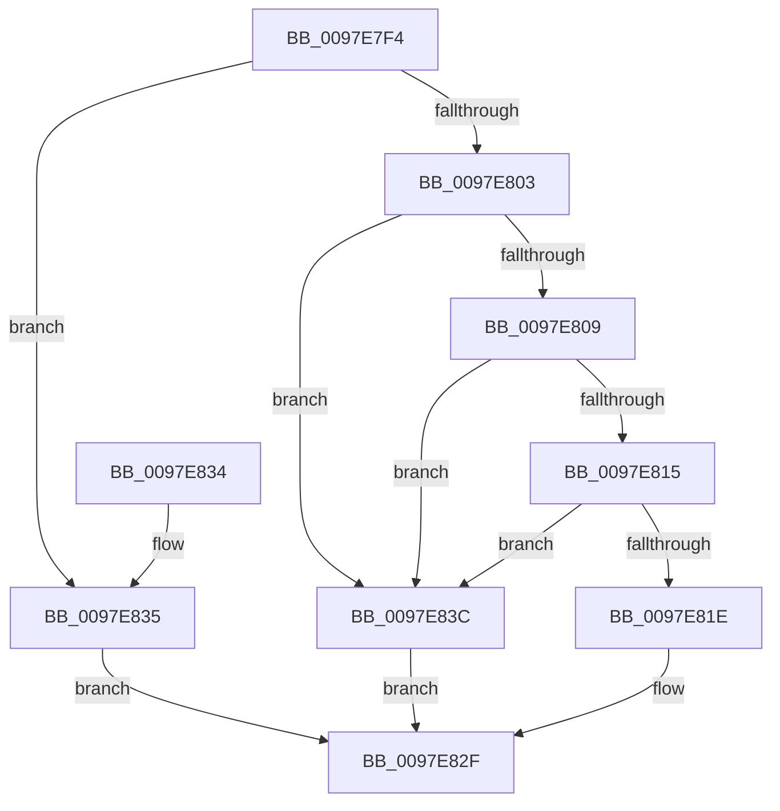

# MiVadHasSharedCommit

- RVA: `0x0097E7F4`–`0x0097E840` (길이 `76` bytes)
- VA: `0x000000014097E7F4`
- 실행 섹션: `PAGE`
- PDB 이름 있음: `예`; PDB Function 태그: `아니요`
- unwind 정보 RVA: `0x00068784`
- 디코드: `27`개 명령, `76/76` bytes 표시
- 미해석 바이트: `0` (있으면 어셈블리에 `.byte`로 보존)

> 이 문서는 커널 이미지의 기계어와 PDB 기호를 분석해 생성했습니다. 4번과 5번은 함수 원형과 자료형을 바이너리 사용 방식에서 추정한 C 해석이며 원본 소스 복구 결과는 아닙니다.

## 1. Dependencies

- 직접 호출 지점: **1**; 고유 호출 대상: **1**
- 직접 호출자로 확인된 함수: **2**
- RIP 상대 이미지 참조: **0**

### Outgoing calls
- `0x0097E821` → [MiIncludeSharedCommit](../../text/42/MiIncludeSharedCommit_function_00428010.md) (function, `0x00428010`)

### Direct callers
- [MiDeletePartialCloneVads](../81/MiDeletePartialCloneVads_function_008116E4.md) at `0x00811816`
- [MiAllocateChildVads](MiAllocateChildVads_function_0097E380.md) at `0x0097E4E1`
- [MiAllocateChildVads](MiAllocateChildVads_function_0097E380.md) at `0x0097E59F`
- [MiAllocateChildVads](MiAllocateChildVads_function_0097E380.md) at `0x0097E7BC`

### Static image references
- 디코드된 RIP-relative 메모리 참조가 없습니다.

## 2. Other-region calls and transfers

- 다른 실행 섹션으로 향하는 call: **1**
  - `0x0097E821` → [MiIncludeSharedCommit](../../text/42/MiIncludeSharedCommit_function_00428010.md) (`PAGE` → `.text`)
- 별도 외부 분기/꼬리 이동을 확인하지 못했습니다.

## 3. Assembly (complete function range)

```asm
0097E7F4  48 83 EC 28                     sub rsp, 0x28
0097E7F8  8B 51 30                        mov edx, dword ptr [rcx + 0x30]
0097E7FB  8B C2                           mov eax, edx
0097E7FD  24 70                           and al, 0x70
0097E7FF  3C 20                           cmp al, 0x20
0097E801  74 32                           je 0x14097e835
0097E803  0F BA E2 15                     bt edx, 0x15
0097E807  72 33                           jb 0x14097e83c
0097E809  48 8B 51 78                     mov rdx, qword ptr [rcx + 0x78]
0097E80D  45 33 C9                        xor r9d, r9d
0097E810  48 85 D2                        test rdx, rdx
0097E813  78 27                           js 0x14097e83c
0097E815  48 8B 49 48                     mov rcx, qword ptr [rcx + 0x48]
0097E819  48 85 C9                        test rcx, rcx
0097E81C  74 1E                           je 0x14097e83c
0097E81E  48 8B 09                        mov rcx, qword ptr [rcx]
0097E821  E8 EA 97 AA FF                  call 0x140428010
0097E826  85 C0                           test eax, eax
0097E828  41 0F 95 C1                     setne r9b
0097E82C  41 8B C1                        mov eax, r9d
0097E82F  48 83 C4 28                     add rsp, 0x28
0097E833  C3                              ret
0097E834  CC                              int3
0097E835  B8 01 00 00 00                  mov eax, 1
0097E83A  EB F3                           jmp 0x14097e82f
0097E83C  33 C0                           xor eax, eax
0097E83E  EB EF                           jmp 0x14097e82f
```

## 4. C-style interpretation (structured pseudocode)

```c
__int64 __fastcall MiVadHasSharedCommit(__int64 a1, __int64 a2, __int64 a3, int a4)
{
    __int64 result;
    __int64 v_rsp;

    v_rsp = (v_rsp) - (40);
    result = (unsigned __int8)(((unsigned int)((unsigned int)((unsigned int)(*(unsigned int *)(a1 + 48))))) & (112));
    if (((unsigned __int8)(result)) == 32) goto loc_0097E835;
    if (((unsigned __int8)(result)) < 32) goto loc_0097E83C;
    a4 = 0;
    if (sign_flag) goto loc_0097E83C;
    if (*(unsigned __int64 *)(a1 + 72) == 0) goto loc_0097E83C;
    result = MiIncludeSharedCommit(*(unsigned __int64 *)(*(unsigned __int64 *)(a1 + 72)), *(unsigned __int64 *)(a1 + 120), a3, a4);
    a4 = ((unsigned int)(result) != 0) ? 1 : 0;
loc_0097E82F:
    v_rsp = (v_rsp) + (40);
    return (unsigned int)(a4);
loc_0097E835:
    goto loc_0097E82F;
loc_0097E83C:
    result = 0;
    goto loc_0097E82F;
}
```

## 5. (Beta) C Style

```c
int64_t MiVadHasSharedCommit(void *Arg1, int64_t Arg2, int64_t Arg3, int32_t Arg4)
{
    uint8_t *arg1 = (uint8_t *)Arg1;

    int64_t result;
    int64_t local_rsp;

    local_rsp = (local_rsp) - (40);
    result = (uint8_t)(((uint32_t)((uint32_t)((uint32_t)(*(uint32_t *)(arg1 + 0x30))))) & (112));
    if (((uint8_t)(result)) == 32) goto loc_0097E835;
    if (((uint8_t)(result)) < 32) goto loc_0097E83C;
    Arg4 = 0;
    if (sign_flag) goto loc_0097E83C;
    if (*(uint64_t *)(arg1 + 0x48) == 0) goto loc_0097E83C;
    result = MiIncludeSharedCommit(*(uint64_t *)(*(uint64_t *)(arg1 + 0x48)), *(uint64_t *)(arg1 + 0x78), Arg3, Arg4);
    Arg4 = ((uint32_t)(result) != 0) ? 1 : 0;
loc_0097E82F:
    local_rsp = (local_rsp) + (40);
    return (uint32_t)(Arg4);
loc_0097E835:
    goto loc_0097E82F;
loc_0097E83C:
    result = 0;
    goto loc_0097E82F;
}
```

### 관측된 메모리 오프셋

구조체 형식이 확인되지 않은 접근은 인자 기준의 오프셋으로만 기록했습니다.

| 기준 인자 | 오프셋 표현 | 폭 (bit) | 접근 |
|---|---:|---:|---|
| `Arg1` | `+ 0x30` | `32` | `R` |
| `Arg1` | `+ 0x48` | `64` | `R` |
| `Arg1` | `+ 0x78` | `64` | `R` |

## 6. Execution-region graph

[열기: 2D/3D 그래프와 함수 탐색 컨트롤 패널](../../../control-panel.html?section=page&rva=0x0097E7F4&view=graph)

- 2D 그래프는 위에서 아래로 흐르고, 3D 그래프는 빈 공간을 드래그해 회전합니다. Shift+드래그는 이동, 휠은 확대·축소, 함수 노드 선택은 대상 보고서 이동입니다.

### Static fallback


