# MmEnumerateAddressSpaceAndReferenceImages

- RVA: `0x0097DD50`–`0x0097E0F6` (길이 `934` bytes)
- VA: `0x000000014097DD50`
- 실행 섹션: `PAGE`
- PDB 이름 있음: `예`; PDB Function 태그: `예`
- unwind 정보 RVA: `0x00097544`
- 디코드: `239`개 명령, `934/934` bytes 표시
- 미해석 바이트: `0` (있으면 어셈블리에 `.byte`로 보존)

> 이 문서는 커널 이미지의 기계어와 PDB 기호를 분석해 생성했습니다. 4번과 5번은 함수 원형과 자료형을 바이너리 사용 방식에서 추정한 C 해석이며 원본 소스 복구 결과는 아닙니다.

## 1. Dependencies

- 직접 호출 지점: **15**; 고유 호출 대상: **14**
- 직접 호출자로 확인된 함수: **2**
- RIP 상대 이미지 참조: **1**

### Outgoing calls
- `0x0097DDD6` → [LOCK_ADDRESS_SPACE_SHARED](../../text/2A/LOCK_ADDRESS_SPACE_SHARED_function_002A8B3C.md) (function, `0x002A8B3C`)
- `0x0097DE14` → [MiAllocatePool](../../text/35/MiAllocatePool_function_0035B540.md) (function, `0x0035B540`)
- `0x0097DE5D` → [MiLockVadShared](../../text/31/MiLockVadShared_function_00316DE0.md) (function, `0x00316DE0`)
- `0x0097DE74` → [MiVadDeleted](../../text/43/MiVadDeleted_function_00431350.md) (function, `0x00431350`)
- `0x0097DEF5` → [MiVadMapsLargeImage](../../text/2A/MiVadMapsLargeImage_function_002A70F0.md) (function, `0x002A70F0`)
- `0x0097DF05` → [MiReadVadFlags2](../../text/45/MiReadVadFlags2_function_00452C1C.md) (function, `0x00452C1C`)
- `0x0097DF39` → [MiReferenceControlAreaFile](../../text/43/MiReferenceControlAreaFile_function_00431554.md) (function, `0x00431554`)
- `0x0097DFD6` → [MiUnlockVadShared](../../text/2E/MiUnlockVadShared_function_002E2420.md) (function, `0x002E2420`)
- `0x0097E034` → [MiUnlockVadShared](../../text/2E/MiUnlockVadShared_function_002E2420.md) (function, `0x002E2420`)
- `0x0097E04A` → [UNLOCK_ADDRESS_SPACE_SHARED](../../text/2A/UNLOCK_ADDRESS_SPACE_SHARED_function_002A8ACC.md) (function, `0x002A8ACC`)
- `0x0097E065` → [_security_check_cookie](../../text/6A/_security_check_cookie_function_006AC640.md) (function, `0x006AC640`)
- `0x0097E091` → [MiFillMapFileInfo](MiFillMapFileInfo_function_0097E15C.md) (function, `0x0097E15C`)
- `0x0097E0B1` → [KeStackAttachProcess](../../text/21/KeStackAttachProcess_function_00216800.md) (function, `0x00216800`)
- `0x0097E0C8` → [MiLocateLockedVadEvent](../../text/2A/MiLocateLockedVadEvent_function_002A7A0C.md) (function, `0x002A7A0C`)
- `0x0097E0EC` → [KiUnstackDetachProcess](../../text/21/KiUnstackDetachProcess_function_00217D30.md) (function, `0x00217D30`)

### Direct callers
- [EtwpEnumerateAddressSpace](../8A/EtwpEnumerateAddressSpace_function_008A7590.md) at `0x008A7722`
- [EtwpCovSampEnumerateProcess](EtwpCovSampEnumerateProcess_function_0097D9B0.md) at `0x0097DA45`

### Static image references
- `0x0097DD6C` → RVA `0x00E0A740` (`.data`; read)

## 2. Other-region calls and transfers

- 다른 실행 섹션으로 향하는 call: **14**
  - `0x0097DDD6` → [LOCK_ADDRESS_SPACE_SHARED](../../text/2A/LOCK_ADDRESS_SPACE_SHARED_function_002A8B3C.md) (`PAGE` → `.text`)
  - `0x0097DE14` → [MiAllocatePool](../../text/35/MiAllocatePool_function_0035B540.md) (`PAGE` → `.text`)
  - `0x0097DE5D` → [MiLockVadShared](../../text/31/MiLockVadShared_function_00316DE0.md) (`PAGE` → `.text`)
  - `0x0097DE74` → [MiVadDeleted](../../text/43/MiVadDeleted_function_00431350.md) (`PAGE` → `.text`)
  - `0x0097DEF5` → [MiVadMapsLargeImage](../../text/2A/MiVadMapsLargeImage_function_002A70F0.md) (`PAGE` → `.text`)
  - `0x0097DF05` → [MiReadVadFlags2](../../text/45/MiReadVadFlags2_function_00452C1C.md) (`PAGE` → `.text`)
  - `0x0097DF39` → [MiReferenceControlAreaFile](../../text/43/MiReferenceControlAreaFile_function_00431554.md) (`PAGE` → `.text`)
  - `0x0097DFD6` → [MiUnlockVadShared](../../text/2E/MiUnlockVadShared_function_002E2420.md) (`PAGE` → `.text`)
  - `0x0097E034` → [MiUnlockVadShared](../../text/2E/MiUnlockVadShared_function_002E2420.md) (`PAGE` → `.text`)
  - `0x0097E04A` → [UNLOCK_ADDRESS_SPACE_SHARED](../../text/2A/UNLOCK_ADDRESS_SPACE_SHARED_function_002A8ACC.md) (`PAGE` → `.text`)
  - `0x0097E065` → [_security_check_cookie](../../text/6A/_security_check_cookie_function_006AC640.md) (`PAGE` → `.text`)
  - `0x0097E0B1` → [KeStackAttachProcess](../../text/21/KeStackAttachProcess_function_00216800.md) (`PAGE` → `.text`)
  - `0x0097E0C8` → [MiLocateLockedVadEvent](../../text/2A/MiLocateLockedVadEvent_function_002A7A0C.md) (`PAGE` → `.text`)
  - `0x0097E0EC` → [KiUnstackDetachProcess](../../text/21/KiUnstackDetachProcess_function_00217D30.md) (`PAGE` → `.text`)
- call이 아닌 외부 분기/꼬리 이동: **1**
  - `0x0097E028` → [sub_00B29F7E](../B2/Unknown_function_00B29F7E.md) (`tail-transfer`)

## 3. Assembly (complete function range)

```asm
0097DD50  48 89 5C 24 10                  mov qword ptr [rsp + 0x10], rbx
0097DD55  48 89 6C 24 18                  mov qword ptr [rsp + 0x18], rbp
0097DD5A  48 89 74 24 20                  mov qword ptr [rsp + 0x20], rsi
0097DD5F  57                              push rdi
0097DD60  41 54                           push r12
0097DD62  41 55                           push r13
0097DD64  41 56                           push r14
0097DD66  41 57                           push r15
0097DD68  48 83 EC 70                     sub rsp, 0x70
0097DD6C  48 8B 05 CD C9 48 00            mov rax, qword ptr [rip + 0x48c9cd]
0097DD73  48 33 C4                        xor rax, rsp
0097DD76  48 89 44 24 60                  mov qword ptr [rsp + 0x60], rax
0097DD7B  44 8B C2                        mov r8d, edx
0097DD7E  4C 8B E9                        mov r13, rcx
0097DD81  8B CA                           mov ecx, edx
0097DD83  0F 57 C0                        xorps xmm0, xmm0
0097DD86  83 E1 01                        and ecx, 1
0097DD89  0F 11 44 24 30                  movups xmmword ptr [rsp + 0x30], xmm0
0097DD8E  8B D1                           mov edx, ecx
0097DD90  83 CA 02                        or edx, 2
0097DD93  41 F6 C0 02                     test r8b, 2
0097DD97  0F 11 44 24 40                  movups xmmword ptr [rsp + 0x40], xmm0
0097DD9C  0F 44 D1                        cmove edx, ecx
0097DD9F  0F 11 44 24 50                  movups xmmword ptr [rsp + 0x50], xmm0
0097DDA4  65 4C 8B 3C 25 88 01 00 00      mov r15, qword ptr gs:[0x188]
0097DDAD  8B DA                           mov ebx, edx
0097DDAF  83 CB 04                        or ebx, 4
0097DDB2  41 F6 C0 04                     test r8b, 4
0097DDB6  0F 44 DA                        cmove ebx, edx
0097DDB9  33 FF                           xor edi, edi
0097DDBB  89 5C 24 20                     mov dword ptr [rsp + 0x20], ebx
0097DDBF  4D 39 AF B8 00 00 00            cmp qword ptr [r15 + 0xb8], r13
0097DDC6  0F 85 DD 02 00 00               jne 0x14097e0a9
0097DDCC  21 7C 24 24                     and dword ptr [rsp + 0x24], edi
0097DDD0  49 8B D5                        mov rdx, r13
0097DDD3  49 8B CF                        mov rcx, r15
0097DDD6  E8 61 AD 92 FF                  call 0x1402a8b3c
0097DDDB  49 8B 85 68 05 00 00            mov rax, qword ptr [r13 + 0x568]
0097DDE2  48 85 C0                        test rax, rax
0097DDE5  0F 84 59 02 00 00               je 0x14097e044
0097DDEB  48 FF C0                        inc rax
0097DDEE  48 B9 55 55 55 55 55 55 55 05   movabs rcx, 0x555555555555555
0097DDF8  48 3B C1                        cmp rax, rcx
0097DDFB  0F 87 43 02 00 00               ja 0x14097e044
0097DE01  48 8D 14 40                     lea rdx, [rax + rax*2]
0097DE05  B9 00 01 00 00                  mov ecx, 0x100
0097DE0A  48 C1 E2 04                     shl rdx, 4
0097DE0E  41 B8 4D 70 31 30               mov r8d, 0x3031704d
0097DE14  E8 27 D7 9D FF                  call 0x14035b540
0097DE19  48 89 44 24 28                  mov qword ptr [rsp + 0x28], rax
0097DE1E  48 8B F8                        mov rdi, rax
0097DE21  48 85 C0                        test rax, rax
0097DE24  0F 84 1A 02 00 00               je 0x14097e044
0097DE2A  49 8B 8D 58 05 00 00            mov rcx, qword ptr [r13 + 0x558]
0097DE31  33 F6                           xor esi, esi
0097DE33  EB 06                           jmp 0x14097de3b
0097DE35  48 8B F1                        mov rsi, rcx
0097DE38  48 8B 09                        mov rcx, qword ptr [rcx]
0097DE3B  48 85 C9                        test rcx, rcx
0097DE3E  75 F5                           jne 0x14097de35
0097DE40  E9 9A 01 00 00                  jmp 0x14097dfdf
0097DE45  48 39 0E                        cmp qword ptr [rsi], rcx
0097DE48  74 0D                           je 0x14097de57
0097DE4A  48 8B CE                        mov rcx, rsi
0097DE4D  48 8B 76 10                     mov rsi, qword ptr [rsi + 0x10]
0097DE51  48 83 E6 FC                     and rsi, 0xfffffffffffffffc
0097DE55  75 EE                           jne 0x14097de45
0097DE57  49 8B D6                        mov rdx, r14
0097DE5A  49 8B CF                        mov rcx, r15
0097DE5D  E8 7E 8F 99 FF                  call 0x140316de0
0097DE62  41 8B 56 30                     mov edx, dword ptr [r14 + 0x30]
0097DE66  49 8B CE                        mov rcx, r14
0097DE69  44 8B C2                        mov r8d, edx
0097DE6C  41 C1 E8 04                     shr r8d, 4
0097DE70  41 83 E0 07                     and r8d, 7
0097DE74  E8 D7 34 AB FF                  call 0x140431350
0097DE79  85 C0                           test eax, eax
0097DE7B  0F 85 AD 01 00 00               jne 0x14097e02e
0097DE81  41 83 F8 01                     cmp r8d, 1
0097DE85  0F 84 A3 01 00 00               je 0x14097e02e
0097DE8B  0F BA E2 15                     bt edx, 0x15
0097DE8F  0F 82 90 01 00 00               jb 0x14097e025
0097DE95  41 83 F8 02                     cmp r8d, 2
0097DE99  0F 85 EA 01 00 00               jne 0x14097e089
0097DE9F  81 E2 80 0F 00 00               and edx, 0xf80
0097DEA5  81 FA 80 03 00 00               cmp edx, 0x380
0097DEAB  0F 85 D8 01 00 00               jne 0x14097e089
0097DEB1  F6 C3 01                        test bl, 1
0097DEB4  0F 84 CF 01 00 00               je 0x14097e089
0097DEBA  49 8B 46 48                     mov rax, qword ptr [r14 + 0x48]
0097DEBE  41 0F B6 4E 20                  movzx ecx, byte ptr [r14 + 0x20]
0097DEC3  41 0F B6 56 21                  movzx edx, byte ptr [r14 + 0x21]
0097DEC8  48 C1 E2 20                     shl rdx, 0x20
0097DECC  4C 8B 20                        mov r12, qword ptr [rax]
0097DECF  41 8B 46 18                     mov eax, dword ptr [r14 + 0x18]
0097DED3  48 C1 E1 20                     shl rcx, 0x20
0097DED7  48 0B C8                        or rcx, rax
0097DEDA  41 8B 46 1C                     mov eax, dword ptr [r14 + 0x1c]
0097DEDE  48 0B D0                        or rdx, rax
0097DEE1  48 8B E9                        mov rbp, rcx
0097DEE4  48 2B D1                        sub rdx, rcx
0097DEE7  48 C1 E5 0C                     shl rbp, 0xc
0097DEEB  48 FF C2                        inc rdx
0097DEEE  49 8B CE                        mov rcx, r14
0097DEF1  48 C1 E2 0C                     shl rdx, 0xc
0097DEF5  E8 F6 91 92 FF                  call 0x1402a70f0
0097DEFA  85 C0                           test eax, eax
0097DEFC  0F 85 C1 01 00 00               jne 0x14097e0c3
0097DF02  49 8B CE                        mov rcx, r14
0097DF05  E8 12 4D AD FF                  call 0x140452c1c
0097DF0A  49 8B 0C 24                     mov rcx, qword ptr [r12]
0097DF0E  49 83 C8 FF                     or r8, 0xffffffffffffffff
0097DF12  8B D8                           mov ebx, eax
0097DF14  49 8B C0                        mov rax, r8
0097DF17  F0 4C 0F B1 41 18               lock cmpxchg qword ptr [rcx + 0x18], r8
0097DF1D  48 05 FF 0F 00 00               add rax, 0xfff
0097DF23  48 89 57 18                     mov qword ptr [rdi + 0x18], rdx
0097DF27  48 25 00 F0 FF FF               and rax, 0xfffffffffffff000
0097DF2D  48 3B D0                        cmp rdx, rax
0097DF30  76 04                           jbe 0x14097df36
0097DF32  48 89 47 18                     mov qword ptr [rdi + 0x18], rax
0097DF36  49 8B CC                        mov rcx, r12
0097DF39  E8 16 36 AB FF                  call 0x140431554
0097DF3E  48 89 07                        mov qword ptr [rdi], rax
0097DF41  48 89 6F 08                     mov qword ptr [rdi + 8], rbp
0097DF45  49 8B 04 24                     mov rax, qword ptr [r12]
0097DF49  48 8B 48 20                     mov rcx, qword ptr [rax + 0x20]
0097DF4D  48 89 4F 10                     mov qword ptr [rdi + 0x10], rcx
0097DF51  49 8B 04 24                     mov rax, qword ptr [r12]
0097DF55  48 8B 48 38                     mov rcx, qword ptr [rax + 0x38]
0097DF59  8B 41 3C                        mov eax, dword ptr [rcx + 0x3c]
0097DF5C  89 47 28                        mov dword ptr [rdi + 0x28], eax
0097DF5F  F6 C3 08                        test bl, 8
0097DF62  0F 85 B1 00 00 00               jne 0x14097e019
0097DF68  49 8B 04 24                     mov rax, qword ptr [r12]
0097DF6C  0F B6 48 0F                     movzx ecx, byte ptr [rax + 0xf]
0097DF70  48 C1 E1 06                     shl rcx, 6
0097DF74  48 8B E9                        mov rbp, rcx
0097DF77  48 33 6F 08                     xor rbp, qword ptr [rdi + 8]
0097DF7B  48 81 E5 3F E0 FF FF            and rbp, 0xffffffffffffe03f
0097DF82  48 33 E9                        xor rbp, rcx
0097DF85  F6 44 24 20 02                  test byte ptr [rsp + 0x20], 2
0097DF8A  48 89 6F 08                     mov qword ptr [rdi + 8], rbp
0097DF8E  74 3C                           je 0x14097dfcc
0097DF90  48 33 EB                        xor rbp, rbx
0097DF93  48 83 E5 FE                     and rbp, 0xfffffffffffffffe
0097DF97  48 33 EB                        xor rbp, rbx
0097DF9A  48 89 6F 08                     mov qword ptr [rdi + 8], rbp
0097DF9E  41 8B 46 30                     mov eax, dword ptr [r14 + 0x30]
0097DFA2  48 C1 E8 06                     shr rax, 6
0097DFA6  48 33 E8                        xor rbp, rax
0097DFA9  48 83 E5 C1                     and rbp, 0xffffffffffffffc1
0097DFAD  48 33 E8                        xor rbp, rax
0097DFB0  48 89 6F 08                     mov qword ptr [rdi + 8], rbp
0097DFB4  41 8B 4E 34                     mov ecx, dword ptr [r14 + 0x34]
0097DFB8  41 0F B6 56 22                  movzx edx, byte ptr [r14 + 0x22]
0097DFBD  48 C1 E2 20                     shl rdx, 0x20
0097DFC1  48 0B D1                        or rdx, rcx
0097DFC4  48 C1 E2 0C                     shl rdx, 0xc
0097DFC8  48 89 57 20                     mov qword ptr [rdi + 0x20], rdx
0097DFCC  8B 5C 24 20                     mov ebx, dword ptr [rsp + 0x20]
0097DFD0  49 8B D6                        mov rdx, r14
0097DFD3  49 8B CF                        mov rcx, r15
0097DFD6  E8 45 44 96 FF                  call 0x1402e2420
0097DFDB  48 83 C7 30                     add rdi, 0x30
0097DFDF  48 85 F6                        test rsi, rsi
0097DFE2  74 57                           je 0x14097e03b
0097DFE4  48 8B 46 08                     mov rax, qword ptr [rsi + 8]
0097DFE8  4C 8B F6                        mov r14, rsi
0097DFEB  48 8B CE                        mov rcx, rsi
0097DFEE  48 85 C0                        test rax, rax
0097DFF1  0F 84 56 FE FF FF               je 0x14097de4d
0097DFF7  48 8B 08                        mov rcx, qword ptr [rax]
0097DFFA  48 8B F0                        mov rsi, rax
0097DFFD  48 85 C9                        test rcx, rcx
0097E000  0F 84 51 FE FF FF               je 0x14097de57
0097E006  48 8B 01                        mov rax, qword ptr [rcx]
0097E009  48 8B F1                        mov rsi, rcx
0097E00C  48 8B C8                        mov rcx, rax
0097E00F  48 85 C0                        test rax, rax
0097E012  75 F2                           jne 0x14097e006
0097E014  E9 3E FE FF FF                  jmp 0x14097de57
0097E019  48 81 E5 FF E3 FF FF            and rbp, 0xffffffffffffe3ff
0097E020  E9 60 FF FF FF                  jmp 0x14097df85
0097E025  83 FB 04                        cmp ebx, 4
0097E028  0F 83 50 BF 1A 00               jae 0x140b29f7e
0097E02E  49 8B D6                        mov rdx, r14
0097E031  49 8B CF                        mov rcx, r15
0097E034  E8 E7 43 96 FF                  call 0x1402e2420
0097E039  EB A4                           jmp 0x14097dfdf
0097E03B  48 83 27 00                     and qword ptr [rdi], 0
0097E03F  48 8B 7C 24 28                  mov rdi, qword ptr [rsp + 0x28]
0097E044  49 8B D5                        mov rdx, r13
0097E047  49 8B CF                        mov rcx, r15
0097E04A  E8 7D AA 92 FF                  call 0x1402a8acc
0097E04F  83 7C 24 24 00                  cmp dword ptr [rsp + 0x24], 0
0097E054  0F 85 8B 00 00 00               jne 0x14097e0e5
0097E05A  48 8B C7                        mov rax, rdi
0097E05D  48 8B 4C 24 60                  mov rcx, qword ptr [rsp + 0x60]
0097E062  48 33 CC                        xor rcx, rsp
0097E065  E8 D6 E5 D2 FF                  call 0x1406ac640
0097E06A  4C 8D 5C 24 70                  lea r11, [rsp + 0x70]
0097E06F  49 8B 5B 38                     mov rbx, qword ptr [r11 + 0x38]
0097E073  49 8B 6B 40                     mov rbp, qword ptr [r11 + 0x40]
0097E077  49 8B 73 48                     mov rsi, qword ptr [r11 + 0x48]
0097E07B  49 8B E3                        mov rsp, r11
0097E07E  41 5F                           pop r15
0097E080  41 5E                           pop r14
0097E082  41 5D                           pop r13
0097E084  41 5C                           pop r12
0097E086  5F                              pop rdi
0097E087  C3                              ret
0097E088  CC                              int3
0097E089  F6 C3 02                        test bl, 2
0097E08C  74 A0                           je 0x14097e02e
0097E08E  48 8B D7                        mov rdx, rdi
0097E091  E8 C6 00 00 00                  call 0x14097e15c
0097E096  48 8B 07                        mov rax, qword ptr [rdi]
0097E099  48 83 E0 FD                     and rax, 0xfffffffffffffffd
0097E09D  48 83 C8 01                     or rax, 1
0097E0A1  48 89 07                        mov qword ptr [rdi], rax
0097E0A4  E9 27 FF FF FF                  jmp 0x14097dfd0
0097E0A9  48 8D 54 24 30                  lea rdx, [rsp + 0x30]
0097E0AE  49 8B CD                        mov rcx, r13
0097E0B1  E8 4A 87 89 FF                  call 0x140216800
0097E0B6  C7 44 24 24 01 00 00 00         mov dword ptr [rsp + 0x24], 1
0097E0BE  E9 0D FD FF FF                  jmp 0x14097ddd0
0097E0C3  BA 10 00 00 00                  mov edx, 0x10
0097E0C8  E8 3F 99 92 FF                  call 0x1402a7a0c
0097E0CD  0F B6 48 08                     movzx ecx, byte ptr [rax + 8]
0097E0D1  48 8B 50 10                     mov rdx, qword ptr [rax + 0x10]
0097E0D5  48 C1 E1 10                     shl rcx, 0x10
0097E0D9  48 03 E9                        add rbp, rcx
0097E0DC  48 C1 E2 0C                     shl rdx, 0xc
0097E0E0  E9 1D FE FF FF                  jmp 0x14097df02
0097E0E5  33 D2                           xor edx, edx
0097E0E7  48 8D 4C 24 30                  lea rcx, [rsp + 0x30]
0097E0EC  E8 3F 9C 89 FF                  call 0x140217d30
0097E0F1  E9 64 FF FF FF                  jmp 0x14097e05a
```

## 4. C-style interpretation (structured pseudocode)

```c
__int64 __fastcall MmEnumerateAddressSpaceAndReferenceImages(__int64 a1, int a2)
{
    __int64 result;
    __int64 v_rbp;
    __int64 v_rbx;
    __int64 v_rdi;
    __int64 v_rsi;
    __int64 v_rsp;
    unsigned __int64 v_stack_m28;
    unsigned __int64 v_stack_m38;
    unsigned __int64 v_stack_m40;
    unsigned __int64 v_stack_m48;
    unsigned int v_stack_m4C;
    unsigned __int64 v_stack_m58;
    unsigned __int64 v_stack_m68;
    unsigned __int64 v_stack_m70;
    unsigned int v_stack_m74;
    unsigned int v_stack_m78;
    unsigned __int64 v_stack_p10;
    unsigned __int64 v_stack_p18;
    unsigned __int64 v_stack_p20;

    v_stack_p10 = v_rbx;
    v_stack_p18 = v_rbp;
    v_stack_p20 = v_rsi;
    v_rsp = (v_rsp) - (112);
    result = (*(unsigned __int64 *)(v_rip + 4770253)) ^ (v_rsp);
    v_stack_m38 = result;
    a1 = (unsigned int)(((unsigned int)(a2)) & (1));
    v_stack_m68 = v_xmm0;
    a2 = (unsigned int)(((unsigned int)((unsigned int)(a1))) | (2));
    v_stack_m58 = v_xmm0;
    if ((((unsigned __int8)((unsigned int)(a2))) & (2)) == 0) { a2 = (unsigned int)(a1); }
    v_stack_m48 = v_xmm0;
    v_rbx = (unsigned int)(((unsigned int)(a2)) | (4));
    if ((((unsigned __int8)((unsigned int)(a2))) & (4)) == 0) { v_rbx = a2; }
    v_rdi = 0;
    v_stack_m78 = (unsigned int)(v_rbx);
    if ((*(unsigned __int64 *)(*(unsigned __int64 *)(gs_base + (0 + 392)) + 184)) != a1) goto loc_0097E0A9;
loc_0097DDD0:
    result = LOCK_ADDRESS_SPACE_SHARED(*(unsigned __int64 *)(gs_base + (0 + 392)), a1, (unsigned int)(a2), a4);
    if (*(unsigned __int64 *)(a1 + 1384) == 0) goto loc_0097E044;
    result = (*(unsigned __int64 *)(a1 + 1384)) + 1;
    if (result > (*(unsigned __int64 *)(gs_base + (0 + 392)))) goto loc_0097E044;
    a2 = (result + result * 2) << (4);
    result = MiAllocatePool(256, a2, (unsigned int)(0x3031704DULL), a4);
    v_stack_m70 = result;
    if (result == 0) goto loc_0097E044;
    v_rsi = 0;
    goto loc_0097DE3B;
loc_0097DE35:
loc_0097DE3B:
    if (*(unsigned __int64 *)(*(unsigned __int64 *)(a1 + 1368)) != 0) goto loc_0097DE35;
    goto loc_0097DFDF;
loc_0097DE45:
    if ((*(unsigned __int64 *)(*(unsigned __int64 *)(a1 + 1368))) == (*(unsigned __int64 *)(*(unsigned __int64 *)(a1 + 1368)))) goto loc_0097DE57;
loc_0097DE4D:
    v_rsi = (*(unsigned __int64 *)(*(unsigned __int64 *)(a1 + 1368) + 16)) & (-4);
    if (condition_is_not_equal) goto loc_0097DE45;
loc_0097DE57:
    result = MiLockVadShared(*(unsigned __int64 *)(gs_base + (0 + 392)), v_r14, (unsigned int)(0x3031704DULL), a4);
    a3 = (unsigned int)(((unsigned int)((unsigned int)((unsigned int)(*(unsigned int *)(v_r14 + 48))))) >> (4));
    a3 = (unsigned int)((a3) & (7));
    result = MiVadDeleted(v_r14, (unsigned int)(*(unsigned int *)(v_r14 + 48)), a3, a4);
    if ((unsigned int)(result) != 0) goto loc_0097E02E;
    if (((unsigned int)(a3)) == 1) goto loc_0097E02E;
    if (((unsigned int)(a3)) < 1) goto loc_0097E025;
    if (((unsigned int)(a3)) != 2) goto loc_0097E089;
    a2 = (unsigned int)(((unsigned int)(*(unsigned int *)(v_r14 + 48))) & (0xF80ULL));
    if (a2 != 896) goto loc_0097E089;
    if ((((unsigned __int8)(v_rbx)) & (1)) == 0) goto loc_0097E089;
    a2 = (*(unsigned __int8 *)(v_r14 + 33)) << (32);
    a1 = (*(unsigned __int8 *)(v_r14 + 32)) << (32);
    a1 = (a1) | ((unsigned int)(*(unsigned int *)(v_r14 + 24)));
    a2 = (a2) | ((unsigned int)(*(unsigned int *)(v_r14 + 28)));
    a2 = (a2) - (a1);
    v_rbp = (a1) << (12);
    a2 = (a2) + 1;
    a2 = (a2) << (12);
    result = MiVadMapsLargeImage(v_r14, a2, a3, a4);
    if ((unsigned int)(result) != 0) goto loc_0097E0C3;
loc_0097DF02:
    result = MiReadVadFlags2(v_r14, a2, a3, a4);
    a3 = (a3) | (-1);
    result = (a3) + (0xFFFULL);
    *(unsigned __int64 *)(result + 24) = a2;
    result = (result) & (0xFFFFFFFFFFFFF000ULL);
    if (a2 >= = result) {
        *(unsigned __int64 *)(result + 24) = result;
    }
    result = MiReferenceControlAreaFile(*(unsigned __int64 *)(*(unsigned __int64 *)(v_r14 + 72)), a2, a3, a4);
    *(unsigned __int64 *)(result) = result;
    *(unsigned __int64 *)(result + 8) = v_rbp;
    *(unsigned __int64 *)(result + 16) = *(unsigned __int64 *)(*(unsigned __int64 *)(*(unsigned __int64 *)(*(unsigned __int64 *)(v_r14 + 72))) + 32);
    *(unsigned int *)(result + 40) = (unsigned int)((unsigned int)(*(unsigned int *)(*(unsigned __int64 *)(*(unsigned __int64 *)(*(unsigned __int64 *)(*(unsigned __int64 *)(v_r14 + 72))) + 56) + 60)));
    if ((((unsigned __int8)((unsigned int)((unsigned int)(result)))) & (8)) != 0) goto loc_0097E019;
    a1 = (*(unsigned __int8 *)(*(unsigned __int64 *)(*(unsigned __int64 *)(*(unsigned __int64 *)(v_r14 + 72))) + 15)) << (6);
    v_rbp = (a1) ^ (*(unsigned __int64 *)(result + 8));
    v_rbp = (v_rbp) & (0xFFFFFFFFFFFFE03FULL);
    v_rbp = (v_rbp) ^ (a1);
loc_0097DF85:
    *(unsigned __int64 *)(result + 8) = v_rbp;
    result = *(unsigned __int64 *)(*(unsigned __int64 *)(*(unsigned __int64 *)(v_r14 + 72)));
    if (((v_stack_m78) & (2)) != 0) {
        v_rbp = (v_rbp) ^ ((unsigned int)((unsigned int)(result)));
        v_rbp = (v_rbp) & (-2);
        v_rbp = (v_rbp) ^ ((unsigned int)((unsigned int)(result)));
        *(unsigned __int64 *)(result + 8) = v_rbp;
        result = *(unsigned int *)(v_r14 + 48);
        result = (result) >> (6);
        v_rbp = (v_rbp) ^ (result);
        v_rbp = (v_rbp) & (-63);
        v_rbp = (v_rbp) ^ (result);
        *(unsigned __int64 *)(result + 8) = v_rbp;
        a1 = *(unsigned int *)(v_r14 + 52);
        a2 = *(unsigned __int8 *)(v_r14 + 34);
        a2 = (a2) << (32);
        a2 = (a2) | (a1);
        a2 = (a2) << (12);
        *(unsigned __int64 *)(result + 32) = a2;
    }
loc_0097DFD0:
    result = MiUnlockVadShared(*(unsigned __int64 *)(gs_base + (0 + 392)), v_r14, a3, a4);
    v_rdi = (result) + (48);
loc_0097DFDF:
    if (v_rsi == 0) goto loc_0097E03B;
    if (*(unsigned __int64 *)(v_rsi + 8) == 0) goto loc_0097DE4D;
    if (*(unsigned __int64 *)(*(unsigned __int64 *)(v_rsi + 8)) == 0) goto loc_0097DE57;
loc_0097E006:
    if (*(unsigned __int64 *)(*(unsigned __int64 *)(*(unsigned __int64 *)(v_rsi + 8))) != 0) goto loc_0097E006;
    goto loc_0097DE57;
loc_0097E019:
    v_rbp = (v_rbp) & (0xFFFFFFFFFFFFE3FFULL);
    goto loc_0097DF85;
loc_0097E025:
loc_0097E02E:
    result = MiUnlockVadShared(*(unsigned __int64 *)(gs_base + (0 + 392)), v_rsi, a3, a4);
    goto loc_0097DFDF;
loc_0097E03B:
loc_0097E044:
    result = UNLOCK_ADDRESS_SPACE_SHARED(*(unsigned __int64 *)(gs_base + (0 + 392)), a1, a3, a4);
    if (v_stack_m74 != 0) goto loc_0097E0E5;
loc_0097E05A:
    a1 = (v_stack_m38) ^ (v_rsp);
    result = _security_check_cookie(a1, a1, a3, a4);
    return result;
loc_0097E089:
    if ((((unsigned __int8)(*(unsigned __int64 *)(v_stack_m28 + 56))) & (2)) == 0) goto loc_0097E02E;
    result = MiFillMapFileInfo(a1, v_stack_m70, a3, a4);
    result = (*(unsigned __int64 *)(v_stack_m70)) & (-3);
    result = (result) | (1);
    *(unsigned __int64 *)(v_stack_m70) = result;
    goto loc_0097DFD0;
loc_0097E0A9:
    result = KeStackAttachProcess(a1, v_stack_m40, a3, a4);
    v_stack_m4C = 1;
    goto loc_0097DDD0;
loc_0097E0C3:
    result = MiLocateLockedVadEvent(a1, 16, a3, a4);
    a1 = (*(unsigned __int8 *)(result + 8)) << (16);
    v_rbp = (*(unsigned __int64 *)(v_stack_m28 + 64)) + (a1);
    a2 = (*(unsigned __int64 *)(result + 16)) << (12);
    goto loc_0097DF02;
loc_0097E0E5:
    a2 = 0;
    result = KiUnstackDetachProcess(v_stack_m40, a2, a3, a4);
    goto loc_0097E05A;
}
```

## 5. (Beta) C Style

```c
int64_t MmEnumerateAddressSpaceAndReferenceImages(void *Arg1, int32_t Arg2)
{
    uint8_t *arg1 = (uint8_t *)Arg1;

    int64_t result;
    int64_t local_rbp;
    int64_t local_rbx;
    int64_t local_rdi;
    int64_t local_rsi;
    int64_t local_rsp;
    uint64_t v_stack_m28;
    uint64_t v_stack_m38;
    uint64_t v_stack_m40;
    uint64_t v_stack_m48;
    uint32_t v_stack_m4C;
    uint64_t v_stack_m58;
    uint64_t v_stack_m68;
    uint64_t v_stack_m70;
    uint32_t v_stack_m74;
    uint32_t v_stack_m78;
    uint64_t v_stack_p10;
    uint64_t v_stack_p18;
    uint64_t v_stack_p20;

    v_stack_p10 = local_rbx;
    v_stack_p18 = local_rbp;
    v_stack_p20 = local_rsi;
    local_rsp = (local_rsp) - (112);
    result = (*(uint64_t *)(v_rip + 0x48C9CD)) ^ (local_rsp);
    v_stack_m38 = result;
    Arg1 = (uint32_t)(((uint32_t)(Arg2)) & (1));
    v_stack_m68 = v_xmm0;
    Arg2 = (uint32_t)(((uint32_t)((uint32_t)(Arg1))) | (2));
    v_stack_m58 = v_xmm0;
    if ((((uint8_t)((uint32_t)(Arg2))) & (2)) == 0) { Arg2 = (uint32_t)(Arg1); }
    v_stack_m48 = v_xmm0;
    local_rbx = (uint32_t)(((uint32_t)(Arg2)) | (4));
    if ((((uint8_t)((uint32_t)(Arg2))) & (4)) == 0) { local_rbx = Arg2; }
    local_rdi = 0;
    v_stack_m78 = (uint32_t)(local_rbx);
    if ((*(uint64_t *)(*(uint64_t *)(gs_base + (0 + 0x188)) + 0xB8)) != Arg1) goto loc_0097E0A9;
loc_0097DDD0:
    result = LOCK_ADDRESS_SPACE_SHARED(*(uint64_t *)(gs_base + (0 + 0x188)), Arg1, (uint32_t)(Arg2), a4);
    if (*(uint64_t *)(arg1 + 0x568) == 0) goto loc_0097E044;
    result = (*(uint64_t *)(arg1 + 0x568)) + 1;
    if (result > (*(uint64_t *)(gs_base + (0 + 0x188)))) goto loc_0097E044;
    Arg2 = (result + result * 2) << (4);
    result = MiAllocatePool(256, Arg2, (uint32_t)(0x3031704DULL), a4);
    v_stack_m70 = result;
    if (result == 0) goto loc_0097E044;
    local_rsi = 0;
    goto loc_0097DE3B;
loc_0097DE35:
loc_0097DE3B:
    if (*(uint64_t *)(*(uint64_t *)(arg1 + 0x558)) != 0) goto loc_0097DE35;
    goto loc_0097DFDF;
loc_0097DE45:
    if ((*(uint64_t *)(*(uint64_t *)(arg1 + 0x558))) == (*(uint64_t *)(*(uint64_t *)(arg1 + 0x558)))) goto loc_0097DE57;
loc_0097DE4D:
    local_rsi = (*(uint64_t *)(*(uint64_t *)(arg1 + 0x558) + 0x10)) & (-4);
    if (condition_is_not_equal) goto loc_0097DE45;
loc_0097DE57:
    result = MiLockVadShared(*(uint64_t *)(gs_base + (0 + 0x188)), local_r14, (uint32_t)(0x3031704DULL), a4);
    a3 = (uint32_t)(((uint32_t)((uint32_t)((uint32_t)(*(uint32_t *)(local_r14 + 0x30))))) >> (4));
    a3 = (uint32_t)((a3) & (7));
    result = MiVadDeleted(local_r14, (uint32_t)(*(uint32_t *)(local_r14 + 0x30)), a3, a4);
    if ((uint32_t)(result) != 0) goto loc_0097E02E;
    if (((uint32_t)(a3)) == 1) goto loc_0097E02E;
    if (((uint32_t)(a3)) < 1) goto loc_0097E025;
    if (((uint32_t)(a3)) != 2) goto loc_0097E089;
    Arg2 = (uint32_t)(((uint32_t)(*(uint32_t *)(local_r14 + 0x30))) & (0xF80ULL));
    if (Arg2 != 896) goto loc_0097E089;
    if ((((uint8_t)(local_rbx)) & (1)) == 0) goto loc_0097E089;
    Arg2 = (*(uint8_t *)(local_r14 + 0x21)) << (32);
    Arg1 = (*(uint8_t *)(local_r14 + 0x20)) << (32);
    Arg1 = (Arg1) | ((uint32_t)(*(uint32_t *)(local_r14 + 0x18)));
    Arg2 = (Arg2) | ((uint32_t)(*(uint32_t *)(local_r14 + 0x1C)));
    Arg2 = (Arg2) - (Arg1);
    local_rbp = (Arg1) << (12);
    Arg2 = (Arg2) + 1;
    Arg2 = (Arg2) << (12);
    result = MiVadMapsLargeImage(local_r14, Arg2, a3, a4);
    if ((uint32_t)(result) != 0) goto loc_0097E0C3;
loc_0097DF02:
    result = MiReadVadFlags2(local_r14, Arg2, a3, a4);
    a3 = (a3) | (-1);
    result = (a3) + (0xFFFULL);
    *(uint64_t *)(result + 0x18) = Arg2;
    result = (result) & (0xFFFFFFFFFFFFF000ULL);
    if (Arg2 >= = result) {
        *(uint64_t *)(result + 0x18) = result;
    }
    result = MiReferenceControlAreaFile(*(uint64_t *)(*(uint64_t *)(local_r14 + 0x48)), Arg2, a3, a4);
    *(uint64_t *)(result) = result;
    *(uint64_t *)(result + 0x8) = local_rbp;
    *(uint64_t *)(result + 0x10) = *(uint64_t *)(*(uint64_t *)(*(uint64_t *)(*(uint64_t *)(local_r14 + 0x48))) + 0x20);
    *(uint32_t *)(result + 0x28) = (uint32_t)((uint32_t)(*(uint32_t *)(*(uint64_t *)(*(uint64_t *)(*(uint64_t *)(*(uint64_t *)(local_r14 + 0x48))) + 0x38) + 0x3C)));
    if ((((uint8_t)((uint32_t)((uint32_t)(result)))) & (8)) != 0) goto loc_0097E019;
    Arg1 = (*(uint8_t *)(*(uint64_t *)(*(uint64_t *)(*(uint64_t *)(local_r14 + 0x48))) + 0xF)) << (6);
    local_rbp = (Arg1) ^ (*(uint64_t *)(result + 0x8));
    local_rbp = (local_rbp) & (0xFFFFFFFFFFFFE03FULL);
    local_rbp = (local_rbp) ^ (Arg1);
loc_0097DF85:
    *(uint64_t *)(result + 0x8) = local_rbp;
    result = *(uint64_t *)(*(uint64_t *)(*(uint64_t *)(local_r14 + 0x48)));
    if (((v_stack_m78) & (2)) != 0) {
        local_rbp = (local_rbp) ^ ((uint32_t)((uint32_t)(result)));
        local_rbp = (local_rbp) & (-2);
        local_rbp = (local_rbp) ^ ((uint32_t)((uint32_t)(result)));
        *(uint64_t *)(result + 0x8) = local_rbp;
        result = *(uint32_t *)(local_r14 + 0x30);
        result = (result) >> (6);
        local_rbp = (local_rbp) ^ (result);
        local_rbp = (local_rbp) & (-63);
        local_rbp = (local_rbp) ^ (result);
        *(uint64_t *)(result + 0x8) = local_rbp;
        Arg1 = *(uint32_t *)(local_r14 + 0x34);
        Arg2 = *(uint8_t *)(local_r14 + 0x22);
        Arg2 = (Arg2) << (32);
        Arg2 = (Arg2) | (Arg1);
        Arg2 = (Arg2) << (12);
        *(uint64_t *)(result + 0x20) = Arg2;
    }
loc_0097DFD0:
    result = MiUnlockVadShared(*(uint64_t *)(gs_base + (0 + 0x188)), local_r14, a3, a4);
    local_rdi = (result) + (48);
loc_0097DFDF:
    if (local_rsi == 0) goto loc_0097E03B;
    if (*(uint64_t *)(local_rsi + 0x8) == 0) goto loc_0097DE4D;
    if (*(uint64_t *)(*(uint64_t *)(local_rsi + 0x8)) == 0) goto loc_0097DE57;
loc_0097E006:
    if (*(uint64_t *)(*(uint64_t *)(*(uint64_t *)(local_rsi + 0x8))) != 0) goto loc_0097E006;
    goto loc_0097DE57;
loc_0097E019:
    local_rbp = (local_rbp) & (0xFFFFFFFFFFFFE3FFULL);
    goto loc_0097DF85;
loc_0097E025:
loc_0097E02E:
    result = MiUnlockVadShared(*(uint64_t *)(gs_base + (0 + 0x188)), local_rsi, a3, a4);
    goto loc_0097DFDF;
loc_0097E03B:
loc_0097E044:
    result = UNLOCK_ADDRESS_SPACE_SHARED(*(uint64_t *)(gs_base + (0 + 0x188)), Arg1, a3, a4);
    if (v_stack_m74 != 0) goto loc_0097E0E5;
loc_0097E05A:
    Arg1 = (v_stack_m38) ^ (local_rsp);
    result = _security_check_cookie(Arg1, Arg1, a3, a4);
    return result;
loc_0097E089:
    if ((((uint8_t)(*(uint64_t *)(v_stack_m28 + 0x38))) & (2)) == 0) goto loc_0097E02E;
    result = MiFillMapFileInfo(Arg1, v_stack_m70, a3, a4);
    result = (*(uint64_t *)(v_stack_m70)) & (-3);
    result = (result) | (1);
    *(uint64_t *)(v_stack_m70) = result;
    goto loc_0097DFD0;
loc_0097E0A9:
    result = KeStackAttachProcess(Arg1, v_stack_m40, a3, a4);
    v_stack_m4C = 1;
    goto loc_0097DDD0;
loc_0097E0C3:
    result = MiLocateLockedVadEvent(Arg1, 16, a3, a4);
    Arg1 = (*(uint8_t *)(result + 0x8)) << (16);
    local_rbp = (*(uint64_t *)(v_stack_m28 + 0x40)) + (Arg1);
    Arg2 = (*(uint64_t *)(result + 0x10)) << (12);
    goto loc_0097DF02;
loc_0097E0E5:
    Arg2 = 0;
    result = KiUnstackDetachProcess(v_stack_m40, Arg2, a3, a4);
    goto loc_0097E05A;
}
```

### 관측된 메모리 오프셋

구조체 형식이 확인되지 않은 접근은 인자 기준의 오프셋으로만 기록했습니다.

| 기준 인자 | 오프셋 표현 | 폭 (bit) | 접근 |
|---|---:|---:|---|
| `Arg1` | `+ 0x558` | `64` | `R` |
| `Arg1` | `+ 0x568` | `64` | `R` |

## 6. Execution-region graph

[열기: 2D/3D 그래프와 함수 탐색 컨트롤 패널](../../../control-panel.html?section=page&rva=0x0097DD50&view=graph)

- 2D 그래프는 위에서 아래로 흐르고, 3D 그래프는 빈 공간을 드래그해 회전합니다. Shift+드래그는 이동, 휠은 확대·축소, 함수 노드 선택은 대상 보고서 이동입니다.

### Static fallback

```mermaid
flowchart TD
  bb_0097DD50[BB_0097DD50]
  bb_0097DDCC[BB_0097DDCC]
  bb_0097DDD0[BB_0097DDD0]
  bb_0097DDEB[BB_0097DDEB]
  bb_0097DE01[BB_0097DE01]
  bb_0097DE2A[BB_0097DE2A]
  bb_0097DE35[BB_0097DE35]
  bb_0097DE3B[BB_0097DE3B]
  bb_0097DE40[BB_0097DE40]
  bb_0097DE45[BB_0097DE45]
  bb_0097DE4A[BB_0097DE4A]
  bb_0097DE4D[BB_0097DE4D]
  bb_0097DE57[BB_0097DE57]
  bb_0097DE81[BB_0097DE81]
  bb_0097DE8B[BB_0097DE8B]
  bb_0097DE95[BB_0097DE95]
  bb_0097DE9F[BB_0097DE9F]
  bb_0097DEB1[BB_0097DEB1]
  bb_0097DEBA[BB_0097DEBA]
  bb_0097DF02[BB_0097DF02]
  bb_0097DF32[BB_0097DF32]
  bb_0097DF36[BB_0097DF36]
  bb_0097DF68[BB_0097DF68]
  bb_0097DF85[BB_0097DF85]
  bb_0097DF90[BB_0097DF90]
  bb_0097DFCC[BB_0097DFCC]
  bb_0097DFD0[BB_0097DFD0]
  bb_0097DFDF[BB_0097DFDF]
  bb_0097DFE4[BB_0097DFE4]
  bb_0097DFF7[BB_0097DFF7]
  bb_0097E006[BB_0097E006]
  bb_0097E014[BB_0097E014]
  bb_0097E019[BB_0097E019]
  bb_0097E025[BB_0097E025]
  bb_0097E02E[BB_0097E02E]
  bb_0097E03B[BB_0097E03B]
  bb_0097E044[BB_0097E044]
  bb_0097E05A[BB_0097E05A]
  bb_0097E088[BB_0097E088]
  bb_0097E089[BB_0097E089]
  bb_0097E08E[BB_0097E08E]
  bb_0097E0A9[BB_0097E0A9]
  bb_0097E0C3[BB_0097E0C3]
  bb_0097E0E5[BB_0097E0E5]
  bb_0097DD50 -->|branch| bb_0097E0A9
  bb_0097DD50 -->|fallthrough| bb_0097DDCC
  bb_0097DDCC -->|flow| bb_0097DDD0
  bb_0097DDD0 -->|branch| bb_0097E044
  bb_0097DDD0 -->|fallthrough| bb_0097DDEB
  bb_0097DDEB -->|branch| bb_0097E044
  bb_0097DDEB -->|fallthrough| bb_0097DE01
  bb_0097DE01 -->|branch| bb_0097E044
  bb_0097DE01 -->|fallthrough| bb_0097DE2A
  bb_0097DE2A -->|branch| bb_0097DE3B
  bb_0097DE35 -->|flow| bb_0097DE3B
  bb_0097DE3B -->|branch| bb_0097DE35
  bb_0097DE3B -->|fallthrough| bb_0097DE40
  bb_0097DE40 -->|branch| bb_0097DFDF
  bb_0097DE45 -->|branch| bb_0097DE57
  bb_0097DE45 -->|fallthrough| bb_0097DE4A
  bb_0097DE4A -->|flow| bb_0097DE4D
  bb_0097DE4D -->|branch| bb_0097DE45
  bb_0097DE4D -->|fallthrough| bb_0097DE57
  bb_0097DE57 -->|branch| bb_0097E02E
  bb_0097DE57 -->|fallthrough| bb_0097DE81
  bb_0097DE81 -->|branch| bb_0097E02E
  bb_0097DE81 -->|fallthrough| bb_0097DE8B
  bb_0097DE8B -->|branch| bb_0097E025
  bb_0097DE8B -->|fallthrough| bb_0097DE95
  bb_0097DE95 -->|branch| bb_0097E089
  bb_0097DE95 -->|fallthrough| bb_0097DE9F
  bb_0097DE9F -->|branch| bb_0097E089
  bb_0097DE9F -->|fallthrough| bb_0097DEB1
  bb_0097DEB1 -->|branch| bb_0097E089
  bb_0097DEB1 -->|fallthrough| bb_0097DEBA
  bb_0097DEBA -->|branch| bb_0097E0C3
  bb_0097DEBA -->|fallthrough| bb_0097DF02
  bb_0097DF02 -->|branch| bb_0097DF36
  bb_0097DF02 -->|fallthrough| bb_0097DF32
  bb_0097DF32 -->|flow| bb_0097DF36
  bb_0097DF36 -->|branch| bb_0097E019
  bb_0097DF36 -->|fallthrough| bb_0097DF68
  bb_0097DF68 -->|flow| bb_0097DF85
  bb_0097DF85 -->|branch| bb_0097DFCC
  bb_0097DF85 -->|fallthrough| bb_0097DF90
  bb_0097DF90 -->|flow| bb_0097DFCC
  bb_0097DFCC -->|flow| bb_0097DFD0
  bb_0097DFD0 -->|flow| bb_0097DFDF
  bb_0097DFDF -->|branch| bb_0097E03B
  bb_0097DFDF -->|fallthrough| bb_0097DFE4
  bb_0097DFE4 -->|branch| bb_0097DE4D
  bb_0097DFE4 -->|fallthrough| bb_0097DFF7
  bb_0097DFF7 -->|branch| bb_0097DE57
  bb_0097DFF7 -->|fallthrough| bb_0097E006
  bb_0097E006 -->|branch| bb_0097E006
  bb_0097E006 -->|fallthrough| bb_0097E014
  bb_0097E014 -->|branch| bb_0097DE57
  bb_0097E019 -->|branch| bb_0097DF85
  bb_0097E025 -->|fallthrough| bb_0097E02E
  bb_0097E02E -->|branch| bb_0097DFDF
  bb_0097E03B -->|flow| bb_0097E044
  bb_0097E044 -->|branch| bb_0097E0E5
  bb_0097E044 -->|fallthrough| bb_0097E05A
  bb_0097E088 -->|flow| bb_0097E089
  bb_0097E089 -->|branch| bb_0097E02E
  bb_0097E089 -->|fallthrough| bb_0097E08E
  bb_0097E08E -->|branch| bb_0097DFD0
  bb_0097E0A9 -->|branch| bb_0097DDD0
  bb_0097E0C3 -->|branch| bb_0097DF02
  bb_0097E0E5 -->|branch| bb_0097E05A
```


