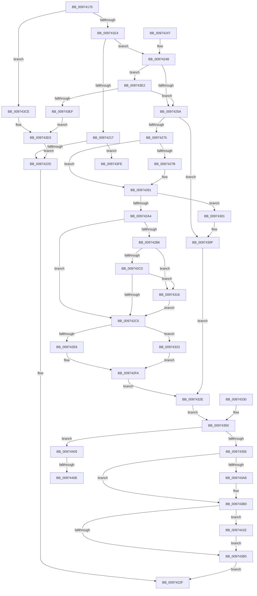

# NtPrivilegeObjectAuditAlarm

- RVA: `0x00974170`–`0x0097442A` (길이 `698` bytes)
- VA: `0x0000000140974170`
- 실행 섹션: `PAGE`
- PDB 이름 있음: `예`; PDB Function 태그: `예`
- unwind 정보 RVA: `0x000963D4`
- 디코드: `179`개 명령, `698/698` bytes 표시
- 미해석 바이트: `0` (있으면 어셈블리에 `.byte`로 보존)

> 이 문서는 커널 이미지의 기계어와 PDB 기호를 분석해 생성했습니다. 4번과 5번은 함수 원형과 자료형을 바이너리 사용 방식에서 추정한 C 해석이며 원본 소스 복구 결과는 아닙니다.

## 1. Dependencies

- 직접 호출 지점: **16**; 고유 호출 대상: **11**
- 직접 호출자로 확인된 함수: **0**
- RIP 상대 이미지 참조: **1**

### Outgoing calls
- `0x009741CB` → [SeCaptureSubjectContext](../86/SeCaptureSubjectContext_function_0086B820.md) (function, `0x0086B820`)
- `0x009741D7` → [SeCheckAuditPrivilege](SeCheckAuditPrivilege_function_00974E48.md) (function, `0x00974E48`)
- `0x0097420C` → [ObReferenceObjectByHandle](../86/ObReferenceObjectByHandle_function_00868DB0.md) (function, `0x00868DB0`)
- `0x0097421C` → [SeReleaseSubjectContext](../86/SeReleaseSubjectContext_function_0086B710.md) (function, `0x0086B710`)
- `0x00974262` → [SepProbeAndCaptureString_U](SepProbeAndCaptureString_U_function_00975070.md) (function, `0x00975070`)
- `0x0097427B` → [ExRaiseDatatypeMisalignment](../89/ExRaiseDatatypeMisalignment_function_00899FD0.md) (function, `0x00899FD0`)
- `0x009742D4` → [ExAllocatePool2](../../poolcode/B8/ExAllocatePool2_function_00B820F0.md) (function, `0x00B820F0`)
- `0x009742EF` → [memcpy](../../text/6C/memcpy_function_006C6840.md) (function, `0x006C6840`)
- `0x0097439C` → [SepAdtPrivilegeObjectAuditAlarm](../86/SepAdtPrivilegeObjectAuditAlarm_function_0086E3F0.md) (function, `0x0086E3F0`)
- `0x009743AB` → [ExFreePoolWithTag](../../poolcode/B8/ExFreePoolWithTag_function_00B82870.md) (function, `0x00B82870`)
- `0x009743BA` → [SeReleaseSubjectContext](../86/SeReleaseSubjectContext_function_0086B710.md) (function, `0x0086B710`)
- `0x009743C2` → [ObfDereferenceObject](../../text/2F/ObfDereferenceObject_function_002F9350.md) (function, `0x002F9350`)
- `0x009743D8` → [SeReleaseSubjectContext](../86/SeReleaseSubjectContext_function_0086B710.md) (function, `0x0086B710`)
- `0x009743F2` → [ObfDereferenceObject](../../text/2F/ObfDereferenceObject_function_002F9350.md) (function, `0x002F9350`)
- `0x00974413` → [ExFreePoolWithTag](../../poolcode/B8/ExFreePoolWithTag_function_00B82870.md) (function, `0x00B82870`)
- `0x00974423` → [ExFreePoolWithTag](../../poolcode/B8/ExFreePoolWithTag_function_00B82870.md) (function, `0x00B82870`)

### Direct callers
- 이 함수 시작 RVA로 연결되는 직접 call은 확인되지 않았습니다. 간접 호출은 완전히 역산할 수 없습니다.

### Static image references
- `0x009741E4` → RVA `0x00FD8020` (`PAGEDATA`; read)

## 2. Other-region calls and transfers

- 다른 실행 섹션으로 향하는 call: **7**
  - `0x009742D4` → [ExAllocatePool2](../../poolcode/B8/ExAllocatePool2_function_00B820F0.md) (`PAGE` → `POOLCODE`)
  - `0x009742EF` → [memcpy](../../text/6C/memcpy_function_006C6840.md) (`PAGE` → `.text`)
  - `0x009743AB` → [ExFreePoolWithTag](../../poolcode/B8/ExFreePoolWithTag_function_00B82870.md) (`PAGE` → `POOLCODE`)
  - `0x009743C2` → [ObfDereferenceObject](../../text/2F/ObfDereferenceObject_function_002F9350.md) (`PAGE` → `.text`)
  - `0x009743F2` → [ObfDereferenceObject](../../text/2F/ObfDereferenceObject_function_002F9350.md) (`PAGE` → `.text`)
  - `0x00974413` → [ExFreePoolWithTag](../../poolcode/B8/ExFreePoolWithTag_function_00B82870.md) (`PAGE` → `POOLCODE`)
  - `0x00974423` → [ExFreePoolWithTag](../../poolcode/B8/ExFreePoolWithTag_function_00B82870.md) (`PAGE` → `POOLCODE`)
- call이 아닌 외부 분기/꼬리 이동: **3**
  - `0x00974400` → [sub_00B297AC + 0x5](../B2/Unknown_function_00B297AC.md) (`tail-transfer`)
  - `0x00974408` → [sub_00B297AC + 0x10](../B2/Unknown_function_00B297AC.md) (`tail-transfer`)
  - `0x00974419` → [sub_00B297AC + 0x10](../B2/Unknown_function_00B297AC.md) (`tail-transfer`)

## 3. Assembly (complete function range)

```asm
00974170  48 8B C4                        mov rax, rsp
00974173  48 89 58 08                     mov qword ptr [rax + 8], rbx
00974177  44 89 48 20                     mov dword ptr [rax + 0x20], r9d
0097417B  48 89 50 10                     mov qword ptr [rax + 0x10], rdx
0097417F  56                              push rsi
00974180  57                              push rdi
00974181  41 54                           push r12
00974183  41 56                           push r14
00974185  41 57                           push r15
00974187  48 81 EC A0 00 00 00            sub rsp, 0xa0
0097418E  45 8B F9                        mov r15d, r9d
00974191  49 8B F0                        mov rsi, r8
00974194  4C 8B E2                        mov r12, rdx
00974197  48 8B F9                        mov rdi, rcx
0097419A  4C 8B B4 24 F0 00 00 00         mov r14, qword ptr [rsp + 0xf0]
009741A2  48 83 60 A8 00                  and qword ptr [rax - 0x58], 0
009741A7  48 83 60 A0 00                  and qword ptr [rax - 0x60], 0
009741AC  0F 57 C0                        xorps xmm0, xmm0
009741AF  0F 11 40 B0                     movups xmmword ptr [rax - 0x50], xmm0
009741B3  0F 11 40 C0                     movups xmmword ptr [rax - 0x40], xmm0
009741B7  65 48 8B 04 25 88 01 00 00      mov rax, qword ptr gs:[0x188]
009741C0  8A 98 32 02 00 00               mov bl, byte ptr [rax + 0x232]
009741C6  48 8D 4C 24 78                  lea rcx, [rsp + 0x78]
009741CB  E8 50 76 EF FF                  call 0x14086b820
009741D0  8A D3                           mov dl, bl
009741D2  48 8D 4C 24 78                  lea rcx, [rsp + 0x78]
009741D7  E8 6C 0C 00 00                  call 0x140974e48
009741DC  84 C0                           test al, al
009741DE  0F 84 EA 01 00 00               je 0x1409743ce
009741E4  4C 8B 05 35 3E 66 00            mov r8, qword ptr [rip + 0x663e35]
009741EB  48 83 64 24 60 00               and qword ptr [rsp + 0x60], 0
009741F1  48 83 64 24 28 00               and qword ptr [rsp + 0x28], 0
009741F7  48 8D 44 24 60                  lea rax, [rsp + 0x60]
009741FC  48 89 44 24 20                  mov qword ptr [rsp + 0x20], rax
00974201  44 8A CB                        mov r9b, bl
00974204  BA 08 00 00 00                  mov edx, 8
00974209  48 8B CE                        mov rcx, rsi
0097420C  E8 9F 4B EF FF                  call 0x140868db0
00974211  8B D8                           mov ebx, eax
00974213  85 C0                           test eax, eax
00974215  79 31                           jns 0x140974248
00974217  48 8D 4C 24 78                  lea rcx, [rsp + 0x78]
0097421C  E8 EF 74 EF FF                  call 0x14086b710
00974221  81 FB 08 00 00 C0               cmp ebx, 0xc0000008
00974227  0F 85 D1 01 00 00               jne 0x1409743fe
0097422D  8B C3                           mov eax, ebx
0097422F  48 8B 9C 24 D0 00 00 00         mov rbx, qword ptr [rsp + 0xd0]
00974237  48 81 C4 A0 00 00 00            add rsp, 0xa0
0097423E  41 5F                           pop r15
00974240  41 5E                           pop r14
00974242  41 5C                           pop r12
00974244  5F                              pop rdi
00974245  5E                              pop rsi
00974246  C3                              ret
00974247  CC                              int3
00974248  48 8B 74 24 60                  mov rsi, qword ptr [rsp + 0x60]
0097424D  83 BE C0 00 00 00 02            cmp dword ptr [rsi + 0xc0], 2
00974254  0F 84 88 01 00 00               je 0x1409743e2
0097425A  48 8D 54 24 70                  lea rdx, [rsp + 0x70]
0097425F  48 8B CF                        mov rcx, rdi
00974262  E8 09 0E 00 00                  call 0x140975070
00974267  8B D8                           mov ebx, eax
00974269  89 44 24 50                     mov dword ptr [rsp + 0x50], eax
0097426D  85 C0                           test eax, eax
0097426F  0F 88 9A 00 00 00               js 0x14097430f
00974275  41 F6 C6 03                     test r14b, 3
00974279  74 06                           je 0x140974281
0097427B  E8 50 5D F2 FF                  call 0x140899fd0
00974280  CC                              int3
00974281  49 B8 00 00 FF FF FF 7F 00 00   movabs r8, 0x7fffffff0000
0097428B  49 8B C0                        mov rax, r8
0097428E  4D 3B F0                        cmp r14, r8
00974291  49 0F 42 C6                     cmovb rax, r14
00974295  90                              nop
00974296  8A 00                           mov al, byte ptr [rax]
00974298  41 8B 1E                        mov ebx, dword ptr [r14]
0097429B  89 5C 24 58                     mov dword ptr [rsp + 0x58], ebx
0097429F  83 FB 43                        cmp ebx, 0x43
009742A2  73 5D                           jae 0x140974301
009742A4  8D 04 5B                        lea eax, [rbx + rbx*2]
009742A7  8D 0C 85 08 00 00 00            lea ecx, [rax*4 + 8]
009742AE  89 4C 24 54                     mov dword ptr [rsp + 0x54], ecx
009742B2  85 C9                           test ecx, ecx
009742B4  74 0F                           je 0x1409742c5
009742B6  8B D1                           mov edx, ecx
009742B8  49 03 D6                        add rdx, r14
009742BB  49 3B D0                        cmp rdx, r8
009742BE  77 56                           ja 0x140974316
009742C0  49 3B D6                        cmp rdx, r14
009742C3  72 51                           jb 0x140974316
009742C5  8B F1                           mov esi, ecx
009742C7  41 B8 53 65 50 72               mov r8d, 0x72506553
009742CD  8B D1                           mov edx, ecx
009742CF  B9 00 01 00 00                  mov ecx, 0x100
009742D4  E8 17 DE 20 00                  call 0x140b820f0
009742D9  48 8B F8                        mov rdi, rax
009742DC  48 89 44 24 68                  mov qword ptr [rsp + 0x68], rax
009742E1  48 85 C0                        test rax, rax
009742E4  74 3D                           je 0x140974323
009742E6  44 8B C6                        mov r8d, esi
009742E9  49 8B D6                        mov rdx, r14
009742EC  48 8B C8                        mov rcx, rax
009742EF  E8 4C 25 D5 FF                  call 0x1406c6840
009742F4  89 1F                           mov dword ptr [rdi], ebx
009742F6  8B 5C 24 50                     mov ebx, dword ptr [rsp + 0x50]
009742FA  48 8B 74 24 60                  mov rsi, qword ptr [rsp + 0x60]
009742FF  EB 2D                           jmp 0x14097432e
00974301  BB 0D 00 00 C0                  mov ebx, 0xc000000d
00974306  89 5C 24 50                     mov dword ptr [rsp + 0x50], ebx
0097430A  48 8B 74 24 60                  mov rsi, qword ptr [rsp + 0x60]
0097430F  48 8B 7C 24 68                  mov rdi, qword ptr [rsp + 0x68]
00974314  EB 18                           jmp 0x14097432e
00974316  41 8A 00                        mov al, byte ptr [r8]
00974319  8B 4C 24 54                     mov ecx, dword ptr [rsp + 0x54]
0097431D  8B 5C 24 58                     mov ebx, dword ptr [rsp + 0x58]
00974321  EB A2                           jmp 0x1409742c5
00974323  BB 9A 00 00 C0                  mov ebx, 0xc000009a
00974328  89 5C 24 50                     mov dword ptr [rsp + 0x50], ebx
0097432C  EB CC                           jmp 0x1409742fa
0097432E  EB 20                           jmp 0x140974350
00974330  8B D8                           mov ebx, eax
00974332  89 44 24 50                     mov dword ptr [rsp + 0x50], eax
00974336  44 8B BC 24 E8 00 00 00         mov r15d, dword ptr [rsp + 0xe8]
0097433E  4C 8B A4 24 D8 00 00 00         mov r12, qword ptr [rsp + 0xd8]
00974346  48 8B 7C 24 68                  mov rdi, qword ptr [rsp + 0x68]
0097434B  48 8B 74 24 60                  mov rsi, qword ptr [rsp + 0x60]
00974350  85 DB                           test ebx, ebx
00974352  0F 88 AD 00 00 00               js 0x140974405
00974358  8A 84 24 F8 00 00 00            mov al, byte ptr [rsp + 0xf8]
0097435F  88 44 24 48                     mov byte ptr [rsp + 0x48], al
00974363  48 89 7C 24 40                  mov qword ptr [rsp + 0x40], rdi
00974368  44 89 7C 24 38                  mov dword ptr [rsp + 0x38], r15d
0097436D  48 8B 84 24 90 00 00 00         mov rax, qword ptr [rsp + 0x90]
00974375  48 89 44 24 30                  mov qword ptr [rsp + 0x30], rax
0097437A  48 8B 84 24 88 00 00 00         mov rax, qword ptr [rsp + 0x88]
00974382  48 89 44 24 28                  mov qword ptr [rsp + 0x28], rax
00974387  48 89 74 24 20                  mov qword ptr [rsp + 0x20], rsi
0097438C  4D 8B CC                        mov r9, r12
0097438F  45 33 C0                        xor r8d, r8d
00974392  33 D2                           xor edx, edx
00974394  48 8B 5C 24 70                  mov rbx, qword ptr [rsp + 0x70]
00974399  48 8B CB                        mov rcx, rbx
0097439C  E8 4F A0 EF FF                  call 0x14086e3f0
009743A1  48 85 FF                        test rdi, rdi
009743A4  74 0A                           je 0x1409743b0
009743A6  33 D2                           xor edx, edx
009743A8  48 8B CF                        mov rcx, rdi
009743AB  E8 C0 E4 20 00                  call 0x140b82870
009743B0  48 85 DB                        test rbx, rbx
009743B3  75 69                           jne 0x14097441e
009743B5  48 8D 4C 24 78                  lea rcx, [rsp + 0x78]
009743BA  E8 51 73 EF FF                  call 0x14086b710
009743BF  48 8B CE                        mov rcx, rsi
009743C2  E8 89 4F 98 FF                  call 0x1402f9350
009743C7  33 C0                           xor eax, eax
009743C9  E9 61 FE FF FF                  jmp 0x14097422f
009743CE  BB 61 00 00 C0                  mov ebx, 0xc0000061
009743D3  48 8D 4C 24 78                  lea rcx, [rsp + 0x78]
009743D8  E8 33 73 EF FF                  call 0x14086b710
009743DD  E9 4B FE FF FF                  jmp 0x14097422d
009743E2  83 BE C4 00 00 00 01            cmp dword ptr [rsi + 0xc4], 1
009743E9  0F 8D 6B FE FF FF               jge 0x14097425a
009743EF  48 8B CE                        mov rcx, rsi
009743F2  E8 59 4F 98 FF                  call 0x1402f9350
009743F7  BB A5 00 00 C0                  mov ebx, 0xc00000a5
009743FC  EB D5                           jmp 0x1409743d3
009743FE  8B CB                           mov ecx, ebx
00974400  E9 AC 53 1B 00                  jmp 0x140b297b1
00974405  48 85 FF                        test rdi, rdi
00974408  0F 84 AE 53 1B 00               je 0x140b297bc
0097440E  33 D2                           xor edx, edx
00974410  48 8B CF                        mov rcx, rdi
00974413  E8 58 E4 20 00                  call 0x140b82870
00974418  90                              nop
00974419  E9 9E 53 1B 00                  jmp 0x140b297bc
0097441E  33 D2                           xor edx, edx
00974420  48 8B CB                        mov rcx, rbx
00974423  E8 48 E4 20 00                  call 0x140b82870
00974428  EB 8B                           jmp 0x1409743b5
```

## 4. C-style interpretation (structured pseudocode)

```c
__int64 __fastcall NtPrivilegeObjectAuditAlarm(__int64 a1, __int64 a2, __int64 a3, int a4, __int64 a5, unsigned __int8 a6)
{
    __int64 result;
    __int64 v_rsp;
    unsigned __int64 v_stack_m50;
    unsigned __int64 v_stack_m68;
    unsigned __int64 v_stack_mA0;
    unsigned __int64 v_stack_mA8;
    unsigned __int64 v_stack_p20;
    unsigned __int64 v_stack_p28;
    unsigned __int64 v_stack_p30;
    unsigned int v_stack_p38;
    unsigned __int64 v_stack_p40;
    unsigned __int8 v_stack_p48;
    unsigned int v_stack_p50;
    unsigned int v_stack_p54;
    unsigned int v_stack_p58;
    unsigned __int64 v_stack_p60;
    unsigned __int64 v_stack_p68;
    unsigned __int64 v_stack_p70;
    unsigned __int64 v_stack_p78;
    unsigned __int64 v_stack_p8;
    unsigned __int64 v_stack_p88;
    unsigned __int64 v_stack_p90;
    unsigned __int64 v_stack_pD8;
    unsigned int v_stack_pE8;

    *(unsigned __int64 *)(v_rsp + 8) = v_rbx;
    *(unsigned int *)(v_rsp + 32) = a4;
    *(unsigned __int64 *)(v_rsp + 16) = a2;
    v_rsp = (v_rsp) - (160);
    *(unsigned __int64 *)(v_rsp - 80) = v_xmm0;
    *(unsigned __int64 *)(v_rsp - 64) = v_xmm0;
    result = SeCaptureSubjectContext(v_stack_m50, a2, a3, a4);
    result = SeCheckAuditPrivilege(v_stack_m50, (unsigned __int8)(*(unsigned __int8 *)(*(unsigned __int64 *)(gs_base + (0 + 392)) + 562)), a3, a4);
    if ((unsigned __int8)(result) == 0) goto loc_009743CE;
    v_stack_mA8 = v_stack_m68;
    result = ObReferenceObjectByHandle(a3, 8, *(unsigned __int64 *)(v_rip + 6700597), (unsigned __int8)(*(unsigned __int8 *)(*(unsigned __int64 *)(gs_base + (0 + 392)) + 562)));
    if (!sign_flag) goto loc_00974248;
    result = SeReleaseSubjectContext(v_stack_m50, 8, *(unsigned __int64 *)(v_rip + 6700597), (unsigned __int8)(*(unsigned __int8 *)(*(unsigned __int64 *)(gs_base + (0 + 392)) + 562)));
    if (((unsigned int)((unsigned int)((unsigned int)(result)))) != 0xC0000008ULL) goto loc_009743FE;
loc_0097422D:
loc_0097422F:
    v_rsp = (v_rsp) + (160);
    return (unsigned int)((unsigned int)((unsigned int)((unsigned int)(result))));
loc_00974248:
    if ((*(unsigned int *)(v_stack_p60 + 192)) == 2) goto loc_009743E2;
loc_0097425A:
    result = SepProbeAndCaptureString_U(a1, v_stack_p70, *(unsigned __int64 *)(v_rip + 6700597), (unsigned __int8)(*(unsigned __int8 *)(*(unsigned __int64 *)(gs_base + (0 + 392)) + 562)));
    v_stack_p50 = (unsigned int)(result);
    if (sign_flag) goto loc_0097430F;
    if ((((unsigned __int8)(a5)) & (3)) != 0) {
        result = ExRaiseDatatypeMisalignment(a1, v_stack_p70, *(unsigned __int64 *)(v_rip + 6700597), (unsigned __int8)(*(unsigned __int8 *)(*(unsigned __int64 *)(gs_base + (0 + 392)) + 562)));
    }
    result = *(unsigned __int64 *)(v_rip + 6700597);
    if (a5 < (*(unsigned __int64 *)(v_rip + 6700597))) { result = a5; }
    v_stack_p58 = (unsigned int)((unsigned int)(*(unsigned int *)(a5)));
    if (((unsigned int)((unsigned int)(*(unsigned int *)(a5)))) >= 67) goto loc_00974301;
    v_stack_p54 = (unsigned int)((unsigned int)(*(unsigned int *)(a5)) + (unsigned int)(*(unsigned int *)(a5)) * 2 * 4 + 8);
    if ((unsigned int)((unsigned int)(*(unsigned int *)(a5)) + (unsigned int)(*(unsigned int *)(a5)) * 2 * 4 + 8) == 0) goto loc_009742C5;
    a2 = ((unsigned int)((unsigned int)((unsigned int)(*(unsigned int *)(a5)) + (unsigned int)(*(unsigned int *)(a5)) * 2 * 4 + 8))) + (a5);
    if (a2 > (*(unsigned __int64 *)(v_rip + 6700597))) goto loc_00974316;
    if (a2 < a5) goto loc_00974316;
loc_009742C5:
    result = ExAllocatePool2(256, (unsigned int)((unsigned int)((unsigned int)(*(unsigned int *)(a5)) + (unsigned int)(*(unsigned int *)(a5)) * 2 * 4 + 8)), (unsigned int)(0x72506553ULL), (unsigned __int8)(*(unsigned __int8 *)(*(unsigned __int64 *)(gs_base + (0 + 392)) + 562)));
    v_stack_p68 = result;
    if (result == 0) goto loc_00974323;
    result = memcpy(result, a5, (unsigned int)((unsigned int)((unsigned int)((unsigned int)((unsigned int)(*(unsigned int *)(a5)) + (unsigned int)(*(unsigned int *)(a5)) * 2 * 4 + 8)))), (unsigned __int8)(*(unsigned __int8 *)(*(unsigned __int64 *)(gs_base + (0 + 392)) + 562)));
    *(unsigned int *)(result) = (unsigned int)((unsigned int)(*(unsigned int *)(a5)));
loc_009742FA:
    goto loc_0097432E;
loc_00974301:
    v_stack_p50 = (unsigned int)((unsigned int)(0xC000000DULL));
loc_0097430F:
    goto loc_0097432E;
loc_00974316:
    goto loc_009742C5;
loc_00974323:
    v_stack_p50 = (unsigned int)((unsigned int)(0xC000009AULL));
    goto loc_009742FA;
loc_0097432E:
    goto loc_00974350;
loc_00974350:
    if (sign_flag) goto loc_00974405;
    v_stack_p48 = a6;
    v_stack_p40 = v_stack_p68;
    v_stack_p38 = (unsigned int)((unsigned int)(a4));
    v_stack_p30 = v_stack_p90;
    v_stack_p28 = v_stack_p88;
    v_stack_p20 = v_stack_p60;
    a3 = 0;
    a2 = 0;
    result = SepAdtPrivilegeObjectAuditAlarm(v_stack_p70, a2, a3, a2);
    if (v_stack_p68 != 0) {
        a2 = 0;
        a1 = v_stack_p68;
        result = ExFreePoolWithTag(a1, a2, a3, a2);
    }
    if (v_stack_p70 != 0) goto loc_0097441E;
loc_009743B5:
    result = SeReleaseSubjectContext(v_stack_p78, a2, a3, a2);
    result = ObfDereferenceObject(v_stack_p60, a2, a3, a2);
    result = 0;
    goto loc_0097422F;
loc_009743CE:
loc_009743D3:
    result = SeReleaseSubjectContext(v_stack_p78, a2, a3, a2);
    goto loc_0097422D;
loc_009743E2:
    if ((*(unsigned int *)(v_stack_p60 + 196)) >= 1) goto loc_0097425A;
    result = ObfDereferenceObject(v_stack_p60, a2, a3, a2);
    goto loc_009743D3;
loc_009743FE:
loc_00974405:
    a2 = 0;
    result = ExFreePoolWithTag(v_stack_p68, a2, a3, a2);
loc_0097441E:
    a2 = 0;
    result = ExFreePoolWithTag((unsigned int)(0xC00000A5ULL), a2, a3, a2);
    goto loc_009743B5;
}
```

## 5. (Beta) C Style

```c
int64_t NtPrivilegeObjectAuditAlarm(int64_t Arg1, int64_t Arg2, int64_t Arg3, int32_t Arg4, int64_t Arg5, uint8_t Arg6)
{
    int64_t result;
    int64_t local_rsp;
    uint64_t v_stack_m50;
    uint64_t v_stack_m68;
    uint64_t v_stack_mA0;
    uint64_t v_stack_mA8;
    uint64_t v_stack_p20;
    uint64_t v_stack_p28;
    uint64_t v_stack_p30;
    uint32_t v_stack_p38;
    uint64_t v_stack_p40;
    uint8_t v_stack_p48;
    uint32_t v_stack_p50;
    uint32_t v_stack_p54;
    uint32_t v_stack_p58;
    uint64_t v_stack_p60;
    uint64_t v_stack_p68;
    uint64_t v_stack_p70;
    uint64_t v_stack_p78;
    uint64_t v_stack_p8;
    uint64_t v_stack_p88;
    uint64_t v_stack_p90;
    uint64_t v_stack_pD8;
    uint32_t v_stack_pE8;

    *(uint64_t *)(local_rsp + 0x8) = local_rbx;
    *(uint32_t *)(local_rsp + 0x20) = Arg4;
    *(uint64_t *)(local_rsp + 0x10) = Arg2;
    local_rsp = (local_rsp) - (160);
    *(uint64_t *)(local_rsp - 0x50) = v_xmm0;
    *(uint64_t *)(local_rsp - 0x40) = v_xmm0;
    result = SeCaptureSubjectContext(v_stack_m50, Arg2, Arg3, Arg4);
    result = SeCheckAuditPrivilege(v_stack_m50, (uint8_t)(*(uint8_t *)(*(uint64_t *)(gs_base + (0 + 0x188)) + 0x232)), Arg3, Arg4);
    if ((uint8_t)(result) == 0) goto loc_009743CE;
    v_stack_mA8 = v_stack_m68;
    result = ObReferenceObjectByHandle(Arg3, 8, *(uint64_t *)(v_rip + 0x663E35), (uint8_t)(*(uint8_t *)(*(uint64_t *)(gs_base + (0 + 0x188)) + 0x232)));
    if (!sign_flag) goto loc_00974248;
    result = SeReleaseSubjectContext(v_stack_m50, 8, *(uint64_t *)(v_rip + 0x663E35), (uint8_t)(*(uint8_t *)(*(uint64_t *)(gs_base + (0 + 0x188)) + 0x232)));
    if (((uint32_t)((uint32_t)((uint32_t)(result)))) != 0xC0000008ULL) goto loc_009743FE;
loc_0097422D:
loc_0097422F:
    local_rsp = (local_rsp) + (160);
    return (uint32_t)((uint32_t)((uint32_t)((uint32_t)(result))));
loc_00974248:
    if ((*(uint32_t *)(v_stack_p60 + 0xC0)) == 2) goto loc_009743E2;
loc_0097425A:
    result = SepProbeAndCaptureString_U(Arg1, v_stack_p70, *(uint64_t *)(v_rip + 0x663E35), (uint8_t)(*(uint8_t *)(*(uint64_t *)(gs_base + (0 + 0x188)) + 0x232)));
    v_stack_p50 = (uint32_t)(result);
    if (sign_flag) goto loc_0097430F;
    if ((((uint8_t)(Arg5)) & (3)) != 0) {
        result = ExRaiseDatatypeMisalignment(Arg1, v_stack_p70, *(uint64_t *)(v_rip + 0x663E35), (uint8_t)(*(uint8_t *)(*(uint64_t *)(gs_base + (0 + 0x188)) + 0x232)));
    }
    result = *(uint64_t *)(v_rip + 0x663E35);
    if (Arg5 < (*(uint64_t *)(v_rip + 0x663E35))) { result = Arg5; }
    v_stack_p58 = (uint32_t)((uint32_t)(*(uint32_t *)(Arg5)));
    if (((uint32_t)((uint32_t)(*(uint32_t *)(Arg5)))) >= 67) goto loc_00974301;
    v_stack_p54 = (uint32_t)((uint32_t)(*(uint32_t *)(Arg5)) + (uint32_t)(*(uint32_t *)(Arg5)) * 2 * 4 + 8);
    if ((uint32_t)((uint32_t)(*(uint32_t *)(Arg5)) + (uint32_t)(*(uint32_t *)(Arg5)) * 2 * 4 + 8) == 0) goto loc_009742C5;
    Arg2 = ((uint32_t)((uint32_t)((uint32_t)(*(uint32_t *)(Arg5)) + (uint32_t)(*(uint32_t *)(Arg5)) * 2 * 4 + 8))) + (Arg5);
    if (Arg2 > (*(uint64_t *)(v_rip + 0x663E35))) goto loc_00974316;
    if (Arg2 < Arg5) goto loc_00974316;
loc_009742C5:
    result = ExAllocatePool2(256, (uint32_t)((uint32_t)((uint32_t)(*(uint32_t *)(Arg5)) + (uint32_t)(*(uint32_t *)(Arg5)) * 2 * 4 + 8)), (uint32_t)(0x72506553ULL), (uint8_t)(*(uint8_t *)(*(uint64_t *)(gs_base + (0 + 0x188)) + 0x232)));
    v_stack_p68 = result;
    if (result == 0) goto loc_00974323;
    result = memcpy(result, Arg5, (uint32_t)((uint32_t)((uint32_t)((uint32_t)((uint32_t)(*(uint32_t *)(Arg5)) + (uint32_t)(*(uint32_t *)(Arg5)) * 2 * 4 + 8)))), (uint8_t)(*(uint8_t *)(*(uint64_t *)(gs_base + (0 + 0x188)) + 0x232)));
    *(uint32_t *)(result) = (uint32_t)((uint32_t)(*(uint32_t *)(Arg5)));
loc_009742FA:
    goto loc_0097432E;
loc_00974301:
    v_stack_p50 = (uint32_t)((uint32_t)(0xC000000DULL));
loc_0097430F:
    goto loc_0097432E;
loc_00974316:
    goto loc_009742C5;
loc_00974323:
    v_stack_p50 = (uint32_t)((uint32_t)(0xC000009AULL));
    goto loc_009742FA;
loc_0097432E:
    goto loc_00974350;
loc_00974350:
    if (sign_flag) goto loc_00974405;
    v_stack_p48 = Arg6;
    v_stack_p40 = v_stack_p68;
    v_stack_p38 = (uint32_t)((uint32_t)(Arg4));
    v_stack_p30 = v_stack_p90;
    v_stack_p28 = v_stack_p88;
    v_stack_p20 = v_stack_p60;
    Arg3 = 0;
    Arg2 = 0;
    result = SepAdtPrivilegeObjectAuditAlarm(v_stack_p70, Arg2, Arg3, Arg2);
    if (v_stack_p68 != 0) {
        Arg2 = 0;
        Arg1 = v_stack_p68;
        result = ExFreePoolWithTag(Arg1, Arg2, Arg3, Arg2);
    }
    if (v_stack_p70 != 0) goto loc_0097441E;
loc_009743B5:
    result = SeReleaseSubjectContext(v_stack_p78, Arg2, Arg3, Arg2);
    result = ObfDereferenceObject(v_stack_p60, Arg2, Arg3, Arg2);
    result = 0;
    goto loc_0097422F;
loc_009743CE:
loc_009743D3:
    result = SeReleaseSubjectContext(v_stack_p78, Arg2, Arg3, Arg2);
    goto loc_0097422D;
loc_009743E2:
    if ((*(uint32_t *)(v_stack_p60 + 0xC4)) >= 1) goto loc_0097425A;
    result = ObfDereferenceObject(v_stack_p60, Arg2, Arg3, Arg2);
    goto loc_009743D3;
loc_009743FE:
loc_00974405:
    Arg2 = 0;
    result = ExFreePoolWithTag(v_stack_p68, Arg2, Arg3, Arg2);
loc_0097441E:
    Arg2 = 0;
    result = ExFreePoolWithTag((uint32_t)(0xC00000A5ULL), Arg2, Arg3, Arg2);
    goto loc_009743B5;
}
```

## 6. Execution-region graph

[열기: 2D/3D 그래프와 함수 탐색 컨트롤 패널](../../../control-panel.html?section=page&rva=0x00974170&view=graph)

- 2D 그래프는 위에서 아래로 흐르고, 3D 그래프는 빈 공간을 드래그해 회전합니다. Shift+드래그는 이동, 휠은 확대·축소, 함수 노드 선택은 대상 보고서 이동입니다.

### Static fallback


