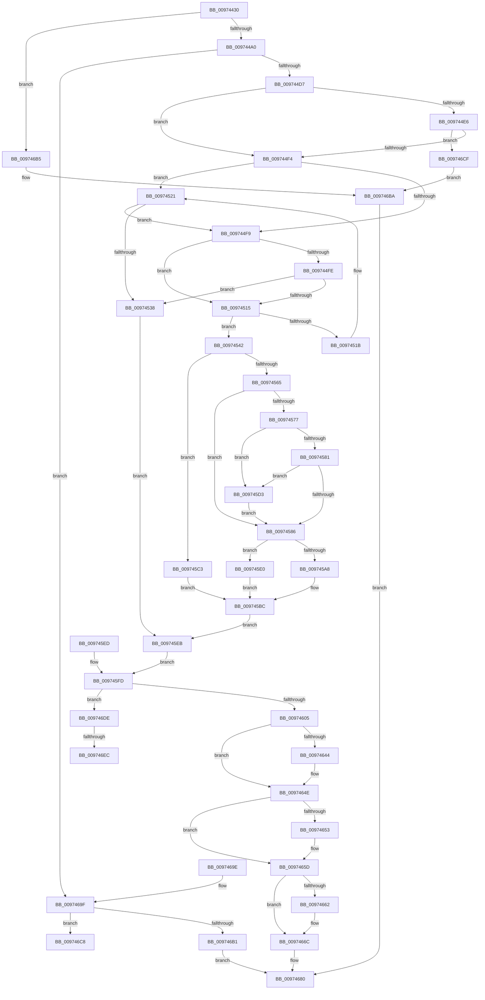

# NtPrivilegedServiceAuditAlarm

- RVA: `0x00974430`–`0x009746F9` (길이 `713` bytes)
- VA: `0x0000000140974430`
- 실행 섹션: `PAGE`
- PDB 이름 있음: `예`; PDB Function 태그: `예`
- unwind 정보 RVA: `0x00096418`
- 디코드: `192`개 명령, `713/713` bytes 표시
- 미해석 바이트: `0` (있으면 어셈블리에 `.byte`로 보존)

> 이 문서는 커널 이미지의 기계어와 PDB 기호를 분석해 생성했습니다. 4번과 5번은 함수 원형과 자료형을 바이너리 사용 방식에서 추정한 C 해석이며 원본 소스 복구 결과는 아닙니다.

## 1. Dependencies

- 직접 호출 지점: **18**; 고유 호출 대상: **11**
- 직접 호출자로 확인된 함수: **0**
- RIP 상대 이미지 참조: **1**

### Outgoing calls
- `0x00974486` → [SeCaptureSubjectContext](../86/SeCaptureSubjectContext_function_0086B820.md) (function, `0x0086B820`)
- `0x00974493` → [SeCheckAuditPrivilege](SeCheckAuditPrivilege_function_00974E48.md) (function, `0x00974E48`)
- `0x009744C4` → [ObReferenceObjectByHandle](../86/ObReferenceObjectByHandle_function_00868DB0.md) (function, `0x00868DB0`)
- `0x00974506` → [SepProbeAndCaptureString_U](SepProbeAndCaptureString_U_function_00975070.md) (function, `0x00975070`)
- `0x0097451B` → [ExRaiseDatatypeMisalignment](../89/ExRaiseDatatypeMisalignment_function_00899FD0.md) (function, `0x00899FD0`)
- `0x00974529` → [SepProbeAndCaptureString_U](SepProbeAndCaptureString_U_function_00975070.md) (function, `0x00975070`)
- `0x00974596` → [ExAllocatePool2](../../poolcode/B8/ExAllocatePool2_function_00B820F0.md) (function, `0x00B820F0`)
- `0x009745B1` → [memcpy](../../text/6C/memcpy_function_006C6840.md) (function, `0x006C6840`)
- `0x0097463A` → [SepAdtPrivilegedServiceAuditAlarm](../87/SepAdtPrivilegedServiceAuditAlarm_function_008714F0.md) (function, `0x008714F0`)
- `0x00974649` → [ExFreePoolWithTag](../../poolcode/B8/ExFreePoolWithTag_function_00B82870.md) (function, `0x00B82870`)
- `0x00974658` → [ExFreePoolWithTag](../../poolcode/B8/ExFreePoolWithTag_function_00B82870.md) (function, `0x00B82870`)
- `0x00974667` → [ExFreePoolWithTag](../../poolcode/B8/ExFreePoolWithTag_function_00B82870.md) (function, `0x00B82870`)
- `0x0097466F` → [ObfDereferenceObject](../../text/2F/ObfDereferenceObject_function_002F9350.md) (function, `0x002F9350`)
- `0x00974679` → [SeReleaseSubjectContext](../86/SeReleaseSubjectContext_function_0086B710.md) (function, `0x0086B710`)
- `0x009746A4` → [SeReleaseSubjectContext](../86/SeReleaseSubjectContext_function_0086B710.md) (function, `0x0086B710`)
- `0x009746BF` → [SeReleaseSubjectContext](../86/SeReleaseSubjectContext_function_0086B710.md) (function, `0x0086B710`)
- `0x009746D2` → [ObfDereferenceObject](../../text/2F/ObfDereferenceObject_function_002F9350.md) (function, `0x002F9350`)
- `0x009746EE` → [ExFreePoolWithTag](../../poolcode/B8/ExFreePoolWithTag_function_00B82870.md) (function, `0x00B82870`)

### Direct callers
- 이 함수 시작 RVA로 연결되는 직접 call은 확인되지 않았습니다. 간접 호출은 완전히 역산할 수 없습니다.

### Static image references
- `0x009744A0` → RVA `0x00FD8020` (`PAGEDATA`; read)

## 2. Other-region calls and transfers

- 다른 실행 섹션으로 향하는 call: **8**
  - `0x00974596` → [ExAllocatePool2](../../poolcode/B8/ExAllocatePool2_function_00B820F0.md) (`PAGE` → `POOLCODE`)
  - `0x009745B1` → [memcpy](../../text/6C/memcpy_function_006C6840.md) (`PAGE` → `.text`)
  - `0x00974649` → [ExFreePoolWithTag](../../poolcode/B8/ExFreePoolWithTag_function_00B82870.md) (`PAGE` → `POOLCODE`)
  - `0x00974658` → [ExFreePoolWithTag](../../poolcode/B8/ExFreePoolWithTag_function_00B82870.md) (`PAGE` → `POOLCODE`)
  - `0x00974667` → [ExFreePoolWithTag](../../poolcode/B8/ExFreePoolWithTag_function_00B82870.md) (`PAGE` → `POOLCODE`)
  - `0x0097466F` → [ObfDereferenceObject](../../text/2F/ObfDereferenceObject_function_002F9350.md) (`PAGE` → `.text`)
  - `0x009746D2` → [ObfDereferenceObject](../../text/2F/ObfDereferenceObject_function_002F9350.md) (`PAGE` → `.text`)
  - `0x009746EE` → [ExFreePoolWithTag](../../poolcode/B8/ExFreePoolWithTag_function_00B82870.md) (`PAGE` → `POOLCODE`)
- call이 아닌 외부 분기/꼬리 이동: **3**
  - `0x009746CA` → [sub_00B297EE + 0x5](../B2/Unknown_function_00B297EE.md) (`tail-transfer`)
  - `0x009746E6` → [sub_00B297EE + 0x10](../B2/Unknown_function_00B297EE.md) (`tail-transfer`)
  - `0x009746F4` → [sub_00B297EE + 0x10](../B2/Unknown_function_00B297EE.md) (`tail-transfer`)

## 3. Assembly (complete function range)

```asm
00974430  48 8B C4                        mov rax, rsp
00974433  48 89 58 08                     mov qword ptr [rax + 8], rbx
00974437  48 89 70 10                     mov qword ptr [rax + 0x10], rsi
0097443B  48 89 78 18                     mov qword ptr [rax + 0x18], rdi
0097443F  41 54                           push r12
00974441  41 56                           push r14
00974443  41 57                           push r15
00974445  48 81 EC 90 00 00 00            sub rsp, 0x90
0097444C  4D 8B F9                        mov r15, r9
0097444F  4D 8B F0                        mov r14, r8
00974452  48 8B F2                        mov rsi, rdx
00974455  4C 8B E1                        mov r12, rcx
00974458  33 DB                           xor ebx, ebx
0097445A  48 89 58 A8                     mov qword ptr [rax - 0x58], rbx
0097445E  0F 57 C0                        xorps xmm0, xmm0
00974461  0F 11 40 C8                     movups xmmword ptr [rax - 0x38], xmm0
00974465  0F 11 40 D8                     movups xmmword ptr [rax - 0x28], xmm0
00974469  48 89 58 C0                     mov qword ptr [rax - 0x40], rbx
0097446D  48 89 58 B8                     mov qword ptr [rax - 0x48], rbx
00974471  65 48 8B 04 25 88 01 00 00      mov rax, qword ptr gs:[0x188]
0097447A  40 8A B8 32 02 00 00            mov dil, byte ptr [rax + 0x232]
00974481  48 8D 4C 24 70                  lea rcx, [rsp + 0x70]
00974486  E8 95 73 EF FF                  call 0x14086b820
0097448B  40 8A D7                        mov dl, dil
0097448E  48 8D 4C 24 70                  lea rcx, [rsp + 0x70]
00974493  E8 B0 09 00 00                  call 0x140974e48
00974498  84 C0                           test al, al
0097449A  0F 84 15 02 00 00               je 0x1409746b5
009744A0  4C 8B 05 79 3B 66 00            mov r8, qword ptr [rip + 0x663b79]
009744A7  48 89 5C 24 48                  mov qword ptr [rsp + 0x48], rbx
009744AC  48 89 5C 24 28                  mov qword ptr [rsp + 0x28], rbx
009744B1  48 8D 44 24 48                  lea rax, [rsp + 0x48]
009744B6  48 89 44 24 20                  mov qword ptr [rsp + 0x20], rax
009744BB  44 8A CF                        mov r9b, dil
009744BE  8D 53 08                        lea edx, [rbx + 8]
009744C1  49 8B CE                        mov rcx, r14
009744C4  E8 E7 48 EF FF                  call 0x140868db0
009744C9  8B F8                           mov edi, eax
009744CB  89 44 24 40                     mov dword ptr [rsp + 0x40], eax
009744CF  85 C0                           test eax, eax
009744D1  0F 88 C8 01 00 00               js 0x14097469f
009744D7  4C 8B 74 24 48                  mov r14, qword ptr [rsp + 0x48]
009744DC  41 83 BE C0 00 00 00 02         cmp dword ptr [r14 + 0xc0], 2
009744E4  75 0E                           jne 0x1409744f4
009744E6  41 83 BE C4 00 00 00 01         cmp dword ptr [r14 + 0xc4], 1
009744EE  0F 8C DB 01 00 00               jl 0x1409746cf
009744F4  4D 85 E4                        test r12, r12
009744F7  75 28                           jne 0x140974521
009744F9  48 85 F6                        test rsi, rsi
009744FC  74 17                           je 0x140974515
009744FE  48 8D 54 24 60                  lea rdx, [rsp + 0x60]
00974503  48 8B CE                        mov rcx, rsi
00974506  E8 65 0B 00 00                  call 0x140975070
0097450B  8B F8                           mov edi, eax
0097450D  89 44 24 40                     mov dword ptr [rsp + 0x40], eax
00974511  85 C0                           test eax, eax
00974513  78 23                           js 0x140974538
00974515  41 F6 C7 03                     test r15b, 3
00974519  74 27                           je 0x140974542
0097451B  E8 B0 5A F2 FF                  call 0x140899fd0
00974520  CC                              int3
00974521  48 8D 54 24 68                  lea rdx, [rsp + 0x68]
00974526  49 8B CC                        mov rcx, r12
00974529  E8 42 0B 00 00                  call 0x140975070
0097452E  8B F8                           mov edi, eax
00974530  89 44 24 40                     mov dword ptr [rsp + 0x40], eax
00974534  85 C0                           test eax, eax
00974536  79 C1                           jns 0x1409744f9
00974538  48 8B 74 24 50                  mov rsi, qword ptr [rsp + 0x50]
0097453D  E9 A9 00 00 00                  jmp 0x1409745eb
00974542  49 B8 00 00 FF FF FF 7F 00 00   movabs r8, 0x7fffffff0000
0097454C  49 8B C0                        mov rax, r8
0097454F  4D 3B F8                        cmp r15, r8
00974552  49 0F 42 C7                     cmovb rax, r15
00974556  90                              nop
00974557  8A 00                           mov al, byte ptr [rax]
00974559  41 8B 3F                        mov edi, dword ptr [r15]
0097455C  89 7C 24 5C                     mov dword ptr [rsp + 0x5c], edi
00974560  83 FF 43                        cmp edi, 0x43
00974563  73 5E                           jae 0x1409745c3
00974565  8D 04 7F                        lea eax, [rdi + rdi*2]
00974568  8D 0C 85 08 00 00 00            lea ecx, [rax*4 + 8]
0097456F  89 4C 24 58                     mov dword ptr [rsp + 0x58], ecx
00974573  85 C9                           test ecx, ecx
00974575  74 0F                           je 0x140974586
00974577  8B D1                           mov edx, ecx
00974579  49 03 D7                        add rdx, r15
0097457C  49 3B D0                        cmp rdx, r8
0097457F  77 52                           ja 0x1409745d3
00974581  49 3B D7                        cmp rdx, r15
00974584  72 4D                           jb 0x1409745d3
00974586  44 8B F1                        mov r14d, ecx
00974589  41 B8 53 65 50 72               mov r8d, 0x72506553
0097458F  8B D1                           mov edx, ecx
00974591  B9 00 01 00 00                  mov ecx, 0x100
00974596  E8 55 DB 20 00                  call 0x140b820f0
0097459B  48 8B F0                        mov rsi, rax
0097459E  48 89 44 24 50                  mov qword ptr [rsp + 0x50], rax
009745A3  48 85 C0                        test rax, rax
009745A6  74 38                           je 0x1409745e0
009745A8  45 8B C6                        mov r8d, r14d
009745AB  49 8B D7                        mov rdx, r15
009745AE  48 8B C8                        mov rcx, rax
009745B1  E8 8A 22 D5 FF                  call 0x1406c6840
009745B6  89 3E                           mov dword ptr [rsi], edi
009745B8  8B 7C 24 40                     mov edi, dword ptr [rsp + 0x40]
009745BC  4C 8B 74 24 48                  mov r14, qword ptr [rsp + 0x48]
009745C1  EB 28                           jmp 0x1409745eb
009745C3  BF 0D 00 00 C0                  mov edi, 0xc000000d
009745C8  89 7C 24 40                     mov dword ptr [rsp + 0x40], edi
009745CC  48 8B 74 24 50                  mov rsi, qword ptr [rsp + 0x50]
009745D1  EB E9                           jmp 0x1409745bc
009745D3  41 8A 00                        mov al, byte ptr [r8]
009745D6  8B 4C 24 58                     mov ecx, dword ptr [rsp + 0x58]
009745DA  8B 7C 24 5C                     mov edi, dword ptr [rsp + 0x5c]
009745DE  EB A6                           jmp 0x140974586
009745E0  BF 9A 00 00 C0                  mov edi, 0xc000009a
009745E5  89 7C 24 40                     mov dword ptr [rsp + 0x40], edi
009745E9  EB D1                           jmp 0x1409745bc
009745EB  EB 10                           jmp 0x1409745fd
009745ED  8B F8                           mov edi, eax
009745EF  89 44 24 40                     mov dword ptr [rsp + 0x40], eax
009745F3  48 8B 74 24 50                  mov rsi, qword ptr [rsp + 0x50]
009745F8  4C 8B 74 24 48                  mov r14, qword ptr [rsp + 0x48]
009745FD  85 FF                           test edi, edi
009745FF  0F 88 D9 00 00 00               js 0x1409746de
00974605  8A 84 24 D0 00 00 00            mov al, byte ptr [rsp + 0xd0]
0097460C  88 44 24 30                     mov byte ptr [rsp + 0x30], al
00974610  48 89 74 24 28                  mov qword ptr [rsp + 0x28], rsi
00974615  48 8B 84 24 80 00 00 00         mov rax, qword ptr [rsp + 0x80]
0097461D  48 89 44 24 20                  mov qword ptr [rsp + 0x20], rax
00974622  4D 8B CE                        mov r9, r14
00974625  48 8B 7C 24 60                  mov rdi, qword ptr [rsp + 0x60]
0097462A  4C 8B C7                        mov r8, rdi
0097462D  4C 8B 7C 24 68                  mov r15, qword ptr [rsp + 0x68]
00974632  49 8B D7                        mov rdx, r15
00974635  48 8D 4C 24 70                  lea rcx, [rsp + 0x70]
0097463A  E8 B1 CE EF FF                  call 0x1408714f0
0097463F  4D 85 FF                        test r15, r15
00974642  74 0A                           je 0x14097464e
00974644  33 D2                           xor edx, edx
00974646  49 8B CF                        mov rcx, r15
00974649  E8 22 E2 20 00                  call 0x140b82870
0097464E  48 85 FF                        test rdi, rdi
00974651  74 0A                           je 0x14097465d
00974653  33 D2                           xor edx, edx
00974655  48 8B CF                        mov rcx, rdi
00974658  E8 13 E2 20 00                  call 0x140b82870
0097465D  48 85 F6                        test rsi, rsi
00974660  74 0A                           je 0x14097466c
00974662  33 D2                           xor edx, edx
00974664  48 8B CE                        mov rcx, rsi
00974667  E8 04 E2 20 00                  call 0x140b82870
0097466C  49 8B CE                        mov rcx, r14
0097466F  E8 DC 4C 98 FF                  call 0x1402f9350
00974674  48 8D 4C 24 70                  lea rcx, [rsp + 0x70]
00974679  E8 92 70 EF FF                  call 0x14086b710
0097467E  33 C0                           xor eax, eax
00974680  4C 8D 9C 24 90 00 00 00         lea r11, [rsp + 0x90]
00974688  49 8B 5B 20                     mov rbx, qword ptr [r11 + 0x20]
0097468C  49 8B 73 28                     mov rsi, qword ptr [r11 + 0x28]
00974690  49 8B 7B 30                     mov rdi, qword ptr [r11 + 0x30]
00974694  49 8B E3                        mov rsp, r11
00974697  41 5F                           pop r15
00974699  41 5E                           pop r14
0097469B  41 5C                           pop r12
0097469D  C3                              ret
0097469E  CC                              int3
0097469F  48 8D 4C 24 70                  lea rcx, [rsp + 0x70]
009746A4  E8 67 70 EF FF                  call 0x14086b710
009746A9  81 FF 08 00 00 C0               cmp edi, 0xc0000008
009746AF  75 17                           jne 0x1409746c8
009746B1  8B C7                           mov eax, edi
009746B3  EB CB                           jmp 0x140974680
009746B5  BB 61 00 00 C0                  mov ebx, 0xc0000061
009746BA  48 8D 4C 24 70                  lea rcx, [rsp + 0x70]
009746BF  E8 4C 70 EF FF                  call 0x14086b710
009746C4  8B C3                           mov eax, ebx
009746C6  EB B8                           jmp 0x140974680
009746C8  8B CF                           mov ecx, edi
009746CA  E9 24 51 1B 00                  jmp 0x140b297f3
009746CF  49 8B CE                        mov rcx, r14
009746D2  E8 79 4C 98 FF                  call 0x1402f9350
009746D7  BB A5 00 00 C0                  mov ebx, 0xc00000a5
009746DC  EB DC                           jmp 0x1409746ba
009746DE  48 8B 4C 24 68                  mov rcx, qword ptr [rsp + 0x68]
009746E3  48 85 C9                        test rcx, rcx
009746E6  0F 84 12 51 1B 00               je 0x140b297fe
009746EC  33 D2                           xor edx, edx
009746EE  E8 7D E1 20 00                  call 0x140b82870
009746F3  90                              nop
009746F4  E9 05 51 1B 00                  jmp 0x140b297fe
```

## 4. C-style interpretation (structured pseudocode)

```c
__int64 __fastcall NtPrivilegedServiceAuditAlarm(__int64 a1, __int64 a2, __int64 a3, __int64 a4, unsigned __int8 a5)
{
    __int64 result;
    __int64 v_rbx;
    __int64 v_rsp;
    unsigned __int64 v_stack_m18;
    unsigned __int64 v_stack_m20;
    unsigned __int64 v_stack_m28;
    unsigned __int64 v_stack_m38;
    unsigned __int64 v_stack_m40;
    unsigned __int64 v_stack_m48;
    unsigned int v_stack_m4C;
    unsigned int v_stack_m50;
    unsigned __int64 v_stack_m58;
    unsigned __int64 v_stack_m60;
    unsigned int v_stack_m68;
    unsigned __int8 v_stack_m78;
    unsigned __int64 v_stack_m80;
    unsigned __int64 v_stack_m88;

    *(unsigned __int64 *)(v_rsp + 8) = v_rbx;
    *(unsigned __int64 *)(v_rsp + 16) = v_rsi;
    *(unsigned __int64 *)(v_rsp + 24) = v_rdi;
    v_rsp = (v_rsp) - (144);
    v_rbx = 0;
    *(unsigned __int64 *)(v_rsp - 88) = 0;
    *(unsigned __int64 *)(v_rsp - 56) = v_xmm0;
    *(unsigned __int64 *)(v_rsp - 40) = v_xmm0;
    *(unsigned __int64 *)(v_rsp - 64) = 0;
    *(unsigned __int64 *)(v_rsp - 72) = 0;
    result = SeCaptureSubjectContext(v_stack_m38, a2, a3, a4);
    result = SeCheckAuditPrivilege(v_stack_m38, (unsigned __int8)(*(unsigned __int8 *)(*(unsigned __int64 *)(gs_base + (0 + 392)) + 562)), a3, a4);
    if ((unsigned __int8)(result) == 0) goto loc_009746B5;
    v_stack_m60 = 0;
    v_stack_m80 = 0;
    v_stack_m88 = v_stack_m60;
    result = ObReferenceObjectByHandle(a3, v_rbx + 8, *(unsigned __int64 *)(v_rip + 6699897), (unsigned __int8)(*(unsigned __int8 *)(*(unsigned __int64 *)(gs_base + (0 + 392)) + 562)));
    v_stack_m68 = (unsigned int)(result);
    if (sign_flag) goto loc_0097469F;
    if ((*(unsigned int *)(v_stack_m60 + 192)) != 2) goto loc_009744F4;
    if ((*(unsigned int *)(v_stack_m60 + 196)) < 1) goto loc_009746CF;
loc_009744F4:
    if (a1 != 0) goto loc_00974521;
loc_009744F9:
    if (a2 == 0) goto loc_00974515;
    result = SepProbeAndCaptureString_U(a2, v_stack_m48, *(unsigned __int64 *)(v_rip + 6699897), (unsigned __int8)(*(unsigned __int8 *)(*(unsigned __int64 *)(gs_base + (0 + 392)) + 562)));
    v_stack_m68 = (unsigned int)(result);
    if (sign_flag) goto loc_00974538;
loc_00974515:
    if ((((unsigned __int8)(a4)) & (3)) == 0) goto loc_00974542;
    result = ExRaiseDatatypeMisalignment(a2, v_stack_m48, *(unsigned __int64 *)(v_rip + 6699897), (unsigned __int8)(*(unsigned __int8 *)(*(unsigned __int64 *)(gs_base + (0 + 392)) + 562)));
loc_00974521:
    result = SepProbeAndCaptureString_U(a1, v_stack_m40, *(unsigned __int64 *)(v_rip + 6699897), (unsigned __int8)(*(unsigned __int8 *)(*(unsigned __int64 *)(gs_base + (0 + 392)) + 562)));
    v_stack_m68 = (unsigned int)(result);
    if (!sign_flag) goto loc_009744F9;
loc_00974538:
    goto loc_009745EB;
loc_00974542:
    result = *(unsigned __int64 *)(v_rip + 6699897);
    if (a4 < (*(unsigned __int64 *)(v_rip + 6699897))) { result = a4; }
    v_stack_m4C = (unsigned int)((unsigned int)(*(unsigned int *)(a4)));
    if (((unsigned int)((unsigned int)(*(unsigned int *)(a4)))) >= 67) goto loc_009745C3;
    v_stack_m50 = (unsigned int)((unsigned int)(*(unsigned int *)(a4)) + (unsigned int)(*(unsigned int *)(a4)) * 2 * 4 + 8);
    if ((unsigned int)((unsigned int)(*(unsigned int *)(a4)) + (unsigned int)(*(unsigned int *)(a4)) * 2 * 4 + 8) == 0) goto loc_00974586;
    a2 = ((unsigned int)((unsigned int)((unsigned int)(*(unsigned int *)(a4)) + (unsigned int)(*(unsigned int *)(a4)) * 2 * 4 + 8))) + (a4);
    if (a2 > (*(unsigned __int64 *)(v_rip + 6699897))) goto loc_009745D3;
    if (a2 < a4) goto loc_009745D3;
loc_00974586:
    result = ExAllocatePool2(256, (unsigned int)((unsigned int)((unsigned int)(*(unsigned int *)(a4)) + (unsigned int)(*(unsigned int *)(a4)) * 2 * 4 + 8)), (unsigned int)(0x72506553ULL), (unsigned __int8)(*(unsigned __int8 *)(*(unsigned __int64 *)(gs_base + (0 + 392)) + 562)));
    v_stack_m58 = result;
    if (result == 0) goto loc_009745E0;
    result = memcpy(result, a4, (unsigned int)((unsigned int)((unsigned int)((unsigned int)((unsigned int)(*(unsigned int *)(a4)) + (unsigned int)(*(unsigned int *)(a4)) * 2 * 4 + 8)))), (unsigned __int8)(*(unsigned __int8 *)(*(unsigned __int64 *)(gs_base + (0 + 392)) + 562)));
    *(unsigned int *)(result) = (unsigned int)((unsigned int)(*(unsigned int *)(a4)));
loc_009745BC:
    goto loc_009745EB;
loc_009745C3:
    v_stack_m68 = (unsigned int)((unsigned int)(0xC000000DULL));
    goto loc_009745BC;
loc_009745D3:
    goto loc_00974586;
loc_009745E0:
    v_stack_m68 = (unsigned int)((unsigned int)(0xC000009AULL));
    goto loc_009745BC;
loc_009745EB:
    goto loc_009745FD;
loc_009745FD:
    if (sign_flag) goto loc_009746DE;
    v_stack_m78 = a5;
    v_stack_m80 = v_stack_m58;
    v_stack_m88 = v_stack_m28;
    result = SepAdtPrivilegedServiceAuditAlarm(v_stack_m38, v_stack_m40, v_stack_m48, v_stack_m60);
    if (v_stack_m40 != 0) {
        a2 = 0;
        a1 = v_stack_m40;
        result = ExFreePoolWithTag(a1, a2, v_stack_m48, v_stack_m60);
    }
    if (v_stack_m48 != 0) {
        a2 = 0;
        a1 = v_stack_m48;
        result = ExFreePoolWithTag(a1, a2, v_stack_m48, v_stack_m60);
    }
    if (v_stack_m58 != 0) {
        a2 = 0;
        a1 = v_stack_m58;
        result = ExFreePoolWithTag(a1, a2, v_stack_m48, v_stack_m60);
    }
    result = ObfDereferenceObject(v_stack_m60, a2, v_stack_m48, v_stack_m60);
    result = SeReleaseSubjectContext(v_stack_m38, a2, v_stack_m48, v_stack_m60);
    result = 0;
loc_00974680:
    return result;
loc_0097469F:
    result = SeReleaseSubjectContext(v_stack_m20, a2, v_stack_m48, v_stack_m60);
    if (((unsigned int)(*(unsigned __int64 *)(v_stack_m18 + 48))) != 0xC0000008ULL) goto loc_009746C8;
    goto loc_00974680;
loc_009746B5:
loc_009746BA:
    result = SeReleaseSubjectContext(v_stack_m20, a2, v_stack_m48, v_stack_m60);
    goto loc_00974680;
loc_009746C8:
loc_009746CF:
    result = ObfDereferenceObject(v_stack_m60, a2, v_stack_m48, v_stack_m60);
    goto loc_009746BA;
loc_009746DE:
    a2 = 0;
    result = ExFreePoolWithTag(v_stack_m28, a2, v_stack_m48, v_stack_m60);
}
```

## 5. (Beta) C Style

```c
int64_t NtPrivilegedServiceAuditAlarm(int64_t Arg1, int64_t Arg2, int64_t Arg3, int64_t Arg4, uint8_t Arg5)
{
    int64_t result;
    int64_t local_rbx;
    int64_t local_rsp;
    uint64_t v_stack_m18;
    uint64_t v_stack_m20;
    uint64_t v_stack_m28;
    uint64_t v_stack_m38;
    uint64_t v_stack_m40;
    uint64_t v_stack_m48;
    uint32_t v_stack_m4C;
    uint32_t v_stack_m50;
    uint64_t v_stack_m58;
    uint64_t v_stack_m60;
    uint32_t v_stack_m68;
    uint8_t v_stack_m78;
    uint64_t v_stack_m80;
    uint64_t v_stack_m88;

    *(uint64_t *)(local_rsp + 0x8) = local_rbx;
    *(uint64_t *)(local_rsp + 0x10) = local_rsi;
    *(uint64_t *)(local_rsp + 0x18) = local_rdi;
    local_rsp = (local_rsp) - (144);
    local_rbx = 0;
    *(uint64_t *)(local_rsp - 0x58) = 0;
    *(uint64_t *)(local_rsp - 0x38) = v_xmm0;
    *(uint64_t *)(local_rsp - 0x28) = v_xmm0;
    *(uint64_t *)(local_rsp - 0x40) = 0;
    *(uint64_t *)(local_rsp - 0x48) = 0;
    result = SeCaptureSubjectContext(v_stack_m38, Arg2, Arg3, Arg4);
    result = SeCheckAuditPrivilege(v_stack_m38, (uint8_t)(*(uint8_t *)(*(uint64_t *)(gs_base + (0 + 0x188)) + 0x232)), Arg3, Arg4);
    if ((uint8_t)(result) == 0) goto loc_009746B5;
    v_stack_m60 = 0;
    v_stack_m80 = 0;
    v_stack_m88 = v_stack_m60;
    result = ObReferenceObjectByHandle(Arg3, local_rbx + 8, *(uint64_t *)(v_rip + 0x663B79), (uint8_t)(*(uint8_t *)(*(uint64_t *)(gs_base + (0 + 0x188)) + 0x232)));
    v_stack_m68 = (uint32_t)(result);
    if (sign_flag) goto loc_0097469F;
    if ((*(uint32_t *)(v_stack_m60 + 0xC0)) != 2) goto loc_009744F4;
    if ((*(uint32_t *)(v_stack_m60 + 0xC4)) < 1) goto loc_009746CF;
loc_009744F4:
    if (Arg1 != 0) goto loc_00974521;
loc_009744F9:
    if (Arg2 == 0) goto loc_00974515;
    result = SepProbeAndCaptureString_U(Arg2, v_stack_m48, *(uint64_t *)(v_rip + 0x663B79), (uint8_t)(*(uint8_t *)(*(uint64_t *)(gs_base + (0 + 0x188)) + 0x232)));
    v_stack_m68 = (uint32_t)(result);
    if (sign_flag) goto loc_00974538;
loc_00974515:
    if ((((uint8_t)(Arg4)) & (3)) == 0) goto loc_00974542;
    result = ExRaiseDatatypeMisalignment(Arg2, v_stack_m48, *(uint64_t *)(v_rip + 0x663B79), (uint8_t)(*(uint8_t *)(*(uint64_t *)(gs_base + (0 + 0x188)) + 0x232)));
loc_00974521:
    result = SepProbeAndCaptureString_U(Arg1, v_stack_m40, *(uint64_t *)(v_rip + 0x663B79), (uint8_t)(*(uint8_t *)(*(uint64_t *)(gs_base + (0 + 0x188)) + 0x232)));
    v_stack_m68 = (uint32_t)(result);
    if (!sign_flag) goto loc_009744F9;
loc_00974538:
    goto loc_009745EB;
loc_00974542:
    result = *(uint64_t *)(v_rip + 0x663B79);
    if (Arg4 < (*(uint64_t *)(v_rip + 0x663B79))) { result = Arg4; }
    v_stack_m4C = (uint32_t)((uint32_t)(*(uint32_t *)(Arg4)));
    if (((uint32_t)((uint32_t)(*(uint32_t *)(Arg4)))) >= 67) goto loc_009745C3;
    v_stack_m50 = (uint32_t)((uint32_t)(*(uint32_t *)(Arg4)) + (uint32_t)(*(uint32_t *)(Arg4)) * 2 * 4 + 8);
    if ((uint32_t)((uint32_t)(*(uint32_t *)(Arg4)) + (uint32_t)(*(uint32_t *)(Arg4)) * 2 * 4 + 8) == 0) goto loc_00974586;
    Arg2 = ((uint32_t)((uint32_t)((uint32_t)(*(uint32_t *)(Arg4)) + (uint32_t)(*(uint32_t *)(Arg4)) * 2 * 4 + 8))) + (Arg4);
    if (Arg2 > (*(uint64_t *)(v_rip + 0x663B79))) goto loc_009745D3;
    if (Arg2 < Arg4) goto loc_009745D3;
loc_00974586:
    result = ExAllocatePool2(256, (uint32_t)((uint32_t)((uint32_t)(*(uint32_t *)(Arg4)) + (uint32_t)(*(uint32_t *)(Arg4)) * 2 * 4 + 8)), (uint32_t)(0x72506553ULL), (uint8_t)(*(uint8_t *)(*(uint64_t *)(gs_base + (0 + 0x188)) + 0x232)));
    v_stack_m58 = result;
    if (result == 0) goto loc_009745E0;
    result = memcpy(result, Arg4, (uint32_t)((uint32_t)((uint32_t)((uint32_t)((uint32_t)(*(uint32_t *)(Arg4)) + (uint32_t)(*(uint32_t *)(Arg4)) * 2 * 4 + 8)))), (uint8_t)(*(uint8_t *)(*(uint64_t *)(gs_base + (0 + 0x188)) + 0x232)));
    *(uint32_t *)(result) = (uint32_t)((uint32_t)(*(uint32_t *)(Arg4)));
loc_009745BC:
    goto loc_009745EB;
loc_009745C3:
    v_stack_m68 = (uint32_t)((uint32_t)(0xC000000DULL));
    goto loc_009745BC;
loc_009745D3:
    goto loc_00974586;
loc_009745E0:
    v_stack_m68 = (uint32_t)((uint32_t)(0xC000009AULL));
    goto loc_009745BC;
loc_009745EB:
    goto loc_009745FD;
loc_009745FD:
    if (sign_flag) goto loc_009746DE;
    v_stack_m78 = Arg5;
    v_stack_m80 = v_stack_m58;
    v_stack_m88 = v_stack_m28;
    result = SepAdtPrivilegedServiceAuditAlarm(v_stack_m38, v_stack_m40, v_stack_m48, v_stack_m60);
    if (v_stack_m40 != 0) {
        Arg2 = 0;
        Arg1 = v_stack_m40;
        result = ExFreePoolWithTag(Arg1, Arg2, v_stack_m48, v_stack_m60);
    }
    if (v_stack_m48 != 0) {
        Arg2 = 0;
        Arg1 = v_stack_m48;
        result = ExFreePoolWithTag(Arg1, Arg2, v_stack_m48, v_stack_m60);
    }
    if (v_stack_m58 != 0) {
        Arg2 = 0;
        Arg1 = v_stack_m58;
        result = ExFreePoolWithTag(Arg1, Arg2, v_stack_m48, v_stack_m60);
    }
    result = ObfDereferenceObject(v_stack_m60, Arg2, v_stack_m48, v_stack_m60);
    result = SeReleaseSubjectContext(v_stack_m38, Arg2, v_stack_m48, v_stack_m60);
    result = 0;
loc_00974680:
    return result;
loc_0097469F:
    result = SeReleaseSubjectContext(v_stack_m20, Arg2, v_stack_m48, v_stack_m60);
    if (((uint32_t)(*(uint64_t *)(v_stack_m18 + 0x30))) != 0xC0000008ULL) goto loc_009746C8;
    goto loc_00974680;
loc_009746B5:
loc_009746BA:
    result = SeReleaseSubjectContext(v_stack_m20, Arg2, v_stack_m48, v_stack_m60);
    goto loc_00974680;
loc_009746C8:
loc_009746CF:
    result = ObfDereferenceObject(v_stack_m60, Arg2, v_stack_m48, v_stack_m60);
    goto loc_009746BA;
loc_009746DE:
    Arg2 = 0;
    result = ExFreePoolWithTag(v_stack_m28, Arg2, v_stack_m48, v_stack_m60);
}
```

## 6. Execution-region graph

[열기: 2D/3D 그래프와 함수 탐색 컨트롤 패널](../../../control-panel.html?section=page&rva=0x00974430&view=graph)

- 2D 그래프는 위에서 아래로 흐르고, 3D 그래프는 빈 공간을 드래그해 회전합니다. Shift+드래그는 이동, 휠은 확대·축소, 함수 노드 선택은 대상 보고서 이동입니다.

### Static fallback


