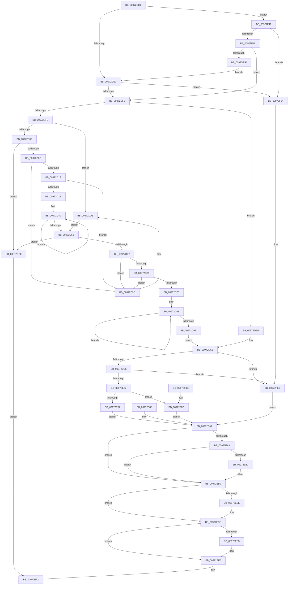

# NtQuerySecurityAttributesToken

- RVA: `0x00972C80`–`0x00972F67` (길이 `743` bytes)
- VA: `0x0000000140972C80`
- 실행 섹션: `PAGE`
- PDB 이름 있음: `예`; PDB Function 태그: `아니요`
- unwind 정보 RVA: `0x000961B8`
- 디코드: `179`개 명령, `743/743` bytes 표시
- 미해석 바이트: `0` (있으면 어셈블리에 `.byte`로 보존)

> 이 문서는 커널 이미지의 기계어와 PDB 기호를 분석해 생성했습니다. 4번과 5번은 함수 원형과 자료형을 바이너리 사용 방식에서 추정한 C 해석이며 원본 소스 복구 결과는 아닙니다.

## 1. Dependencies

- 직접 호출 지점: **11**; 고유 호출 대상: **10**
- 직접 호출자로 확인된 함수: **0**
- RIP 상대 이미지 참조: **0**

### Outgoing calls
- `0x00972D9D` → [ExRaiseAccessViolation](../8E/ExRaiseAccessViolation_function_008E9240.md) (function, `0x008E9240`)
- `0x00972DB0` → [ExRaiseDatatypeMisalignment](../89/ExRaiseDatatypeMisalignment_function_00899FD0.md) (function, `0x00899FD0`)
- `0x00972DD2` → [SepCaptureUnicodeStringArray](SepCaptureUnicodeStringArray_function_00972F70.md) (function, `0x00972F70`)
- `0x00972E0F` → [SepReferenceTokenByHandle](../../text/3E/SepReferenceTokenByHandle_function_003EDAD0.md) (function, `0x003EDAD0`)
- `0x00972E3E` → [ExAcquireResourceSharedLite](../../text/21/ExAcquireResourceSharedLite_function_00211BC0.md) (function, `0x00211BC0`)
- `0x00972E7B` → [SepInternalQuerySecurityAttributesTokenEx](../../text/3A/SepInternalQuerySecurityAttributesTokenEx_function_003A77B0.md) (function, `0x003A77B0`)
- `0x00972EB4` → [ExFreePoolWithTag](../../poolcode/B8/ExFreePoolWithTag_function_00B82870.md) (function, `0x00B82870`)
- `0x00972EC2` → [ExReleaseResourceLite](../../text/25/ExReleaseResourceLite_function_0025FA10.md) (function, `0x0025FA10`)
- `0x00972ED0` → [KeLeaveCriticalRegionThread](../../text/25/KeLeaveCriticalRegionThread_function_0025EFF0.md) (function, `0x0025EFF0`)
- `0x00972EEB` → [ObfDereferenceObjectWithTag](../../text/2F/ObfDereferenceObjectWithTag_function_002F78E0.md) (function, `0x002F78E0`)
- `0x00972F31` → [SepInternalQuerySecurityAttributesTokenEx](../../text/3A/SepInternalQuerySecurityAttributesTokenEx_function_003A77B0.md) (function, `0x003A77B0`)

### Direct callers
- 이 함수 시작 RVA로 연결되는 직접 call은 확인되지 않았습니다. 간접 호출은 완전히 역산할 수 없습니다.

### Static image references
- 디코드된 RIP-relative 메모리 참조가 없습니다.

## 2. Other-region calls and transfers

- 다른 실행 섹션으로 향하는 call: **8**
  - `0x00972E0F` → [SepReferenceTokenByHandle](../../text/3E/SepReferenceTokenByHandle_function_003EDAD0.md) (`PAGE` → `.text`)
  - `0x00972E3E` → [ExAcquireResourceSharedLite](../../text/21/ExAcquireResourceSharedLite_function_00211BC0.md) (`PAGE` → `.text`)
  - `0x00972E7B` → [SepInternalQuerySecurityAttributesTokenEx](../../text/3A/SepInternalQuerySecurityAttributesTokenEx_function_003A77B0.md) (`PAGE` → `.text`)
  - `0x00972EB4` → [ExFreePoolWithTag](../../poolcode/B8/ExFreePoolWithTag_function_00B82870.md) (`PAGE` → `POOLCODE`)
  - `0x00972EC2` → [ExReleaseResourceLite](../../text/25/ExReleaseResourceLite_function_0025FA10.md) (`PAGE` → `.text`)
  - `0x00972ED0` → [KeLeaveCriticalRegionThread](../../text/25/KeLeaveCriticalRegionThread_function_0025EFF0.md) (`PAGE` → `.text`)
  - `0x00972EEB` → [ObfDereferenceObjectWithTag](../../text/2F/ObfDereferenceObjectWithTag_function_002F78E0.md) (`PAGE` → `.text`)
  - `0x00972F31` → [SepInternalQuerySecurityAttributesTokenEx](../../text/3A/SepInternalQuerySecurityAttributesTokenEx_function_003A77B0.md) (`PAGE` → `.text`)
- 별도 외부 분기/꼬리 이동을 확인하지 못했습니다.

## 3. Assembly (complete function range)

```asm
00972C80  48 89 5C 24 08                  mov qword ptr [rsp + 8], rbx
00972C85  48 89 74 24 10                  mov qword ptr [rsp + 0x10], rsi
00972C8A  44 89 44 24 18                  mov dword ptr [rsp + 0x18], r8d
00972C8F  57                              push rdi
00972C90  41 54                           push r12
00972C92  41 55                           push r13
00972C94  41 56                           push r14
00972C96  41 57                           push r15
00972C98  48 83 EC 60                     sub rsp, 0x60
00972C9C  4D 8B F1                        mov r14, r9
00972C9F  45 8B D0                        mov r10d, r8d
00972CA2  4C 8B DA                        mov r11, rdx
00972CA5  48 8B D9                        mov rbx, rcx
00972CA8  33 C0                           xor eax, eax
00972CAA  48 89 44 24 50                  mov qword ptr [rsp + 0x50], rax
00972CAF  45 32 ED                        xor r13b, r13b
00972CB2  48 89 44 24 48                  mov qword ptr [rsp + 0x48], rax
00972CB7  48 89 44 24 58                  mov qword ptr [rsp + 0x58], rax
00972CBC  88 44 24 40                     mov byte ptr [rsp + 0x40], al
00972CC0  65 48 8B 04 25 88 01 00 00      mov rax, qword ptr gs:[0x188]
00972CC9  44 0F B6 B8 32 02 00 00         movzx r15d, byte ptr [rax + 0x232]
00972CD1  44 88 7C 24 41                  mov byte ptr [rsp + 0x41], r15b
00972CD6  44 8B A4 24 B0 00 00 00         mov r12d, dword ptr [rsp + 0xb0]
00972CDE  45 85 E4                        test r12d, r12d
00972CE1  0F 84 5A 02 00 00               je 0x140972f41
00972CE7  4D 85 F6                        test r14, r14
00972CEA  0F 84 64 02 00 00               je 0x140972f54
00972CF0  45 84 FF                        test r15b, r15b
00972CF3  0F 84 C2 00 00 00               je 0x140972dbb
00972CF9  45 85 E4                        test r12d, r12d
00972CFC  0F 84 A1 00 00 00               je 0x140972da3
00972D02  49 8B C6                        mov rax, r14
00972D05  41 F6 C6 03                     test r14b, 3
00972D09  0F 85 A1 00 00 00               jne 0x140972db0
00972D0F  49 8D 51 FF                     lea rdx, [r9 - 1]
00972D13  49 03 D4                        add rdx, r12
00972D16  4C 3B F2                        cmp r14, rdx
00972D19  0F 87 7E 00 00 00               ja 0x140972d9d
00972D1F  49 B8 00 00 FF FF FF 7F 00 00   movabs r8, 0x7fffffff0000
00972D29  49 3B D0                        cmp rdx, r8
00972D2C  73 6F                           jae 0x140972d9d
00972D2E  48 81 E2 00 F0 FF FF            and rdx, 0xfffffffffffff000
00972D35  48 81 C2 00 10 00 00            add rdx, 0x1000
00972D3C  0F 1F 40 00                     nop dword ptr [rax]
00972D40  0F B6 08                        movzx ecx, byte ptr [rax]
00972D43  88 08                           mov byte ptr [rax], cl
00972D45  48 25 00 F0 FF FF               and rax, 0xfffffffffffff000
00972D4B  48 05 00 10 00 00               add rax, 0x1000
00972D51  48 3B C2                        cmp rax, rdx
00972D54  75 EA                           jne 0x140972d40
00972D56  48 8B B4 24 B8 00 00 00         mov rsi, qword ptr [rsp + 0xb8]
00972D5E  48 8B CE                        mov rcx, rsi
00972D61  40 F6 C6 03                     test sil, 3
00972D65  75 49                           jne 0x140972db0
00972D67  48 8D 56 03                     lea rdx, [rsi + 3]
00972D6B  48 3B F2                        cmp rsi, rdx
00972D6E  77 2D                           ja 0x140972d9d
00972D70  49 3B D0                        cmp rdx, r8
00972D73  73 28                           jae 0x140972d9d
00972D75  48 81 E2 00 F0 FF FF            and rdx, 0xfffffffffffff000
00972D7C  48 81 C2 00 10 00 00            add rdx, 0x1000
00972D83  0F B6 01                        movzx eax, byte ptr [rcx]
00972D86  88 01                           mov byte ptr [rcx], al
00972D88  48 81 E1 00 F0 FF FF            and rcx, 0xfffffffffffff000
00972D8F  48 81 C1 00 10 00 00            add rcx, 0x1000
00972D96  48 3B CA                        cmp rcx, rdx
00972D99  75 E8                           jne 0x140972d83
00972D9B  EB 26                           jmp 0x140972dc3
00972D9D  E8 9E 64 F7 FF                  call 0x1408e9240
00972DA2  CC                              int3
00972DA3  90                              nop
00972DA4  49 B8 00 00 FF FF FF 7F 00 00   movabs r8, 0x7fffffff0000
00972DAE  EB A6                           jmp 0x140972d56
00972DB0  E8 1B 72 F2 FF                  call 0x140899fd0
00972DB5  90                              nop
00972DB6  E9 37 01 00 00                  jmp 0x140972ef2
00972DBB  48 8B B4 24 B8 00 00 00         mov rsi, qword ptr [rsp + 0xb8]
00972DC3  4C 8D 4C 24 50                  lea r9, [rsp + 0x50]
00972DC8  45 0F B6 C7                     movzx r8d, r15b
00972DCC  41 8B D2                        mov edx, r10d
00972DCF  49 8B CB                        mov rcx, r11
00972DD2  E8 99 01 00 00                  call 0x140972f70
00972DD7  8B F8                           mov edi, eax
00972DD9  89 44 24 44                     mov dword ptr [rsp + 0x44], eax
00972DDD  85 C0                           test eax, eax
00972DDF  0F 88 78 01 00 00               js 0x140972f5d
00972DE5  48 8D 44 24 58                  lea rax, [rsp + 0x58]
00972DEA  48 89 44 24 30                  mov qword ptr [rsp + 0x30], rax
00972DEF  48 8D 44 24 40                  lea rax, [rsp + 0x40]
00972DF4  48 89 44 24 28                  mov qword ptr [rsp + 0x28], rax
00972DF9  48 8D 44 24 48                  lea rax, [rsp + 0x48]
00972DFE  48 89 44 24 20                  mov qword ptr [rsp + 0x20], rax
00972E03  45 0F B6 C7                     movzx r8d, r15b
00972E07  BA 08 00 00 00                  mov edx, 8
00972E0C  48 8B CB                        mov rcx, rbx
00972E0F  E8 BC AC A7 FF                  call 0x1403edad0
00972E14  8B F8                           mov edi, eax
00972E16  89 44 24 44                     mov dword ptr [rsp + 0x44], eax
00972E1A  85 C0                           test eax, eax
00972E1C  0F 88 3B 01 00 00               js 0x140972f5d
00972E22  65 48 8B 04 25 88 01 00 00      mov rax, qword ptr gs:[0x188]
00972E2B  66 FF 88 E4 01 00 00            dec word ptr [rax + 0x1e4]
00972E32  90                              nop
00972E33  B2 01                           mov dl, 1
00972E35  48 8B 5C 24 48                  mov rbx, qword ptr [rsp + 0x48]
00972E3A  48 8B 4B 30                     mov rcx, qword ptr [rbx + 0x30]
00972E3E  E8 7D ED 89 FF                  call 0x140211bc0
00972E43  41 B5 01                        mov r13b, 1
00972E46  44 88 AC 24 B0 00 00 00         mov byte ptr [rsp + 0xb0], r13b
00972E4E  45 84 FF                        test r15b, r15b
00972E51  0F 84 B6 00 00 00               je 0x140972f0d
00972E57  48 89 74 24 38                  mov qword ptr [rsp + 0x38], rsi
00972E5C  44 89 64 24 30                  mov dword ptr [rsp + 0x30], r12d
00972E61  4C 89 74 24 28                  mov qword ptr [rsp + 0x28], r14
00972E66  C6 44 24 20 00                  mov byte ptr [rsp + 0x20], 0
00972E6B  44 8B 8C 24 A0 00 00 00         mov r9d, dword ptr [rsp + 0xa0]
00972E73  4C 8B 44 24 50                  mov r8, qword ptr [rsp + 0x50]
00972E78  48 8B CB                        mov rcx, rbx
00972E7B  E8 30 49 A3 FF                  call 0x1403a77b0
00972E80  8B F8                           mov edi, eax
00972E82  89 44 24 44                     mov dword ptr [rsp + 0x44], eax
00972E86  EB 1A                           jmp 0x140972ea2
00972E88  8B F8                           mov edi, eax
00972E8A  89 44 24 44                     mov dword ptr [rsp + 0x44], eax
00972E8E  44 0F B6 7C 24 41               movzx r15d, byte ptr [rsp + 0x41]
00972E94  44 0F B6 AC 24 B0 00 00 00      movzx r13d, byte ptr [rsp + 0xb0]
00972E9D  48 8B 5C 24 48                  mov rbx, qword ptr [rsp + 0x48]
00972EA2  41 80 FF 01                     cmp r15b, 1
00972EA6  75 11                           jne 0x140972eb9
00972EA8  48 8B 4C 24 50                  mov rcx, qword ptr [rsp + 0x50]
00972EAD  48 85 C9                        test rcx, rcx
00972EB0  74 07                           je 0x140972eb9
00972EB2  33 D2                           xor edx, edx
00972EB4  E8 B7 F9 20 00                  call 0x140b82870
00972EB9  45 84 ED                        test r13b, r13b
00972EBC  74 20                           je 0x140972ede
00972EBE  48 8B 4B 30                     mov rcx, qword ptr [rbx + 0x30]
00972EC2  E8 49 CB 8E FF                  call 0x14025fa10
00972EC7  65 48 8B 0C 25 88 01 00 00      mov rcx, qword ptr gs:[0x188]
00972ED0  E8 1B C1 8E FF                  call 0x14025eff0
00972ED5  8B 7C 24 44                     mov edi, dword ptr [rsp + 0x44]
00972ED9  48 8B 5C 24 48                  mov rbx, qword ptr [rsp + 0x48]
00972EDE  48 85 DB                        test rbx, rbx
00972EE1  74 0D                           je 0x140972ef0
00972EE3  BA 53 68 72 74                  mov edx, 0x74726853
00972EE8  48 8B CB                        mov rcx, rbx
00972EEB  E8 F0 49 98 FF                  call 0x1402f78e0
00972EF0  8B C7                           mov eax, edi
00972EF2  4C 8D 5C 24 60                  lea r11, [rsp + 0x60]
00972EF7  49 8B 5B 30                     mov rbx, qword ptr [r11 + 0x30]
00972EFB  49 8B 73 38                     mov rsi, qword ptr [r11 + 0x38]
00972EFF  49 8B E3                        mov rsp, r11
00972F02  41 5F                           pop r15
00972F04  41 5E                           pop r14
00972F06  41 5D                           pop r13
00972F08  41 5C                           pop r12
00972F0A  5F                              pop rdi
00972F0B  C3                              ret
00972F0C  CC                              int3
00972F0D  48 89 74 24 38                  mov qword ptr [rsp + 0x38], rsi
00972F12  44 89 64 24 30                  mov dword ptr [rsp + 0x30], r12d
00972F17  4C 89 74 24 28                  mov qword ptr [rsp + 0x28], r14
00972F1C  C6 44 24 20 00                  mov byte ptr [rsp + 0x20], 0
00972F21  44 8B 8C 24 A0 00 00 00         mov r9d, dword ptr [rsp + 0xa0]
00972F29  4C 8B 44 24 50                  mov r8, qword ptr [rsp + 0x50]
00972F2E  48 8B CB                        mov rcx, rbx
00972F31  E8 7A 48 A3 FF                  call 0x1403a77b0
00972F36  8B F8                           mov edi, eax
00972F38  89 44 24 44                     mov dword ptr [rsp + 0x44], eax
00972F3C  E9 61 FF FF FF                  jmp 0x140972ea2
00972F41  4D 85 F6                        test r14, r14
00972F44  75 0E                           jne 0x140972f54
00972F46  45 85 E4                        test r12d, r12d
00972F49  0F 84 A1 FD FF FF               je 0x140972cf0
00972F4F  E9 93 FD FF FF                  jmp 0x140972ce7
00972F54  BF 0D 00 00 C0                  mov edi, 0xc000000d
00972F59  89 7C 24 44                     mov dword ptr [rsp + 0x44], edi
00972F5D  48 8B 5C 24 48                  mov rbx, qword ptr [rsp + 0x48]
00972F62  E9 3B FF FF FF                  jmp 0x140972ea2
```

## 4. C-style interpretation (structured pseudocode)

```c
__int64 __fastcall NtQuerySecurityAttributesToken(__int64 a1, __int64 a2, int a3, __int64 a4, unsigned int a5, __int64 a6)
{
    __int64 result;
    __int64 v_r13;
    __int64 v_rbx;
    __int64 v_rdi;
    __int64 v_rsp;
    unsigned __int64 v_stack_m10;
    unsigned __int64 v_stack_m18;
    unsigned int v_stack_m1C;
    unsigned __int64 v_stack_m28;
    unsigned __int64 v_stack_m30;
    unsigned __int64 v_stack_m38;
    unsigned __int64 v_stack_m40;
    unsigned int v_stack_m44;
    unsigned __int8 v_stack_m47;
    unsigned __int8 v_stack_m48;
    unsigned __int64 v_stack_m50;
    unsigned __int64 v_stack_m58;
    unsigned __int64 v_stack_m60;
    unsigned __int64 v_stack_m68;
    unsigned __int64 v_stack_p10;
    unsigned int v_stack_p18;
    unsigned __int8 v_stack_p28;
    unsigned int v_stack_p40;
    unsigned __int64 v_stack_p8;

    v_stack_p8 = v_rbx;
    v_stack_p10 = v_rsi;
    v_stack_p18 = a3;
    v_rsp = (v_rsp) - (96);
    result = 0;
    v_stack_m38 = 0;
    v_r13 = 0;
    v_stack_m40 = 0;
    v_stack_m30 = 0;
    v_stack_m48 = 0;
    v_stack_m47 = (unsigned __int8)(*(unsigned __int8 *)(*(unsigned __int64 *)(gs_base + (0 + 392)) + 562));
    if ((unsigned int)((unsigned int)(a5)) == 0) goto loc_00972F41;
loc_00972CE7:
    if (a4 == 0) goto loc_00972F54;
loc_00972CF0:
    if ((unsigned __int8)(*(unsigned __int8 *)(*(unsigned __int64 *)(gs_base + (0 + 392)) + 562)) == 0) goto loc_00972DBB;
    if ((unsigned int)((unsigned int)(a5)) == 0) goto loc_00972DA3;
    if ((((unsigned __int8)(a4)) & (3)) != 0) goto loc_00972DB0;
    a2 = (a4 - 1) + ((unsigned int)(a5));
    if (a4 > a2) goto loc_00972D9D;
    if (a2 >= a3) goto loc_00972D9D;
    a2 = (a2) & (0xFFFFFFFFFFFFF000ULL);
    a2 = (a2) + (0x1000ULL);
loc_00972D40:
    *(unsigned __int8 *)(a4) = (unsigned __int8)(*(unsigned __int8 *)(a4));
    result = (a4) & (0xFFFFFFFFFFFFF000ULL);
    result = (result) + (0x1000ULL);
    if (result != a2) goto loc_00972D40;
loc_00972D56:
    if ((((unsigned __int8)(a6)) & (3)) != 0) goto loc_00972DB0;
    if (a6 > (a6 + 3)) goto loc_00972D9D;
    if ((a6 + 3) >= a3) goto loc_00972D9D;
    a2 = (a6 + 3) & (0xFFFFFFFFFFFFF000ULL);
    a2 = (a2) + (0x1000ULL);
loc_00972D83:
    *(unsigned __int8 *)(a6) = (unsigned __int8)(*(unsigned __int8 *)(a6));
    a1 = (a6) & (0xFFFFFFFFFFFFF000ULL);
    a1 = (a1) + (0x1000ULL);
    if (a1 != a2) goto loc_00972D83;
    goto loc_00972DC3;
loc_00972D9D:
    result = ExRaiseAccessViolation(a1, a2, a3, a4);
loc_00972DA3:
    goto loc_00972D56;
loc_00972DB0:
    result = ExRaiseDatatypeMisalignment(a1, a2, a3, a4);
    goto loc_00972EF2;
loc_00972DBB:
loc_00972DC3:
    result = SepCaptureUnicodeStringArray(a2, (unsigned int)((unsigned int)((unsigned int)(a3))), (unsigned __int8)(*(unsigned __int8 *)(*(unsigned __int64 *)(gs_base + (0 + 392)) + 562)), v_stack_m38);
    v_stack_m44 = (unsigned int)(result);
    if (sign_flag) goto loc_00972F5D;
    v_stack_m58 = v_stack_m30;
    v_stack_m60 = v_stack_m48;
    v_stack_m68 = v_stack_m40;
    result = SepReferenceTokenByHandle(a1, 8, (unsigned __int8)(*(unsigned __int8 *)(*(unsigned __int64 *)(gs_base + (0 + 392)) + 562)), v_stack_m38);
    v_stack_m44 = (unsigned int)(result);
    if (sign_flag) goto loc_00972F5D;
    result = ExAcquireResourceSharedLite(*(unsigned __int64 *)(v_stack_m40 + 48), 1, (unsigned __int8)(*(unsigned __int8 *)(*(unsigned __int64 *)(gs_base + (0 + 392)) + 562)), v_stack_m38);
    v_stack_p28 = 1;
    if ((unsigned __int8)(*(unsigned __int8 *)(*(unsigned __int64 *)(gs_base + (0 + 392)) + 562)) == 0) goto loc_00972F0D;
    v_stack_m50 = a6;
    v_stack_m58 = (unsigned int)((unsigned int)(a5));
    v_stack_m60 = a4;
    v_stack_m68 = 0;
    result = SepInternalQuerySecurityAttributesTokenEx(v_stack_m40, 1, v_stack_m38, (unsigned int)(v_stack_p18));
    v_stack_m44 = (unsigned int)(result);
    goto loc_00972EA2;
loc_00972EA2:
    if (((unsigned __int8)(*(unsigned __int8 *)(*(unsigned __int64 *)(gs_base + (0 + 392)) + 562))) != 1) goto loc_00972EB9;
    if (v_stack_m38 != 0) {
        a2 = 0;
        result = ExFreePoolWithTag(v_stack_m38, a2, v_stack_m38, (unsigned int)(v_stack_p18));
    }
    v_rbx = v_stack_m40;
    v_rdi = (unsigned int)((unsigned int)(result));
    if (1 != 0) {
        a1 = *(unsigned __int64 *)(v_stack_m40 + 48);
        result = ExReleaseResourceLite(a1, a2, v_stack_m38, (unsigned int)(v_stack_p18));
        a1 = *(unsigned __int64 *)(gs_base + (0 + 392));
        result = KeLeaveCriticalRegionThread(a1, a2, v_stack_m38, (unsigned int)(v_stack_p18));
        v_rdi = v_stack_m44;
        v_rbx = v_stack_m40;
    }
    if (v_rbx != 0) {
        a2 = 0x74726853ULL;
        a1 = v_rbx;
        result = ObfDereferenceObjectWithTag(a1, a2, v_stack_m38, (unsigned int)(v_stack_p18));
    }
loc_00972EF2:
    return (unsigned int)((unsigned int)(v_rdi));
loc_00972F0D:
    v_stack_m28 = *(unsigned __int64 *)(v_stack_m28 + 56);
    v_stack_m30 = (unsigned int)((unsigned int)(a5));
    v_stack_m38 = a4;
    v_stack_m40 = 0;
    result = SepInternalQuerySecurityAttributesTokenEx(*(unsigned __int64 *)(v_stack_m28 + 48), a2, v_stack_m10, (unsigned int)(v_stack_p40));
    v_stack_m1C = (unsigned int)(result);
    goto loc_00972EA2;
loc_00972F41:
    if (a4 != 0) goto loc_00972F54;
    if ((unsigned int)((unsigned int)(a5)) == 0) goto loc_00972CF0;
    goto loc_00972CE7;
loc_00972F54:
    v_stack_m1C = (unsigned int)((unsigned int)(0xC000000DULL));
loc_00972F5D:
    goto loc_00972EA2;
}
```

## 5. (Beta) C Style

```c
int64_t NtQuerySecurityAttributesToken(int64_t Arg1, int64_t Arg2, int32_t Arg3, void *Arg4, uint32_t Arg5, int64_t Arg6)
{
    uint8_t *arg4 = (uint8_t *)Arg4;

    int64_t result;
    int64_t local_r13;
    int64_t local_rbx;
    int64_t local_rdi;
    int64_t local_rsp;
    uint64_t v_stack_m10;
    uint64_t v_stack_m18;
    uint32_t v_stack_m1C;
    uint64_t v_stack_m28;
    uint64_t v_stack_m30;
    uint64_t v_stack_m38;
    uint64_t v_stack_m40;
    uint32_t v_stack_m44;
    uint8_t v_stack_m47;
    uint8_t v_stack_m48;
    uint64_t v_stack_m50;
    uint64_t v_stack_m58;
    uint64_t v_stack_m60;
    uint64_t v_stack_m68;
    uint64_t v_stack_p10;
    uint32_t v_stack_p18;
    uint8_t v_stack_p28;
    uint32_t v_stack_p40;
    uint64_t v_stack_p8;

    v_stack_p8 = local_rbx;
    v_stack_p10 = local_rsi;
    v_stack_p18 = Arg3;
    local_rsp = (local_rsp) - (96);
    result = 0;
    v_stack_m38 = 0;
    local_r13 = 0;
    v_stack_m40 = 0;
    v_stack_m30 = 0;
    v_stack_m48 = 0;
    v_stack_m47 = (uint8_t)(*(uint8_t *)(*(uint64_t *)(gs_base + (0 + 0x188)) + 0x232));
    if ((uint32_t)((uint32_t)(Arg5)) == 0) goto loc_00972F41;
loc_00972CE7:
    if (Arg4 == NULL) goto loc_00972F54;
loc_00972CF0:
    if ((uint8_t)(*(uint8_t *)(*(uint64_t *)(gs_base + (0 + 0x188)) + 0x232)) == 0) goto loc_00972DBB;
    if ((uint32_t)((uint32_t)(Arg5)) == 0) goto loc_00972DA3;
    if ((((uint8_t)(Arg4)) & (3)) != 0) goto loc_00972DB0;
    Arg2 = (Arg4 - 1) + ((uint32_t)(Arg5));
    if (Arg4 > Arg2) goto loc_00972D9D;
    if (Arg2 >= Arg3) goto loc_00972D9D;
    Arg2 = (Arg2) & (0xFFFFFFFFFFFFF000ULL);
    Arg2 = (Arg2) + (0x1000ULL);
loc_00972D40:
    *(uint8_t *)(arg4) = (uint8_t)(*(uint8_t *)(arg4));
    result = (Arg4) & (0xFFFFFFFFFFFFF000ULL);
    result = (result) + (0x1000ULL);
    if (result != Arg2) goto loc_00972D40;
loc_00972D56:
    if ((((uint8_t)(Arg6)) & (3)) != 0) goto loc_00972DB0;
    if (Arg6 > (Arg6 + 3)) goto loc_00972D9D;
    if ((Arg6 + 3) >= Arg3) goto loc_00972D9D;
    Arg2 = (Arg6 + 3) & (0xFFFFFFFFFFFFF000ULL);
    Arg2 = (Arg2) + (0x1000ULL);
loc_00972D83:
    *(uint8_t *)(Arg6) = (uint8_t)(*(uint8_t *)(Arg6));
    Arg1 = (Arg6) & (0xFFFFFFFFFFFFF000ULL);
    Arg1 = (Arg1) + (0x1000ULL);
    if (Arg1 != Arg2) goto loc_00972D83;
    goto loc_00972DC3;
loc_00972D9D:
    result = ExRaiseAccessViolation(Arg1, Arg2, Arg3, Arg4);
loc_00972DA3:
    goto loc_00972D56;
loc_00972DB0:
    result = ExRaiseDatatypeMisalignment(Arg1, Arg2, Arg3, Arg4);
    goto loc_00972EF2;
loc_00972DBB:
loc_00972DC3:
    result = SepCaptureUnicodeStringArray(Arg2, (uint32_t)((uint32_t)((uint32_t)(Arg3))), (uint8_t)(*(uint8_t *)(*(uint64_t *)(gs_base + (0 + 0x188)) + 0x232)), v_stack_m38);
    v_stack_m44 = (uint32_t)(result);
    if (sign_flag) goto loc_00972F5D;
    v_stack_m58 = v_stack_m30;
    v_stack_m60 = v_stack_m48;
    v_stack_m68 = v_stack_m40;
    result = SepReferenceTokenByHandle(Arg1, 8, (uint8_t)(*(uint8_t *)(*(uint64_t *)(gs_base + (0 + 0x188)) + 0x232)), v_stack_m38);
    v_stack_m44 = (uint32_t)(result);
    if (sign_flag) goto loc_00972F5D;
    result = ExAcquireResourceSharedLite(*(uint64_t *)(v_stack_m40 + 0x30), 1, (uint8_t)(*(uint8_t *)(*(uint64_t *)(gs_base + (0 + 0x188)) + 0x232)), v_stack_m38);
    v_stack_p28 = 1;
    if ((uint8_t)(*(uint8_t *)(*(uint64_t *)(gs_base + (0 + 0x188)) + 0x232)) == 0) goto loc_00972F0D;
    v_stack_m50 = Arg6;
    v_stack_m58 = (uint32_t)((uint32_t)(Arg5));
    v_stack_m60 = Arg4;
    v_stack_m68 = 0;
    result = SepInternalQuerySecurityAttributesTokenEx(v_stack_m40, 1, v_stack_m38, (uint32_t)(v_stack_p18));
    v_stack_m44 = (uint32_t)(result);
    goto loc_00972EA2;
loc_00972EA2:
    if (((uint8_t)(*(uint8_t *)(*(uint64_t *)(gs_base + (0 + 0x188)) + 0x232))) != 1) goto loc_00972EB9;
    if (v_stack_m38 != 0) {
        Arg2 = 0;
        result = ExFreePoolWithTag(v_stack_m38, Arg2, v_stack_m38, (uint32_t)(v_stack_p18));
    }
    local_rbx = v_stack_m40;
    local_rdi = (uint32_t)((uint32_t)(result));
    if (1 != 0) {
        Arg1 = *(uint64_t *)(v_stack_m40 + 0x30);
        result = ExReleaseResourceLite(Arg1, Arg2, v_stack_m38, (uint32_t)(v_stack_p18));
        Arg1 = *(uint64_t *)(gs_base + (0 + 0x188));
        result = KeLeaveCriticalRegionThread(Arg1, Arg2, v_stack_m38, (uint32_t)(v_stack_p18));
        local_rdi = v_stack_m44;
        local_rbx = v_stack_m40;
    }
    if (local_rbx != 0) {
        Arg2 = 0x74726853ULL;
        Arg1 = local_rbx;
        result = ObfDereferenceObjectWithTag(Arg1, Arg2, v_stack_m38, (uint32_t)(v_stack_p18));
    }
loc_00972EF2:
    return (uint32_t)((uint32_t)(local_rdi));
loc_00972F0D:
    v_stack_m28 = *(uint64_t *)(v_stack_m28 + 0x38);
    v_stack_m30 = (uint32_t)((uint32_t)(Arg5));
    v_stack_m38 = Arg4;
    v_stack_m40 = 0;
    result = SepInternalQuerySecurityAttributesTokenEx(*(uint64_t *)(v_stack_m28 + 0x30), Arg2, v_stack_m10, (uint32_t)(v_stack_p40));
    v_stack_m1C = (uint32_t)(result);
    goto loc_00972EA2;
loc_00972F41:
    if (Arg4 != NULL) goto loc_00972F54;
    if ((uint32_t)((uint32_t)(Arg5)) == 0) goto loc_00972CF0;
    goto loc_00972CE7;
loc_00972F54:
    v_stack_m1C = (uint32_t)((uint32_t)(0xC000000DULL));
loc_00972F5D:
    goto loc_00972EA2;
}
```

### 관측된 메모리 오프셋

구조체 형식이 확인되지 않은 접근은 인자 기준의 오프셋으로만 기록했습니다.

| 기준 인자 | 오프셋 표현 | 폭 (bit) | 접근 |
|---|---:|---:|---|
| `Arg4` | `- 0x1` | `64` | `R` |

## 6. Execution-region graph

[열기: 2D/3D 그래프와 함수 탐색 컨트롤 패널](../../../control-panel.html?section=page&rva=0x00972C80&view=graph)

- 2D 그래프는 위에서 아래로 흐르고, 3D 그래프는 빈 공간을 드래그해 회전합니다. Shift+드래그는 이동, 휠은 확대·축소, 함수 노드 선택은 대상 보고서 이동입니다.

### Static fallback


