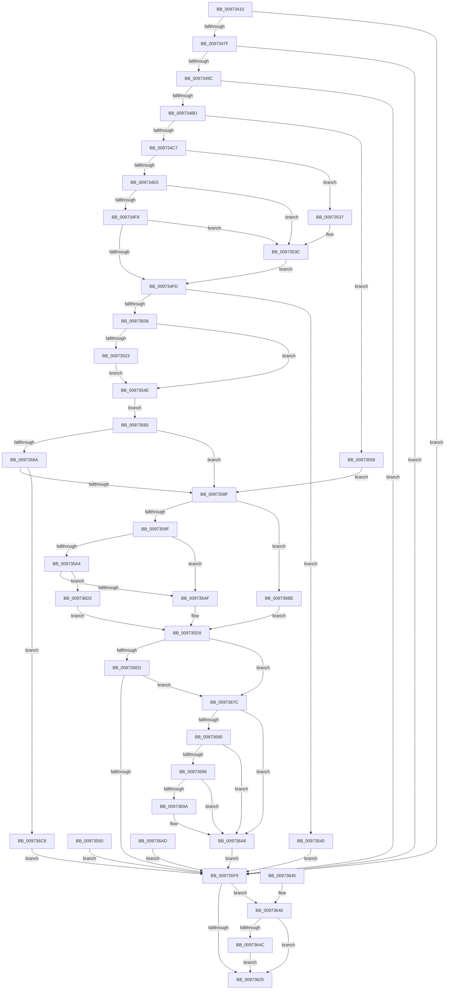

# NtQuerySecurityPolicy

- RVA: `0x00973410`–`0x009736DC` (길이 `716` bytes)
- VA: `0x0000000140973410`
- 실행 섹션: `PAGE`
- PDB 이름 있음: `예`; PDB Function 태그: `아니요`
- unwind 정보 RVA: `0x00096274`
- 디코드: `182`개 명령, `716/716` bytes 표시
- 미해석 바이트: `0` (있으면 어셈블리에 `.byte`로 보존)

> 이 문서는 커널 이미지의 기계어와 PDB 기호를 분석해 생성했습니다. 4번과 5번은 함수 원형과 자료형을 바이너리 사용 방식에서 추정한 C 해석이며 원본 소스 복구 결과는 아닙니다.

## 1. Dependencies

- 직접 호출 지점: **14**; 고유 호출 대상: **8**
- 직접 호출자로 확인된 함수: **0**
- RIP 상대 이미지 참조: **1**

### Outgoing calls
- `0x00973470` → [SepCaptureUnicodeStringArray](SepCaptureUnicodeStringArray_function_00972F70.md) (function, `0x00972F70`)
- `0x0097348D` → [SepCaptureUnicodeStringArray](SepCaptureUnicodeStringArray_function_00972F70.md) (function, `0x00972F70`)
- `0x009734AA` → [SepCaptureUnicodeStringArray](SepCaptureUnicodeStringArray_function_00972F70.md) (function, `0x00972F70`)
- `0x009734D2` → [ProbeForWrite](../8E/ProbeForWrite_function_008E91C0.md) (function, `0x008E91C0`)
- `0x00973511` → [ProbeForWrite](../8E/ProbeForWrite_function_008E91C0.md) (function, `0x008E91C0`)
- `0x00973530` → [ProbeForWrite](../8E/ProbeForWrite_function_008E91C0.md) (function, `0x008E91C0`)
- `0x00973537` → [ExRaiseDatatypeMisalignment](../89/ExRaiseDatatypeMisalignment_function_00899FD0.md) (function, `0x00899FD0`)
- `0x00973579` → [ExAllocatePool2](../../poolcode/B8/ExAllocatePool2_function_00B820F0.md) (function, `0x00B820F0`)
- `0x009735D2` → [guard_dispatch_icall](../../text/6B/guard_dispatch_icall_function_006BAAD0.md) (function, `0x006BAAD0`)
- `0x00973601` → [SeReleaseUnicodeStringStructures](SeReleaseUnicodeStringStructures_function_00973360.md) (function, `0x00973360`)
- `0x0097360E` → [SeReleaseUnicodeStringStructures](SeReleaseUnicodeStringStructures_function_00973360.md) (function, `0x00973360`)
- `0x0097361B` → [SeReleaseUnicodeStringStructures](SeReleaseUnicodeStringStructures_function_00973360.md) (function, `0x00973360`)
- `0x00973651` → [ExFreePoolWithTag](../../poolcode/B8/ExFreePoolWithTag_function_00B82870.md) (function, `0x00B82870`)
- `0x009736A3` → [memcpy](../../text/6C/memcpy_function_006C6840.md) (function, `0x006C6840`)

### Direct callers
- 이 함수 시작 RVA로 연결되는 직접 call은 확인되지 않았습니다. 간접 호출은 완전히 역산할 수 없습니다.

### Static image references
- `0x0097358F` → RVA `0x00F04ED0` (`.data`; read)

## 2. Other-region calls and transfers

- 다른 실행 섹션으로 향하는 call: **4**
  - `0x00973579` → [ExAllocatePool2](../../poolcode/B8/ExAllocatePool2_function_00B820F0.md) (`PAGE` → `POOLCODE`)
  - `0x009735D2` → [guard_dispatch_icall](../../text/6B/guard_dispatch_icall_function_006BAAD0.md) (`PAGE` → `.text`)
  - `0x00973651` → [ExFreePoolWithTag](../../poolcode/B8/ExFreePoolWithTag_function_00B82870.md) (`PAGE` → `POOLCODE`)
  - `0x009736A3` → [memcpy](../../text/6C/memcpy_function_006C6840.md) (`PAGE` → `.text`)
- 별도 외부 분기/꼬리 이동을 확인하지 못했습니다.

## 3. Assembly (complete function range)

```asm
00973410  48 8B C4                        mov rax, rsp
00973413  48 89 58 08                     mov qword ptr [rax + 8], rbx
00973417  48 89 70 10                     mov qword ptr [rax + 0x10], rsi
0097341B  48 89 78 18                     mov qword ptr [rax + 0x18], rdi
0097341F  41 54                           push r12
00973421  41 56                           push r14
00973423  41 57                           push r15
00973425  48 81 EC 80 00 00 00            sub rsp, 0x80
0097342C  4D 8B E1                        mov r12, r9
0097342F  4D 8B F8                        mov r15, r8
00973432  4C 8B F2                        mov r14, rdx
00973435  48 83 60 C0 00                  and qword ptr [rax - 0x40], 0
0097343A  48 83 60 C8 00                  and qword ptr [rax - 0x38], 0
0097343F  33 FF                           xor edi, edi
00973441  48 89 7C 24 50                  mov qword ptr [rsp + 0x50], rdi
00973446  48 21 78 D0                     and qword ptr [rax - 0x30], rdi
0097344A  21 78 AC                        and dword ptr [rax - 0x54], edi
0097344D  21 78 B4                        and dword ptr [rax - 0x4c], edi
00973450  65 48 8B 04 25 88 01 00 00      mov rax, qword ptr gs:[0x188]
00973459  40 8A B0 32 02 00 00            mov sil, byte ptr [rax + 0x232]
00973460  40 88 74 24 40                  mov byte ptr [rsp + 0x40], sil
00973465  4C 8D 4C 24 58                  lea r9, [rsp + 0x58]
0097346A  44 8A C6                        mov r8b, sil
0097346D  8D 57 01                        lea edx, [rdi + 1]
00973470  E8 FB FA FF FF                  call 0x140972f70
00973475  8B D8                           mov ebx, eax
00973477  85 C0                           test eax, eax
00973479  0F 88 7A 01 00 00               js 0x1409735f9
0097347F  4C 8D 4C 24 60                  lea r9, [rsp + 0x60]
00973484  44 8A C6                        mov r8b, sil
00973487  8D 57 01                        lea edx, [rdi + 1]
0097348A  49 8B CE                        mov rcx, r14
0097348D  E8 DE FA FF FF                  call 0x140972f70
00973492  8B D8                           mov ebx, eax
00973494  85 C0                           test eax, eax
00973496  0F 88 5D 01 00 00               js 0x1409735f9
0097349C  4C 8D 4C 24 68                  lea r9, [rsp + 0x68]
009734A1  44 8A C6                        mov r8b, sil
009734A4  8D 57 01                        lea edx, [rdi + 1]
009734A7  49 8B CF                        mov rcx, r15
009734AA  E8 C1 FA FF FF                  call 0x140972f70
009734AF  8B D8                           mov ebx, eax
009734B1  89 44 24 48                     mov dword ptr [rsp + 0x48], eax
009734B5  85 C0                           test eax, eax
009734B7  0F 88 3C 01 00 00               js 0x1409735f9
009734BD  40 80 FE 01                     cmp sil, 1
009734C1  0F 85 91 01 00 00               jne 0x140973658
009734C7  8D 5F 04                        lea ebx, [rdi + 4]
009734CA  44 8B C3                        mov r8d, ebx
009734CD  8B D3                           mov edx, ebx
009734CF  49 8B CC                        mov rcx, r12
009734D2  E8 E9 5C F7 FF                  call 0x1408e91c0
009734D7  4C 8B B4 24 C8 00 00 00         mov r14, qword ptr [rsp + 0xc8]
009734DF  41 F6 C6 03                     test r14b, 3
009734E3  75 52                           jne 0x140973537
009734E5  49 8D 46 04                     lea rax, [r14 + 4]
009734E9  48 B9 00 00 FF FF FF 7F 00 00   movabs rcx, 0x7fffffff0000
009734F3  48 3B C1                        cmp rax, rcx
009734F6  77 44                           ja 0x14097353c
009734F8  49 3B C6                        cmp rax, r14
009734FB  72 3F                           jb 0x14097353c
009734FD  41 8B 06                        mov eax, dword ptr [r14]
00973500  89 44 24 44                     mov dword ptr [rsp + 0x44], eax
00973504  85 C0                           test eax, eax
00973506  74 38                           je 0x140973540
00973508  44 8B C3                        mov r8d, ebx
0097350B  48 8B D3                        mov rdx, rbx
0097350E  49 8B CE                        mov rcx, r14
00973511  E8 AA 5C F7 FF                  call 0x1408e91c0
00973516  4C 8B BC 24 C0 00 00 00         mov r15, qword ptr [rsp + 0xc0]
0097351E  4D 85 FF                        test r15, r15
00973521  74 2B                           je 0x14097354e
00973523  8B 54 24 44                     mov edx, dword ptr [rsp + 0x44]
00973527  41 B8 01 00 00 00               mov r8d, 1
0097352D  49 8B CF                        mov rcx, r15
00973530  E8 8B 5C F7 FF                  call 0x1408e91c0
00973535  EB 17                           jmp 0x14097354e
00973537  E8 94 6A F2 FF                  call 0x140899fd0
0097353C  8A 01                           mov al, byte ptr [rcx]
0097353E  EB BD                           jmp 0x1409734fd
00973540  BB 0D 00 00 C0                  mov ebx, 0xc000000d
00973545  89 5C 24 48                     mov dword ptr [rsp + 0x48], ebx
00973549  E9 AB 00 00 00                  jmp 0x1409735f9
0097354E  EB 15                           jmp 0x140973565
00973550  8B D8                           mov ebx, eax
00973552  89 44 24 48                     mov dword ptr [rsp + 0x48], eax
00973556  48 8B 7C 24 50                  mov rdi, qword ptr [rsp + 0x50]
0097355B  40 8A 74 24 40                  mov sil, byte ptr [rsp + 0x40]
00973560  E9 94 00 00 00                  jmp 0x1409735f9
00973565  4D 85 FF                        test r15, r15
00973568  74 25                           je 0x14097358f
0097356A  8B 54 24 44                     mov edx, dword ptr [rsp + 0x44]
0097356E  B9 01 01 00 00                  mov ecx, 0x101
00973573  41 B8 53 65 20 20               mov r8d, 0x20206553
00973579  E8 72 EB 20 00                  call 0x140b820f0
0097357E  48 8B F8                        mov rdi, rax
00973581  48 89 44 24 50                  mov qword ptr [rsp + 0x50], rax
00973586  48 85 C0                        test rax, rax
00973589  0F 84 39 01 00 00               je 0x1409736c8
0097358F  48 8B 05 3A 19 59 00            mov rax, qword ptr [rip + 0x59193a]
00973596  48 85 C0                        test rax, rax
00973599  0F 84 1F 01 00 00               je 0x1409736be
0097359F  48 85 FF                        test rdi, rdi
009735A2  74 0B                           je 0x1409735af
009735A4  83 7C 24 44 00                  cmp dword ptr [rsp + 0x44], 0
009735A9  0F 84 23 01 00 00               je 0x1409736d2
009735AF  48 8D 4C 24 44                  lea rcx, [rsp + 0x44]
009735B4  48 89 4C 24 28                  mov qword ptr [rsp + 0x28], rcx
009735B9  48 89 7C 24 20                  mov qword ptr [rsp + 0x20], rdi
009735BE  4C 8D 4C 24 4C                  lea r9, [rsp + 0x4c]
009735C3  4C 8B 44 24 68                  mov r8, qword ptr [rsp + 0x68]
009735C8  48 8B 54 24 60                  mov rdx, qword ptr [rsp + 0x60]
009735CD  48 8B 4C 24 58                  mov rcx, qword ptr [rsp + 0x58]
009735D2  E8 F9 74 D4 FF                  call 0x1406baad0
009735D7  8B D8                           mov ebx, eax
009735D9  89 5C 24 48                     mov dword ptr [rsp + 0x48], ebx
009735DD  B9 00 00 00 80                  mov ecx, 0x80000000
009735E2  8D 04 0B                        lea eax, [rbx + rcx]
009735E5  85 C1                           test ecx, eax
009735E7  0F 85 8F 00 00 00               jne 0x14097367c
009735ED  81 FB 23 00 00 C0               cmp ebx, 0xc0000023
009735F3  0F 84 83 00 00 00               je 0x14097367c
009735F9  40 8A D6                        mov dl, sil
009735FC  48 8B 4C 24 58                  mov rcx, qword ptr [rsp + 0x58]
00973601  E8 5A FD FF FF                  call 0x140973360
00973606  40 8A D6                        mov dl, sil
00973609  48 8B 4C 24 60                  mov rcx, qword ptr [rsp + 0x60]
0097360E  E8 4D FD FF FF                  call 0x140973360
00973613  40 8A D6                        mov dl, sil
00973616  48 8B 4C 24 68                  mov rcx, qword ptr [rsp + 0x68]
0097361B  E8 40 FD FF FF                  call 0x140973360
00973620  48 85 FF                        test rdi, rdi
00973623  75 21                           jne 0x140973646
00973625  8B C3                           mov eax, ebx
00973627  4C 8D 9C 24 80 00 00 00         lea r11, [rsp + 0x80]
0097362F  49 8B 5B 20                     mov rbx, qword ptr [r11 + 0x20]
00973633  49 8B 73 28                     mov rsi, qword ptr [r11 + 0x28]
00973637  49 8B 7B 30                     mov rdi, qword ptr [r11 + 0x30]
0097363B  49 8B E3                        mov rsp, r11
0097363E  41 5F                           pop r15
00973640  41 5E                           pop r14
00973642  41 5C                           pop r12
00973644  C3                              ret
00973645  CC                              int3
00973646  40 80 FE 01                     cmp sil, 1
0097364A  75 D9                           jne 0x140973625
0097364C  33 D2                           xor edx, edx
0097364E  48 8B CF                        mov rcx, rdi
00973651  E8 1A F2 20 00                  call 0x140b82870
00973656  EB CD                           jmp 0x140973625
00973658  4C 8B BC 24 C0 00 00 00         mov r15, qword ptr [rsp + 0xc0]
00973660  49 8B FF                        mov rdi, r15
00973663  4C 89 7C 24 50                  mov qword ptr [rsp + 0x50], r15
00973668  4C 8B B4 24 C8 00 00 00         mov r14, qword ptr [rsp + 0xc8]
00973670  41 8B 06                        mov eax, dword ptr [r14]
00973673  89 44 24 44                     mov dword ptr [rsp + 0x44], eax
00973677  E9 13 FF FF FF                  jmp 0x14097358f
0097367C  8B 44 24 4C                     mov eax, dword ptr [rsp + 0x4c]
00973680  41 89 04 24                     mov dword ptr [r12], eax
00973684  8B 44 24 44                     mov eax, dword ptr [rsp + 0x44]
00973688  41 89 06                        mov dword ptr [r14], eax
0097368B  4D 85 FF                        test r15, r15
0097368E  74 18                           je 0x1409736a8
00973690  40 80 FE 01                     cmp sil, 1
00973694  75 12                           jne 0x1409736a8
00973696  85 DB                           test ebx, ebx
00973698  78 0E                           js 0x1409736a8
0097369A  44 8B C0                        mov r8d, eax
0097369D  48 8B D7                        mov rdx, rdi
009736A0  49 8B CF                        mov rcx, r15
009736A3  E8 98 31 D5 FF                  call 0x1406c6840
009736A8  E9 4C FF FF FF                  jmp 0x1409735f9
009736AD  8B D8                           mov ebx, eax
009736AF  48 8B 7C 24 50                  mov rdi, qword ptr [rsp + 0x50]
009736B4  40 8A 74 24 40                  mov sil, byte ptr [rsp + 0x40]
009736B9  E9 3B FF FF FF                  jmp 0x1409735f9
009736BE  BB BB 00 00 C0                  mov ebx, 0xc00000bb
009736C3  E9 11 FF FF FF                  jmp 0x1409735d9
009736C8  BB 9A 00 00 C0                  mov ebx, 0xc000009a
009736CD  E9 27 FF FF FF                  jmp 0x1409735f9
009736D2  BB 0D 00 00 C0                  mov ebx, 0xc000000d
009736D7  E9 FD FE FF FF                  jmp 0x1409735d9
```

## 4. C-style interpretation (structured pseudocode)

```c
__int64 __fastcall NtQuerySecurityPolicy(__int64 a1, __int64 a2, __int64 a3, __int64 a4, __int64 a5, __int64 a6)
{
    __int64 result;
    __int64 v_rdi;
    __int64 v_rsp;
    unsigned __int64 v_stack_m18;
    unsigned __int64 v_stack_m30;
    unsigned int v_stack_m34;
    unsigned __int64 v_stack_m38;
    unsigned int v_stack_m3C;
    unsigned __int64 v_stack_m40;
    unsigned __int64 v_stack_m48;
    unsigned __int64 v_stack_m4C;
    unsigned int v_stack_m50;
    unsigned int v_stack_m54;
    unsigned __int8 v_stack_m58;
    unsigned __int64 v_stack_m70;
    unsigned __int64 v_stack_m78;

    *(unsigned __int64 *)(v_rsp + 8) = v_rbx;
    *(unsigned __int64 *)(v_rsp + 16) = v_rsi;
    *(unsigned __int64 *)(v_rsp + 24) = v_rdi;
    v_rsp = (v_rsp) - (128);
    v_rdi = 0;
    v_stack_m48 = 0;
    v_stack_m58 = (unsigned __int8)(*(unsigned __int8 *)(*(unsigned __int64 *)(gs_base + (0 + 392)) + 562));
    result = SepCaptureUnicodeStringArray(a1, v_rdi + 1, (unsigned __int8)(*(unsigned __int8 *)(*(unsigned __int64 *)(gs_base + (0 + 392)) + 562)), v_stack_m40);
    if (sign_flag) goto loc_009735F9;
    result = SepCaptureUnicodeStringArray(a2, v_rdi + 1, (unsigned __int8)(*(unsigned __int8 *)(*(unsigned __int64 *)(gs_base + (0 + 392)) + 562)), v_stack_m38);
    if (sign_flag) goto loc_009735F9;
    result = SepCaptureUnicodeStringArray(a3, v_rdi + 1, (unsigned __int8)(*(unsigned __int8 *)(*(unsigned __int64 *)(gs_base + (0 + 392)) + 562)), v_stack_m30);
    v_stack_m50 = (unsigned int)(result);
    if (sign_flag) goto loc_009735F9;
    if (((unsigned __int8)(*(unsigned __int8 *)(*(unsigned __int64 *)(gs_base + (0 + 392)) + 562))) != 1) goto loc_00973658;
    result = ProbeForWrite(a4, (unsigned int)((unsigned int)(v_rdi + 4)), (unsigned int)((unsigned int)(v_rdi + 4)), v_stack_m30);
    if ((((unsigned __int8)(a6)) & (3)) != 0) goto loc_00973537;
    if ((a6 + 4) > a4) goto loc_0097353C;
    if ((a6 + 4) < a6) goto loc_0097353C;
loc_009734FD:
    v_stack_m54 = (unsigned int)((unsigned int)(*(unsigned int *)(a6)));
    if ((unsigned int)((unsigned int)(*(unsigned int *)(a6))) == 0) goto loc_00973540;
    result = ProbeForWrite(a6, v_rdi + 4, (unsigned int)((unsigned int)(v_rdi + 4)), v_stack_m30);
    if (a5 == 0) goto loc_0097354E;
    result = ProbeForWrite(a5, (unsigned int)(v_stack_m54), 1, v_stack_m30);
    goto loc_0097354E;
loc_00973537:
    result = ExRaiseDatatypeMisalignment(a5, (unsigned int)(v_stack_m54), 1, v_stack_m30);
loc_0097353C:
    goto loc_009734FD;
loc_00973540:
    v_stack_m50 = (unsigned int)((unsigned int)(0xC000000DULL));
    goto loc_009735F9;
loc_0097354E:
    goto loc_00973565;
loc_00973565:
    if (a5 == 0) goto loc_0097358F;
    result = ExAllocatePool2(257, (unsigned int)(v_stack_m54), (unsigned int)(0x20206553ULL), v_stack_m30);
    v_stack_m48 = result;
    if (result == 0) goto loc_009736C8;
loc_0097358F:
    if (*(unsigned __int64 *)(v_rip + 5839162) == 0) goto loc_009736BE;
    if (result == 0) goto loc_009735AF;
    if (v_stack_m54 == 0) goto loc_009736D2;
loc_009735AF:
    v_stack_m70 = v_stack_m54;
    v_stack_m78 = result;
    result = guard_dispatch_icall(v_stack_m40, v_stack_m38, v_stack_m30, v_stack_m4C);
loc_009735D9:
    v_stack_m50 = (unsigned int)((unsigned int)((unsigned int)(result)));
    if ((((unsigned int)((unsigned int)(0x80000000ULL))) & ((unsigned int)((unsigned int)((unsigned int)(result)) + (unsigned int)(0x80000000ULL) * 1))) != 0) goto loc_0097367C;
    if (((unsigned int)((unsigned int)((unsigned int)(result)))) == 0xC0000023ULL) goto loc_0097367C;
loc_009735F9:
    result = SeReleaseUnicodeStringStructures(v_stack_m40, (unsigned __int8)(*(unsigned __int8 *)(*(unsigned __int64 *)(gs_base + (0 + 392)) + 562)), v_stack_m30, v_stack_m4C);
    result = SeReleaseUnicodeStringStructures(v_stack_m38, (unsigned __int8)(*(unsigned __int8 *)(*(unsigned __int64 *)(gs_base + (0 + 392)) + 562)), v_stack_m30, v_stack_m4C);
    result = SeReleaseUnicodeStringStructures(v_stack_m30, (unsigned __int8)(*(unsigned __int8 *)(*(unsigned __int64 *)(gs_base + (0 + 392)) + 562)), v_stack_m30, v_stack_m4C);
    if (result != 0) goto loc_00973646;
loc_00973625:
    return (unsigned int)((unsigned int)((unsigned int)((unsigned int)(result))));
loc_00973646:
    if (((unsigned __int8)(*(unsigned __int64 *)(v_stack_m18 + 40))) != 1) goto loc_00973625;
    a2 = 0;
    result = ExFreePoolWithTag(*(unsigned __int64 *)(v_stack_m18 + 48), a2, v_stack_m30, v_stack_m4C);
    goto loc_00973625;
loc_00973658:
    v_stack_m30 = a5;
    v_stack_m3C = (unsigned int)((unsigned int)(*(unsigned int *)(a6)));
    goto loc_0097358F;
loc_0097367C:
    *(unsigned int *)(a4) = (unsigned int)((unsigned int)(v_stack_m34));
    *(unsigned int *)(a6) = (unsigned int)((unsigned int)(v_stack_m3C));
    if (a5 == 0) goto loc_009736A8;
    if (((unsigned __int8)(*(unsigned __int64 *)(v_stack_m18 + 40))) != 1) goto loc_009736A8;
    result = (unsigned int)(v_stack_m3C);
    if (!(sign_flag)) {
        a3 = (unsigned int)((unsigned int)(v_stack_m3C));
        a2 = a5;
        a1 = a5;
        result = memcpy(a1, a2, a3, v_stack_m4C);
    }
    goto loc_009735F9;
loc_009736BE:
    goto loc_009735D9;
loc_009736C8:
    goto loc_009735F9;
loc_009736D2:
    goto loc_009735D9;
}
```

## 5. (Beta) C Style

```c
int64_t NtQuerySecurityPolicy(int64_t Arg1, int64_t Arg2, int64_t Arg3, void *Arg4, int64_t Arg5, void *Arg6)
{
    uint8_t *arg4 = (uint8_t *)Arg4;
    uint8_t *arg6 = (uint8_t *)Arg6;

    int64_t result;
    int64_t local_rdi;
    int64_t local_rsp;
    uint64_t v_stack_m18;
    uint64_t v_stack_m30;
    uint32_t v_stack_m34;
    uint64_t v_stack_m38;
    uint32_t v_stack_m3C;
    uint64_t v_stack_m40;
    uint64_t v_stack_m48;
    uint64_t v_stack_m4C;
    uint32_t v_stack_m50;
    uint32_t v_stack_m54;
    uint8_t v_stack_m58;
    uint64_t v_stack_m70;
    uint64_t v_stack_m78;

    *(uint64_t *)(local_rsp + 0x8) = local_rbx;
    *(uint64_t *)(local_rsp + 0x10) = local_rsi;
    *(uint64_t *)(local_rsp + 0x18) = local_rdi;
    local_rsp = (local_rsp) - (128);
    local_rdi = 0;
    v_stack_m48 = 0;
    v_stack_m58 = (uint8_t)(*(uint8_t *)(*(uint64_t *)(gs_base + (0 + 0x188)) + 0x232));
    result = SepCaptureUnicodeStringArray(Arg1, local_rdi + 1, (uint8_t)(*(uint8_t *)(*(uint64_t *)(gs_base + (0 + 0x188)) + 0x232)), v_stack_m40);
    if (sign_flag) goto loc_009735F9;
    result = SepCaptureUnicodeStringArray(Arg2, local_rdi + 1, (uint8_t)(*(uint8_t *)(*(uint64_t *)(gs_base + (0 + 0x188)) + 0x232)), v_stack_m38);
    if (sign_flag) goto loc_009735F9;
    result = SepCaptureUnicodeStringArray(Arg3, local_rdi + 1, (uint8_t)(*(uint8_t *)(*(uint64_t *)(gs_base + (0 + 0x188)) + 0x232)), v_stack_m30);
    v_stack_m50 = (uint32_t)(result);
    if (sign_flag) goto loc_009735F9;
    if (((uint8_t)(*(uint8_t *)(*(uint64_t *)(gs_base + (0 + 0x188)) + 0x232))) != 1) goto loc_00973658;
    result = ProbeForWrite(Arg4, (uint32_t)((uint32_t)(local_rdi + 4)), (uint32_t)((uint32_t)(local_rdi + 4)), v_stack_m30);
    if ((((uint8_t)(Arg6)) & (3)) != 0) goto loc_00973537;
    if ((Arg6 + 4) > Arg4) goto loc_0097353C;
    if ((Arg6 + 4) < Arg6) goto loc_0097353C;
loc_009734FD:
    v_stack_m54 = (uint32_t)((uint32_t)(*(uint32_t *)(arg6)));
    if ((uint32_t)((uint32_t)(*(uint32_t *)(arg6))) == 0) goto loc_00973540;
    result = ProbeForWrite(Arg6, local_rdi + 4, (uint32_t)((uint32_t)(local_rdi + 4)), v_stack_m30);
    if (Arg5 == 0) goto loc_0097354E;
    result = ProbeForWrite(Arg5, (uint32_t)(v_stack_m54), 1, v_stack_m30);
    goto loc_0097354E;
loc_00973537:
    result = ExRaiseDatatypeMisalignment(Arg5, (uint32_t)(v_stack_m54), 1, v_stack_m30);
loc_0097353C:
    goto loc_009734FD;
loc_00973540:
    v_stack_m50 = (uint32_t)((uint32_t)(0xC000000DULL));
    goto loc_009735F9;
loc_0097354E:
    goto loc_00973565;
loc_00973565:
    if (Arg5 == 0) goto loc_0097358F;
    result = ExAllocatePool2(257, (uint32_t)(v_stack_m54), (uint32_t)(0x20206553ULL), v_stack_m30);
    v_stack_m48 = result;
    if (result == 0) goto loc_009736C8;
loc_0097358F:
    if (*(uint64_t *)(v_rip + 0x59193A) == 0) goto loc_009736BE;
    if (result == 0) goto loc_009735AF;
    if (v_stack_m54 == 0) goto loc_009736D2;
loc_009735AF:
    v_stack_m70 = v_stack_m54;
    v_stack_m78 = result;
    result = guard_dispatch_icall(v_stack_m40, v_stack_m38, v_stack_m30, v_stack_m4C);
loc_009735D9:
    v_stack_m50 = (uint32_t)((uint32_t)((uint32_t)(result)));
    if ((((uint32_t)((uint32_t)(0x80000000ULL))) & ((uint32_t)((uint32_t)((uint32_t)(result)) + (uint32_t)(0x80000000ULL) * 1))) != 0) goto loc_0097367C;
    if (((uint32_t)((uint32_t)((uint32_t)(result)))) == 0xC0000023ULL) goto loc_0097367C;
loc_009735F9:
    result = SeReleaseUnicodeStringStructures(v_stack_m40, (uint8_t)(*(uint8_t *)(*(uint64_t *)(gs_base + (0 + 0x188)) + 0x232)), v_stack_m30, v_stack_m4C);
    result = SeReleaseUnicodeStringStructures(v_stack_m38, (uint8_t)(*(uint8_t *)(*(uint64_t *)(gs_base + (0 + 0x188)) + 0x232)), v_stack_m30, v_stack_m4C);
    result = SeReleaseUnicodeStringStructures(v_stack_m30, (uint8_t)(*(uint8_t *)(*(uint64_t *)(gs_base + (0 + 0x188)) + 0x232)), v_stack_m30, v_stack_m4C);
    if (result != 0) goto loc_00973646;
loc_00973625:
    return (uint32_t)((uint32_t)((uint32_t)((uint32_t)(result))));
loc_00973646:
    if (((uint8_t)(*(uint64_t *)(v_stack_m18 + 0x28))) != 1) goto loc_00973625;
    Arg2 = 0;
    result = ExFreePoolWithTag(*(uint64_t *)(v_stack_m18 + 0x30), Arg2, v_stack_m30, v_stack_m4C);
    goto loc_00973625;
loc_00973658:
    v_stack_m30 = Arg5;
    v_stack_m3C = (uint32_t)((uint32_t)(*(uint32_t *)(arg6)));
    goto loc_0097358F;
loc_0097367C:
    *(uint32_t *)(arg4) = (uint32_t)((uint32_t)(v_stack_m34));
    *(uint32_t *)(arg6) = (uint32_t)((uint32_t)(v_stack_m3C));
    if (Arg5 == 0) goto loc_009736A8;
    if (((uint8_t)(*(uint64_t *)(v_stack_m18 + 0x28))) != 1) goto loc_009736A8;
    result = (uint32_t)(v_stack_m3C);
    if (!(sign_flag)) {
        Arg3 = (uint32_t)((uint32_t)(v_stack_m3C));
        Arg2 = Arg5;
        Arg1 = Arg5;
        result = memcpy(Arg1, Arg2, Arg3, v_stack_m4C);
    }
    goto loc_009735F9;
loc_009736BE:
    goto loc_009735D9;
loc_009736C8:
    goto loc_009735F9;
loc_009736D2:
    goto loc_009735D9;
}
```

### 관측된 메모리 오프셋

구조체 형식이 확인되지 않은 접근은 인자 기준의 오프셋으로만 기록했습니다.

| 기준 인자 | 오프셋 표현 | 폭 (bit) | 접근 |
|---|---:|---:|---|
| `Arg4` | `+ 0x0` | `32` | `W` |
| `Arg6` | `+ 0x0` | `32` | `R` |

## 6. Execution-region graph

[열기: 2D/3D 그래프와 함수 탐색 컨트롤 패널](../../../control-panel.html?section=page&rva=0x00973410&view=graph)

- 2D 그래프는 위에서 아래로 흐르고, 3D 그래프는 빈 공간을 드래그해 회전합니다. Shift+드래그는 이동, 휠은 확대·축소, 함수 노드 선택은 대상 보고서 이동입니다.

### Static fallback


