# NtSetCachedSigningLevel2

- RVA: `0x00973720`–`0x00973A22` (길이 `770` bytes)
- VA: `0x0000000140973720`
- 실행 섹션: `PAGE`
- PDB 이름 있음: `예`; PDB Function 태그: `예`
- unwind 정보 RVA: `0x000962D0`
- 디코드: `189`개 명령, `770/770` bytes 표시
- 미해석 바이트: `0` (있으면 어셈블리에 `.byte`로 보존)

> 이 문서는 커널 이미지의 기계어와 PDB 기호를 분석해 생성했습니다. 4번과 5번은 함수 원형과 자료형을 바이너리 사용 방식에서 추정한 C 해석이며 원본 소스 복구 결과는 아닙니다.

## 1. Dependencies

- 직접 호출 지점: **10**; 고유 호출 대상: **8**
- 직접 호출자로 확인된 함수: **1**
- RIP 상대 이미지 참조: **2**

### Outgoing calls
- `0x009737EC` → [ExAllocatePool2](../../poolcode/B8/ExAllocatePool2_function_00B820F0.md) (function, `0x00B820F0`)
- `0x0097380B` → [SeReleaseUnicodeStringStructures](SeReleaseUnicodeStringStructures_function_00973360.md) (function, `0x00973360`)
- `0x0097381D` → [ExFreePoolWithTag](../../poolcode/B8/ExFreePoolWithTag_function_00B82870.md) (function, `0x00B82870`)
- `0x00973864` → [memcpy](../../text/6C/memcpy_function_006C6840.md) (function, `0x006C6840`)
- `0x0097387E` → [ExRaiseDatatypeMisalignment](../89/ExRaiseDatatypeMisalignment_function_00899FD0.md) (function, `0x00899FD0`)
- `0x009738BB` → [ExRaiseDatatypeMisalignment](../89/ExRaiseDatatypeMisalignment_function_00899FD0.md) (function, `0x00899FD0`)
- `0x009738FB` → [SepCaptureUnicodeStringArray](SepCaptureUnicodeStringArray_function_00972F70.md) (function, `0x00972F70`)
- `0x00973913` → [RtlUnicodeStringValidateEx](../../text/45/RtlUnicodeStringValidateEx_function_00451374.md) (function, `0x00451374`)
- `0x009739A8` → [guard_dispatch_icall](../../text/6B/guard_dispatch_icall_function_006BAAD0.md) (function, `0x006BAAD0`)
- `0x00973A18` → [ExFreePoolWithTag](../../poolcode/B8/ExFreePoolWithTag_function_00B82870.md) (function, `0x00B82870`)

### Direct callers
- [NtSetCachedSigningLevel](NtSetCachedSigningLevel_function_009736F0.md) at `0x00973704`

### Static image references
- `0x0097377F` → RVA `0x00F04E48` (`.data`; read)
- `0x009739B4` → RVA `0x00F04F28` (`.data`; read)

## 2. Other-region calls and transfers

- 다른 실행 섹션으로 향하는 call: **6**
  - `0x009737EC` → [ExAllocatePool2](../../poolcode/B8/ExAllocatePool2_function_00B820F0.md) (`PAGE` → `POOLCODE`)
  - `0x0097381D` → [ExFreePoolWithTag](../../poolcode/B8/ExFreePoolWithTag_function_00B82870.md) (`PAGE` → `POOLCODE`)
  - `0x00973864` → [memcpy](../../text/6C/memcpy_function_006C6840.md) (`PAGE` → `.text`)
  - `0x00973913` → [RtlUnicodeStringValidateEx](../../text/45/RtlUnicodeStringValidateEx_function_00451374.md) (`PAGE` → `.text`)
  - `0x009739A8` → [guard_dispatch_icall](../../text/6B/guard_dispatch_icall_function_006BAAD0.md) (`PAGE` → `.text`)
  - `0x00973A18` → [ExFreePoolWithTag](../../poolcode/B8/ExFreePoolWithTag_function_00B82870.md) (`PAGE` → `POOLCODE`)
- call이 아닌 외부 분기/꼬리 이동: **2**
  - `0x009737C1` → [sub_00B29218 + 0x188](../B2/Unknown_function_00B29218.md) (`tail-transfer`)
  - `0x009739BB` → [sub_00B29218](../B2/Unknown_function_00B29218.md) (`tail-transfer`)

## 3. Assembly (complete function range)

```asm
00973720  48 8B C4                        mov rax, rsp
00973723  44 89 48 20                     mov dword ptr [rax + 0x20], r9d
00973727  88 50 10                        mov byte ptr [rax + 0x10], dl
0097372A  53                              push rbx
0097372B  56                              push rsi
0097372C  57                              push rdi
0097372D  41 54                           push r12
0097372F  41 55                           push r13
00973731  41 56                           push r14
00973733  41 57                           push r15
00973735  48 81 EC A0 00 00 00            sub rsp, 0xa0
0097373C  45 8B E1                        mov r12d, r9d
0097373F  4D 8B E8                        mov r13, r8
00973742  44 8B F1                        mov r14d, ecx
00973745  33 F6                           xor esi, esi
00973747  8B FE                           mov edi, esi
00973749  40 88 74 24 58                  mov byte ptr [rsp + 0x58], sil
0097374E  48 89 70 90                     mov qword ptr [rax - 0x70], rsi
00973752  48 89 70 88                     mov qword ptr [rax - 0x78], rsi
00973756  0F 57 C0                        xorps xmm0, xmm0
00973759  0F 11 40 A0                     movups xmmword ptr [rax - 0x60], xmm0
0097375D  65 48 8B 04 25 88 01 00 00      mov rax, qword ptr gs:[0x188]
00973766  44 8A B8 32 02 00 00            mov r15b, byte ptr [rax + 0x232]
0097376D  44 88 BC 24 E0 00 00 00         mov byte ptr [rsp + 0xe0], r15b
00973775  0F BA E1 0D                     bt ecx, 0xd
00973779  0F 82 35 02 00 00               jb 0x1409739b4
0097377F  48 39 35 C2 16 59 00            cmp qword ptr [rip + 0x5916c2], rsi
00973786  0F 84 35 02 00 00               je 0x1409739c1
0097378C  F6 C2 30                        test dl, 0x30
0097378F  0F 85 54 02 00 00               jne 0x1409739e9
00973795  41 8D 44 24 FF                  lea eax, [r12 - 1]
0097379A  3D FF 0F 00 00                  cmp eax, 0xfff
0097379F  0F 87 3A 02 00 00               ja 0x1409739df
009737A5  41 F6 C6 06                     test r14b, 6
009737A9  0F 84 44 02 00 00               je 0x1409739f3
009737AF  41 8B C6                        mov eax, r14d
009737B2  83 E0 03                        and eax, 3
009737B5  3C 03                           cmp al, 3
009737B7  0F 84 89 00 00 00               je 0x140973846
009737BD  41 80 FF 01                     cmp r15b, 1
009737C1  0F 84 D9 5B 1B 00               je 0x140b293a0
009737C7  41 F6 C6 01                     test r14b, 1
009737CB  0F 84 FA 01 00 00               je 0x1409739cb
009737D1  C6 44 24 58 0F                  mov byte ptr [rsp + 0x58], 0xf
009737D6  4E 8D 24 E5 00 00 00 00         lea r12, [r12*8]
009737DE  41 B8 43 49 73 63               mov r8d, 0x63734943
009737E4  49 8B D4                        mov rdx, r12
009737E7  B9 00 01 00 00                  mov ecx, 0x100
009737EC  E8 FF E8 20 00                  call 0x140b820f0
009737F1  48 8B F8                        mov rdi, rax
009737F4  48 89 44 24 70                  mov qword ptr [rsp + 0x70], rax
009737F9  48 85 C0                        test rax, rax
009737FC  75 4F                           jne 0x14097384d
009737FE  BB 9A 00 00 C0                  mov ebx, 0xc000009a
00973803  41 8A D7                        mov dl, r15b
00973806  48 8B 4C 24 68                  mov rcx, qword ptr [rsp + 0x68]
0097380B  E8 50 FB FF FF                  call 0x140973360
00973810  48 85 FF                        test rdi, rdi
00973813  74 0D                           je 0x140973822
00973815  BA 43 49 73 63                  mov edx, 0x63734943
0097381A  48 8B CF                        mov rcx, rdi
0097381D  E8 4E F0 20 00                  call 0x140b82870
00973822  48 8B 44 24 60                  mov rax, qword ptr [rsp + 0x60]
00973827  48 85 C0                        test rax, rax
0097382A  0F 85 D6 01 00 00               jne 0x140973a06
00973830  8B C3                           mov eax, ebx
00973832  48 81 C4 A0 00 00 00            add rsp, 0xa0
00973839  41 5F                           pop r15
0097383B  41 5E                           pop r14
0097383D  41 5D                           pop r13
0097383F  41 5C                           pop r12
00973841  5F                              pop rdi
00973842  5E                              pop rsi
00973843  5B                              pop rbx
00973844  C3                              ret
00973845  CC                              int3
00973846  BB EF 00 00 C0                  mov ebx, 0xc00000ef
0097384B  EB B6                           jmp 0x140973803
0097384D  41 80 FF 01                     cmp r15b, 1
00973851  74 20                           je 0x140973873
00973853  48 8B 9C 24 08 01 00 00         mov rbx, qword ptr [rsp + 0x108]
0097385B  4D 8B C4                        mov r8, r12
0097385E  49 8B D5                        mov rdx, r13
00973861  48 8B CF                        mov rcx, rdi
00973864  E8 D7 2F D5 FF                  call 0x1406c6840
00973869  48 85 DB                        test rbx, rbx
0097386C  75 64                           jne 0x1409738d2
0097386E  E9 B3 00 00 00                  jmp 0x140973926
00973873  4D 85 E4                        test r12, r12
00973876  74 27                           je 0x14097389f
00973878  41 F6 C5 07                     test r13b, 7
0097387C  74 05                           je 0x140973883
0097387E  E8 4D 67 F2 FF                  call 0x140899fd0
00973883  4B 8D 04 2C                     lea rax, [r12 + r13]
00973887  48 B9 00 00 FF FF FF 7F 00 00   movabs rcx, 0x7fffffff0000
00973891  48 3B C1                        cmp rax, rcx
00973894  77 05                           ja 0x14097389b
00973896  49 3B C5                        cmp rax, r13
00973899  73 0E                           jae 0x1409738a9
0097389B  8A 01                           mov al, byte ptr [rcx]
0097389D  EB 0A                           jmp 0x1409738a9
0097389F  48 B9 00 00 FF FF FF 7F 00 00   movabs rcx, 0x7fffffff0000
009738A9  48 8B 9C 24 08 01 00 00         mov rbx, qword ptr [rsp + 0x108]
009738B1  48 85 DB                        test rbx, rbx
009738B4  74 A5                           je 0x14097385b
009738B6  F6 C3 03                        test bl, 3
009738B9  74 05                           je 0x1409738c0
009738BB  E8 10 67 F2 FF                  call 0x140899fd0
009738C0  48 8D 43 18                     lea rax, [rbx + 0x18]
009738C4  48 3B C1                        cmp rax, rcx
009738C7  77 05                           ja 0x1409738ce
009738C9  48 3B C3                        cmp rax, rbx
009738CC  73 8D                           jae 0x14097385b
009738CE  8A 01                           mov al, byte ptr [rcx]
009738D0  EB 89                           jmp 0x14097385b
009738D2  83 3B 18                        cmp dword ptr [rbx], 0x18
009738D5  73 0E                           jae 0x1409738e5
009738D7  BB F4 00 00 C0                  mov ebx, 0xc00000f4
009738DC  89 5C 24 54                     mov dword ptr [rsp + 0x54], ebx
009738E0  E9 1E FF FF FF                  jmp 0x140973803
009738E5  48 8D 4B 08                     lea rcx, [rbx + 8]
009738E9  66 39 31                        cmp word ptr [rcx], si
009738EC  76 38                           jbe 0x140973926
009738EE  4C 8D 4C 24 68                  lea r9, [rsp + 0x68]
009738F3  45 8A C7                        mov r8b, r15b
009738F6  BA 01 00 00 00                  mov edx, 1
009738FB  E8 70 F6 FF FF                  call 0x140972f70
00973900  8B D8                           mov ebx, eax
00973902  89 44 24 54                     mov dword ptr [rsp + 0x54], eax
00973906  85 C0                           test eax, eax
00973908  0F 88 F5 FE FF FF               js 0x140973803
0097390E  48 8B 4C 24 68                  mov rcx, qword ptr [rsp + 0x68]
00973913  E8 5C DA AD FF                  call 0x140451374
00973918  8B D8                           mov ebx, eax
0097391A  89 44 24 54                     mov dword ptr [rsp + 0x54], eax
0097391E  85 C0                           test eax, eax
00973920  0F 88 DD FE FF FF               js 0x140973803
00973926  EB 18                           jmp 0x140973940
00973928  8B D8                           mov ebx, eax
0097392A  89 44 24 54                     mov dword ptr [rsp + 0x54], eax
0097392E  48 8B 7C 24 70                  mov rdi, qword ptr [rsp + 0x70]
00973933  44 8A BC 24 E0 00 00 00         mov r15b, byte ptr [rsp + 0xe0]
0097393B  E9 C3 FE FF FF                  jmp 0x140973803
00973940  8B 94 24 F8 00 00 00            mov edx, dword ptr [rsp + 0xf8]
00973947  41 F6 C6 06                     test r14b, 6
0097394B  74 1A                           je 0x140973967
0097394D  83 FA 01                        cmp edx, 1
00973950  0F 85 89 00 00 00               jne 0x1409739df
00973956  48 8B 07                        mov rax, qword ptr [rdi]
00973959  48 39 84 24 00 01 00 00         cmp qword ptr [rsp + 0x100], rax
00973961  0F 85 95 00 00 00               jne 0x1409739fc
00973967  41 81 E6 07 08 00 00            and r14d, 0x807
0097396E  48 8B 05 D3 14 59 00            mov rax, qword ptr [rip + 0x5914d3]
00973975  48 8B 4C 24 68                  mov rcx, qword ptr [rsp + 0x68]
0097397A  48 89 4C 24 38                  mov qword ptr [rsp + 0x38], rcx
0097397F  48 8B 8C 24 00 01 00 00         mov rcx, qword ptr [rsp + 0x100]
00973987  48 89 4C 24 30                  mov qword ptr [rsp + 0x30], rcx
0097398C  89 54 24 28                     mov dword ptr [rsp + 0x28], edx
00973990  48 89 7C 24 20                  mov qword ptr [rsp + 0x20], rdi
00973995  44 8A 4C 24 58                  mov r9b, byte ptr [rsp + 0x58]
0097399A  44 8A 84 24 E8 00 00 00         mov r8b, byte ptr [rsp + 0xe8]
009739A2  41 8A D7                        mov dl, r15b
009739A5  41 8B CE                        mov ecx, r14d
009739A8  E8 23 71 D4 FF                  call 0x1406baad0
009739AD  8B D8                           mov ebx, eax
009739AF  E9 4F FE FF FF                  jmp 0x140973803
009739B4  48 39 35 6D 15 59 00            cmp qword ptr [rip + 0x59156d], rsi
009739BB  0F 85 57 58 1B 00               jne 0x140b29218
009739C1  BB 02 00 00 C0                  mov ebx, 0xc0000002
009739C6  E9 38 FE FF FF                  jmp 0x140973803
009739CB  41 F6 C6 02                     test r14b, 2
009739CF  0F 84 71 FE FF FF               je 0x140973846
009739D5  C6 44 24 58 08                  mov byte ptr [rsp + 0x58], 8
009739DA  E9 F7 FD FF FF                  jmp 0x1409737d6
009739DF  BB F2 00 00 C0                  mov ebx, 0xc00000f2
009739E4  E9 1A FE FF FF                  jmp 0x140973803
009739E9  BB F0 00 00 C0                  mov ebx, 0xc00000f0
009739EE  E9 10 FE FF FF                  jmp 0x140973803
009739F3  84 D2                           test dl, dl
009739F5  75 F2                           jne 0x1409739e9
009739F7  E9 B3 FD FF FF                  jmp 0x1409737af
009739FC  BB F3 00 00 C0                  mov ebx, 0xc00000f3
00973A01  E9 FD FD FF FF                  jmp 0x140973803
00973A06  41 80 FF 01                     cmp r15b, 1
00973A0A  0F 85 20 FE FF FF               jne 0x140973830
00973A10  BA 43 49 73 63                  mov edx, 0x63734943
00973A15  48 8B C8                        mov rcx, rax
00973A18  E8 53 EE 20 00                  call 0x140b82870
00973A1D  E9 0E FE FF FF                  jmp 0x140973830
```

## 4. C-style interpretation (structured pseudocode)

```c
__int64 __fastcall NtSetCachedSigningLevel2(int a1, unsigned __int8 a2, __int64 a3, int a4, __int64 a5, __int64 a6)
{
    __int64 result;
    __int64 v_r14;
    __int64 v_rsi;
    __int64 v_rsp;
    unsigned __int64 v_stack_m68;
    unsigned __int64 v_stack_m70;
    unsigned __int64 v_stack_m78;
    unsigned __int8 v_stack_m80;
    unsigned __int64 v_stack_p20;
    unsigned int v_stack_p28;
    unsigned __int64 v_stack_p30;
    unsigned __int64 v_stack_p38;
    unsigned int v_stack_p54;
    unsigned __int8 v_stack_p58;
    unsigned __int64 v_stack_p68;
    unsigned __int64 v_stack_p70;
    unsigned __int8 v_stack_p8;
    unsigned __int8 v_stack_pE0;
    unsigned __int8 v_stack_pE8;
    unsigned int v_stack_pF8;

    *(unsigned int *)(v_rsp + 32) = a4;
    *(unsigned __int8 *)(v_rsp + 16) = a2;
    v_rsp = (v_rsp) - (160);
    v_rsi = 0;
    v_stack_m80 = 0;
    *(unsigned __int64 *)(v_rsp - 112) = 0;
    *(unsigned __int64 *)(v_rsp - 120) = 0;
    *(unsigned __int64 *)(v_rsp - 96) = v_xmm0;
    v_stack_p8 = (unsigned __int8)(*(unsigned __int8 *)(*(unsigned __int64 *)(gs_base + (0 + 392)) + 562));
    if (condition_is_below) goto loc_009739B4;
    if ((*(unsigned __int64 *)(v_rip + 5838530)) == 0) goto loc_009739C1;
    if (((a2) & (48)) != 0) goto loc_009739E9;
    if (((unsigned int)((unsigned int)(a4) - 1)) > 0xFFFULL) goto loc_009739DF;
    if ((((unsigned __int8)((unsigned int)(a1))) & (6)) == 0) goto loc_009739F3;
loc_009737AF:
    result = (unsigned int)(((unsigned int)((unsigned int)((unsigned int)(a1)))) & (3));
    if (((unsigned __int8)(result)) == 3) goto loc_00973846;
    if ((((unsigned __int8)((unsigned int)(a1))) & (1)) == 0) goto loc_009739CB;
    v_stack_m80 = 15;
loc_009737D6:
    result = ExAllocatePool2(256, (unsigned int)(a4) * 8, (unsigned int)(0x63734943ULL), a4);
    v_stack_m68 = result;
    if (result != 0) goto loc_0097384D;
loc_00973803:
    result = SeReleaseUnicodeStringStructures(v_stack_m70, (unsigned __int8)(*(unsigned __int8 *)(*(unsigned __int64 *)(gs_base + (0 + 392)) + 562)), (unsigned int)(0x63734943ULL), a4);
    if (result != 0) {
        a2 = 0x63734943ULL;
        a1 = result;
        result = ExFreePoolWithTag(a1, a2, (unsigned int)(0x63734943ULL), a4);
    }
    if (v_stack_m78 != 0) goto loc_00973A06;
loc_00973830:
    v_rsp = (v_rsp) + (160);
    return (unsigned int)((unsigned int)((unsigned int)(0xC000009AULL)));
loc_00973846:
    goto loc_00973803;
loc_0097384D:
    if (((unsigned __int8)(*(unsigned __int8 *)(*(unsigned __int64 *)(gs_base + (0 + 392)) + 562))) == 1) goto loc_00973873;
loc_0097385B:
    result = memcpy(result, a3, (unsigned int)(a4) * 8, a4);
    if (a6 != 0) goto loc_009738D2;
    goto loc_00973926;
loc_00973873:
    if ((unsigned int)(a4) * 8 == 0) goto loc_0097389F;
    if ((((unsigned __int8)(a3)) & (7)) != 0) {
        result = ExRaiseDatatypeMisalignment(result, a3, (unsigned int)(a4) * 8, a4);
    }
    if (((unsigned int)(a4) * 8 + a3 * 1) > result) goto loc_0097389B;
    if (((unsigned int)(a4) * 8 + a3 * 1) >= a3) goto loc_009738A9;
loc_0097389B:
    goto loc_009738A9;
loc_0097389F:
loc_009738A9:
    if (a6 == 0) goto loc_0097385B;
    result = *(unsigned __int8 *)(result);
    if ((((unsigned __int8)(a6)) & (3)) != 0) {
        result = ExRaiseDatatypeMisalignment(result, a3, (unsigned int)(a4) * 8, a4);
    }
    if ((a6 + 24) > result) goto loc_009738CE;
    if ((a6 + 24) >= a6) goto loc_0097385B;
loc_009738CE:
    goto loc_0097385B;
loc_009738D2:
    if ((*(unsigned int *)(a6)) >= 24) goto loc_009738E5;
    v_stack_p54 = (unsigned int)((unsigned int)(0xC00000F4ULL));
    goto loc_00973803;
loc_009738E5:
    if ((*(unsigned __int16 *)((unsigned int)(0xC00000F4ULL) + 8)) <= 0) goto loc_00973926;
    result = SepCaptureUnicodeStringArray((unsigned int)(0xC00000F4ULL) + 8, 1, (unsigned __int8)(*(unsigned __int8 *)(*(unsigned __int64 *)(gs_base + (0 + 392)) + 562)), v_stack_p68);
    v_stack_p54 = (unsigned int)(result);
    if (sign_flag) goto loc_00973803;
    result = RtlUnicodeStringValidateEx(v_stack_p68, 1, (unsigned __int8)(*(unsigned __int8 *)(*(unsigned __int64 *)(gs_base + (0 + 392)) + 562)), v_stack_p68);
    v_stack_p54 = (unsigned int)(result);
    if (sign_flag) goto loc_00973803;
loc_00973926:
    goto loc_00973940;
loc_00973940:
    if ((((unsigned __int8)((unsigned int)(a1))) & (6)) == 0) goto loc_00973967;
    if (((unsigned int)((unsigned int)(v_stack_pF8))) != 1) goto loc_009739DF;
    if (a5 != (*(unsigned __int64 *)(result))) goto loc_009739FC;
loc_00973967:
    v_r14 = (unsigned int)(((unsigned int)(a1)) & (0x807ULL));
    v_stack_p38 = v_stack_p68;
    v_stack_p30 = a5;
    v_stack_p28 = (unsigned int)((unsigned int)(v_stack_pF8));
    v_stack_p20 = result;
    result = guard_dispatch_icall((unsigned int)((unsigned int)(v_r14)), (unsigned __int8)(*(unsigned __int8 *)(*(unsigned __int64 *)(gs_base + (0 + 392)) + 562)), v_stack_pE8, v_stack_p58);
    goto loc_00973803;
loc_009739B4:
loc_009739C1:
    goto loc_00973803;
loc_009739CB:
    if ((((unsigned __int8)(v_r14)) & (2)) == 0) goto loc_00973846;
    v_stack_p58 = 8;
    goto loc_009737D6;
loc_009739DF:
    goto loc_00973803;
loc_009739E9:
    goto loc_00973803;
loc_009739F3:
    if ((unsigned __int8)((unsigned __int8)(*(unsigned __int8 *)(*(unsigned __int64 *)(gs_base + (0 + 392)) + 562))) != 0) goto loc_009739E9;
    goto loc_009737AF;
loc_009739FC:
    goto loc_00973803;
loc_00973A06:
    if (((unsigned __int8)(*(unsigned __int8 *)(*(unsigned __int64 *)(gs_base + (0 + 392)) + 562))) != 1) goto loc_00973830;
    result = ExFreePoolWithTag(result, (unsigned int)(0x63734943ULL), v_stack_pE8, v_stack_p58);
    goto loc_00973830;
}
```

## 5. (Beta) C Style

```c
int64_t NtSetCachedSigningLevel2(int32_t Arg1, uint8_t Arg2, int64_t Arg3, void *Arg4, int64_t Arg5, int64_t Arg6)
{
    uint8_t *arg4 = (uint8_t *)Arg4;

    int64_t result;
    int64_t local_r14;
    int64_t local_rsi;
    int64_t local_rsp;
    uint64_t v_stack_m68;
    uint64_t v_stack_m70;
    uint64_t v_stack_m78;
    uint8_t v_stack_m80;
    uint64_t v_stack_p20;
    uint32_t v_stack_p28;
    uint64_t v_stack_p30;
    uint64_t v_stack_p38;
    uint32_t v_stack_p54;
    uint8_t v_stack_p58;
    uint64_t v_stack_p68;
    uint64_t v_stack_p70;
    uint8_t v_stack_p8;
    uint8_t v_stack_pE0;
    uint8_t v_stack_pE8;
    uint32_t v_stack_pF8;

    *(uint32_t *)(local_rsp + 0x20) = Arg4;
    *(uint8_t *)(local_rsp + 0x10) = Arg2;
    local_rsp = (local_rsp) - (160);
    local_rsi = 0;
    v_stack_m80 = 0;
    *(uint64_t *)(local_rsp - 0x70) = 0;
    *(uint64_t *)(local_rsp - 0x78) = 0;
    *(uint64_t *)(local_rsp - 0x60) = v_xmm0;
    v_stack_p8 = (uint8_t)(*(uint8_t *)(*(uint64_t *)(gs_base + (0 + 0x188)) + 0x232));
    if (condition_is_below) goto loc_009739B4;
    if ((*(uint64_t *)(v_rip + 0x5916C2)) == 0) goto loc_009739C1;
    if (((Arg2) & (48)) != 0) goto loc_009739E9;
    if (((uint32_t)((uint32_t)(Arg4) - 1)) > 0xFFFULL) goto loc_009739DF;
    if ((((uint8_t)((uint32_t)(Arg1))) & (6)) == 0) goto loc_009739F3;
loc_009737AF:
    result = (uint32_t)(((uint32_t)((uint32_t)((uint32_t)(Arg1)))) & (3));
    if (((uint8_t)(result)) == 3) goto loc_00973846;
    if ((((uint8_t)((uint32_t)(Arg1))) & (1)) == 0) goto loc_009739CB;
    v_stack_m80 = 15;
loc_009737D6:
    result = ExAllocatePool2(256, (uint32_t)(Arg4) * 8, (uint32_t)(0x63734943ULL), Arg4);
    v_stack_m68 = result;
    if (result != 0) goto loc_0097384D;
loc_00973803:
    result = SeReleaseUnicodeStringStructures(v_stack_m70, (uint8_t)(*(uint8_t *)(*(uint64_t *)(gs_base + (0 + 0x188)) + 0x232)), (uint32_t)(0x63734943ULL), Arg4);
    if (result != 0) {
        Arg2 = 0x63734943ULL;
        Arg1 = result;
        result = ExFreePoolWithTag(Arg1, Arg2, (uint32_t)(0x63734943ULL), Arg4);
    }
    if (v_stack_m78 != 0) goto loc_00973A06;
loc_00973830:
    local_rsp = (local_rsp) + (160);
    return (uint32_t)((uint32_t)((uint32_t)(0xC000009AULL)));
loc_00973846:
    goto loc_00973803;
loc_0097384D:
    if (((uint8_t)(*(uint8_t *)(*(uint64_t *)(gs_base + (0 + 0x188)) + 0x232))) == 1) goto loc_00973873;
loc_0097385B:
    result = memcpy(result, Arg3, (uint32_t)(Arg4) * 8, Arg4);
    if (Arg6 != 0) goto loc_009738D2;
    goto loc_00973926;
loc_00973873:
    if ((uint32_t)(Arg4) * 8 == 0) goto loc_0097389F;
    if ((((uint8_t)(Arg3)) & (7)) != 0) {
        result = ExRaiseDatatypeMisalignment(result, Arg3, (uint32_t)(Arg4) * 8, Arg4);
    }
    if (((uint32_t)(Arg4) * 8 + Arg3 * 1) > result) goto loc_0097389B;
    if (((uint32_t)(Arg4) * 8 + Arg3 * 1) >= Arg3) goto loc_009738A9;
loc_0097389B:
    goto loc_009738A9;
loc_0097389F:
loc_009738A9:
    if (Arg6 == 0) goto loc_0097385B;
    result = *(uint8_t *)(result);
    if ((((uint8_t)(Arg6)) & (3)) != 0) {
        result = ExRaiseDatatypeMisalignment(result, Arg3, (uint32_t)(Arg4) * 8, Arg4);
    }
    if ((Arg6 + 24) > result) goto loc_009738CE;
    if ((Arg6 + 24) >= Arg6) goto loc_0097385B;
loc_009738CE:
    goto loc_0097385B;
loc_009738D2:
    if ((*(uint32_t *)(Arg6)) >= 24) goto loc_009738E5;
    v_stack_p54 = (uint32_t)((uint32_t)(0xC00000F4ULL));
    goto loc_00973803;
loc_009738E5:
    if ((*(uint16_t *)((uint32_t)(0xC00000F4ULL) + 0x8)) <= 0) goto loc_00973926;
    result = SepCaptureUnicodeStringArray((uint32_t)(0xC00000F4ULL) + 8, 1, (uint8_t)(*(uint8_t *)(*(uint64_t *)(gs_base + (0 + 0x188)) + 0x232)), v_stack_p68);
    v_stack_p54 = (uint32_t)(result);
    if (sign_flag) goto loc_00973803;
    result = RtlUnicodeStringValidateEx(v_stack_p68, 1, (uint8_t)(*(uint8_t *)(*(uint64_t *)(gs_base + (0 + 0x188)) + 0x232)), v_stack_p68);
    v_stack_p54 = (uint32_t)(result);
    if (sign_flag) goto loc_00973803;
loc_00973926:
    goto loc_00973940;
loc_00973940:
    if ((((uint8_t)((uint32_t)(Arg1))) & (6)) == 0) goto loc_00973967;
    if (((uint32_t)((uint32_t)(v_stack_pF8))) != 1) goto loc_009739DF;
    if (Arg5 != (*(uint64_t *)(result))) goto loc_009739FC;
loc_00973967:
    local_r14 = (uint32_t)(((uint32_t)(Arg1)) & (0x807ULL));
    v_stack_p38 = v_stack_p68;
    v_stack_p30 = Arg5;
    v_stack_p28 = (uint32_t)((uint32_t)(v_stack_pF8));
    v_stack_p20 = result;
    result = guard_dispatch_icall((uint32_t)((uint32_t)(local_r14)), (uint8_t)(*(uint8_t *)(*(uint64_t *)(gs_base + (0 + 0x188)) + 0x232)), v_stack_pE8, v_stack_p58);
    goto loc_00973803;
loc_009739B4:
loc_009739C1:
    goto loc_00973803;
loc_009739CB:
    if ((((uint8_t)(local_r14)) & (2)) == 0) goto loc_00973846;
    v_stack_p58 = 8;
    goto loc_009737D6;
loc_009739DF:
    goto loc_00973803;
loc_009739E9:
    goto loc_00973803;
loc_009739F3:
    if ((uint8_t)((uint8_t)(*(uint8_t *)(*(uint64_t *)(gs_base + (0 + 0x188)) + 0x232))) != 0) goto loc_009739E9;
    goto loc_009737AF;
loc_009739FC:
    goto loc_00973803;
loc_00973A06:
    if (((uint8_t)(*(uint8_t *)(*(uint64_t *)(gs_base + (0 + 0x188)) + 0x232))) != 1) goto loc_00973830;
    result = ExFreePoolWithTag(result, (uint32_t)(0x63734943ULL), v_stack_pE8, v_stack_p58);
    goto loc_00973830;
}
```

### 관측된 메모리 오프셋

구조체 형식이 확인되지 않은 접근은 인자 기준의 오프셋으로만 기록했습니다.

| 기준 인자 | 오프셋 표현 | 폭 (bit) | 접근 |
|---|---:|---:|---|
| `Arg4` | `- 0x1` | `32` | `R` |

## 6. Execution-region graph

[열기: 2D/3D 그래프와 함수 탐색 컨트롤 패널](../../../control-panel.html?section=page&rva=0x00973720&view=graph)

- 2D 그래프는 위에서 아래로 흐르고, 3D 그래프는 빈 공간을 드래그해 회전합니다. Shift+드래그는 이동, 휠은 확대·축소, 함수 노드 선택은 대상 보고서 이동입니다.

### Static fallback

```mermaid
flowchart TD
  bb_00973720[BB_00973720]
  bb_0097377F[BB_0097377F]
  bb_0097378C[BB_0097378C]
  bb_00973795[BB_00973795]
  bb_009737A5[BB_009737A5]
  bb_009737AF[BB_009737AF]
  bb_009737BD[BB_009737BD]
  bb_009737C7[BB_009737C7]
  bb_009737D1[BB_009737D1]
  bb_009737D6[BB_009737D6]
  bb_009737FE[BB_009737FE]
  bb_00973803[BB_00973803]
  bb_00973815[BB_00973815]
  bb_00973822[BB_00973822]
  bb_00973830[BB_00973830]
  bb_00973845[BB_00973845]
  bb_00973846[BB_00973846]
  bb_0097384D[BB_0097384D]
  bb_00973853[BB_00973853]
  bb_0097385B[BB_0097385B]
  bb_0097386E[BB_0097386E]
  bb_00973873[BB_00973873]
  bb_00973878[BB_00973878]
  bb_0097387E[BB_0097387E]
  bb_00973883[BB_00973883]
  bb_00973896[BB_00973896]
  bb_0097389B[BB_0097389B]
  bb_0097389F[BB_0097389F]
  bb_009738A9[BB_009738A9]
  bb_009738B6[BB_009738B6]
  bb_009738BB[BB_009738BB]
  bb_009738C0[BB_009738C0]
  bb_009738C9[BB_009738C9]
  bb_009738CE[BB_009738CE]
  bb_009738D2[BB_009738D2]
  bb_009738D7[BB_009738D7]
  bb_009738E5[BB_009738E5]
  bb_009738EE[BB_009738EE]
  bb_0097390E[BB_0097390E]
  bb_00973926[BB_00973926]
  bb_00973928[BB_00973928]
  bb_00973940[BB_00973940]
  bb_0097394D[BB_0097394D]
  bb_00973956[BB_00973956]
  bb_00973967[BB_00973967]
  bb_009739B4[BB_009739B4]
  bb_009739C1[BB_009739C1]
  bb_009739CB[BB_009739CB]
  bb_009739D5[BB_009739D5]
  bb_009739DF[BB_009739DF]
  bb_009739E9[BB_009739E9]
  bb_009739F3[BB_009739F3]
  bb_009739F7[BB_009739F7]
  bb_009739FC[BB_009739FC]
  bb_00973A06[BB_00973A06]
  bb_00973A10[BB_00973A10]
  bb_00973720 -->|branch| bb_009739B4
  bb_00973720 -->|fallthrough| bb_0097377F
  bb_0097377F -->|branch| bb_009739C1
  bb_0097377F -->|fallthrough| bb_0097378C
  bb_0097378C -->|branch| bb_009739E9
  bb_0097378C -->|fallthrough| bb_00973795
  bb_00973795 -->|branch| bb_009739DF
  bb_00973795 -->|fallthrough| bb_009737A5
  bb_009737A5 -->|branch| bb_009739F3
  bb_009737A5 -->|fallthrough| bb_009737AF
  bb_009737AF -->|branch| bb_00973846
  bb_009737AF -->|fallthrough| bb_009737BD
  bb_009737BD -->|fallthrough| bb_009737C7
  bb_009737C7 -->|branch| bb_009739CB
  bb_009737C7 -->|fallthrough| bb_009737D1
  bb_009737D1 -->|flow| bb_009737D6
  bb_009737D6 -->|branch| bb_0097384D
  bb_009737D6 -->|fallthrough| bb_009737FE
  bb_009737FE -->|flow| bb_00973803
  bb_00973803 -->|branch| bb_00973822
  bb_00973803 -->|fallthrough| bb_00973815
  bb_00973815 -->|flow| bb_00973822
  bb_00973822 -->|branch| bb_00973A06
  bb_00973822 -->|fallthrough| bb_00973830
  bb_00973845 -->|flow| bb_00973846
  bb_00973846 -->|branch| bb_00973803
  bb_0097384D -->|branch| bb_00973873
  bb_0097384D -->|fallthrough| bb_00973853
  bb_00973853 -->|flow| bb_0097385B
  bb_0097385B -->|branch| bb_009738D2
  bb_0097385B -->|fallthrough| bb_0097386E
  bb_0097386E -->|branch| bb_00973926
  bb_00973873 -->|branch| bb_0097389F
  bb_00973873 -->|fallthrough| bb_00973878
  bb_00973878 -->|branch| bb_00973883
  bb_00973878 -->|fallthrough| bb_0097387E
  bb_0097387E -->|flow| bb_00973883
  bb_00973883 -->|branch| bb_0097389B
  bb_00973883 -->|fallthrough| bb_00973896
  bb_00973896 -->|branch| bb_009738A9
  bb_00973896 -->|fallthrough| bb_0097389B
  bb_0097389B -->|branch| bb_009738A9
  bb_0097389F -->|flow| bb_009738A9
  bb_009738A9 -->|branch| bb_0097385B
  bb_009738A9 -->|fallthrough| bb_009738B6
  bb_009738B6 -->|branch| bb_009738C0
  bb_009738B6 -->|fallthrough| bb_009738BB
  bb_009738BB -->|flow| bb_009738C0
  bb_009738C0 -->|branch| bb_009738CE
  bb_009738C0 -->|fallthrough| bb_009738C9
  bb_009738C9 -->|branch| bb_0097385B
  bb_009738C9 -->|fallthrough| bb_009738CE
  bb_009738CE -->|branch| bb_0097385B
  bb_009738D2 -->|branch| bb_009738E5
  bb_009738D2 -->|fallthrough| bb_009738D7
  bb_009738D7 -->|branch| bb_00973803
  bb_009738E5 -->|branch| bb_00973926
  bb_009738E5 -->|fallthrough| bb_009738EE
  bb_009738EE -->|branch| bb_00973803
  bb_009738EE -->|fallthrough| bb_0097390E
  bb_0097390E -->|branch| bb_00973803
  bb_0097390E -->|fallthrough| bb_00973926
  bb_00973926 -->|branch| bb_00973940
  bb_00973928 -->|branch| bb_00973803
  bb_00973940 -->|branch| bb_00973967
  bb_00973940 -->|fallthrough| bb_0097394D
  bb_0097394D -->|branch| bb_009739DF
  bb_0097394D -->|fallthrough| bb_00973956
  bb_00973956 -->|branch| bb_009739FC
  bb_00973956 -->|fallthrough| bb_00973967
  bb_00973967 -->|branch| bb_00973803
  bb_009739B4 -->|fallthrough| bb_009739C1
  bb_009739C1 -->|branch| bb_00973803
  bb_009739CB -->|branch| bb_00973846
  bb_009739CB -->|fallthrough| bb_009739D5
  bb_009739D5 -->|branch| bb_009737D6
  bb_009739DF -->|branch| bb_00973803
  bb_009739E9 -->|branch| bb_00973803
  bb_009739F3 -->|branch| bb_009739E9
  bb_009739F3 -->|fallthrough| bb_009739F7
  bb_009739F7 -->|branch| bb_009737AF
  bb_009739FC -->|branch| bb_00973803
  bb_00973A06 -->|branch| bb_00973830
  bb_00973A06 -->|fallthrough| bb_00973A10
  bb_00973A10 -->|branch| bb_00973830
```


