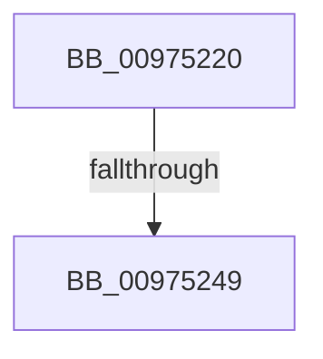

# ObpChargeQuotaForObject

- RVA: `0x00975220`–`0x0097525E` (길이 `62` bytes)
- VA: `0x0000000140975220`
- 실행 섹션: `PAGE`
- PDB 이름 있음: `예`; PDB Function 태그: `아니요`
- unwind 정보 RVA: `0x000965E4`
- 디코드: `17`개 명령, `62/62` bytes 표시
- 미해석 바이트: `0` (있으면 어셈블리에 `.byte`로 보존)

> 이 문서는 커널 이미지의 기계어와 PDB 기호를 분석해 생성했습니다. 4번과 5번은 함수 원형과 자료형을 바이너리 사용 방식에서 추정한 C 해석이며 원본 소스 복구 결과는 아닙니다.

## 1. Dependencies

- 직접 호출 지점: **0**; 고유 호출 대상: **0**
- 직접 호출자로 확인된 함수: **1**
- RIP 상대 이미지 참조: **1**

### Outgoing calls
- 직접 디코드된 call 명령이 없습니다.

### Direct callers
- [ObInsertObjectEx](../8B/ObInsertObjectEx_function_008B97A0.md) at `0x008B9DD6`

### Static image references
- `0x0097523A` → RVA `0x00000000` (`image boundary/outside`; read)

## 2. Other-region calls and transfers

- 다른 실행 섹션으로 향하는 call: **0**
- call이 아닌 외부 분기/꼬리 이동: **1**
  - `0x00975243` → [sub_00975429](Unknown_function_00975429.md) (`tail-transfer`)

## 3. Assembly (complete function range)

```asm
00975220  48 89 5C 24 20                  mov qword ptr [rsp + 0x20], rbx
00975225  56                              push rsi
00975226  57                              push rdi
00975227  41 57                           push r15
00975229  48 83 EC 20                     sub rsp, 0x20
0097522D  0F B6 41 1A                     movzx eax, byte ptr [rcx + 0x1a]
00975231  45 33 FF                        xor r15d, r15d
00975234  48 8B F2                        mov rsi, rdx
00975237  48 8B D9                        mov rbx, rcx
0097523A  48 8D 15 BF AD 68 FF            lea rdx, [rip - 0x975241]
00975241  A8 08                           test al, 8
00975243  0F 84 E0 01 00 00               je 0x140975429
00975249  83 E0 0F                        and eax, 0xf
0097524C  48 8B F9                        mov rdi, rcx
0097524F  0F B6 84 10 80 FF F0 00         movzx eax, byte ptr [rax + rdx + 0xf0ff80]
00975257  48 2B F8                        sub rdi, rax
0097525A  0F B6 41 1B                     movzx eax, byte ptr [rcx + 0x1b]
```

## 4. C-style interpretation (structured pseudocode)

```c
__int64 __fastcall ObpChargeQuotaForObject(__int64 a1, __int64 a2)
{
    __int64 result;
    __int64 v_r15;
    __int64 v_rdi;
    __int64 v_rsp;
    unsigned __int64 v_stack_p20;

    v_stack_p20 = v_rbx;
    v_rsp = (v_rsp) - (32);
    v_r15 = 0;
    result = (unsigned int)((*(unsigned __int8 *)(a1 + 26)) & (15));
    v_rdi = (a1) - (*(unsigned __int8 *)(result + v_rip - 9916993 * 1 + 15794048));
    return *(unsigned __int8 *)(a1 + 27);
}
```

## 5. (Beta) C Style

```c
int64_t ObpChargeQuotaForObject(void *Arg1, int64_t Arg2)
{
    uint8_t *arg1 = (uint8_t *)Arg1;

    int64_t result;
    int64_t local_r15;
    int64_t local_rdi;
    int64_t local_rsp;
    uint64_t v_stack_p20;

    v_stack_p20 = local_rbx;
    local_rsp = (local_rsp) - (32);
    local_r15 = 0;
    result = (uint32_t)((*(uint8_t *)(arg1 + 0x1A)) & (15));
    local_rdi = (Arg1) - (*(uint8_t *)(result + v_rip - 0x975241 * 1 + 0xF0FF80));
    return *(uint8_t *)(arg1 + 0x1B);
}
```

### 관측된 메모리 오프셋

구조체 형식이 확인되지 않은 접근은 인자 기준의 오프셋으로만 기록했습니다.

| 기준 인자 | 오프셋 표현 | 폭 (bit) | 접근 |
|---|---:|---:|---|
| `Arg1` | `+ 0x1A` | `8` | `R` |
| `Arg1` | `+ 0x1B` | `8` | `R` |

## 6. Execution-region graph

[열기: 2D/3D 그래프와 함수 탐색 컨트롤 패널](../../../control-panel.html?section=page&rva=0x00975220&view=graph)

- 2D 그래프는 위에서 아래로 흐르고, 3D 그래프는 빈 공간을 드래그해 회전합니다. Shift+드래그는 이동, 휠은 확대·축소, 함수 노드 선택은 대상 보고서 이동입니다.

### Static fallback


