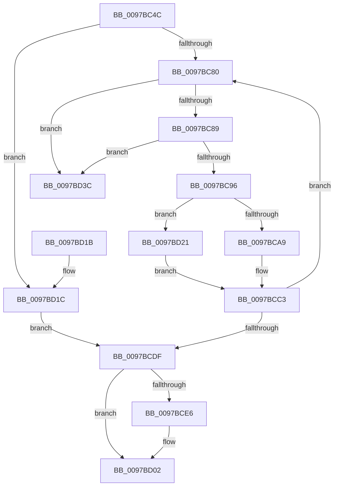

# PfTFreeBufferList

- RVA: `0x0097BC4C`–`0x0097BD43` (길이 `247` bytes)
- VA: `0x000000014097BC4C`
- 실행 섹션: `PAGE`
- PDB 이름 있음: `예`; PDB Function 태그: `아니요`
- unwind 정보 RVA: `0x00096DE8`
- 디코드: `73`개 명령, `247/247` bytes 표시
- 미해석 바이트: `0` (있으면 어셈블리에 `.byte`로 보존)

> 이 문서는 커널 이미지의 기계어와 PDB 기호를 분석해 생성했습니다. 4번과 5번은 함수 원형과 자료형을 바이너리 사용 방식에서 추정한 C 해석이며 원본 소스 복구 결과는 아닙니다.

## 1. Dependencies

- 직접 호출 지점: **3**; 고유 호출 대상: **1**
- 직접 호출자로 확인된 함수: **1**
- RIP 상대 이미지 참조: **0**

### Outgoing calls
- `0x0097BCB1` → [memset](../../text/6C/memset_function_006C6C40.md) (function, `0x006C6C40`)
- `0x0097BCF0` → [memset](../../text/6C/memset_function_006C6C40.md) (function, `0x006C6C40`)
- `0x0097BD27` → [memset](../../text/6C/memset_function_006C6C40.md) (function, `0x006C6C40`)

### Direct callers
- [PfTCreateTraceDump](PfTCreateTraceDump_function_0097B450.md) at `0x0097B894`
- [PfTCreateTraceDump](PfTCreateTraceDump_function_0097B450.md) at `0x0097B8A0`

### Static image references
- 디코드된 RIP-relative 메모리 참조가 없습니다.

## 2. Other-region calls and transfers

- 다른 실행 섹션으로 향하는 call: **3**
  - `0x0097BCB1` → [memset](../../text/6C/memset_function_006C6C40.md) (`PAGE` → `.text`)
  - `0x0097BCF0` → [memset](../../text/6C/memset_function_006C6C40.md) (`PAGE` → `.text`)
  - `0x0097BD27` → [memset](../../text/6C/memset_function_006C6C40.md) (`PAGE` → `.text`)
- 별도 외부 분기/꼬리 이동을 확인하지 못했습니다.

## 3. Assembly (complete function range)

```asm
0097BC4C  48 89 5C 24 08                  mov qword ptr [rsp + 8], rbx
0097BC51  48 89 6C 24 10                  mov qword ptr [rsp + 0x10], rbp
0097BC56  48 89 74 24 18                  mov qword ptr [rsp + 0x18], rsi
0097BC5B  57                              push rdi
0097BC5C  41 56                           push r14
0097BC5E  41 57                           push r15
0097BC60  48 83 EC 20                     sub rsp, 0x20
0097BC64  8B 29                           mov ebp, dword ptr [rcx]
0097BC66  48 8D 71 18                     lea rsi, [rcx + 0x18]
0097BC6A  48 8B 3E                        mov rdi, qword ptr [rsi]
0097BC6D  4C 8B F1                        mov r14, rcx
0097BC70  48 8B 5E 08                     mov rbx, qword ptr [rsi + 8]
0097BC74  C1 ED 04                        shr ebp, 4
0097BC77  48 3B FB                        cmp rdi, rbx
0097BC7A  0F 84 9C 00 00 00               je 0x14097bd1c
0097BC80  48 39 33                        cmp qword ptr [rbx], rsi
0097BC83  0F 85 B3 00 00 00               jne 0x14097bd3c
0097BC89  48 8B 43 08                     mov rax, qword ptr [rbx + 8]
0097BC8D  48 39 18                        cmp qword ptr [rax], rbx
0097BC90  0F 85 A6 00 00 00               jne 0x14097bd3c
0097BC96  48 89 46 08                     mov qword ptr [rsi + 8], rax
0097BC9A  33 D2                           xor edx, edx
0097BC9C  48 89 30                        mov qword ptr [rax], rsi
0097BC9F  41 8B 06                        mov eax, dword ptr [r14]
0097BCA2  44 8B FD                        mov r15d, ebp
0097BCA5  A8 0F                           test al, 0xf
0097BCA7  75 78                           jne 0x14097bd21
0097BCA9  4C 8D 45 E8                     lea r8, [rbp - 0x18]
0097BCAD  48 8D 4B 18                     lea rcx, [rbx + 0x18]
0097BCB1  E8 8A AF D4 FF                  call 0x1406c6c40
0097BCB6  83 63 10 00                     and dword ptr [rbx + 0x10], 0
0097BCBA  8D 45 E8                        lea eax, [rbp - 0x18]
0097BCBD  C1 E8 04                        shr eax, 4
0097BCC0  89 43 14                        mov dword ptr [rbx + 0x14], eax
0097BCC3  49 8B 46 10                     mov rax, qword ptr [r14 + 0x10]
0097BCC7  48 89 03                        mov qword ptr [rbx], rax
0097BCCA  49 89 5E 10                     mov qword ptr [r14 + 0x10], rbx
0097BCCE  66 41 FF 46 0A                  inc word ptr [r14 + 0xa]
0097BCD3  48 8B 3E                        mov rdi, qword ptr [rsi]
0097BCD6  48 8B 5E 08                     mov rbx, qword ptr [rsi + 8]
0097BCDA  48 3B FB                        cmp rdi, rbx
0097BCDD  75 A1                           jne 0x14097bc80
0097BCDF  41 8B 06                        mov eax, dword ptr [r14]
0097BCE2  A8 0F                           test al, 0xf
0097BCE4  75 1C                           jne 0x14097bd02
0097BCE6  4D 8D 47 E8                     lea r8, [r15 - 0x18]
0097BCEA  33 D2                           xor edx, edx
0097BCEC  48 8D 4F 18                     lea rcx, [rdi + 0x18]
0097BCF0  E8 4B AF D4 FF                  call 0x1406c6c40
0097BCF5  83 67 10 00                     and dword ptr [rdi + 0x10], 0
0097BCF9  8D 45 E8                        lea eax, [rbp - 0x18]
0097BCFC  C1 E8 04                        shr eax, 4
0097BCFF  89 47 14                        mov dword ptr [rdi + 0x14], eax
0097BD02  48 8B 5C 24 40                  mov rbx, qword ptr [rsp + 0x40]
0097BD07  48 8B 6C 24 48                  mov rbp, qword ptr [rsp + 0x48]
0097BD0C  48 8B 74 24 50                  mov rsi, qword ptr [rsp + 0x50]
0097BD11  48 83 C4 20                     add rsp, 0x20
0097BD15  41 5F                           pop r15
0097BD17  41 5E                           pop r14
0097BD19  5F                              pop rdi
0097BD1A  C3                              ret
0097BD1B  CC                              int3
0097BD1C  44 8B FD                        mov r15d, ebp
0097BD1F  EB BE                           jmp 0x14097bcdf
0097BD21  4D 8B C7                        mov r8, r15
0097BD24  48 8B CB                        mov rcx, rbx
0097BD27  E8 14 AF D4 FF                  call 0x1406c6c40
0097BD2C  48 89 5B 08                     mov qword ptr [rbx + 8], rbx
0097BD30  48 89 1B                        mov qword ptr [rbx], rbx
0097BD33  C7 43 20 00 08 00 00            mov dword ptr [rbx + 0x20], 0x800
0097BD3A  EB 87                           jmp 0x14097bcc3
0097BD3C  B9 03 00 00 00                  mov ecx, 3
0097BD41  CD 29                           int 0x29
```

## 4. C-style interpretation (structured pseudocode)

```c
__int64 __fastcall PfTFreeBufferList(__int64 a1, int a2)
{
    __int64 result;
    __int64 v_rbp;
    __int64 v_rsp;
    unsigned __int64 v_stack_p10;
    unsigned __int64 v_stack_p18;
    unsigned __int64 v_stack_p8;

    v_stack_p8 = v_rbx;
    v_stack_p10 = v_rbp;
    v_stack_p18 = v_rsi;
    v_rsp = (v_rsp) - (32);
    v_rbp = (unsigned int)(((unsigned int)(*(unsigned int *)(a1))) >> (4));
    if ((*(unsigned __int64 *)(a1 + 24)) == (*(unsigned __int64 *)(a1 + 24 + 8))) goto loc_0097BD1C;
loc_0097BC80:
    if ((*(unsigned __int64 *)(*(unsigned __int64 *)(a1 + 24 + 8))) != (a1 + 24)) goto loc_0097BD3C;
    if ((*(unsigned __int64 *)(*(unsigned __int64 *)(*(unsigned __int64 *)(a1 + 24 + 8) + 8))) != (*(unsigned __int64 *)(a1 + 24 + 8))) goto loc_0097BD3C;
    *(unsigned __int64 *)(a1 + 24 + 8) = *(unsigned __int64 *)(*(unsigned __int64 *)(a1 + 24 + 8) + 8);
    a2 = 0;
    *(unsigned __int64 *)(*(unsigned __int64 *)(*(unsigned __int64 *)(a1 + 24 + 8) + 8)) = a1 + 24;
    if ((((unsigned __int8)((unsigned int)(*(unsigned int *)(a1)))) & (15)) != 0) goto loc_0097BD21;
    result = memset(*(unsigned __int64 *)(a1 + 24 + 8) + 24, a2, v_rbp - 24, a4);
    result = (unsigned int)((v_rbp - 24) >> (4));
    *(unsigned int *)(*(unsigned __int64 *)(a1 + 24 + 8) + 20) = (unsigned int)(result);
loc_0097BCC3:
    *(unsigned __int64 *)(*(unsigned __int64 *)(a1 + 24 + 8)) = *(unsigned __int64 *)(a1 + 16);
    *(unsigned __int64 *)(a1 + 16) = *(unsigned __int64 *)(a1 + 24 + 8);
    if ((*(unsigned __int64 *)(a1 + 24)) != (*(unsigned __int64 *)(a1 + 24 + 8))) goto loc_0097BC80;
loc_0097BCDF:
    result = (unsigned int)(*(unsigned int *)(a1));
    if ((((unsigned __int8)((unsigned int)(*(unsigned int *)(a1)))) & (15)) == 0) {
        a3 = (unsigned int)((unsigned int)(v_rbp)) - 24;
        a2 = 0;
        a1 = *(unsigned __int64 *)(a1 + 24) + 24;
        result = memset(a1, a2, a3, a4);
        result = v_rbp - 24;
        result = (unsigned int)((result) >> (4));
        *(unsigned int *)(*(unsigned __int64 *)(a1 + 24) + 20) = (unsigned int)(result);
    }
    v_rsp = (v_rsp) + (32);
    return result;
loc_0097BD1C:
    goto loc_0097BCDF;
loc_0097BD21:
    result = memset(v_stack_p8, a2, (unsigned int)((unsigned int)(v_stack_p10)), a4);
    *(unsigned __int64 *)(v_stack_p8 + 8) = v_stack_p8;
    *(unsigned __int64 *)(v_stack_p8) = v_stack_p8;
    *(unsigned int *)(v_stack_p8 + 32) = 0x800ULL;
    goto loc_0097BCC3;
loc_0097BD3C:
    return result;
}
```

## 5. (Beta) C Style

```c
int64_t PfTFreeBufferList(void *Arg1, int32_t Arg2)
{
    uint8_t *arg1 = (uint8_t *)Arg1;

    int64_t result;
    int64_t local_rbp;
    int64_t local_rsp;
    uint64_t v_stack_p10;
    uint64_t v_stack_p18;
    uint64_t v_stack_p8;

    v_stack_p8 = local_rbx;
    v_stack_p10 = local_rbp;
    v_stack_p18 = local_rsi;
    local_rsp = (local_rsp) - (32);
    local_rbp = (uint32_t)(((uint32_t)(*(uint32_t *)(arg1))) >> (4));
    if ((*(uint64_t *)(arg1 + 0x18)) == (*(uint64_t *)(arg1 + 0x18 + 0x8))) goto loc_0097BD1C;
loc_0097BC80:
    if ((*(uint64_t *)(*(uint64_t *)(arg1 + 0x18 + 0x8))) != (Arg1 + 24)) goto loc_0097BD3C;
    if ((*(uint64_t *)(*(uint64_t *)(*(uint64_t *)(arg1 + 0x18 + 0x8) + 0x8))) != (*(uint64_t *)(arg1 + 0x18 + 0x8))) goto loc_0097BD3C;
    *(uint64_t *)(arg1 + 0x18 + 0x8) = *(uint64_t *)(*(uint64_t *)(arg1 + 0x18 + 0x8) + 0x8);
    Arg2 = 0;
    *(void **)(*(uint64_t *)(*(uint64_t *)(arg1 + 0x18 + 0x8) + 0x8)) = Arg1 + 24;
    if ((((uint8_t)((uint32_t)(*(uint32_t *)(arg1)))) & (15)) != 0) goto loc_0097BD21;
    result = memset(*(uint64_t *)(arg1 + 0x18 + 0x8) + 24, Arg2, local_rbp - 24, a4);
    result = (uint32_t)((local_rbp - 24) >> (4));
    *(uint32_t *)(*(uint64_t *)(arg1 + 0x18 + 0x8) + 0x14) = (uint32_t)(result);
loc_0097BCC3:
    *(uint64_t *)(*(uint64_t *)(arg1 + 0x18 + 0x8)) = *(uint64_t *)(arg1 + 0x10);
    *(uint64_t *)(arg1 + 0x10) = *(uint64_t *)(arg1 + 0x18 + 0x8);
    if ((*(uint64_t *)(arg1 + 0x18)) != (*(uint64_t *)(arg1 + 0x18 + 0x8))) goto loc_0097BC80;
loc_0097BCDF:
    result = (uint32_t)(*(uint32_t *)(arg1));
    if ((((uint8_t)((uint32_t)(*(uint32_t *)(arg1)))) & (15)) == 0) {
        a3 = (uint32_t)((uint32_t)(local_rbp)) - 24;
        Arg2 = 0;
        Arg1 = *(uint64_t *)(arg1 + 0x18) + 24;
        result = memset(Arg1, Arg2, a3, a4);
        result = local_rbp - 24;
        result = (uint32_t)((result) >> (4));
        *(uint32_t *)(*(uint64_t *)(arg1 + 0x18) + 0x14) = (uint32_t)(result);
    }
    local_rsp = (local_rsp) + (32);
    return result;
loc_0097BD1C:
    goto loc_0097BCDF;
loc_0097BD21:
    result = memset(v_stack_p8, Arg2, (uint32_t)((uint32_t)(v_stack_p10)), a4);
    *(uint64_t *)(v_stack_p8 + 0x8) = v_stack_p8;
    *(uint64_t *)(v_stack_p8) = v_stack_p8;
    *(uint32_t *)(v_stack_p8 + 0x20) = 0x800ULL;
    goto loc_0097BCC3;
loc_0097BD3C:
    return result;
}
```

### 관측된 메모리 오프셋

구조체 형식이 확인되지 않은 접근은 인자 기준의 오프셋으로만 기록했습니다.

| 기준 인자 | 오프셋 표현 | 폭 (bit) | 접근 |
|---|---:|---:|---|
| `Arg1` | `+ 0x0` | `32` | `R` |
| `Arg1` | `+ 0x0` | `64` | `R` |
| `Arg1` | `+ 0x8` | `64` | `R` |
| `Arg1` | `+ 0x8` | `64` | `W` |
| `Arg1` | `+ 0xA` | `16` | `R/W` |
| `Arg1` | `+ 0x10` | `64` | `R` |
| `Arg1` | `+ 0x10` | `64` | `W` |
| `Arg1` | `+ 0x18` | `64` | `R` |

## 6. Execution-region graph

[열기: 2D/3D 그래프와 함수 탐색 컨트롤 패널](../../../control-panel.html?section=page&rva=0x0097BC4C&view=graph)

- 2D 그래프는 위에서 아래로 흐르고, 3D 그래프는 빈 공간을 드래그해 회전합니다. Shift+드래그는 이동, 휠은 확대·축소, 함수 노드 선택은 대상 보고서 이동입니다.

### Static fallback


