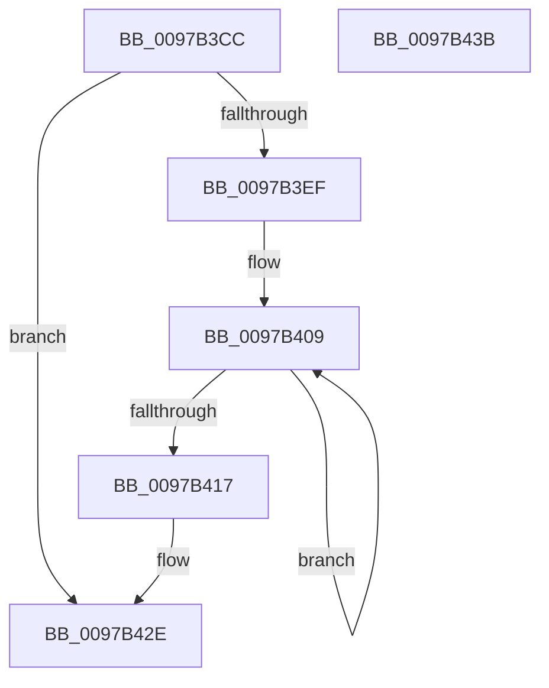

# PfTGenerateTrace

- RVA: `0x0097B3CC`–`0x0097B43C` (길이 `112` bytes)
- VA: `0x000000014097B3CC`
- 실행 섹션: `PAGE`
- PDB 이름 있음: `예`; PDB Function 태그: `아니요`
- unwind 정보 RVA: `0x0005CAAC`
- 디코드: `29`개 명령, `112/112` bytes 표시
- 미해석 바이트: `0` (있으면 어셈블리에 `.byte`로 보존)

> 이 문서는 커널 이미지의 기계어와 PDB 기호를 분석해 생성했습니다. 4번과 5번은 함수 원형과 자료형을 바이너리 사용 방식에서 추정한 C 해석이며 원본 소스 복구 결과는 아닙니다.

## 1. Dependencies

- 직접 호출 지점: **2**; 고유 호출 대상: **2**
- 직접 호출자로 확인된 함수: **2**
- RIP 상대 이미지 참조: **0**

### Outgoing calls
- `0x0097B3E4` → [PfTCreateTraceDump](PfTCreateTraceDump_function_0097B450.md) (function, `0x0097B450`)
- `0x0097B429` → [PfTTraceListAdd](../A6/PfTTraceListAdd_function_00A60E00.md) (function, `0x00A60E00`)

### Direct callers
- [PfTLoggingWorker](PfTLoggingWorker_function_0097B140.md) at `0x0097B2F0`
- [PfTLoggingWorker](PfTLoggingWorker_function_0097B140.md) at `0x0097B350`
- [PfTLoggingWorker](PfTLoggingWorker_function_0097B140.md) at `0x0097B390`
- [sub_00B29CFA](../B2/Unknown_function_00B29CFA.md) at `0x00B29D23`

### Static image references
- 디코드된 RIP-relative 메모리 참조가 없습니다.

## 2. Other-region calls and transfers

- 다른 실행 섹션으로 향하는 call: **0**
- 별도 외부 분기/꼬리 이동을 확인하지 못했습니다.

## 3. Assembly (complete function range)

```asm
0097B3CC  48 89 5C 24 08                  mov qword ptr [rsp + 8], rbx
0097B3D1  57                              push rdi
0097B3D2  48 83 EC 20                     sub rsp, 0x20
0097B3D6  48 83 64 24 38 00               and qword ptr [rsp + 0x38], 0
0097B3DC  48 8D 54 24 38                  lea rdx, [rsp + 0x38]
0097B3E1  48 8B D9                        mov rbx, rcx
0097B3E4  E8 67 00 00 00                  call 0x14097b450
0097B3E9  8B F8                           mov edi, eax
0097B3EB  85 C0                           test eax, eax
0097B3ED  78 3F                           js 0x14097b42e
0097B3EF  FF 83 D0 02 00 00               inc dword ptr [rbx + 0x2d0]
0097B3F5  49 B8 B0 03 00 00 80 F7 FF FF   movabs r8, 0xfffff780000003b0
0097B3FF  49 B9 08 00 00 00 80 F7 FF FF   movabs r9, 0xfffff78000000008
0097B409  49 8B 10                        mov rdx, qword ptr [r8]
0097B40C  49 8B 09                        mov rcx, qword ptr [r9]
0097B40F  49 8B 00                        mov rax, qword ptr [r8]
0097B412  48 3B D0                        cmp rdx, rax
0097B415  75 F2                           jne 0x14097b409
0097B417  48 2B CA                        sub rcx, rdx
0097B41A  48 8B 54 24 38                  mov rdx, qword ptr [rsp + 0x38]
0097B41F  48 89 8B 00 01 00 00            mov qword ptr [rbx + 0x100], rcx
0097B426  48 8B CB                        mov rcx, rbx
0097B429  E8 D2 59 0E 00                  call 0x140a60e00
0097B42E  48 8B 5C 24 30                  mov rbx, qword ptr [rsp + 0x30]
0097B433  8B C7                           mov eax, edi
0097B435  48 83 C4 20                     add rsp, 0x20
0097B439  5F                              pop rdi
0097B43A  C3                              ret
0097B43B  CC                              int3
```

## 4. C-style interpretation (structured pseudocode)

```c
__int64 __fastcall PfTGenerateTrace(__int64 a1)
{
    __int64 result;
    __int64 v_rsp;
    unsigned __int64 v_stack_p10;
    unsigned __int64 v_stack_p8;

    v_stack_p8 = v_rbx;
    v_rsp = (v_rsp) - (32);
    result = PfTCreateTraceDump(a1, v_stack_p10, a3, a4);
    if (sign_flag) goto loc_0097B42E;
loc_0097B409:
    if ((*(unsigned __int64 *)(a3)) != (*(unsigned __int64 *)(a3))) goto loc_0097B409;
    a1 = (*(unsigned __int64 *)(a4)) - (*(unsigned __int64 *)(a3));
    *(unsigned __int64 *)(a1 + 256) = a1;
    result = PfTTraceListAdd(a1, v_stack_p10, a3, a4);
loc_0097B42E:
    v_rsp = (v_rsp) + (32);
    return (unsigned int)((unsigned int)((unsigned int)((unsigned int)(result))));
}
```

## 5. (Beta) C Style

```c
int64_t PfTGenerateTrace(void *Arg1)
{
    uint8_t *arg1 = (uint8_t *)Arg1;

    int64_t result;
    int64_t local_rsp;
    uint64_t v_stack_p10;
    uint64_t v_stack_p8;

    v_stack_p8 = local_rbx;
    local_rsp = (local_rsp) - (32);
    result = PfTCreateTraceDump(Arg1, v_stack_p10, a3, a4);
    if (sign_flag) goto loc_0097B42E;
loc_0097B409:
    if ((*(uint64_t *)(a3)) != (*(uint64_t *)(a3))) goto loc_0097B409;
    Arg1 = (*(uint64_t *)(a4)) - (*(uint64_t *)(a3));
    *(void **)(arg1 + 0x100) = Arg1;
    result = PfTTraceListAdd(Arg1, v_stack_p10, a3, a4);
loc_0097B42E:
    local_rsp = (local_rsp) + (32);
    return (uint32_t)((uint32_t)((uint32_t)((uint32_t)(result))));
}
```

### 관측된 메모리 오프셋

구조체 형식이 확인되지 않은 접근은 인자 기준의 오프셋으로만 기록했습니다.

| 기준 인자 | 오프셋 표현 | 폭 (bit) | 접근 |
|---|---:|---:|---|
| `Arg1` | `+ 0x100` | `64` | `W` |
| `Arg1` | `+ 0x2D0` | `32` | `R/W` |

## 6. Execution-region graph

[열기: 2D/3D 그래프와 함수 탐색 컨트롤 패널](../../../control-panel.html?section=page&rva=0x0097B3CC&view=graph)

- 2D 그래프는 위에서 아래로 흐르고, 3D 그래프는 빈 공간을 드래그해 회전합니다. Shift+드래그는 이동, 휠은 확대·축소, 함수 노드 선택은 대상 보고서 이동입니다.

### Static fallback


