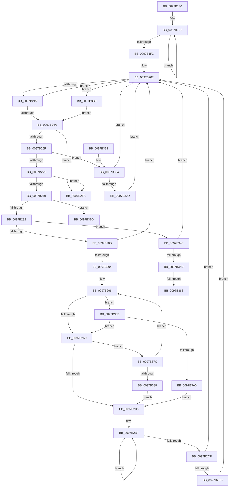

# PfTLoggingWorker

- RVA: `0x0097B140`–`0x0097B3C4` (길이 `644` bytes)
- VA: `0x000000014097B140`
- 실행 섹션: `PAGE`
- PDB 이름 있음: `예`; PDB Function 태그: `예`
- unwind 정보 RVA: `0x00096D94`
- 디코드: `146`개 명령, `644/644` bytes 표시
- 미해석 바이트: `0` (있으면 어셈블리에 `.byte`로 보존)

> 이 문서는 커널 이미지의 기계어와 PDB 기호를 분석해 생성했습니다. 4번과 5번은 함수 원형과 자료형을 바이너리 사용 방식에서 추정한 C 해석이며 원본 소스 복구 결과는 아닙니다.

## 1. Dependencies

- 직접 호출 지점: **12**; 고유 호출 대상: **8**
- 직접 호출자로 확인된 함수: **0**
- RIP 상대 이미지 참조: **1**

### Outgoing calls
- `0x0097B199` → [KeSetBasePriorityThread](../../text/3C/KeSetBasePriorityThread_function_003C6EB0.md) (function, `0x003C6EB0`)
- `0x0097B233` → [KeWaitForMultipleObjects](../../text/20/KeWaitForMultipleObjects_function_0020D110.md) (function, `0x0020D110`)
- `0x0097B252` → [KeResetEvent](../../text/24/KeResetEvent_function_00248350.md) (function, `0x00248350`)
- `0x0097B299` → [PfpFlushBuffers](PfpFlushBuffers_function_0097C0A0.md) (function, `0x0097C0A0`)
- `0x0097B2F0` → [PfTGenerateTrace](PfTGenerateTrace_function_0097B3CC.md) (function, `0x0097B3CC`)
- `0x0097B301` → [_security_check_cookie](../../text/6A/_security_check_cookie_function_006AC640.md) (function, `0x006AC640`)
- `0x0097B339` → [KeSetEvent](../../text/33/KeSetEvent_function_0033F310.md) (function, `0x0033F310`)
- `0x0097B346` → [PfpFlushBuffers](PfpFlushBuffers_function_0097C0A0.md) (function, `0x0097C0A0`)
- `0x0097B350` → [PfTGenerateTrace](PfTGenerateTrace_function_0097B3CC.md) (function, `0x0097B3CC`)
- `0x0097B371` → [KeDelayExecutionThread](../../text/20/KeDelayExecutionThread_function_00209550.md) (function, `0x00209550`)
- `0x0097B390` → [PfTGenerateTrace](PfTGenerateTrace_function_0097B3CC.md) (function, `0x0097B3CC`)
- `0x0097B3A9` → [KeDelayExecutionThread](../../text/20/KeDelayExecutionThread_function_00209550.md) (function, `0x00209550`)

### Direct callers
- 이 함수 시작 RVA로 연결되는 직접 call은 확인되지 않았습니다. 간접 호출은 완전히 역산할 수 없습니다.

### Static image references
- `0x0097B15F` → RVA `0x00E0A740` (`.data`; read)

## 2. Other-region calls and transfers

- 다른 실행 섹션으로 향하는 call: **7**
  - `0x0097B199` → [KeSetBasePriorityThread](../../text/3C/KeSetBasePriorityThread_function_003C6EB0.md) (`PAGE` → `.text`)
  - `0x0097B233` → [KeWaitForMultipleObjects](../../text/20/KeWaitForMultipleObjects_function_0020D110.md) (`PAGE` → `.text`)
  - `0x0097B252` → [KeResetEvent](../../text/24/KeResetEvent_function_00248350.md) (`PAGE` → `.text`)
  - `0x0097B301` → [_security_check_cookie](../../text/6A/_security_check_cookie_function_006AC640.md) (`PAGE` → `.text`)
  - `0x0097B339` → [KeSetEvent](../../text/33/KeSetEvent_function_0033F310.md) (`PAGE` → `.text`)
  - `0x0097B371` → [KeDelayExecutionThread](../../text/20/KeDelayExecutionThread_function_00209550.md) (`PAGE` → `.text`)
  - `0x0097B3A9` → [KeDelayExecutionThread](../../text/20/KeDelayExecutionThread_function_00209550.md) (`PAGE` → `.text`)
- call이 아닌 외부 분기/꼬리 이동: **3**
  - `0x0097B362` → [sub_00B29CFA](../B2/Unknown_function_00B29CFA.md) (`tail-transfer`)
  - `0x0097B377` → [sub_00B29CFA](../B2/Unknown_function_00B29CFA.md) (`tail-transfer`)
  - `0x0097B3BF` → [sub_00B29CFA + 0xE](../B2/Unknown_function_00B29CFA.md) (`tail-transfer`)

## 3. Assembly (complete function range)

```asm
0097B140  48 8B C4                        mov rax, rsp
0097B143  48 89 58 10                     mov qword ptr [rax + 0x10], rbx
0097B147  48 89 70 18                     mov qword ptr [rax + 0x18], rsi
0097B14B  48 89 78 20                     mov qword ptr [rax + 0x20], rdi
0097B14F  55                              push rbp
0097B150  41 54                           push r12
0097B152  41 57                           push r15
0097B154  48 8D 68 98                     lea rbp, [rax - 0x68]
0097B158  48 81 EC 50 01 00 00            sub rsp, 0x150
0097B15F  48 8B 05 DA F5 48 00            mov rax, qword ptr [rip + 0x48f5da]
0097B166  48 33 C4                        xor rax, rsp
0097B169  48 89 45 40                     mov qword ptr [rbp + 0x40], rax
0097B16D  48 B8 00 A2 2F 4D FF FF FF FF   movabs rax, 0xffffffff4d2fa200
0097B177  48 89 4C 24 48                  mov qword ptr [rsp + 0x48], rcx
0097B17C  48 89 44 24 50                  mov qword ptr [rsp + 0x50], rax
0097B181  48 8B F9                        mov rdi, rcx
0097B184  65 48 8B 0C 25 88 01 00 00      mov rcx, qword ptr gs:[0x188]
0097B18D  83 CA FF                        or edx, 0xffffffff
0097B190  48 C7 44 24 40 20 6C FB FF      mov qword ptr [rsp + 0x40], 0xfffffffffffb6c20
0097B199  E8 12 BD A4 FF                  call 0x1403c6eb0
0097B19E  48 8D 87 08 01 00 00            lea rax, [rdi + 0x108]
0097B1A5  49 BC B0 03 00 00 80 F7 FF FF   movabs r12, 0xfffff780000003b0
0097B1AF  48 89 44 24 58                  mov qword ptr [rsp + 0x58], rax
0097B1B4  48 8D 87 C8 00 00 00            lea rax, [rdi + 0xc8]
0097B1BB  48 89 44 24 60                  mov qword ptr [rsp + 0x60], rax
0097B1C0  48 8D 87 B0 00 00 00            lea rax, [rdi + 0xb0]
0097B1C7  48 89 44 24 68                  mov qword ptr [rsp + 0x68], rax
0097B1CC  48 8D 87 E0 02 00 00            lea rax, [rdi + 0x2e0]
0097B1D3  48 89 44 24 70                  mov qword ptr [rsp + 0x70], rax
0097B1D8  48 BF 08 00 00 00 80 F7 FF FF   movabs rdi, 0xfffff78000000008
0097B1E2  49 8B 14 24                     mov rdx, qword ptr [r12]
0097B1E6  48 8B 0F                        mov rcx, qword ptr [rdi]
0097B1E9  49 8B 04 24                     mov rax, qword ptr [r12]
0097B1ED  48 3B D0                        cmp rdx, rax
0097B1F0  75 F0                           jne 0x14097b1e2
0097B1F2  48 8B 7C 24 48                  mov rdi, qword ptr [rsp + 0x48]
0097B1F7  48 2B CA                        sub rcx, rdx
0097B1FA  41 BF 01 00 00 00               mov r15d, 1
0097B200  48 89 8F 00 01 00 00            mov qword ptr [rdi + 0x100], rcx
0097B207  48 8D 45 80                     lea rax, [rbp - 0x80]
0097B20B  45 33 C9                        xor r9d, r9d
0097B20E  48 89 44 24 38                  mov qword ptr [rsp + 0x38], rax
0097B213  48 8D 54 24 58                  lea rdx, [rsp + 0x58]
0097B218  48 8D 44 24 50                  lea rax, [rsp + 0x50]
0097B21D  45 8B C7                        mov r8d, r15d
0097B220  48 89 44 24 30                  mov qword ptr [rsp + 0x30], rax
0097B225  C6 44 24 28 00                  mov byte ptr [rsp + 0x28], 0
0097B22A  41 8D 49 04                     lea ecx, [r9 + 4]
0097B22E  C6 44 24 20 00                  mov byte ptr [rsp + 0x20], 0
0097B233  E8 D8 1E 89 FF                  call 0x14020d110
0097B238  8B D8                           mov ebx, eax
0097B23A  3D 02 01 00 00                  cmp eax, 0x102
0097B23F  0F 84 6E 01 00 00               je 0x14097b3b3
0097B245  83 F8 04                        cmp eax, 4
0097B248  7D BD                           jge 0x14097b207
0097B24A  48 63 CB                        movsxd rcx, ebx
0097B24D  48 8B 4C CC 58                  mov rcx, qword ptr [rsp + rcx*8 + 0x58]
0097B252  E8 F9 D0 8C FF                  call 0x140248350
0097B257  85 DB                           test ebx, ebx
0097B259  0F 84 9B 00 00 00               je 0x14097b2fa
0097B25F  8B 87 5C 02 00 00               mov eax, dword ptr [rdi + 0x25c]
0097B265  39 87 58 02 00 00               cmp dword ptr [rdi + 0x258], eax
0097B26B  0F 83 B3 00 00 00               jae 0x14097b324
0097B271  85 DB                           test ebx, ebx
0097B273  0F 84 81 00 00 00               je 0x14097b2fa
0097B279  83 EB 01                        sub ebx, 1
0097B27C  0F 84 3B 01 00 00               je 0x14097b3bd
0097B282  83 EB 01                        sub ebx, 1
0097B285  0F 84 B8 00 00 00               je 0x14097b343
0097B28B  83 FB 01                        cmp ebx, 1
0097B28E  0F 85 73 FF FF FF               jne 0x14097b207
0097B294  33 DB                           xor ebx, ebx
0097B296  48 8B CF                        mov rcx, rdi
0097B299  E8 02 0E 00 00                  call 0x14097c0a0
0097B29E  40 8A F0                        mov sil, al
0097B2A1  84 C0                           test al, al
0097B2A3  0F 84 E4 00 00 00               je 0x14097b38d
0097B2A9  41 03 DF                        add ebx, r15d
0097B2AC  40 84 F6                        test sil, sil
0097B2AF  0F 84 C7 00 00 00               je 0x14097b37c
0097B2B5  49 BF 08 00 00 00 80 F7 FF FF   movabs r15, 0xfffff78000000008
0097B2BF  49 8B 14 24                     mov rdx, qword ptr [r12]
0097B2C3  49 8B 0F                        mov rcx, qword ptr [r15]
0097B2C6  49 8B 04 24                     mov rax, qword ptr [r12]
0097B2CA  48 3B D0                        cmp rdx, rax
0097B2CD  75 F0                           jne 0x14097b2bf
0097B2CF  48 2B 8F 00 01 00 00            sub rcx, qword ptr [rdi + 0x100]
0097B2D6  B8 00 5E D0 B2                  mov eax, 0xb2d05e00
0097B2DB  48 2B CA                        sub rcx, rdx
0097B2DE  41 BF 01 00 00 00               mov r15d, 1
0097B2E4  48 3B C8                        cmp rcx, rax
0097B2E7  0F 86 1A FF FF FF               jbe 0x14097b207
0097B2ED  48 8B CF                        mov rcx, rdi
0097B2F0  E8 D7 00 00 00                  call 0x14097b3cc
0097B2F5  E9 0D FF FF FF                  jmp 0x14097b207
0097B2FA  48 8B 4D 40                     mov rcx, qword ptr [rbp + 0x40]
0097B2FE  48 33 CC                        xor rcx, rsp
0097B301  E8 3A 13 D3 FF                  call 0x1406ac640
0097B306  4C 8D 9C 24 50 01 00 00         lea r11, [rsp + 0x150]
0097B30E  49 8B 5B 28                     mov rbx, qword ptr [r11 + 0x28]
0097B312  49 8B 73 30                     mov rsi, qword ptr [r11 + 0x30]
0097B316  49 8B 7B 38                     mov rdi, qword ptr [r11 + 0x38]
0097B31A  49 8B E3                        mov rsp, r11
0097B31D  41 5F                           pop r15
0097B31F  41 5C                           pop r12
0097B321  5D                              pop rbp
0097B322  C3                              ret
0097B323  CC                              int3
0097B324  41 3B DF                        cmp ebx, r15d
0097B327  0F 85 DA FE FF FF               jne 0x14097b207
0097B32D  48 8D 8F E0 00 00 00            lea rcx, [rdi + 0xe0]
0097B334  45 33 C0                        xor r8d, r8d
0097B337  33 D2                           xor edx, edx
0097B339  E8 D2 3F 9C FF                  call 0x14033f310
0097B33E  E9 C4 FE FF FF                  jmp 0x14097b207
0097B343  48 8B CF                        mov rcx, rdi
0097B346  E8 55 0D 00 00                  call 0x14097c0a0
0097B34B  48 8B CF                        mov rcx, rdi
0097B34E  8A D8                           mov bl, al
0097B350  E8 77 00 00 00                  call 0x14097b3cc
0097B355  84 DB                           test bl, bl
0097B357  0F 85 AA FE FF FF               jne 0x14097b207
0097B35D  3D 9A 00 00 C0                  cmp eax, 0xc000009a
0097B362  0F 85 92 E9 1A 00               jne 0x140b29cfa
0097B368  4C 8D 44 24 40                  lea r8, [rsp + 0x40]
0097B36D  33 D2                           xor edx, edx
0097B36F  33 C9                           xor ecx, ecx
0097B371  E8 DA E1 88 FF                  call 0x140209550
0097B376  90                              nop
0097B377  E9 7E E9 1A 00                  jmp 0x140b29cfa
0097B37C  81 FB E8 03 00 00               cmp ebx, 0x3e8
0097B382  0F 82 0E FF FF FF               jb 0x14097b296
0097B388  E9 28 FF FF FF                  jmp 0x14097b2b5
0097B38D  48 8B CF                        mov rcx, rdi
0097B390  E8 37 00 00 00                  call 0x14097b3cc
0097B395  3D 9A 00 00 C0                  cmp eax, 0xc000009a
0097B39A  0F 85 09 FF FF FF               jne 0x14097b2a9
0097B3A0  4C 8D 44 24 40                  lea r8, [rsp + 0x40]
0097B3A5  33 D2                           xor edx, edx
0097B3A7  33 C9                           xor ecx, ecx
0097B3A9  E8 A2 E1 88 FF                  call 0x140209550
0097B3AE  E9 02 FF FF FF                  jmp 0x14097b2b5
0097B3B3  BB 03 00 00 00                  mov ebx, 3
0097B3B8  E9 8D FE FF FF                  jmp 0x14097b24a
0097B3BD  33 DB                           xor ebx, ebx
0097B3BF  E9 44 E9 1A 00                  jmp 0x140b29d08
```

## 4. C-style interpretation (structured pseudocode)

```c
__int64 __fastcall PfTLoggingWorker(__int64 a1, int a2, __int64 a3, int a4)
{
    __int64 result;
    __int64 v_rbx;
    __int64 v_rsp;
    unsigned __int64 v_stack_m100;
    unsigned __int64 v_stack_m108;
    unsigned __int64 v_stack_m110;
    unsigned __int64 v_stack_m118;
    unsigned __int64 v_stack_m120;
    unsigned __int64 v_stack_m128;
    unsigned __int64 v_stack_m130;
    unsigned __int64 v_stack_m138;
    unsigned __int8 v_stack_m140;
    unsigned __int8 v_stack_m148;
    unsigned __int64 v_stack_m18;
    unsigned __int64 v_stack_mF8;

    *(unsigned __int64 *)(v_rsp + 16) = v_rbx;
    *(unsigned __int64 *)(v_rsp + 24) = v_rsi;
    *(unsigned __int64 *)(v_rsp + 32) = v_rdi;
    v_rsp = (v_rsp) - (336);
    result = (*(unsigned __int64 *)(v_rip + 4781530)) ^ (v_rsp);
    *(unsigned __int64 *)(v_rsp - 104 + 64) = result;
    v_stack_m120 = a1;
    v_stack_m118 = result;
    a2 = (unsigned int)((a2) | (0xFFFFFFFFULL));
    v_stack_m128 = 0xFFFFFFFFFFFB6C20ULL;
    result = KeSetBasePriorityThread(*(unsigned __int64 *)(gs_base + (0 + 392)), a2, a3, a4);
    v_stack_m110 = a1 + 264;
    v_stack_m108 = a1 + 200;
    v_stack_m100 = a1 + 176;
    v_stack_mF8 = a1 + 736;
loc_0097B1E2:
    if ((*(unsigned __int64 *)(v_r12)) != (*(unsigned __int64 *)(v_r12))) goto loc_0097B1E2;
    a1 = (*(unsigned __int64 *)(a1)) - (*(unsigned __int64 *)(v_r12));
    *(unsigned __int64 *)(v_stack_m120 + 256) = a1;
loc_0097B207:
    a4 = 0;
    v_stack_m130 = v_rsp - 104 - 128;
    v_stack_m138 = v_stack_m118;
    v_stack_m140 = 0;
    v_stack_m148 = 0;
    result = KeWaitForMultipleObjects(a4 + 4, v_stack_m110, 1, a4);
    if (((unsigned int)(result)) == 258) goto loc_0097B3B3;
    if (((unsigned int)(result)) >= 4) goto loc_0097B207;
loc_0097B24A:
    result = KeResetEvent(*(unsigned __int64 *)(v_rsp + (int)((unsigned int)((unsigned int)((unsigned int)(result)))) * 8 + 88), v_stack_m110, 1, a4);
    if ((unsigned int)((unsigned int)((unsigned int)(result))) == 0) goto loc_0097B2FA;
    if ((*(unsigned int *)(v_stack_m120 + 600)) >= ((unsigned int)((unsigned int)(*(unsigned int *)(v_stack_m120 + 604))))) goto loc_0097B324;
    if ((unsigned int)((unsigned int)((unsigned int)(result))) == 0) goto loc_0097B2FA;
    v_rbx = (unsigned int)(((unsigned int)((unsigned int)(result))) - (1));
    if (condition_is_equal) goto loc_0097B3BD;
    v_rbx = (unsigned int)((v_rbx) - (1));
    if (condition_is_equal) goto loc_0097B343;
    if (((unsigned int)(v_rbx)) != 1) goto loc_0097B207;
    v_rbx = 0;
loc_0097B296:
    result = PfpFlushBuffers(v_stack_m120, v_stack_m110, 1, a4);
    if ((unsigned __int8)(result) == 0) goto loc_0097B38D;
loc_0097B2A9:
    v_rbx = (unsigned int)((v_rbx) + (1));
    if ((unsigned __int8)((unsigned __int8)(result)) == 0) goto loc_0097B37C;
loc_0097B2B5:
loc_0097B2BF:
    if ((*(unsigned __int64 *)(v_r12)) != (*(unsigned __int64 *)(v_r12))) goto loc_0097B2BF;
    a1 = (*(unsigned __int64 *)(1)) - (*(unsigned __int64 *)(v_stack_m120 + 256));
    a1 = (a1) - (*(unsigned __int64 *)(v_r12));
    if (a1 <= ((unsigned int)(0xB2D05E00ULL))) goto loc_0097B207;
    result = PfTGenerateTrace(v_stack_m120, *(unsigned __int64 *)(v_r12), 1, a4);
    goto loc_0097B207;
loc_0097B2FA:
    a1 = (*(unsigned __int64 *)(v_rsp - 104 + 64)) ^ (v_rsp);
    result = _security_check_cookie(a1, *(unsigned __int64 *)(v_r12), 1, a4);
    return result;
loc_0097B324:
    if (((unsigned int)(*(unsigned __int64 *)(v_stack_m18 + 40))) != 1) goto loc_0097B207;
    a3 = 0;
    a2 = 0;
    result = KeSetEvent(*(unsigned __int64 *)(v_stack_m18 + 56) + 224, a2, a3, a4);
    goto loc_0097B207;
loc_0097B343:
    result = PfpFlushBuffers(*(unsigned __int64 *)(v_stack_m18 + 56), a2, a3, a4);
    result = PfTGenerateTrace(*(unsigned __int64 *)(v_stack_m18 + 56), a2, a3, a4);
    if ((unsigned __int8)((unsigned __int8)(result)) != 0) goto loc_0097B207;
    a2 = 0;
    a1 = 0;
    result = KeDelayExecutionThread(a1, a2, v_stack_m110, a4);
loc_0097B37C:
    if (((unsigned int)((unsigned __int8)(result))) < 1000) goto loc_0097B296;
    goto loc_0097B2B5;
loc_0097B38D:
    result = PfTGenerateTrace(*(unsigned __int64 *)(v_stack_m18 + 56), a2, v_stack_m110, a4);
    if (((unsigned int)(result)) != 0xC000009AULL) goto loc_0097B2A9;
    a2 = 0;
    a1 = 0;
    result = KeDelayExecutionThread(a1, a2, v_stack_m110, a4);
    goto loc_0097B2B5;
loc_0097B3B3:
    goto loc_0097B24A;
loc_0097B3BD:
    v_rbx = 0;
}
```

## 5. (Beta) C Style

```c
int64_t PfTLoggingWorker(void *Arg1, int32_t Arg2, int64_t Arg3, int32_t Arg4)
{
    uint8_t *arg1 = (uint8_t *)Arg1;

    int64_t result;
    int64_t local_rbx;
    int64_t local_rsp;
    uint64_t v_stack_m100;
    uint64_t v_stack_m108;
    uint64_t v_stack_m110;
    uint64_t v_stack_m118;
    uint64_t v_stack_m120;
    uint64_t v_stack_m128;
    uint64_t v_stack_m130;
    uint64_t v_stack_m138;
    uint8_t v_stack_m140;
    uint8_t v_stack_m148;
    uint64_t v_stack_m18;
    uint64_t v_stack_mF8;

    *(uint64_t *)(local_rsp + 0x10) = local_rbx;
    *(uint64_t *)(local_rsp + 0x18) = local_rsi;
    *(uint64_t *)(local_rsp + 0x20) = local_rdi;
    local_rsp = (local_rsp) - (336);
    result = (*(uint64_t *)(v_rip + 0x48F5DA)) ^ (local_rsp);
    *(uint64_t *)(local_rsp - 0x68 + 0x40) = result;
    v_stack_m120 = Arg1;
    v_stack_m118 = result;
    Arg2 = (uint32_t)((Arg2) | (0xFFFFFFFFULL));
    v_stack_m128 = 0xFFFFFFFFFFFB6C20ULL;
    result = KeSetBasePriorityThread(*(uint64_t *)(gs_base + (0 + 0x188)), Arg2, Arg3, Arg4);
    v_stack_m110 = Arg1 + 264;
    v_stack_m108 = Arg1 + 200;
    v_stack_m100 = Arg1 + 176;
    v_stack_mF8 = Arg1 + 736;
loc_0097B1E2:
    if ((*(uint64_t *)(local_r12)) != (*(uint64_t *)(local_r12))) goto loc_0097B1E2;
    Arg1 = (*(uint64_t *)(arg1)) - (*(uint64_t *)(local_r12));
    *(void **)(v_stack_m120 + 0x100) = Arg1;
loc_0097B207:
    Arg4 = 0;
    v_stack_m130 = local_rsp - 104 - 128;
    v_stack_m138 = v_stack_m118;
    v_stack_m140 = 0;
    v_stack_m148 = 0;
    result = KeWaitForMultipleObjects(Arg4 + 4, v_stack_m110, 1, Arg4);
    if (((uint32_t)(result)) == 258) goto loc_0097B3B3;
    if (((uint32_t)(result)) >= 4) goto loc_0097B207;
loc_0097B24A:
    result = KeResetEvent(*(uint64_t *)(local_rsp + (int32_t)((uint32_t)((uint32_t)((uint32_t)(result)))) * 8 + 0x58), v_stack_m110, 1, Arg4);
    if ((uint32_t)((uint32_t)((uint32_t)(result))) == 0) goto loc_0097B2FA;
    if ((*(uint32_t *)(v_stack_m120 + 0x258)) >= ((uint32_t)((uint32_t)(*(uint32_t *)(v_stack_m120 + 0x25C))))) goto loc_0097B324;
    if ((uint32_t)((uint32_t)((uint32_t)(result))) == 0) goto loc_0097B2FA;
    local_rbx = (uint32_t)(((uint32_t)((uint32_t)(result))) - (1));
    if (condition_is_equal) goto loc_0097B3BD;
    local_rbx = (uint32_t)((local_rbx) - (1));
    if (condition_is_equal) goto loc_0097B343;
    if (((uint32_t)(local_rbx)) != 1) goto loc_0097B207;
    local_rbx = 0;
loc_0097B296:
    result = PfpFlushBuffers(v_stack_m120, v_stack_m110, 1, Arg4);
    if ((uint8_t)(result) == 0) goto loc_0097B38D;
loc_0097B2A9:
    local_rbx = (uint32_t)((local_rbx) + (1));
    if ((uint8_t)((uint8_t)(result)) == 0) goto loc_0097B37C;
loc_0097B2B5:
loc_0097B2BF:
    if ((*(uint64_t *)(local_r12)) != (*(uint64_t *)(local_r12))) goto loc_0097B2BF;
    Arg1 = (*(uint64_t *)(1)) - (*(uint64_t *)(v_stack_m120 + 0x100));
    Arg1 = (Arg1) - (*(uint64_t *)(local_r12));
    if (Arg1 <= ((uint32_t)(0xB2D05E00ULL))) goto loc_0097B207;
    result = PfTGenerateTrace(v_stack_m120, *(uint64_t *)(local_r12), 1, Arg4);
    goto loc_0097B207;
loc_0097B2FA:
    Arg1 = (*(uint64_t *)(local_rsp - 0x68 + 0x40)) ^ (local_rsp);
    result = _security_check_cookie(Arg1, *(uint64_t *)(local_r12), 1, Arg4);
    return result;
loc_0097B324:
    if (((uint32_t)(*(uint64_t *)(v_stack_m18 + 0x28))) != 1) goto loc_0097B207;
    Arg3 = 0;
    Arg2 = 0;
    result = KeSetEvent(*(uint64_t *)(v_stack_m18 + 0x38) + 224, Arg2, Arg3, Arg4);
    goto loc_0097B207;
loc_0097B343:
    result = PfpFlushBuffers(*(uint64_t *)(v_stack_m18 + 0x38), Arg2, Arg3, Arg4);
    result = PfTGenerateTrace(*(uint64_t *)(v_stack_m18 + 0x38), Arg2, Arg3, Arg4);
    if ((uint8_t)((uint8_t)(result)) != 0) goto loc_0097B207;
    Arg2 = 0;
    Arg1 = 0;
    result = KeDelayExecutionThread(Arg1, Arg2, v_stack_m110, Arg4);
loc_0097B37C:
    if (((uint32_t)((uint8_t)(result))) < 1000) goto loc_0097B296;
    goto loc_0097B2B5;
loc_0097B38D:
    result = PfTGenerateTrace(*(uint64_t *)(v_stack_m18 + 0x38), Arg2, v_stack_m110, Arg4);
    if (((uint32_t)(result)) != 0xC000009AULL) goto loc_0097B2A9;
    Arg2 = 0;
    Arg1 = 0;
    result = KeDelayExecutionThread(Arg1, Arg2, v_stack_m110, Arg4);
    goto loc_0097B2B5;
loc_0097B3B3:
    goto loc_0097B24A;
loc_0097B3BD:
    local_rbx = 0;
}
```

### 관측된 메모리 오프셋

구조체 형식이 확인되지 않은 접근은 인자 기준의 오프셋으로만 기록했습니다.

| 기준 인자 | 오프셋 표현 | 폭 (bit) | 접근 |
|---|---:|---:|---|
| `Arg1` | `+ 0xB0` | `64` | `R` |
| `Arg1` | `+ 0xC8` | `64` | `R` |
| `Arg1` | `+ 0x108` | `64` | `R` |
| `Arg1` | `+ 0x2E0` | `64` | `R` |

## 6. Execution-region graph

[열기: 2D/3D 그래프와 함수 탐색 컨트롤 패널](../../../control-panel.html?section=page&rva=0x0097B140&view=graph)

- 2D 그래프는 위에서 아래로 흐르고, 3D 그래프는 빈 공간을 드래그해 회전합니다. Shift+드래그는 이동, 휠은 확대·축소, 함수 노드 선택은 대상 보고서 이동입니다.

### Static fallback


