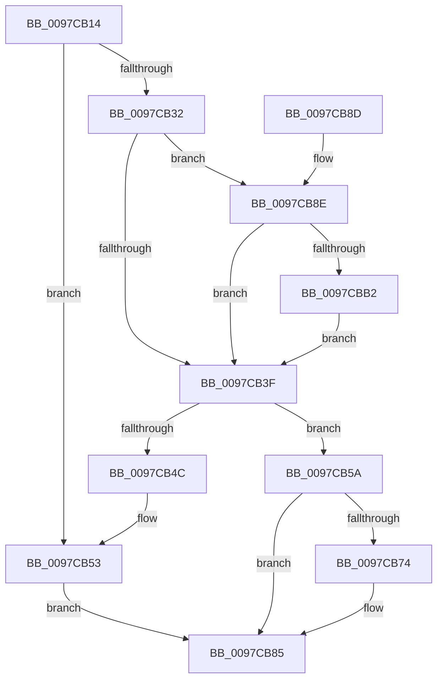

# PfTReplaceCurrentBuffer

- RVA: `0x0097CB14`–`0x0097CBC8` (길이 `180` bytes)
- VA: `0x000000014097CB14`
- 실행 섹션: `PAGE`
- PDB 이름 있음: `예`; PDB Function 태그: `아니요`
- unwind 정보 RVA: `0x00089F6C`
- 디코드: `52`개 명령, `180/180` bytes 표시
- 미해석 바이트: `0` (있으면 어셈블리에 `.byte`로 보존)

> 이 문서는 커널 이미지의 기계어와 PDB 기호를 분석해 생성했습니다. 4번과 5번은 함수 원형과 자료형을 바이너리 사용 방식에서 추정한 C 해석이며 원본 소스 복구 결과는 아닙니다.

## 1. Dependencies

- 직접 호출 지점: **2**; 고유 호출 대상: **2**
- 직접 호출자로 확인된 함수: **3**
- RIP 상대 이미지 참조: **0**

### Outgoing calls
- `0x0097CB23` → [PfTGetFreeBuffer](PfTGetFreeBuffer_function_0097CBD0.md) (function, `0x0097CBD0`)
- `0x0097CB80` → [KeSetEvent](../../text/33/KeSetEvent_function_0033F310.md) (function, `0x0033F310`)

### Direct callers
- [PfpCopyEvent](PfpCopyEvent_function_0097BE5C.md) at `0x0097C03A`
- [sub_0097C2ED](Unknown_function_0097C2ED.md) at `0x0097C3C0`
- [PfpLogPageAccess](PfpLogPageAccess_function_0097C450.md) at `0x0097CA06`
- [PfpLogPageAccess](PfpLogPageAccess_function_0097C450.md) at `0x0097CA32`
- [PfpLogPageAccess](PfpLogPageAccess_function_0097C450.md) at `0x0097CAA9`

### Static image references
- 디코드된 RIP-relative 메모리 참조가 없습니다.

## 2. Other-region calls and transfers

- 다른 실행 섹션으로 향하는 call: **1**
  - `0x0097CB80` → [KeSetEvent](../../text/33/KeSetEvent_function_0033F310.md) (`PAGE` → `.text`)
- 별도 외부 분기/꼬리 이동을 확인하지 못했습니다.

## 3. Assembly (complete function range)

```asm
0097CB14  40 53                           push rbx
0097CB16  48 83 EC 20                     sub rsp, 0x20
0097CB1A  4C 8B D9                        mov r11, rcx
0097CB1D  4C 8B D2                        mov r10, rdx
0097CB20  48 8B CA                        mov rcx, rdx
0097CB23  E8 A8 00 00 00                  call 0x14097cbd0
0097CB28  33 DB                           xor ebx, ebx
0097CB2A  4C 8B C8                        mov r9, rax
0097CB2D  48 85 C0                        test rax, rax
0097CB30  74 21                           je 0x14097cb53
0097CB32  44 8B 01                        mov r8d, dword ptr [rcx]
0097CB35  41 80 E0 0F                     and r8b, 0xf
0097CB39  41 80 F8 01                     cmp r8b, 1
0097CB3D  74 4F                           je 0x14097cb8e
0097CB3F  49 8D 42 18                     lea rax, [r10 + 0x18]
0097CB43  48 8B 08                        mov rcx, qword ptr [rax]
0097CB46  48 39 41 08                     cmp qword ptr [rcx + 8], rax
0097CB4A  74 0E                           je 0x14097cb5a
0097CB4C  B9 03 00 00 00                  mov ecx, 3
0097CB51  CD 29                           int 0x29
0097CB53  BB 01 00 00 C0                  mov ebx, 0xc0000001
0097CB58  EB 2B                           jmp 0x14097cb85
0097CB5A  49 89 09                        mov qword ptr [r9], rcx
0097CB5D  49 89 41 08                     mov qword ptr [r9 + 8], rax
0097CB61  4C 89 49 08                     mov qword ptr [rcx + 8], r9
0097CB65  4C 89 08                        mov qword ptr [rax], r9
0097CB68  41 0F B7 42 08                  movzx eax, word ptr [r10 + 8]
0097CB6D  66 41 39 42 0A                  cmp word ptr [r10 + 0xa], ax
0097CB72  77 11                           ja 0x14097cb85
0097CB74  49 8D 8B B0 00 00 00            lea rcx, [r11 + 0xb0]
0097CB7B  45 33 C0                        xor r8d, r8d
0097CB7E  33 D2                           xor edx, edx
0097CB80  E8 8B 27 9C FF                  call 0x14033f310
0097CB85  8B C3                           mov eax, ebx
0097CB87  48 83 C4 20                     add rsp, 0x20
0097CB8B  5B                              pop rbx
0097CB8C  C3                              ret
0097CB8D  CC                              int3
0097CB8E  49 8B 4A 18                     mov rcx, qword ptr [r10 + 0x18]
0097CB92  44 0F B7 41 24                  movzx r8d, word ptr [rcx + 0x24]
0097CB97  B9 FF FF 00 00                  mov ecx, 0xffff
0097CB9C  66 44 03 40 20                  add r8w, word ptr [rax + 0x20]
0097CBA1  41 0F B7 C0                     movzx eax, r8w
0097CBA5  2B C8                           sub ecx, eax
0097CBA7  66 41 89 41 24                  mov word ptr [r9 + 0x24], ax
0097CBAC  41 3B 49 20                     cmp ecx, dword ptr [r9 + 0x20]
0097CBB0  73 8D                           jae 0x14097cb3f
0097CBB2  49 8D 41 2F                     lea rax, [r9 + 0x2f]
0097CBB6  48 83 E0 F8                     and rax, 0xfffffffffffffff8
0097CBBA  48 8D 0C 89                     lea rcx, [rcx + rcx*4]
0097CBBE  48 83 0C C8 FF                  or qword ptr [rax + rcx*8], 0xffffffffffffffff
0097CBC3  E9 77 FF FF FF                  jmp 0x14097cb3f
```

## 4. C-style interpretation (structured pseudocode)

```c
__int64 __fastcall PfTReplaceCurrentBuffer(__int64 a1, __int64 a2)
{
    __int64 result;
    __int64 v_rbx;
    __int64 v_rsp;

    v_rsp = (v_rsp) - (32);
    result = PfTGetFreeBuffer(a2, a2, a3, a4);
    v_rbx = 0;
    if (result == 0) goto loc_0097CB53;
    a3 = (unsigned __int8)(((unsigned int)(*(unsigned int *)(a2))) & (15));
    if (((unsigned __int8)(a3)) == 1) goto loc_0097CB8E;
loc_0097CB3F:
    if ((*(unsigned __int64 *)(*(unsigned __int64 *)(a2 + 24) + 8)) == (a2 + 24)) goto loc_0097CB5A;
loc_0097CB53:
    goto loc_0097CB85;
loc_0097CB5A:
    *(unsigned __int64 *)(result) = 3;
    *(unsigned __int64 *)(result + 8) = a2 + 24;
    *(unsigned __int64 *)(3 + 8) = result;
    *(unsigned __int64 *)(a2 + 24) = result;
    result = *(unsigned __int16 *)(a2 + 8);
    if ((*(unsigned __int16 *)(a2 + 10)) <= ((unsigned __int16)(*(unsigned __int16 *)(a2 + 8)))) {
        a1 = a1 + 176;
        a3 = 0;
        a2 = 0;
        result = KeSetEvent(a1, a2, a3, result);
    }
    v_rsp = (v_rsp) + (32);
    return (unsigned int)((unsigned int)((unsigned int)(0xC0000001ULL)));
loc_0097CB8E:
    a3 = (unsigned __int16)((*(unsigned __int16 *)(*(unsigned __int64 *)(a2 + 24) + 36)) + (*(unsigned __int16 *)((unsigned int)((unsigned int)((unsigned int)(0xC0000001ULL))) + 32)));
    a1 = (unsigned int)(((unsigned int)(0xFFFFULL)) - ((unsigned int)((unsigned __int16)(a3))));
    *(unsigned __int16 *)(result + 36) = (unsigned __int16)((unsigned __int16)(a3));
    if (((unsigned int)(a1)) >= (*(unsigned int *)(result + 32))) goto loc_0097CB3F;
    result = (result + 47) & (-8);
    goto loc_0097CB3F;
}
```

## 5. (Beta) C Style

```c
int64_t PfTReplaceCurrentBuffer(int64_t Arg1, int64_t Arg2)
{
    int64_t result;
    int64_t local_rbx;
    int64_t local_rsp;

    local_rsp = (local_rsp) - (32);
    result = PfTGetFreeBuffer(Arg2, Arg2, a3, a4);
    local_rbx = 0;
    if (result == 0) goto loc_0097CB53;
    a3 = (uint8_t)(((uint32_t)(*(uint32_t *)(Arg2))) & (15));
    if (((uint8_t)(a3)) == 1) goto loc_0097CB8E;
loc_0097CB3F:
    if ((*(uint64_t *)(*(uint64_t *)(Arg2 + 0x18) + 0x8)) == (Arg2 + 24)) goto loc_0097CB5A;
loc_0097CB53:
    goto loc_0097CB85;
loc_0097CB5A:
    *(uint64_t *)(result) = 3;
    *(uint64_t *)(result + 0x8) = Arg2 + 24;
    *(uint64_t *)(3 + 0x8) = result;
    *(uint64_t *)(Arg2 + 0x18) = result;
    result = *(uint16_t *)(Arg2 + 0x8);
    if ((*(uint16_t *)(Arg2 + 0xA)) <= ((uint16_t)(*(uint16_t *)(Arg2 + 0x8)))) {
        Arg1 = Arg1 + 176;
        a3 = 0;
        Arg2 = 0;
        result = KeSetEvent(Arg1, Arg2, a3, result);
    }
    local_rsp = (local_rsp) + (32);
    return (uint32_t)((uint32_t)((uint32_t)(0xC0000001ULL)));
loc_0097CB8E:
    a3 = (uint16_t)((*(uint16_t *)(*(uint64_t *)(Arg2 + 0x18) + 0x24)) + (*(uint16_t *)((uint32_t)((uint32_t)((uint32_t)(0xC0000001ULL))) + 0x20)));
    Arg1 = (uint32_t)(((uint32_t)(0xFFFFULL)) - ((uint32_t)((uint16_t)(a3))));
    *(uint16_t *)(result + 0x24) = (uint16_t)((uint16_t)(a3));
    if (((uint32_t)(Arg1)) >= (*(uint32_t *)(result + 0x20))) goto loc_0097CB3F;
    result = (result + 47) & (-8);
    goto loc_0097CB3F;
}
```

## 6. Execution-region graph

[열기: 2D/3D 그래프와 함수 탐색 컨트롤 패널](../../../control-panel.html?section=page&rva=0x0097CB14&view=graph)

- 2D 그래프는 위에서 아래로 흐르고, 3D 그래프는 빈 공간을 드래그해 회전합니다. Shift+드래그는 이동, 휠은 확대·축소, 함수 노드 선택은 대상 보고서 이동입니다.

### Static fallback


